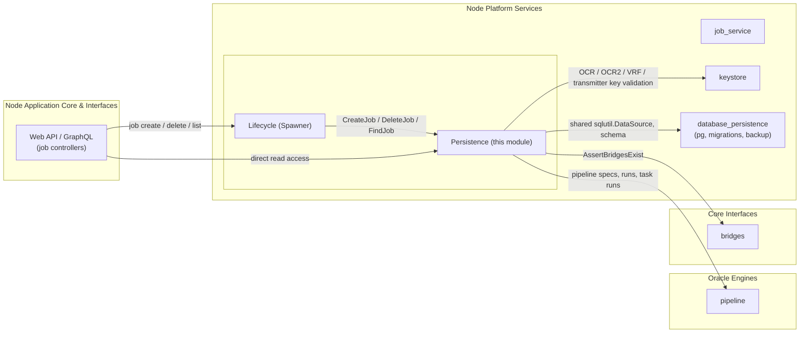
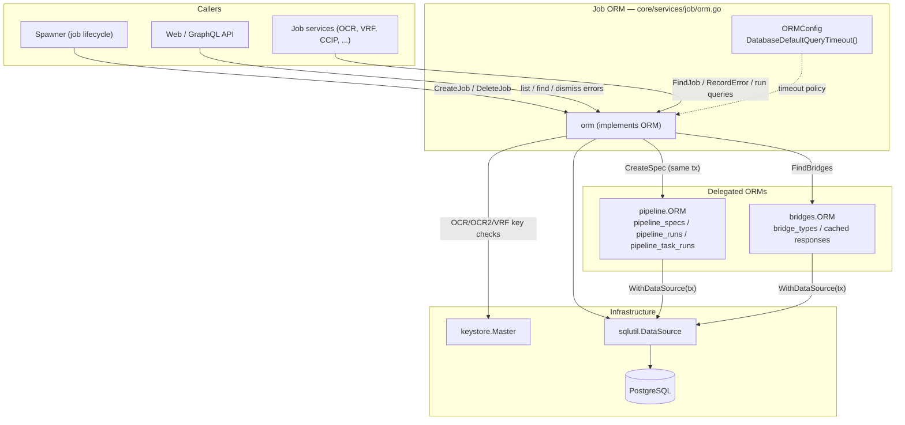
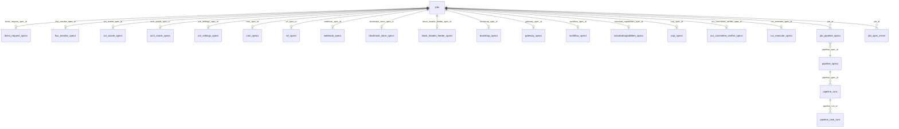
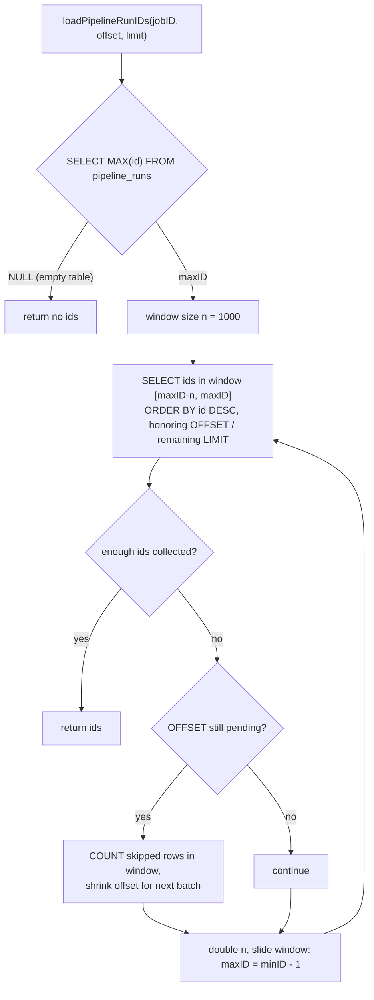

# Job Service — Persistence (`job_service_persistence`)

> **Code anchor:** `chainlink/core/services/job/orm.go` — core component [`ORMConfig`](#core-components), plus the `ORM` interface and its `orm` implementation defined in the same file.
>
> **Parent module:** [Job Service](../job_service.md) · **Siblings:** [Domain Model](job_service_domain_model.md) · [Lifecycle / Spawner](job_service_lifecycle.md)

## 1. Overview

`job_service_persistence` is the database persistence layer of the **Job Service**. It owns all SQL access to the `jobs` table, the per-job-type *spec* tables, the `job_pipeline_specs` join, pipeline run lookups, and `job_spec_errors` recording. Every job on a Chainlink node — OCR/OCR2 oracles, VRF, Cron, Gateway, CCIP, CCV, Standard Capabilities, bootstrap peers, streams, etc. — is created, found, hydrated and deleted through this module.

The module is intentionally the *only* place where job persistence SQL lives:

- **Consumers** (the [Spawner](job_service_lifecycle.md), REST/GraphQL [web API](../../Node_Application_Core___Interfaces/web_api.md), and individual job services) depend on the `ORM` interface, never on SQL.
- **Delegated storage** for pipeline specs/runs and bridge responses is delegated to the [pipeline](../../Oracle_Engines___Data_Pipelines/pipeline.md) and [bridges](../../Node_Application_Core___Interfaces/bridges.md) ORMs, which are composed into (and transactionally coordinated by) the job ORM.
- **Schema lifecycle** (migrations, backup, low-level `pg` bindings) belongs to the [database persistence](../database_persistence.md) module; this module assumes an already-migrated schema.

### Position in the system



## 2. Core Components

All components live in `chainlink/core/services/job/orm.go`.

### 2.1 `ORMConfig` — configuration surface

```go
type ORMConfig interface {
    DatabaseDefaultQueryTimeout() time.Duration
}
```

`ORMConfig` is the minimal configuration contract this module needs from the node's [general config](../../Node_Application_Core___Interfaces/node_application/node_application_config.md). It exposes the node-wide default database query timeout, which callers use to bound potentially expensive queries against large tables (the job ORM itself manages query contexts explicitly, e.g. overriding the default timeout for the heavyweight `DeleteJob` cascade — see [§4.2](#42-deletejob--cascading-removal)).

### 2.2 `ORM` — the data-access contract

The `ORM` interface groups the full persistence surface into five areas:

| Area | Representative methods |
|---|---|
| **Job CRUD** | `CreateJob`, `InsertJob`, `InsertWebhookSpec`, `DeleteJob`, `FindJobs`, `FindJob`, `FindJobByExternalJobID` |
| **Lookup by identity** | `FindJobIDByAddress` (OCR / FluxMonitor), `FindOCR2JobIDByAddress`, `FindJobIDByCapabilityNameAndVersion` (CCIP), `FindStandardCapabilityJobID`, `FindGatewayJobID`, `FindJobIDsWithBridge` |
| **Pipeline runs (read side)** | `PipelineRuns`, `FindPipelineRunIDsByJobID`, `FindPipelineRunsByIDs`, `FindPipelineRunByID`, `FindPipelineRunsByJobID`, `CountPipelineRunsByJobID`, `FindTaskResultByRunIDAndTaskName`, `FindJobsByPipelineSpecIDs` |
| **Spec errors** | `RecordError`, `TryRecordError`, `DismissError`, `FindSpecError`, `FindSpecErrorsByJobIDs`, `FindJobWithoutSpecErrors` |
| **Infrastructure** | `AssertBridgesExist`, `DataSource()`, `WithDataSource(...)`, `Close()` |

### 2.3 `orm` — implementation

```go
type orm struct {
    ds          sqlutil.DataSource      // sqlx/pgx-backed data source
    keyStore    keystore.Master         // key validation (OCR, OCR2, VRF, transmitters)
    pipelineORM pipeline.ORM            // pipeline_specs / pipeline_runs storage
    lggr        commonlogger.SugaredLogger
    bridgeORM   bridges.ORM             // bridge_types storage
}
```

Constructed via `NewORM(ds, pipelineORM, bridgeORM, keyStore, lggr)`; interface compliance is compile-time asserted with `var _ ORM = (*orm)(nil)`. `Close()` is a no-op (the data source is owned by the [database persistence](../database_persistence.md) layer).

### 2.4 Sentinel errors

| Error | Meaning |
|---|---|
| `ErrJobTypeRemoved` | The job type has been permanently removed; creation is rejected (see [§5.1](#51-removed-job-types)). |
| `ErrNoSuchKeyBundle` | Referenced encrypted OCR/OCR2 key bundle does not exist in the keystore. |
| `ErrNoSuchTransmitterKey` | Referenced transmitter/sending key does not exist (or fails relay-specific validation). |
| `ErrNoSuchSendingKey` | A sending key listed in `relayConfig["sendingKeys"]` does not exist. |
| `ErrNoSuchPublicKey` | VRF public key not present (surfaced from the `vrf_specs_public_key_fkey` FK violation). |

## 3. Persistence Architecture

### 3.1 Component interactions



### 3.2 Transactional pattern: copy-on-write data source

The `orm` struct is *immutable by convention*: it never mutates its own `ds` field. Instead:

1. `transact(ctx, readOnly, fn)` builds `sql.TxOptions` (with a `ReadOnly` flag used by read paths such as `FindJobWithoutSpecErrors`).
2. It calls `sqlutil.Transact(ctx, o.withDataSource, o.ds, opts, fn)` from the shared [sqlutil](../../Shared_Foundation_Libraries___Domain_Types/sqlutil.md) library.
3. `withDataSource(ds)` returns a **shallow copy** of the ORM whose `ds` is the transaction handle, and — critically — **re-binds the pipeline and bridges ORMs to the same transaction** through their `WithDataSource` methods. The keystore and logger are shared.

This guarantees that a job's type-specific spec insert, the pipeline spec creation, the `jobs` row, and the `job_pipeline_specs` link all commit atomically, including the storage written by *delegated* ORMs.

### 3.3 Data model

The `jobs` table is the aggregate root; each job type owns a dedicated spec table referenced by a nullable FK column. Pipeline storage is a many-to-many through `job_pipeline_specs` (the first spec is inserted with `is_primary = true`).



Job type → spec table mapping (see [domain model](job_service_domain_model.md) for struct definitions):

| Job `Type` | Spec table | `Job` field | Notes |
|---|---|---|---|
| DirectRequest | `direct_request_specs` | `DirectRequestSpec` | Creation rejected (`ErrJobTypeRemoved`); delete path retained |
| FluxMonitor | `flux_monitor_specs` | `FluxMonitorSpec` | Creation rejected; delete path retained |
| OffchainReporting (OCR v1) | `ocr_oracle_specs` | `OCROracleSpec` | Contract-address uniqueness per chain |
| OffchainReporting2 | `ocr2_oracle_specs` | `OCR2OracleSpec` | Relay-agnostic; rich validation (see §4.1) |
| CRESettings | `cre_settings_specs` | `CRESettingsSpec` | |
| Cron | `cron_specs` | `CronSpec` | |
| VRF | `vrf_specs` | `VRFSpec` | `FromAddresses` via `pq.ByteaArray` row helper |
| Webhook | `webhook_specs` | `WebhookSpec` | Creation rejected; delete path retained |
| BlockhashStore | `blockhash_store_specs` | `BlockhashStoreSpec` | ByteaArray row helper |
| BlockHeaderFeeder | `block_header_feeder_specs` | `BlockHeaderFeederSpec` | ByteaArray row helper |
| Bootstrap | `bootstrap_specs` | `BootstrapSpec` | |
| Gateway | `gateway_specs` | `GatewaySpec` | JSONB `gateway_config` |
| Stream | *(none)* | — | Identified by `stream_id` on `jobs` |
| StandardCapabilities | `standardcapabilities_specs` | `StandardCapabilitiesSpec` | |
| CCIP | `ccip_specs` | `CCIPSpec` | |
| CCVCommitteeVerifier | `ccv_committee_verifier_specs` | `CCVCommitteeVerifierSpec` | |
| CCVExecutor | `ccv_executor_specs` | `CCVExecutorSpec` | |
| Workflow | `workflow_specs` | `WorkflowSpec` | Creation rejected; delete path retained |

## 4. Key Flows

### 4.1 `CreateJob` — transactional creation

`CreateJob` expects an already-validated, unmarshalled `*Job` (output of the `ValidatedXX` constructors in the [domain model](job_service_domain_model.md)) and ends by scanning all persisted rows back into the struct.

```mermaid
sequenceDiagram
    autonumber
    participant C as Caller (Spawner / API)
    participant O as job.orm
    participant B as bridges.ORM
    participant K as keystore.Master
    participant P as pipeline.ORM
    participant DB as PostgreSQL

    C->>O: CreateJob(ctx, jb)
    O->>O: reject removed types (DirectRequest, FluxMonitor, Webhook, Workflow) with ErrJobTypeRemoved
    O->>B: AssertBridgesExist(jb.Pipeline)
    B->>DB: FindBridges(unique bridge names)
    O->>O: transact() → withDataSource(tx) (pipeline + bridge ORMs re-bound)
    Note over O,K: per-type validation: key bundles, transmitter / sending keys,<br/>uniqueness checks, plugin-pipeline validation
    O->>K: OCR / OCR2 / VRF key lookups (if applicable)
    O->>DB: INSERT INTO &lt;type&gt;_specs ... RETURNING id
    O->>P: CreateSpec(jb.Pipeline, jb.MaxTaskDuration)
    P->>DB: INSERT INTO pipeline_specs
    O->>DB: INSERT INTO jobs RETURNING * (auto UUID if ExternalJobID empty)
    O->>DB: INSERT INTO job_pipeline_specs (is_primary = true)
    O->>DB: findJob(): SELECT jobs ⨝ job_pipeline_specs, loadAllJobTypes, loadJobSpecErrors
    O-->>C: hydrated *Job (all relations loaded)
```

Notable per-type validation inside the transaction:

- **OCR v1** — optional key bundle and transmitter address must exist; contract address must not already exist for the same (or NULL) `evm_chain_id`.
- **OCR2** — sending keys vs. transmitter ID are mutually exclusive and at least one is required; keystore match validated per relay network (EVM, Solana, StarkNet, Aptos, Tron, TON, Sui, Stellar; CSA key for LLO); forwarding allowed only for `ForwardersSupportedPlugins`; `feed_id` rejected; **median** plugin pipelines (`JuelsPerFeeCoinPipeline`, optional `GasPriceSubunitsPipeline`) are parsed and bridge-checked; **dual transmission** config validated (EVM-only, hex addresses, meta object) with key-lock checks.
- **VRF** — an FK violation on `vrf_specs_public_key_fkey` (pg error `23503`) is translated to `ErrNoSuchPublicKey`.

### 4.2 `DeleteJob` — cascading removal

Deletion is a single statement built from PostgreSQL CTEs, so the job and everything only-it-references disappear atomically. Because it can be slow on databases with millions of `pipeline_runs`, the context is switched to `sqlutil.WithoutDefaultTimeout` and capped with a **hard 1-minute timeout**.

```mermaid
sequenceDiagram
    autonumber
    participant C as Caller
    participant O as job.orm
    participant DB as PostgreSQL

    C->>O: DeleteJob(ctx, id, jobType)
    O->>O: apply 1-minute hard timeout (sqlutil.WithoutDefaultTimeout)
    O->>DB: WITH deleted_jobs AS (DELETE FROM jobs WHERE id=$1 RETURNING all spec id columns + stream_id)
    O->>DB: DELETE FROM &lt;type&gt;_specs WHERE id IN (SELECT ... FROM deleted_jobs)
    O->>DB: DELETE FROM job_pipeline_specs WHERE job_id IN (...) RETURNING pipeline_spec_id
    O->>DB: DELETE FROM pipeline_specs WHERE id IN (returned ids)
    O->>O: rowsAffected == 0 → sql.ErrNoRows
    O-->>C: nil, or "job type %s not supported" for unknown types
```

> `Stream` jobs have an empty spec-delete statement (there is no spec table); their `stream_id` column lives on `jobs` itself.

### 4.3 Job hydration (`findJob` / `loadAllJobTypes`)

`FindJob`, `FindJobByExternalJobID` and the tail of `CreateJob` share `findJob`, which:

1. selects the job joined with its **primary** `job_pipeline_specs` row;
2. runs `loadAllJobTypes` — one `SELECT * FROM <spec_table> WHERE id = $1` per non-nil spec FK. For generic tables this uses reflection (`reflect.New` on the field's element type) to scan into the right `Job` field; VRF, BlockhashStore and BlockHeaderFeeder use dedicated *row helper* types (`vrfSpecRow`, etc.) to convert `bytea[]` ↔ `FromAddresses` via `pq.ByteaArray`;
3. loads the pipeline spec (joined back to `job_pipeline_specs`);
4. loads all `job_spec_errors` for the job.

`loadAllJobsTypes` applies the same to a slice — the code itself flags this as an **N+1 query**, acceptable because it is GUI-bound (see [§7](#7-performance-notes)).

### 4.4 Pipeline run pagination — doubling-window scan

`loadPipelineRunIDs` (backing `PipelineRuns` and `FindPipelineRunIDsByJobID`) avoids full-table sorts on very large `pipeline_runs` tables:



The window starts at the most recent 1 000 rows and doubles only while more pages are needed, keeping the ORDER BY's sort scoped to a small ID range. Relation loading (`loadPipelineRunsRelations`) then batch-loads the referenced `pipeline_specs` (with owning `job_id`) and `pipeline_task_runs` in two queries.

### 4.5 Spec errors

`RecordError` performs an **upsert** on `(job_id, description)`: first insert records occurrence 1; repeats increment `occurrences` and bump `updated_at`. A foreign-key violation (`23503` on `job_spec_errors_v2_job_id_fkey`) — which happens when the job was deleted concurrently — is treated as a **no-op success**. `TryRecordError` wraps this and only logs failures. `DismissError` deletes the row and returns `sql.ErrNoRows` if nothing matched.

## 5. Validation & Keystore Integration

Because job specs reference cryptographic keys, the ORM is one of the few ORM layers that talks to the [keystore](../keystore.md):

- `ValidateKeyStoreMatch` — validates an OCR2 transmitter identifier: CSA key for `LLO` plugins, otherwise a relay-specific key lookup.
- `validateKeyStoreMatchForRelay` — dispatches to the correct keystore sub-service per relay network (EVM, Solana, StarkNet, Aptos, Tron, TON, Sui, Stellar).
- `areSendingKeysDefined` — resolves `relayConfig["sendingKeys"]` (via `SendingKeysForJob`) and validates each.
- `checkIfKeyHasLock` — queries the EVM keystore **resource mutex** to prevent a transmitter key that is the *primary* transmitter (`TXMv1`) in one job from being used as a *secondary/dual-transmission* transmitter (`TXMv2`) in another, and vice-versa.
- `LoadConfigVarsOCR` / `LoadConfigVarsLocalOCR` / `LoadDefaultVRFPollPeriod` / `SetDRMinIncomingConfirmations` — helpers that merge node-level [config defaults](../../Node_Application_Core___Interfaces/node_application/node_application_config.md) (OCR timeouts, key bundle ID, transmitter address) into spec structs before persistence.

## 5.1 Removed job types

`CreateJob` unconditionally rejects `DirectRequest`, `FluxMonitor`, `Webhook` and `Workflow` submissions with `ErrJobTypeRemoved`, regardless of the entry path (REST, GraphQL, feeds manager). Their spec tables and delete queries are retained so existing jobs can still be removed cleanly.

## 5.2 Lookup helpers of note

| Method | Behavior |
|---|---|
| `FindOCR2JobIDByAddress` | Matches `(contract_id, feed_id, relay, relay_config->'chainID')` across `ocr2_oracle_specs` and `bootstrap_specs`; uses `IS NOT DISTINCT FROM` so a SQL-NULL `feed_id` matches; errors if more than one job matches, returns `0, nil` if none. |
| `FindGatewayJobID` | JSONB containment query: `gateway_config @> {"ConnectionManagerConfig": {"AuthGatewayId": ...}}`. |
| `FindJobIDsWithBridge` | Cheap `ILIKE '%<name>%'` prefilter over `pipeline_specs.dot_dag_source`, then parses each candidate DOT graph and matches actual `BridgeTask` names — used when renaming/deleting bridges. |
| `FindJobIDByAddress` | Single query LEFT-JOINing `ocr_oracle_specs` and `flux_monitor_specs` by contract address (chain ID or NULL). |
| `FindTaskResultByRunIDAndTaskName` | Returns a task run's output as JSON; surfaces the stored task error instead of the output when present. |

## 7. Performance Notes

- **`loadAllJobsTypes` is N+1** (one query per spec column per job). Acceptable per code comments; only used by the GUI.
- **`DeleteJob`** can take tens of seconds on DBs with millions of runs; hence the dedicated 1-minute timeout rather than the default query timeout supplied via [`ORMConfig`](#21-ormconfig--configuration-surface).
- **Run pagination** deliberately scans doubling windows from the newest IDs instead of a full ordered scan (see [§4.4](#44-pipeline-run-pagination--doubling-window-scan)).
- Batch relation loading (`loadPipelineRunsRelations`) keeps run listing at O(2) extra queries per page.

## 8. Dependencies & Related Modules

| Dependency | Used for | Documentation |
|---|---|---|
| `chainlink-common/pkg/sqlutil` | `DataSource`, `Transact`, `TxOptions`, `Interval`, `WithoutDefaultTimeout` | [sqlutil](../../Shared_Foundation_Libraries___Domain_Types/sqlutil.md) |
| `pipeline.ORM` (`core/services/pipeline`) | Pipeline spec creation, run/task-run tables | [pipeline](../../Oracle_Engines___Data_Pipelines/pipeline.md) |
| `bridges.ORM` (`core/bridges`) | Bridge existence assertions, bridge storage | [bridges](../../Node_Application_Core___Interfaces/bridges.md) |
| `keystore.Master` (`core/services/keystore`) | OCR/OCR2/VRF/transmitter key validation | [keystore](../keystore.md) |
| Job domain types (`models.go`) | `Job`, spec structs, `SpecError` | [job_service_domain_model](job_service_domain_model.md) |
| `Spawner` (`spawner.go`) | Primary lifecycle consumer of this ORM | [job_service_lifecycle](job_service_lifecycle.md) |
| `pg` / `versioning` / `periodicbackup` / migrations | Shared DB infrastructure | [database_persistence](../database_persistence.md) |

## 9. Build, Deployment & Testing Notes

- **Driver stack** (from [`chainlink/go.mod`](../../../repo/chainlink/go.mod)): `github.com/jmoiron/sqlx v1.4.0`, `github.com/lib/pq v1.12.3` (incl. `pq.ByteaArray` used by the spec row helpers), `github.com/jackc/pgx/v5 v5.9.2` (pgconn error codes), `github.com/pressly/goose/v3` for migrations, and `github.com/peterldowns/pgtestdb` for real-Postgres test harnesses.
- **Database provisioning**: nodes run against PostgreSQL (version 15 in the docker dev topology of [`chainlink/tools/docker/docker-compose.postgres.yaml`](../../../repo/chainlink/tools/docker/docker-compose.postgres.yaml)), where each node receives a `CL_DATABASE_URL=postgresql://...` pointing at its dedicated `node-db` service. The job ORM receives this connection as its `sqlutil.DataSource`; schema creation is handled by the migration tooling described in [database_persistence](../database_persistence.md).
- The `Stream` job type stores its identifier as `jobs.stream_id` rather than a spec table — relevant when provisioning databases or writing migrations.

## 10. Known Caveats

- `FindTaskResultByRunIDAndTaskName` interpolates `taskName` into the SQL string (parameterized only for `runID`); task names are internally generated DOT IDs today, but any future caller-supplied names should be treated carefully.
- `loadAllJobTypes` uses reflection per job; adding a new job type requires extending the `stderrors.Join(...)` list in `loadAllJobTypes`, the `queries` map in `DeleteJob`, and the `InsertJob` column lists.
- `FindJobIDsWithBridge` relies on a substring (`ILIKE`) prefilter — a bridge name that is a substring of unrelated DOT source content will be parsed and then filtered correctly, but the scan itself is not index-backed.
- `PipelineRunsByJobsIDs` contains a JOIN to `jobs` that references `jobs.id` without the table in its FROM clause; callers rely on the id-array path (`FindPipelineRunIDsByJobID` + `FindPipelineRunsByIDs`) for multi-job listings.
