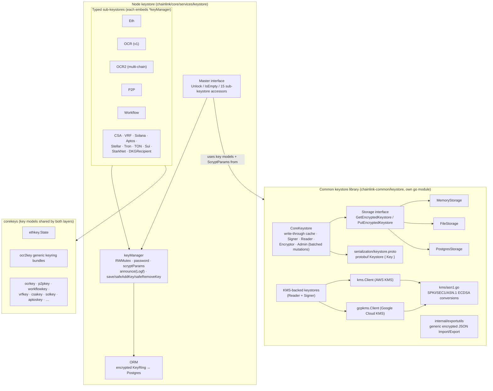
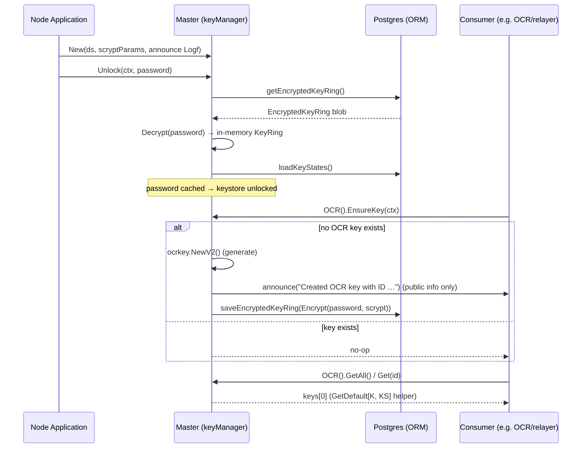
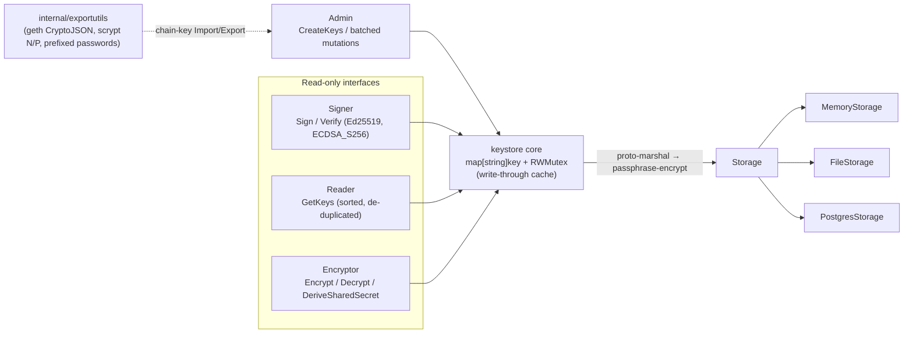

# Keystore

## 1. Overview

The **keystore** module is the custodian of every piece of private key material used by a Chainlink node. It is responsible for generating, storing, importing/exporting, announcing, and using cryptographic keys — spanning EVM transaction keys, OCR/OCR2 key bundles, P2P identity keys, workflow signing keys, VRF proof keys, and a growing set of chain-specific keys (Solana, Aptos, Stellar, Tron, TON, Sui, StarkNet, Cosmos), plus CSA auth keys and DKG recipient keys.

The module is organized as **two coordinated layers**:

| Layer | Location | Purpose |
|---|---|---|
| **Node keystore (Master)** | `chainlink/core/services/keystore/` | The running node's key manager: one `Master` interface exposing 15 typed sub-keystores, backed by an encrypted-at-rest `KeyRing` persisted in the node's Postgres database. |
| **Common keystore library** | `chainlink-common/keystore/` (standalone Go module) | A dependency-minimized, chain-family-agnostic key storage library providing the key models (`corekeys`), a generic write-through keystore runtime with pluggable `Storage` backends, `Signer`/`Reader`/`Encryptor` interfaces, protobuf serialization, and AWS/GCP KMS integrations. |

Both layers are intentionally conservative about key material exposure: raw private key bytes are confined to `internal/` package APIs, and the node keystore package **may not import any logger** — it instead accepts injected `Logf` callbacks in a few select places to announce newly created *public* keys only.

> The module lives under [Node_Platform_Services](../Node_Platform_Services.md) alongside sibling services such as [database_persistence](database_persistence.md) (Postgres plumbing the node ORM relies on), [p2p](p2p.md) (consumer of P2P keys), and the [job_service](job_service.md) (consumer of OCR/VRF/Workflow keys).

## 2. Architecture



### 2.1 How the layers relate

- The **node keystore** imports the standalone `chainlink-common/keystore` module for its typed key models (`corekeys/...`) and its scrypt parameter types. Each sub-keystore file in `core/services/keystore` (OCR, OCR2, P2P, Workflow, …) is a thin, strongly-typed façade over the shared `keyManager`.
- The **common keystore** is the foundation for a new generation of chain-agnostic keystores (family-specific keystores such as EVM and Solana v2 keys are layered on top of it in their own repos, per the library's [README](https://github.com/smartcontractkit/chainlink-common/keystore)). It supports software keys (memory/file/Postgres storage) as well as cloud HSM-backed keys via AWS KMS and Google Cloud KMS.
- For off-chain plugin processes, the keystore is also reachable **over gRPC** through the [Loop plugin framework](../Plugin_Process_Framework_(Loop)/loop-plugin-core.md) (`GRPCPluginKeystore`, generated `keystore_grpc.pb.go` bindings), and the canonical consumer interfaces are declared in [types-core](../Shared_Foundation_Libraries___Domain_Types/types-core.md) (`pkg/types/keystore` and `pkg/types/core/keystore`).

## 3. Node keystore: `Master` and typed sub-keystores

Detailed reference: [keystore_node_keyring](keystore/keystore_node_keyring.md)

The node keystore is a single `Master` service constructed with three inputs: a `sqlutil.DataSource` (Postgres), `keystore.ScryptParams` for at-rest encryption, and an injected `Logf` announcer. On `Unlock(ctx, password)` it fetches the encrypted key ring blob from the database, decrypts it with the password, and holds the in-memory `KeyRing` guarded by an `sync.RWMutex`. Every mutating operation (`Create`, `Add`, `Delete`, `Import`) locks the manager, updates the typed key map, re-encrypts the **entire key ring**, persists it, and rolls back the in-memory change if persistence fails.



Uniform API per key type: `Get`, `GetAll`, `Create`, `Add`, `Delete`, `Import` (from password-encrypted JSON), `Export` (to password-encrypted JSON), and `EnsureKey` (idempotent self-seeding). Notable per-type behaviors:

- **OCR (v1)** – single chain (EVM), `EnsureKey` seeds one key on first boot.
- **OCR2** – multi-chain: keys are `ocr2key.KeyBundle`s tagged with a `corekeys.ChainType`; supports `GetAllOfType(chainType)` and `EnsureKeys(ctx, enabledChains…)`, generating one bundle per enabled chain type.
- **P2P** – peer identity keys; `GetOrFirst` resolves the configured `PeerID`, falls back to the only key present, and raises a descriptive error when several keys exist and no peer ID is configured (ambiguity protection). Deleting a P2P key also cascades to the `p2p_peers` table via a SQL callback.
- **Workflow** – enforces a **single** workflow signing key (`ErrWorkflowKeyExists`), used to authenticate workflow registrations; see the [CRE engine](../Workflow___Capability_Runtime_(CRE_Engine)/workflows.md).

The generic helper `GetDefault[K, KS]` encapsulates the common "ensure a key exists, then return the first one" pattern used by consumers that need exactly one key of a type.

## 4. Common keystore library: chain-agnostic runtime

Detailed references: [keystore_runtime](keystore/keystore_runtime.md) · [keystore_core_keys](keystore/keystore_core_keys.md) · [keystore_kms](keystore/keystore_kms.md)

The `chainlink-common/keystore` module (its own `go.mod`, minimal external dependencies) implements the design principles documented in its README:

- **Client-side key naming** – callers define key names (path-like `KeyPath`, e.g. `solana/tx/my-key`); the library imposes no chain-specific key derivations.
- **Storage abstraction** – only the `Storage` interface (`GetEncryptedKeystore` / atomically replacing `PutEncryptedKeystore`) is required; implementations ship for **memory**, **file** (atomic writes), and **Postgres**. A write-through cache keeps the in-memory key map synchronized with the stored blob.
- **Common serialization/encryption** – the whole keystore is serialized with **protobuf** (`serialization/keystore.proto`: `Keystore { repeated Key { name, private_key, created_at, key_type, metadata } }`) and then encrypted with a passphrase before persistence.
- **Admin interface for mutations** – only the batched `Admin` interface mutates keys; `Signer`, `Reader`, and `Encryptor` are read-only against key material.
- **Supported primitives** – digital signatures (ECDSA over secp256k1, Ed25519) and hybrid encryption (X25519/box, ECDH P-256 — the latter pending audit), with KMS supported for the signature key types.



For chain-family keys, `internal/exportutils.go` provides generic encrypted-JSON import/export built on go-ethereum's `CryptoJSON` (scrypt N/P work factors, prefixed passwords), so every `corekeys` package implements `FromEncryptedJSON` / `ToEncryptedJSON` uniformly — this is exactly the Import/Export surface used by the node keystore's typed sub-stores.

## 5. KMS integrations

Detailed reference: [keystore_kms](keystore/keystore_kms.md)

The library ships two cloud KMS backends so keys can live in an HSM instead of software storage. Both satisfy the same read-only `Reader` + `Signer` surface as the software keystore — consumers sign identically regardless of backend:

```mermaid
sequenceDiagram
    participant C as Consumer
    participant K as KMS-backed keystore
    participant P as Cloud KMS (AWS / GCP)

    C->>K: GetKeys / GetKeyRequest{KeyNames}
    K->>P: ListKeys (AWS only; GCP requires explicit names)
    K->>P: GetPublicKey (ASN.1 SPKI DER)
    K->>P: DescribeKey / GetCryptoKeyVersion (key type, createdAt)
    K->>K: SPKI → SEC1 conversion (secp256k1), PKIX parse (Ed25519)
    K-->>C: KeyInfo{KeyType, PublicKey, …}

    C->>K: Sign{KeyName, Data(32-byte digest)}
    K->>P: AsymmetricSign / Sign
    P-->>K: DER ECDSA signature
    K->>K: ASN.1 → SEC1 (R‖S‖V), EIP-2 low-S normalization,<br/>recovery-ID reconstruction
    K-->>C: SignResponse{Signature}
```

- **AWS KMS** (`kms/`) — thin `Client` interface (`GetPublicKey`, `Sign`, `DescribeKey`, `ListKeys`) over AWS SDK v2, constructed either with a named profile (local dev) or the default credential chain (IRSA/instance profiles in production). Supports `ECC_SECG_P256K1 → ECDSA_S256` and `ECC_NIST_EDWARDS25519 → Ed25519`.
- **Google Cloud KMS** (`gcpkms/`) — `Client` interface scoped to a single `CryptoKeyVersion` per operation (`GetCryptoKeyVersion`, `GetPublicKey`, `AsymmetricSign`) so deployments can bind per-key IAM permissions with least privilege; credentials come from Application Default Credentials. The GCP backend does not support listing keys — callers must configure explicit key names.
- **`kms/asn1.go`** — the encoding bridge both backends rely on: RFC 5280 SPKI ↔ SEC1 uncompressed public keys, and RFC 3279 DER ECDSA signatures ↔ 65-byte SEC1 `R‖S‖V` signatures, including the EIP-2 low-S adjustment and public-key-recovery-based reconstruction of the recovery ID that blockchains require.

## 6. Security model highlights

1. **Locking semantics** — the node keystore starts locked (`isLocked()` = empty password). Every operation first checks `isLocked()` and fails fast with `ErrLocked`; unlock is idempotent and rejects a *different* password.
2. **No logging of key material** — the node keystore package may not import logger packages; announcements of newly created keys go through an injected `Logf` that reports only key *kind* and *ID* (and chain type where applicable).
3. **Encrypted at rest** — both layers encrypt before persistence: the node `KeyRing` uses scrypt (configurable `ScryptParams`) with the unlock password; the common keystore encrypts a protobuf blob of all keys via the `Storage` backend.
4. **Raw-byte confinement** — private key bytes are wrapped in `internal.Raw` and are not exposed outside the keystore subtrees; only `ID()`, public keys, and signature/verification operations cross the boundary.
5. **Rollback on failure** — `safeAddKey` / `safeRemoveKey` revert in-memory key-ring mutations if the database save fails, keeping memory and storage consistent.
6. **Single-key invariants** — Workflow keys enforce at most one key; P2P ambiguity is surfaced to operators rather than resolved silently.

## 7. Sub-module documentation

All detailed sub-module pages are generated under the `keystore/` folder next to this file:

| Sub-module page | Scope |
|---|---|
| [keystore_node_keyring](keystore/keystore_node_keyring.md) (`keystore/keystore_node_keyring.md`) | The node `Master` keystore: shared `keyManager`, the OCR / OCR2 / P2P / Workflow sub-keystores, and the `GetDefault` helper. |
| [keystore_core_keys](keystore/keystore_core_keys.md) (`keystore/keystore_core_keys.md`) | Key models in `corekeys`: `ethkey.State` lifecycle tracking and the multi-chain `ocr2key` generic key-bundle machinery (marshalling, migration, bundle IDs). |
| [keystore_runtime](keystore/keystore_runtime.md) (`keystore/keystore_runtime.md`) | The chain-agnostic keystore runtime: `Signer`, `Reader`, `Storage`, protobuf serialization, generic encrypted-JSON export utilities, and module composition. |
| [keystore_kms](keystore/keystore_kms.md) (`keystore/keystore_kms.md`) | Cloud KMS backends: AWS KMS client, GCP KMS client, and the ASN.1/SEC1 encoding bridge. |

Reading order suggestion: start with **keystore_node_keyring** (node behavior), then **keystore_core_keys** (data models both layers share), then **keystore_runtime** (the chain-agnostic engine), and finally **keystore_kms** (cloud HSM operation).

## 8. Relationships to other modules

- **[database_persistence](database_persistence.md)** – the node keystore's ORM persists the encrypted key ring (and key states, plus the `p2p_peers` cascade) in the same Postgres instance the node uses for jobs and pipelines; it relies on the shared `sqlutil.DataSource` layer.
- **[p2p](p2p.md)** – P2P identity keys (`p2pkey.KeyV2`) bootstrap peer authentication for libocr and wsrpc networking.
- **[Oracle_Engines___Data_Pipelines](../Oracle_Engines___Data_Pipelines/ocr.md)** – OCR (v1) jobs consume `ocrkey.KeyV2`; OCR2/OCR3 plugins (median, LLO, CCIP) consume chain-typed `ocr2key.KeyBundle`s via `GetAllOfType`, and VRF consumes `vrfkey.KeyV2`.
- **[Workflow___Capability_Runtime_(CRE_Engine)](../Workflow___Capability_Runtime_(CRE_Engine)/workflows.md)** – the workflow engine signs registrations/updates with the single workflow key; the [vault capability](../Workflow___Capability_Runtime_(CRE_Engine)/core_capabilities_runtime.md) provides complementary secret storage for workflow payloads.
- **[Plugin_Process_Framework_(Loop)](../Plugin_Process_Framework_(Loop)/loop-plugin-core.md)** – external plugin processes obtain signing capabilities over gRPC through `GRPCPluginKeystore` and the generated `keystore` protobuf services.
- **[node_application](../Node_Application_Core___Interfaces/node_application.md)** – the `Application` service constructs the `Master` keystore with database access, scrypt parameters, and the key-announcement logger, and unlocks it during node startup.
