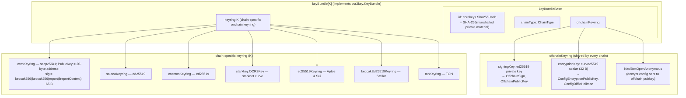
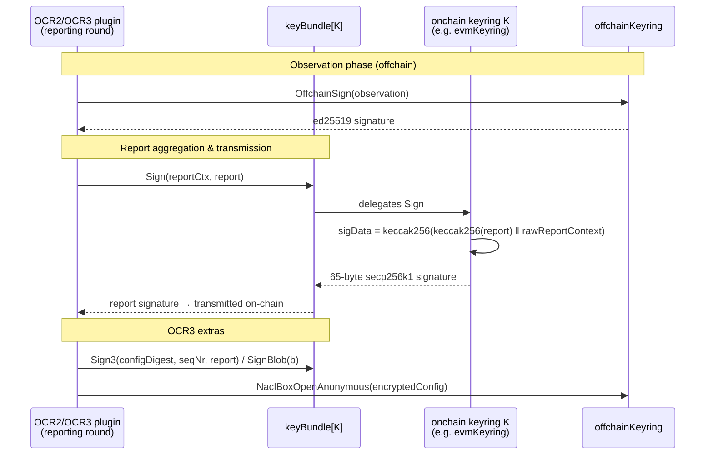

# Keystore — Core Keys (`corekeys`)

> **Module:** `chainlink-common/keystore/corekeys` (Go module `github.com/smartcontractkit/chainlink-common/keystore`, see [`chainlink-common/keystore/go.mod`](../../../repo/chainlink-common/keystore/go.mod))
> **Parent domain:** [Node_Platform_Services](../../Node_Platform_Services.md) → [Keystore](../keystore.md)

## 1. Introduction

`keystore_core_keys` is the **canonical library of cryptographic key types** used by every Chainlink node and shared component. It is a pure, self-contained Go package tree with **no dependency on the node binary**: it defines what a key *is* (its private material, identity, serialization, and signing behavior), while leaving *where* keys are stored (database, KMS, gRPC-exposed keystore) to its sibling modules.

The module answers three questions for every key the node owns:

1. **Identity** — how the key is addressed (`EIP-55` address, SHA-256 bundle ID, peer ID, …).
2. **Materialization** — how a key is rebuilt from raw private-key bytes (`KeyFor(internal.Raw)`) and serialized back (`Marshal`/`Raw()`).
3. **Behavior** — what the key can *do* (sign transactions, sign/verify OCR2 & OCR3 reports, generate VRF proofs, decrypt config, derive peer identities).

Two core components anchor the module and are documented in depth here:

- [`corekeys/ethkey/models.go::State`](../../../repo/chainlink-common/keystore/corekeys/ethkey/models.go) — the persisted operational state of an EVM signing key (address × chain ID × enabled/disabled, with usage tracking).
- [`corekeys/ocr2key/generic_key_bundle.go::keyring`](../../../repo/chainlink-common/keystore/corekeys/ocr2key/generic_key_bundle.go) — the generic contract every chain-specific OCR2 onchain keyring must satisfy, plus the type-parameterized `keyBundle[K]` that composes an onchain keyring with the shared offchain keyring into one `KeyBundle`.

## 2. Position in the Keystore Ecosystem

The `corekeys` package sits at the bottom of the keystore stack. Everything above it is an orchestration, storage, or transport concern:

- The **node keyring** ([`keystore_node_keyring`](keystore_node_keyring.md)) instantiates a `Master` store per key family and persists an encrypted `KeyRing` snapshot.
- The **runtime layer** ([`keystore_runtime`](keystore_runtime.md)) provides `Storage`, `Signer`, the `Raw`/`Key` primitives, generic encrypted-JSON export helpers, and the protobuf serialization envelope.
- The **KMS integrations** ([`keystore_kms`](keystore_kms.md)) produce/consume the same core key types backed by AWS KMS and GCP KMS.

```mermaid
flowchart TB
    subgraph consumers["Consumers"]
        OCR["OCR / OCR2 / OCR3 reporting<br/>(Oracle Engines)"]
        VRF["VRF proof generation"]
        LLO["LLO keyring adapter"]
        CRE["Workflows / CRE engine<br/>(workflowkey, DKG keys)"]
        PLUGINS["Loop plugin processes<br/>(gRPC keystore service)"]
    end

    subgraph keystoreMod["chainlink-common/keystore (this module tree)"]
        subgraph nodeSide["Node keyring — see keystore_node_keyring"]
            MASTER["Master + per-chain stores<br/>(core/services/keystore)"]
        end
        subgraph runtime["Runtime — see keystore_runtime"]
            RAW["internal.Raw / Key"]
            ENC["Encrypted-JSON export utils"]
            PROTO["serialization/keystore.proto"]
        end
        subgraph corekeysMod["corekeys — THIS MODULE"]
            CT["ChainType registry"]
            ETH["ethkey (KeyV2, EIP55Address, State)"]
            OCR2["ocr2key (KeyBundle, keyBundle[K])"]
            FAM["solkey, cosmoskey, starkkey,<br/>aptoskey, stellarkey, tronkey,<br/>tonkey, suikey, ocrkey, p2pkey,<br/>vrfkey, csakey, workflowkey,<br/>dkgrecipientkey"]
            MODELS["models (KeyRing, EncryptedKeyRing,<br/>KeyStates, LegacyKeyStorage)"]
        end
        subgraph kmsSide["KMS — see keystore_kms"]
            KMS["AWS / GCP KMS clients"]
        end
    end

    DB[("Postgres: encrypted key ring<br/>+ eth key states")]

    MASTER --> "reflects over & persists" MODELS
    MODELS --> "aggregates" ETH
    MODELS --> "aggregates" OCR2
    MODELS --> "aggregates" FAM
    ETH --> CT
    OCR2 --> CT
    ETH --> RAW
    OCR2 --> RAW
    FAM --> RAW
    MODELS --> ENC
    MASTER --> DB
    KMS --> FAM
    OCR --> OCR2
    VRF --> FAM
    CRE --> FAM
    LLO --> OCR2
    PLUGINS --> PROTO
```

*Multi-chain crypto support (Ethereum secp256k1, Cosmos, Solana ed25519, StarkNet, Aptos/Sui ed25519, TON, Stellar, Tron, DKG via `smdkg`) is drawn in directly by this Go module — see the dependency set in [`chainlink-common/keystore/go.mod`](../../../repo/chainlink-common/keystore/go.mod).*

## 3. Package Architecture

```
corekeys/
├── chaintype.go        # ChainType enum + numeric wire encoding (1..10)
├── sha256.go           # Sha256Hash: 32-byte ID type with JSON/SQL codecs
├── models/             # KeyRing aggregate, EncryptedKeyRing, KeyStates, LegacyKeyStorage
├── ethkey/             # EVM: KeyV2, EIP55Address, State, geth-keystore export
├── ocr2key/            # OCR2/OCR3: KeyBundle, keyring contract, per-chain keyrings
├── ocrkey/             # OCR (v1) signing/config keys
├── p2pkey/             # libp2p peer identity keys
├── vrfkey/             # VRF proving keys + proof logic
├── csakey/             # CSA authentication keys
├── solkey/  cosmoskey/ starkkey/ aptoskey/ stellarkey/ tronkey/ tonkey/ suikey/
│                       # per-chain account keys (solkey, starkkey, tonkey, stellarkey
│                       #  also provide OCR2 onchain keyrings)
├── workflowkey/        # CRE workflow/report signing keys
├── dkgrecipientkey/    # DKG recipient keys
└── exporttestutils.go  # deterministic key generation for tests
```

### 3.1 The universal key contract

Every key family implements the same minimal shape, enabling the node's keyring to manage heterogeneous keys uniformly:

```mermaid
classDiagram
    class internal_Key["internal.Key"] {
        <<interface>>
        +Raw() internal.Raw
    }
    class internal_Raw["internal.Raw"] {
        -bytes []byte
        +String() string "always '<Raw Private Key>'"
    }
    class ethkey_KeyV2 {
        +Address common.Address
        +EIP55Address
        +ID() string  "EIP-55 hex"
        +Sign(data) ([]byte, error)
        +SignerFn(chainID) bind.SignerFn
        +ToEncryptedJSON(password, scryptParams)
    }
    class ocr2key_KeyBundle {
        <<interface>>
        +ID() string  "sha256 hex of bundle"
        +ChainType() corekeys.ChainType
        +OnChainPublicKey() string
        +NaclBoxOpenAnonymous(ct) (pt, error)
        +Marshal() ([]byte, error)
        +Unmarshal(b) error
        +Raw() internal.Raw
    }
    class keyring {
        <<interface, unexported>>
        ocrtypes.OnchainKeyring
        OCR3SignerVerifier
        +Marshal() ([]byte, error)
        +Unmarshal(in) error
    }
    class keyBundle~K~ {
        +keyBundleBase  "offchainKeyring, id, chainType"
        +keyring K
        +Sign / Sign3 / SignBlob
        +Verify / Verify3 / VerifyBlob
        +OnChainPublicKey() string
    }
    class ethkey_State {
        +ID int32
        +Address EIP55Address
        +EVMChainID sqlutil.Big
        +Disabled bool
        +CreatedAt time.Time
        +UpdatedAt time.Time
        -lastUsed time.Time
        +KeyID() string
        +WasUsed()
    }

    internal_Key <|.. ethkey_KeyV2
    internal_Key <|.. ocr2key_KeyBundle
    internal_Raw o-- ethkey_KeyV2 : raw private bytes
    keyring <|.. ocr2key_KeyBundle : composed via keyBundle[K]
    keyring <|.. "evmKeyring, cosmosKeyring, solanaKeyring,\nstarkkey.OCR2Key, ed25519Keyring (Aptos/Sui),\nkeccakEd25519Keyring (Stellar), tonKeyring"
    ocr2key_KeyBundle <|.. keyBundle~K~
    ethkey_State --> ethkey_KeyV2 : "indexes by Address × ChainID"
```

Key design points:

- **`internal.Raw`** (defined in `chainlink-common/keystore/internal/raw.go`) wraps raw private-key bytes and *cannot be printed*: `String`, `GoString`, and `Format` all render `<Raw Private Key>`. Byte access is only possible inside the keystore package subtree, preventing accidental key leakage through logs or `fmt` calls in dependent code.
- **`KeyFor(raw)` reconstruction.** Persisted keys are stored as *raw private-key bytes only* (no derived public data). Each family exposes a `KeyFor(internal.Raw)` constructor that re-derives public components (addresses, peer IDs, public keys) on load — see `rawKeyRing.keys()` in [`corekeys/models/models.go`](../../../repo/chainlink-common/keystore/corekeys/models/models.go).
- **Compile-time conformance.** `ocr2key/key_bundle.go` asserts every chain keyring satisfies both `KeyBundle` and the internal `keyring` interface at compile time (e.g. `var _ KeyBundle = &keyBundle[*evmKeyring]{}`).

### 3.2 `ChainType` registry

`corekeys/chaintype.go` defines the supported chain enumeration used by OCR2 bundle factories and the `Offchain` pseudo-type used when signing for offchain protocols (e.g. DKG):

| Constant | String | Wire code (`Type()`/`NewChainType`) |
|---|---|---|
| `EVM` | `"evm"` | 1 |
| `Solana` | `"solana"` | 2 |
| `Cosmos` | `"cosmos"` | 3 |
| `StarkNet` | `"starknet"` | 4 |
| `Aptos` | `"aptos"` | 5 |
| `Tron` | `"tron"` | 6 |
| `TON` | `"ton"` | 7 |
| `Sui` | `"sui"` | 8 |
| `Offchain` | `"offchain"` | 9 |
| `Stellar` | `"stellar"` | 10 |

`SupportedChainTypes` includes all of the above **except `Offchain`**; `IsSupportedChainType` and `NewErrInvalidChainType` guard factory lookups. The numeric mapping exists so chain type can travel over compact wire formats without importing the full enum.

### 3.3 `Sha256Hash`

`corekeys/sha256.go` provides the 32-byte identifier type used for OCR2 bundle IDs. It implements hex JSON/text marshalling plus `database/sql` `Scan`/`Value` (stored as `bytea`), so bundle IDs survive round-trips through Postgres and JSON config without format drift.

## 4. Core Component: `ethkey` (EVM keys)

### 4.1 `KeyV2` — the EVM signing key

[`corekeys/ethkey/key_v2.go`](../../../repo/chainlink-common/keystore/corekeys/ethkey/key_v2.go) implements secp256k1 (via go-ethereum `crypto.S256`) signing:

- **`KeyFor(raw)`** rehydrates a key from the 32-byte private scalar in `internal.Raw`, recomputing the public point via `ScalarBaseMult`.
- **`NewV2()` / `FromPrivateKey`** generate or wrap keys; the address is derived with `crypto.PubkeyToAddress` and immediately normalized into `EIP55Address`.
- **`ID()`** returns the EIP-55 checksummed hex address — the identity used by `KeyRing.Eth`, the node's `Eth()` store, and the `KeyStates` index.
- **`Sign(data)`** produces a 65-byte `[R || S || V]` Ethereum signature; **`SignerFn(chainID)`** returns a `bind.SignerFn` closure that hashes a transaction with the chain-appropriate signer and attaches the signature — the entry point used by the EVM transaction manager and contract transmitters.
- **`Cmp`** provides stable address-byte ordering (used for deterministic key listing).

### 4.2 `EIP55Address`

[`corekeys/ethkey/address.go`](../../../repo/chainlink-common/keystore/corekeys/ethkey/address.go) is a string type that *refuses* to exist in a non-canonical form:

- `NewEIP55Address` validates `0x` prefix, length, hex characters, **and the EIP-55 checksum** (rejecting `"0xabc…"` mixed-case errors that would silently change key identity).
- Implements `sql/driver` (`Value` → raw 20 bytes, `Scan` from string or bytes), JSON/text unmarshalling with validation, and `IsZero` for unset-address checks.
- `EIP55AddressCollection` persists comma-joined address lists in a single column.

### 4.3 `State` — per-chain key operational state *(core component)*

[`corekeys/ethkey/models.go::State`](../../../repo/chainlink-common/keystore/corekeys/ethkey/models.go) is the metadata record that the node persists **next to** (not inside) the encrypted keyring. Because private material lives in the encrypted blob, this plaintext table is what operators and the Eth store query for status:

| Field | Type | Meaning |
|---|---|---|
| `ID` | `int32` | DB primary key |
| `Address` | `EIP55Address` | canonical key identity (= `KeyID()`) |
| `EVMChainID` | `sqlutil.Big` | the chain this key state applies to — the same address may be enabled on chain A and disabled on chain B |
| `Disabled` | `bool` | operator-controlled kill switch for signing on that chain |
| `CreatedAt` / `UpdatedAt` | `time.Time` | audit timestamps |
| `lastUsed` *(unexported)* | `time.Time` | **in-memory only** — never persisted, never serialized; updated via `WasUsed()` |

The bidirectional index `KeyStates` (in `corekeys/models/models.go`) maintains `KeyID → ChainID → *State` *and* `ChainID → KeyID → *State` plus an `All` slice, enabling O(1) lookups from either direction for the Eth signer and the key-state REST API. Its methods are explicitly **not thread-safe** — the node-side `keyManager` RWMutex (see [`keystore_node_keyring`](keystore_node_keyring.md)) provides the synchronization.

### 4.4 EVM key export

`corekeys/ethkey/export.go` implements `ToEncryptedJSON` using the **go-ethereum keystore (Web3 secret storage V3) format**, with the key UUID deterministically derived from the address bytes. This matches the format used by `geth` and third-party tooling. Other key families use the generic encrypted-export helper instead (see [§6.3](#63-exportimport-and-the-keystore_runtime-contract)).

## 5. Core Component: `ocr2key` (OCR2/OCR3 key bundles)

### 5.1 Bundle anatomy

An OCR2 key is a **composite** of two independently generated key pairs, wrapped by a chain-agnostic shell:



- The **offchain keyring** ([`corekeys/ocr2key/offchain_keyring.go`](../../../repo/chainlink-common/keystore/corekeys/ocr2key/offchain_keyring.go)) signs observations (ed25519), participates in configuration Diffie–Hellman (curve25519 `X25519`), and decrypts encrypted configuration sent to the node (`NaclBoxOpenAnonymous`, anonymous nacl box).
- The **onchain keyring** (the `K` in `keyBundle[K]`) signs the aggregated report for verification by the onchain contract. The `keyring` contract (unexported, in [`generic_key_bundle.go`](../../../repo/chainlink-common/keystore/corekeys/ocr2key/generic_key_bundle.go)) = `ocrtypes.OnchainKeyring` + `OCR3SignerVerifier` (`Sign3`/`Verify3` with config digest + sequence number, and `SignBlob`/`VerifyBlob` for arbitrary payloads) + `Marshal`/`Unmarshal`.
- **`OnChainPublicKey()`** hex-encodes `keyring.PublicKey()`. For EVM this is the 20-byte *address*; `RawEVMOnChainPublicKey(kb)` returns the full 65-byte uncompressed public key when the bundle is an EVM bundle (`evmKeyring.RawOnChainPublicKey`).

### 5.2 Serialization and migration *(core component logic)*

`keyBundleRawData` is the JSON envelope persisted for every OCR2 bundle:

| Field | Purpose |
|---|---|
| `ChainType` | selects the factory on load |
| `OffchainKeyring` | binary-marshalled ed25519 signing key + curve25519 encryption scalar |
| `Keyring` | binary-marshalled chain-specific onchain private key |
| `ID` | SHA-256 bundle ID, **carried forward** so re-serialization after migration keeps the same ID |
| `EVMKeyring` / `SolanaKeyring` / `CosmosKeyring` | legacy chain-specific fields (omitted when empty) |

`Unmarshal` → `keyBundleRawData.Migrate(b)` performs two backward-compatibility repairs: (1) if `Keyring` is empty, it is populated from the legacy `EVMKeyring`/`SolanaKeyring`/`CosmosKeyring` field; (2) if `ID` is the zero hash (old formats), it is re-derived as `SHA-256(b)` and then preserved. This is what allows a node to upgrade across the OCR2 key-format change without operator intervention.

### 5.3 Factory registry and construction

`ocr2key/key_bundle.go` maps `ChainType → keyBundleFactory`, where each factory offers three construction paths:

- **`New(chainType)`** — production: all three entropy inputs come from `crypto/rand`.
- **`MustNewInsecure(reader, chainType)`** — test/simulation: deterministic keys from a caller-supplied reader (also exposed via `corekeys/exporttestutils.go`); panics on unsupported chain.
- **`empty()`** — uninitialized bundle used by **`KeyFor(raw)`**, which peeks at the `ChainType` field of the raw JSON, selects the factory, then unmarshals. This is the rehydration path used when the encrypted keyring is decrypted.

> ⚠️ **Naming caveat for maintainers:** in `newKeyBundleFrom(chain, newKeyring, onchainSigningKeyMaterial, onchainEncryptionKeyMaterial, offchainKeyMaterial)`, the first reader is passed as the *encryption* material to `newOffchainKeyring(encryptionMaterial, signingMaterial)` (so it seeds both the onchain keyring and the offchain encryption scalar), while the second reader seeds the offchain ed25519 signing key, and `offchainKeyMaterial` is currently unused in the generic path. The parameter names do not reflect this wiring — verify reader order carefully when touching bundle generation.

### 5.4 OCR2/OCR3 signing flow



OCR2 bundles are consumed by the OCR/OCR2 oracle stack — see [OCR Engines & Data Pipelines / ocr](../../Oracle_Engines___Data_Pipelines/ocr.md) — and by the LLO keyring adapter ([llo](../../Oracle_Engines___Data_Pipelines/llo.md)).

## 6. The `models` Package: KeyRing Aggregate & Persistence Model

[`corekeys/models/models.go`](../../../repo/chainlink-common/keystore/corekeys/models/models.go) defines the **in-memory keyring** the node keeps after unlock, and the encrypted-at-rest representation.

### 6.1 `KeyRing` and `EncryptedKeyRing`

- `KeyRing` holds one `map[string]T` per key family (`CSA`, `Eth`, `OCR`, `OCR2`, `P2P`, `Cosmos`, `Solana`, `StarkNet`, `Sui`, `Aptos`, `Stellar`, `Tron`, `TON`, `VRF`, `Workflow`, `DKGRecipient`) keyed by each key's `ID()`.
- `raw()` flattens every key to its private-key bytes via `internal.RawBytes` — derived data (public keys, addresses) is **never persisted**; it is recomputed by `KeyFor` on load (`keys()`).
- `Encrypt(password, scryptParams)` JSON-serializes `rawKeyRing` and encrypts it with go-ethereum's `EncryptDataV3` (scrypt + AES-128-CTR + MAC) into `EncryptedKeyRing{EncryptedKeys, UpdatedAt}`. The password is **adulterated** (`"master-password-" + password`) so a password reused elsewhere cannot decrypt node keys.
- `LegacyKeyStorage` (`corekeys/models/legacy_key.go`, excluded from the supported-field JSON with `json:"-"`) round-trips key entries whose types are **no longer supported by the running node**: unsupported fields detected on decrypt are stashed via `StoreUnsupported` and re-injected via `UnloadUnsupported` before re-encryption, so a downgrade/upgrade cycle never silently destroys key material.

### 6.2 Lifecycle: create → persist → unlock

```mermaid
sequenceDiagram
    participant Op as Operator / Service
    participant KS as Node key store<br/>(keystore_node_keyring)
    participant KM as keyManager
    participant KR as models.KeyRing
    participant CK as corekeys package
    participant DB as Postgres

    Note over Op,DB: Creation
    Op->>KS: CreateKey(...)
    KS->>CK: ethkey.NewV2() / ocr2key.New(chainType) / …
    CK-->>KS: key (ID, Raw private material)
    KS->>KM: safeAddKey(key)
    KM->>KR: map[fieldName][key.ID()] = key  (reflection via GetFieldNameForKey)
    KM->>KR: Encrypt(password, scryptParams)
    KR-->>KM: EncryptedKeyRing (AES-GCM… via geth CryptoJSON)
    KM->>DB: saveEncryptedKeyRing (+ per-key callbacks e.g. eth State rows)
    KM-->>Op: announce "Created <Kind> key with ID … for chain …" (never key bytes)

    Note over Op,DB: Unlock (node start / password entry)
    Op->>KM: Unlock(ctx, password)
    KM->>DB: getEncryptedKeyRing()
    DB-->>KM: EncryptedKeyRing
    KM->>KR: Decrypt(password) → KeyRing (each family rebuilt via KeyFor(Raw))
    KM->>DB: loadKeyStates() → models.KeyStates (ethkey.State rows)
    KM->>KM: password cached; stores serve keys
```

The reflection-based `GetFieldNameForKey` (in the node's `master.go`) maps each concrete core key type to its `KeyRing` field, with insert/save-rollback symmetry: if the encrypted snapshot fails to persist, the in-memory mutation is reverted.

### 6.3 Export/import and the `keystore_runtime` contract

Beyond family-specific exports (e.g. ethkey's geth-format export), the sibling runtime module provides the generic helpers `FromEncryptedJSON` / `ToEncryptedJSON` over `EncryptedKeyExport{keyType, publicKey, crypto}` with per-family password adulteration functions — see [`keystore_runtime`](keystore_runtime.md) (note: `models.EncryptedKeyRing` uses the `"master-password-"` prefix while OCR2 bundles historically use `"ocr2key"`; the generic export path delegates prefixing to each family). For remote (KMS-hosted) key material, the KMS module wraps the same core keys — see [`keystore_kms`](keystore_kms.md).

## 7. Key Family Inventory

| Package | Key type | ID scheme | Primary use | Consumed by |
|---|---|---|---|---|
| `ethkey` | `KeyV2` (+ `State`) | EIP-55 address | EVM tx signing, VRF/OCR funding, forwarders | Tx manager, Eth store |
| `ocr2key` | `KeyBundle` (`keyBundle[K]`) | SHA-256 of bundle | OCR2/OCR3 report & observation signing, config decryption | OCR2/OCR3 plugins, LLO adapter |
| `ocrkey` | `KeyV2` | on-chain signing address | Legacy OCR (v1) rounds | OCR v1 oracle |
| `p2pkey` | `KeyV2` | peer ID | libp2p/P2P identity | P2P networking, OCR2 bootstraps |
| `vrfkey` | `KeyV2` | public key hash | VRF request fulfillment proofs | [VRF](../../Oracle_Engines___Data_Pipelines/vrf.md) |
| `csakey` | `KeyV2` | UUID | CSA authentication with chainlink services | Node↔platform auth |
| `solkey` `cosmoskey` `starkkey` `aptoskey` `stellarkey` `tronkey` `tonkey` `suikey` | `Key` | chain-native address | Non-EVM account keys (+ OCR2 keyrings where noted in §5.1) | Relay adapters |
| `workflowkey` | `Key` | hex pubkey | CRE workflow/report signing | [Workflows/CRE](../../Workflow___Capability_Runtime_(CRE_Engine)/workflows.md) |
| `dkgrecipientkey` | `Key` | pubkey | DKG ceremony recipient | OCR2 DKG (vault/CCV) |

Chain-level import/export of these keys from TOML config is handled by `ImportableChainKey` in the application layer — see [core_config / chain keys](../../Node_Application_Core___Interfaces/core_config/core_config_chain_keys.md).

## 8. Integration Boundaries

| Direction | Boundary | Where documented |
|---|---|---|
| Upward | Node `Master` keyring instantiates, indexes, encrypts, and announces core keys | [keystore_node_keyring](keystore_node_keyring.md) |
| Upward | `Storage`/`Signer` runtime, protobuf `serialization.Keystore` envelope, `Raw`/`Key` primitives | [keystore_runtime](keystore_runtime.md) |
| Upward | AWS/GCP KMS clients producing the same key types from cloud-held material | [keystore_kms](keystore_kms.md) |
| Outward | OCR2/OCR3 plugins receive `KeyBundle` behavior through the Loop gRPC keystore/relayer services | [loop-plugin-core](../../Plugin_Process_Framework_(Loop)/loop-plugin-core.md), [loop-grpc-bindings](../../Plugin_Process_Framework_(Loop)/loop-grpc-bindings.md) |
| Outward | Key-state rows (`ethkey.State`) live beside the encrypted ring in Postgres | [database_persistence](../database_persistence.md) |

## 9. Extending the Module (adding a chain)

1. **Chain type** — add the constant and wire code to `corekeys/chaintype.go` (`SupportedChainTypes`, `NewChainType`, `Type`).
2. **Onchain keyring** — implement the unexported `ocr2key.keyring` contract (`OnchainKeyring` + `OCR3SignerVerifier` + `Marshal`/`Unmarshal`) in a new file under `ocr2key/` (or reuse `ed25519Keyring` if plain ed25519 applies).
3. **Register the factory** — add a `corekeys.<Chain>: newKeyBundleFactory(...)` entry to `keyBundleFactories` and a compile-time `var _ KeyBundle = &keyBundle[...]{}` assertion.
4. **Account key family** — create `corekeys/<chain>key` with `Key`, `KeyFor(internal.Raw)`, `ID()`, and encrypted export (via the generic `internal` export utils).
5. **Wire into the ring** — add the family to `models.KeyRing`/`rawKeyRing` and register the type→field mapping in the node's `GetFieldNameForKey`.

## 10. Security Considerations

- **Private material is print-safe by construction** — `internal.Raw` redacts all formatting paths; `Bytes()` is package-internal.
- **Password adulteration** at every encryption boundary (master ring: `master-password-…`; export paths use per-family prefixes) defeats cross-protocol password reuse.
- **Derived data is never persisted** — the encrypted blob contains only private scalars; public keys/addresses are recomputed on unlock, keeping the ciphertext minimal and stable.
- **`lastUsed` on `ethkey.State` is intentionally volatile** — it is unexported and excluded from persistence/serialization to avoid a plaintext oracle of signing activity.
- **Bundle IDs are preserved across migrations** (`keyBundleRawData.ID` + `Migrate`), so key identity never changes when the serialization format evolves.
- **Legacy key quarantine** (`LegacyKeyStorage`) ensures unsupported key families survive node upgrades rather than being dropped during re-encryption.
- The announcer in the node keyring logs only kind + ID + chain type — never `Raw` content.

## 11. References

- Parent module: [Keystore](../keystore.md) — module overview and sibling index.
- Sibling pages: [`keystore_node_keyring`](keystore_node_keyring.md) · [`keystore_runtime`](keystore_runtime.md) · [`keystore_kms`](keystore_kms.md)
- Source anchors: [`corekeys/ethkey/models.go`](../../../repo/chainlink-common/keystore/corekeys/ethkey/models.go) · [`corekeys/ocr2key/generic_key_bundle.go`](../../../repo/chainlink-common/keystore/corekeys/ocr2key/generic_key_bundle.go) · [`corekeys/models/models.go`](../../../repo/chainlink-common/keystore/corekeys/models/models.go) · [`corekeys/chaintype.go`](../../../repo/chainlink-common/keystore/corekeys/chaintype.go) · [`corekeys/ocr2key/key_bundle.go`](../../../repo/chainlink-common/keystore/corekeys/ocr2key/key_bundle.go) · [`internal/raw.go`](../../../repo/chainlink-common/keystore/internal/raw.go)
