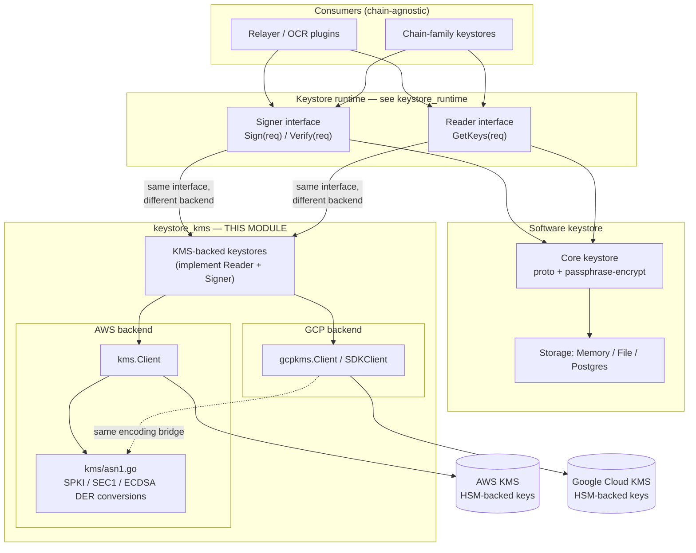
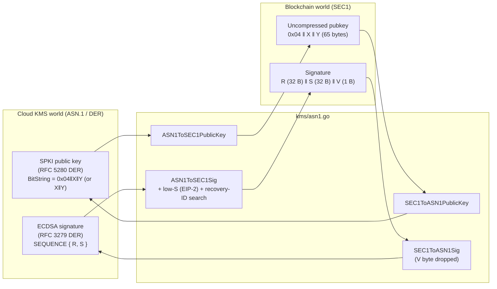
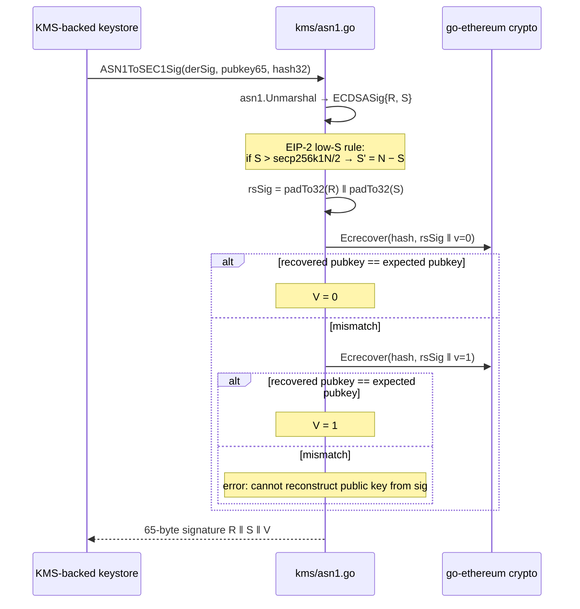
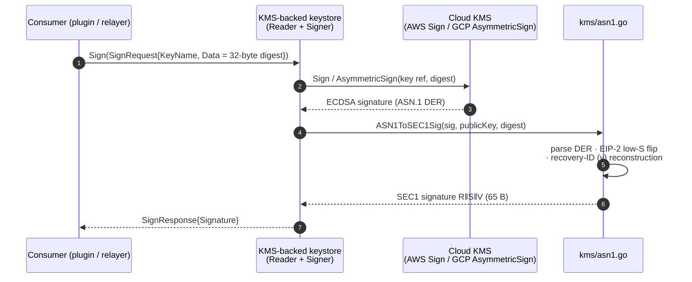
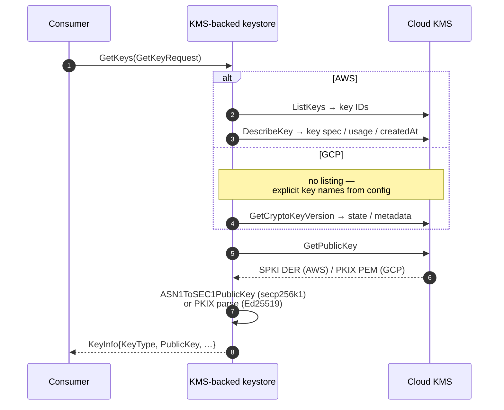

# Keystore — KMS Integrations (`kms`, `gcpkms`, `kms/asn1`)

> **Module:** `chainlink-common/keystore/kms` and `chainlink-common/keystore/gcpkms` (Go module [`github.com/smartcontractkit/chainlink-common/keystore`](../../../repo/chainlink-common/keystore/go.mod))
> **Parent domain:** [Node_Platform_Services](../../Node_Platform_Services.md) → [Keystore](../keystore.md)

## 1. Introduction

`keystore_kms` is the **cloud HSM integration layer** of the Chainlink keystore. It allows cryptographic keys to live in a managed cloud Key Management Service — AWS KMS or Google Cloud KMS — instead of (or alongside) the software keystores persisted in Postgres or on disk. Private key material is generated, held, and used *inside* the cloud service: the node never sees raw private bytes, only public keys and signatures.

The module consists of three packages:

| Package | File | Role |
|---|---|---|
| `kms` (AWS) | [`kms/client.go`](../../../repo/chainlink-common/keystore/kms/client.go) | Minimal `Client` interface over the AWS SDK for Go v2 KMS service, plus a credential-flexible constructor. |
| `kms` (AWS) | [`kms/asn1.go`](../../../repo/chainlink-common/keystore/kms/asn1.go) | The **encoding bridge**: ASN.1 DER ↔ SEC1 conversion for secp256k1 public keys and ECDSA signatures. |
| `gcpkms` (GCP) | [`gcpkms/client.go`](../../../repo/chainlink-common/keystore/gcpkms/client.go) | Minimal `Client` interface over the Google Cloud KMS Go SDK, with an `SDKClient` adapter that owns the transport. |

All three live inside the standalone `chainlink-common/keystore` Go module, whose direct dependencies include `github.com/aws/aws-sdk-go-v2/service/kms` and `cloud.google.com/go/kms` (see [`chainlink-common/keystore/go.mod`](../../../repo/chainlink-common/keystore/go.mod)).

The defining design decision of this module is that **both cloud backends are consumed through narrow, locally-owned `Client` interfaces**, not through the generated SDK types. This keeps the keystore independent of vendor SDK churn, and it makes the boundary trivially mockable — the devenv test environment ships a local fake KMS that mirrors the same ASN.1 structures (see [§8](#8-testing-and-environment-integration)).

## 2. Position in the Keystore Ecosystem

The KMS packages are one of the backends of the chain-agnostic keystore runtime ([`keystore_runtime`](keystore_runtime.md)). KMS-backed keystores satisfy the **same read-only `Reader` + `Signer` surface** as the software keystore, so consumers sign identically regardless of where keys are held:

- [`keystore_runtime`](keystore_runtime.md) — defines `Signer` (`Sign`/`Verify` via `SignRequest{KeyName, Data}` → `SignResponse{Signature}`) and `Reader` (`GetKeys` via `GetKeyRequest`), which KMS-backed keystores implement. Note that only the `Storage` interface (memory / file / Postgres backends) is bypassed — cloud keys have no encrypted-keystore blob.
- [`keystore_node_keyring`](keystore_node_keyring.md) — the node `Master` keystore and its typed sub-stores; the software-based counterpart for key families not yet served by KMS.
- [`keystore_core_keys`](keystore_core_keys.md) — the key models (`ethkey.State`, `ocr2key` bundles, …) that remain unchanged; KMS changes *where keys live*, not *what a key is*.



For the high-level lifecycle (unlock, key creation, persistence) of the node's software keystore, see [keystore](../keystore.md); the KMS path replaces the `Storage` step entirely with cloud API calls.

## 3. Component Architecture

```mermaid
classDiagram
    class aws_Client["kms.Client (AWS)"] {
        <<interface>>
        +GetPublicKey(ctx, *kms.GetPublicKeyInput, opts...) (*kms.GetPublicKeyOutput, error)
        +Sign(ctx, *kms.SignInput, opts...) (*kms.SignOutput, error)
        +DescribeKey(ctx, *kms.DescribeKeyInput, opts...) (*kms.DescribeKeyOutput, error)
        +ListKeys(ctx, *kms.ListKeysInput, opts...) (*kms.ListKeysOutput, error)
    }
    class ClientOptions {
        +Profile string  "AWS profile (local dev); empty → default credential chain"
        +Region string   "region override; empty → profile / environment"
    }
    class gcp_Client["gcpkms.Client (GCP)"] {
        <<interface>>
        +GetCryptoKeyVersion(ctx, *kmspb.GetCryptoKeyVersionRequest, opts...) (*kmspb.CryptoKeyVersion, error)
        +GetPublicKey(ctx, *kmspb.GetPublicKeyRequest, opts...) (*kmspb.PublicKey, error)
        +AsymmetricSign(ctx, *kmspb.AsymmetricSignRequest, opts...) (*kmspb.AsymmetricSignResponse, error)
    }
    class SDKClient {
        -client *apiv1.KeyManagementClient
        +Close() error
    }
    class asn1pkg["kms/asn1.go (package funcs)"] {
        +ASN1ToSEC1PublicKey(asn1PublicKey) ([]byte, error)
        +SEC1ToASN1PublicKey(sec1PubKey) ([]byte, error)
        +ASN1ToSEC1Sig(asn1Sig, ecdsaPubKeyBytes, hash) ([]byte, error)
        +SEC1ToASN1Sig(sec1Sig) ([]byte, error)
        -recoverSEC1Signature(expectedPublicKey, txHash, r, s) ([]byte, error)
        -padTo32Bytes(buffer) []byte
    }
    class SPKI {
        <<RFC 5280 struct>>
        +AlgorithmIdentifier SPKIAlgorithmIdentifier
        +SubjectPublicKey asn1.BitString
    }
    class ECDSASig {
        <<RFC 3279 struct>>
        +R asn1.RawValue
        +S asn1.RawValue
    }

    aws_Client ..> ClientOptions : NewClient(ctx, opts)
    SDKClient ..|> gcp_Client
    gcp_Client ..> SDKClient : NewClient(ctx, opts...) returns
    KMSKeystore["KMS-backed keystore (upstream)"] --> aws_Client
    KMSKeystore --> gcp_Client
    aws_Client ..> asn1pkg : SPKI / DER sig outputs
    gcp_Client ..> asn1pkg : key / signature material
    asn1pkg --> SPKI : unmarshal / marshal
    asn1pkg --> ECDSASig : unmarshal
```

Key relationships:

- `kms.Client` mirrors **only the four AWS KMS operations the keystore needs** — the doc comment on the interface states this explicitly. The generated AWS client can do far more; the keystore intentionally narrows the surface.
- `gcpkms.Client` is scoped to operations on a **single `CryptoKeyVersion`**, so every call can be authorized with per-key IAM bindings: a deployment binds exactly the keys it configures and nothing else. `SDKClient` is a thin adapter over the generated `apiv1.KeyManagementClient` (`var _ Client = (*SDKClient)(nil)` asserts conformance) that **owns the underlying transport — callers must `Close()` it**.
- Both backends funnel their outputs through `kms/asn1.go`, the shared encoding bridge. It is intentionally dependency-light: only `encoding/asn1`, go-ethereum's `crypto`/`secp256k1` packages, and the standard library.

## 4. AWS KMS Backend

### 4.1 Client construction and credentials

`NewClient(ctx, ClientOptions)` picks between two credential strategies, per [`kms/client.go`](../../../repo/chainlink-common/keystore/kms/client.go):

| `ClientOptions.Profile` | Behavior |
|---|---|
| Non-empty | `config.LoadDefaultConfig` with `config.WithSharedConfigProfile(profile)` — **profile-based auth for local development**. |
| Empty (default) | Plain `config.LoadDefaultConfig` — the **default credential chain**: IRSA (IAM Roles for Service Accounts) in production, EC2 instance profiles, environment variables, etc. |

`ClientOptions.Region` is applied after loading, only when non-empty; otherwise the region comes from the profile or environment. There is no session or long-lived state — the constructor returns `kms.NewFromConfig(cfg)`, which is safe for concurrent use.

### 4.2 Interface surface

| Method | Purpose in the keystore |
|---|---|
| `GetPublicKey` | Fetch the key's public half; AWS returns a **DER-encoded X.509 `SubjectPublicKeyInfo`** blob, which must be converted via `ASN1ToSEC1PublicKey` before blockchain consumption. |
| `Sign` | Sign a pre-hashed message (32-byte digest); AWS returns the ECDSA signature in **ASN.1 DER** form, converted via `ASN1ToSEC1Sig`. |
| `DescribeKey` | Resolve key metadata (key spec, key usage, creation date) — used to classify a key as secp256k1/ECDSA or Ed25519. |
| `ListKeys` | Enumerate KMS key IDs — **an AWS-only capability**; the GCP backend has no equivalent, so GCP deployments must configure explicit key names. |

All four methods accept variadic `func(*kms.Options)` pass-throughs, matching the AWS SDK v2 style, so callers can inject per-call options (e.g. custom endpoints for local testing) without the keystore knowing about them.

## 5. Google Cloud KMS Backend

`gcpkms.NewClient(ctx, opts...)` wraps `apiv1.NewKeyManagementClient` and returns an `*SDKClient`. Credentials **always come from Application Default Credentials (ADC)**, which uniformly covers:

- production: GKE Workload Identity, GCE / Cloud Run service accounts;
- local development: `gcloud auth application-default login`, or `GOOGLE_APPLICATION_CREDENTIALS` pointing at a service-account key file.

The variadic `opts ...option.ClientOption` is passed straight through to the SDK for the cases ADC does not cover — a custom endpoint or emulator, a quota project, a non-default token source (per [GCP ADC docs](https://cloud.google.com/docs/authentication/application-default-credentials)).

| Method | Purpose in the keystore |
|---|---|
| `GetCryptoKeyVersion` | Resolve version state and metadata for a fully-qualified `CryptoKeyVersion` resource name. |
| `GetPublicKey` | Fetch the public key for that version (PKIX/PEM form, parsed downstream rather than via the SPKI path). |
| `AsymmetricSign` | Sign a digest with that version's asymmetric key. |

Two properties distinguish the GCP client:

1. **Per-key least privilege.** Every method operates on a single `CryptoKeyVersion`, so IAM bindings can be granted per key rather than per project — the interface doc comment calls this out as the reason for the shape.
2. **No key listing.** There is no `ListKeys` equivalent; callers must supply explicit key names, which shifts key discovery from "enumerate the cloud account" to "read the node configuration."

## 6. The ASN.1 ↔ SEC1 Encoding Bridge

Cloud KMS services speak X.509/ASN.1 (the PKI world), while blockchains — Ethereum and most others — use the SEC1 conventions for both keys and signatures. `kms/asn1.go` is the adapter between the two, and it is the reason this module can support both cloud vendors with a single conversion surface.



### 6.1 Public key conversions

**`ASN1ToSEC1PublicKey`** (SPKI DER → SEC1 uncompressed):

1. `asn1.Unmarshal` into the `SPKI` struct (`AlgorithmIdentifier` + `SubjectPublicKey asn1.BitString`).
2. Normalize the BitString: KMS sometimes emits 65 bytes (`0x04 ‖ X ‖ Y`) and sometimes 64 bytes (`X ‖ Y`); a 64-byte payload gets a `0x04` prefix prepended, and anything else is rejected with a length error.
3. Parse with go-ethereum's `crypto.UnmarshalPubkey`, then re-marshal via `secp256k1.S256().Marshal(X, Y)` to guarantee canonical 65-byte output.

**`SEC1ToASN1PublicKey`** (the reverse): validates the 65-byte `0x04`-prefixed form, re-parses it for validation, fills 32-byte X/Y coordinates, and builds the SPKI structure with the standard OIDs — `ecPublicKey` `1.2.840.10045.2.1` and `secp256k1` `1.3.132.0.10` — before DER-marshalling. A code comment notes this implementation deliberately matches `chainlink-deployments-framework` (`chain/evm/provider/kms_signer.go`), keeping the two repos interoperable.

### 6.2 Signature conversions

**`SEC1ToASN1Sig`** (SEC1 → DER): splits the 65-byte `R ‖ S ‖ V` input into two big.Ints and DER-marshals a `SEQUENCE { R, S }`. **The recovery ID `V` is irrecoverably dropped** — ASN.1 has no field for it — so this direction is only valid where public-key recovery is not needed.

**`ASN1ToSEC1Sig`** (DER → SEC1) is the important direction for signing, and it is genuinely lossy-to-lossless reconstruction, not a plain re-encode:



Why the extra steps?

- **EIP-2 low-S normalization.** Blockchains require `S ≤ secp256k1N/2` (`secp256k1HalfN` in the code). AWS may return a high-S signature, so the value is flipped (`S' = N − S`) when needed. The AWS-referenced approach follows the [AWS guide on managing Ethereum accounts with KMS](https://aws.amazon.com/blogs/database/part2-use-aws-kms-to-securely-manage-ethereum-accounts/).
- **Recovery-ID reconstruction.** The SEC1 65th byte `V` exists only for public-key recovery; KMS never returns it. The bridge tries `v = 0` and `v = 1`, recovering the public key with `crypto.Ecrecover` each time and comparing against the known public key (hex-compared) — the matching `V` is the one that belongs in the signature. `padTo32Bytes` guarantees R and S are exactly 32 bytes by trimming leading zeros and left-padding, since ASN.1 INTEGERs are variable-length.

## 7. End-to-End Flows

### 7.1 Signature production (the hot path)



The consumer never learns whether AWS or GCP served the request, nor that DER/ASN.1 was involved — the runtime `Signer` contract (see [keystore_runtime](keystore_runtime.md)) abstracts all of it.

### 7.2 Key discovery and public-key materialization



Supported key families per the parent module ([keystore](../keystore.md#5-kms-integrations)): `ECC_SECG_P256K1 → ECDSA_S256` (via the ASN.1 bridge above) and `ECC_NIST_EDWARDS25519 → Ed25519` (parsed via PKIX rather than the secp256k1-specific bridge).

## 8. Testing and Environment Integration

- **Narrow interfaces enable fakes.** Because both backends are consumed through package-local `Client` interfaces, tests substitute lightweight fakes without importing vendor SDKs or hitting cloud endpoints.
- **Devenv fake KMS.** The development environment ships `chainlink/deployment/environment/devenv/internal/kms/kms_client.go`, a local KMS emulator whose internal `asn1ECDSASig {R, S}` and `asn1SubjectPublicKeyInfo` structures deliberately mirror the SPKI/ECDSA shapes defined in [`kms/asn1.go`](../../../repo/chainlink-common/keystore/kms/asn1.go) — see [deployment-environment](../../Dev,_Test___Simulation_Environments/deployment-environment.md). This lets integration tests exercise the exact wire formats a real KMS produces.
- **Cross-repo parity.** `ASN1ToSEC1PublicKey` documents byte-for-byte parity with `chainlink-deployments-framework`'s `kms_signer.go`, so EVM provider signing in deployment tooling and keystore runtime signing agree on encoding.

## 9. Backend Comparison

| Aspect | AWS KMS (`kms`) | Google Cloud KMS (`gcpkms`) |
|---|---|---|
| SDK | `aws-sdk-go-v2/service/kms` | `cloud.google.com/go/kms/apiv1` |
| Credentials | Named profile (local dev) or default chain — IRSA / instance profiles (production) | Always ADC — Workload Identity, GCE/Cloud Run SAs, `gcloud` login, credential files |
| Region/project handling | `ClientOptions.Region` override | Pass-through `option.ClientOption`s (endpoint/emulator, quota project, token source) |
| Key discovery | `ListKeys` + `DescribeKey` | None — explicit `CryptoKeyVersion` names required |
| Key addressing | Key ID / alias via input structs | Fully-qualified `CryptoKeyVersion` resource name |
| IAM granularity | KMS key policies | Per-key bindings; interface scoped to single-version operations |
| Public key format out | ASN.1 SPKI DER | PKIX (parsed downstream) |
| Resource lifecycle | Stateless config-derived client | `SDKClient` owns transport; **callers must `Close()`** |
| Signature out | ASN.1 DER → `ASN1ToSEC1Sig` | Native asymmetric-sign response, normalized by the keystore |

## 10. Security Model

1. **Private keys never leave the HSM.** Neither client interface exposes any operation that returns private material; only public keys, metadata, and signatures cross the process boundary. The keystore's broader raw-byte confinement rules (see [keystore_core_keys](keystore_core_keys.md)) are inherited for free.
2. **Least-privilege authorization.** GCP's single-`CryptoKeyVersion` scoping allows per-key IAM bindings; AWS's default credential chain (IRSA / instance profiles) avoids long-lived credentials entirely in production.
3. **No credential handling in this module.** `ClientOptions` carries only a profile name and region — secrets resolution is delegated to the vendor SDKs' standard mechanisms.
4. **Explicit failure over silent drift.** Every conversion function returns errors on malformed input (wrong BitString length, non-`0x04`-prefixed SEC1 keys, wrong signature length) rather than guessing, and `recoverSEC1Signature` fails loudly if neither recovery ID reproduces the expected public key — which would indicate a digest/key mismatch, not a formatting issue.

## 11. Related Documentation

- [keystore](../keystore.md) — parent module overview: both keystore layers, security model, and the KMS section this page details.
- [keystore_runtime](keystore_runtime.md) — the `Signer` / `Reader` / `Storage` contracts KMS keystores implement, protobuf serialization, and module composition.
- [keystore_core_keys](keystore_core_keys.md) — key models (`ethkey.State`, `ocr2key` keyrings) that sit above the storage/KMS split.
- [keystore_node_keyring](keystore_node_keyring.md) — the node `Master` keystore and typed sub-stores (software-based path).
- [deployment-environment](../../Dev,_Test___Simulation_Environments/deployment-environment.md) — the devenv fake KMS client used in integration testing.
- Repository sources: [`kms/client.go`](../../../repo/chainlink-common/keystore/kms/client.go) · [`kms/asn1.go`](../../../repo/chainlink-common/keystore/kms/asn1.go) · [`gcpkms/client.go`](../../../repo/chainlink-common/keystore/gcpkms/client.go) · [`keystore/go.mod`](../../../repo/chainlink-common/keystore/go.mod)
