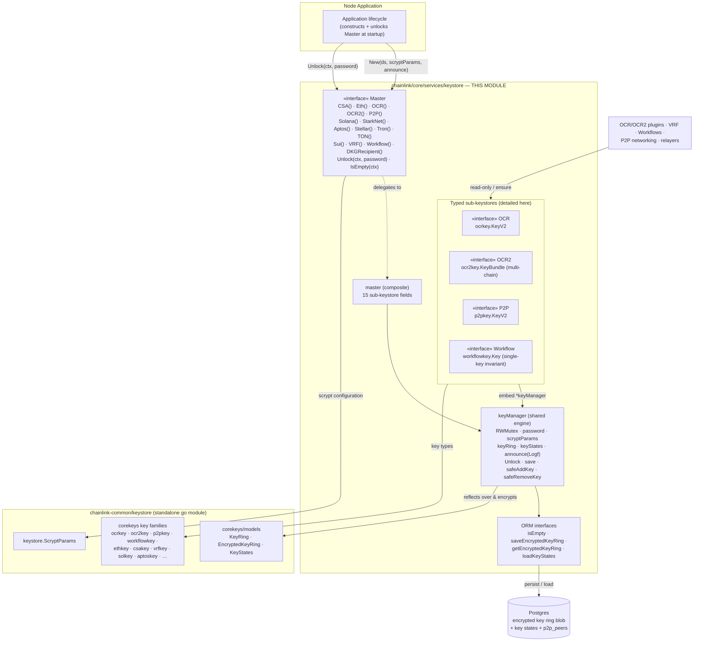
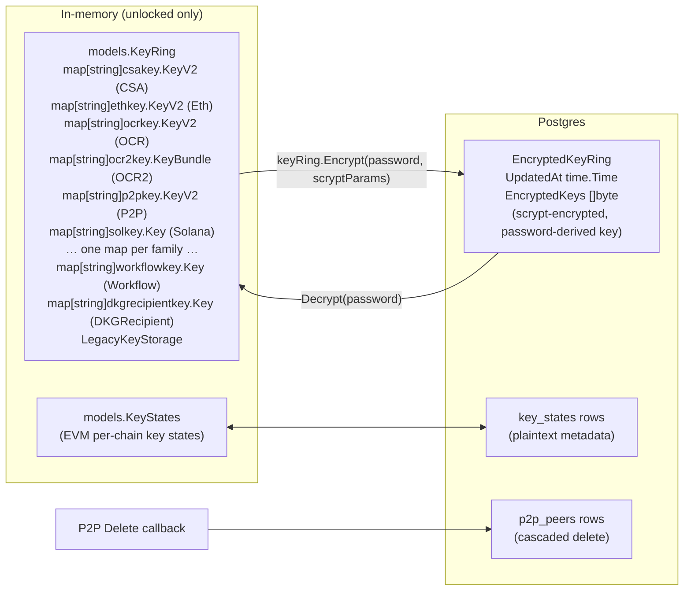
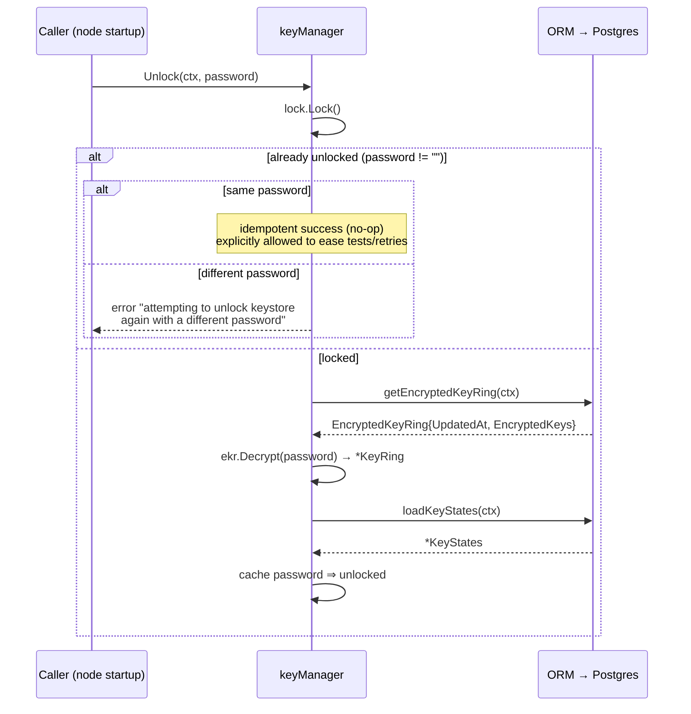
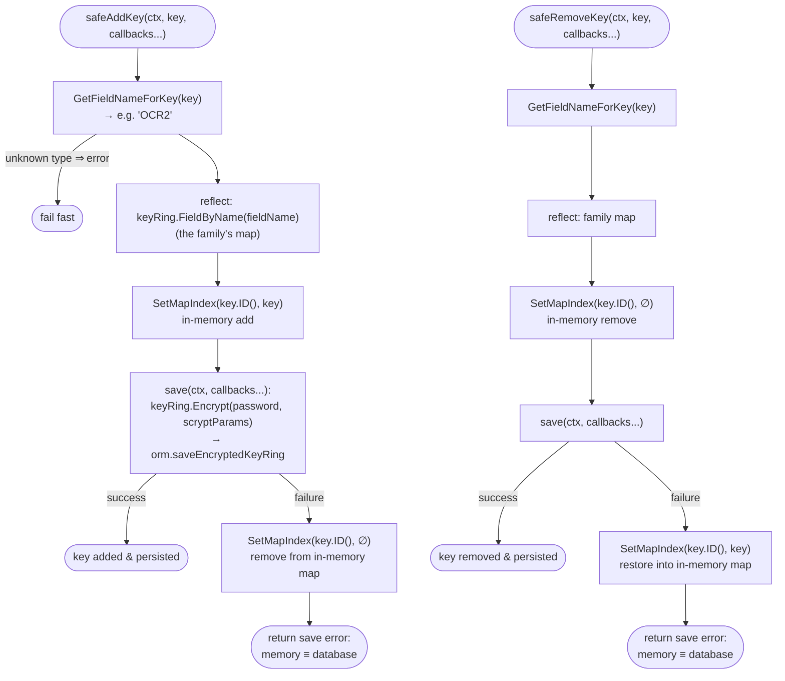
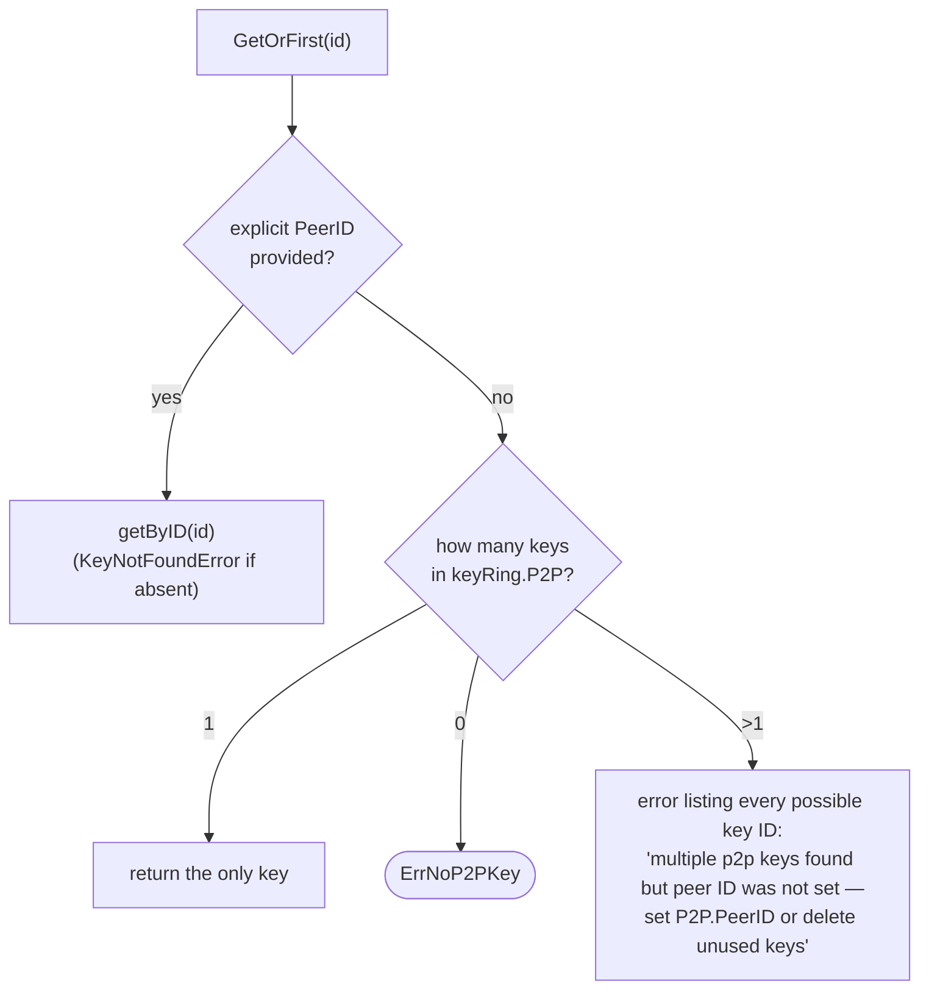
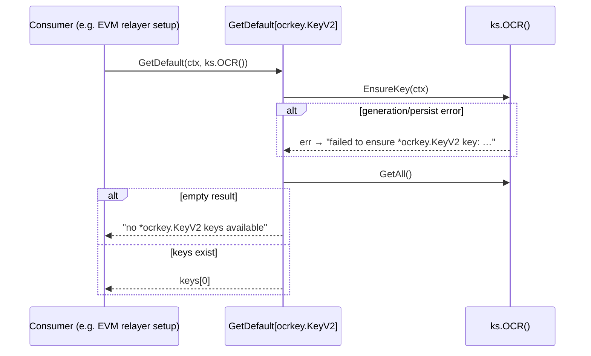

# Keystore — Node Keyring (`Master` & Typed Sub-Keystores)

> **Module:** `chainlink/core/services/keystore` (uses the standalone [`chainlink-common/keystore`](../../../repo/chainlink-common/keystore/go.mod) library)
> **Parent domain:** [Node_Platform_Services](../../Node_Platform_Services.md) → [Keystore](../keystore.md)
> **Core components:** `master.go::Master` · `keystore.go::getDefault` · `ocr.go::OCR` · `ocr2.go::OCR2` · `p2p.go::P2P` · `workflow.go::Workflow`

## 1. Introduction

`keystore_node_keyring` is the **running node's key manager**. It is the concrete, in-process keystore that every part of a Chainlink node consults when it needs to sign, decrypt, or identify itself: the `Master` service exposes **fifteen strongly-typed sub-keystores** (one per key family), all sharing a single encrypted-at-rest `KeyRing` that is persisted in the node's Postgres database.

The module is deliberately conservative about key material:

- **Raw private-key bytes never leave the subtree.** The package documentation in [`keystore.go`](../../../repo/chainlink/core/services/keystore/keystore.go) states that all raw key byte access is limited to `internal/` package APIs.
- **No logger imports.** The keystore subtree may not import logger packages; instead, a few select places accept injected `Logf` functions that announce **public** information only (key kind, ID, and chain type) when a key is created.
- **Fail-closed locking.** The keystore boots locked; every operation checks lock state and fails fast with `ErrLocked` until `Unlock` succeeds.

This page documents the node-side keyring in depth — the shared `keyManager` engine, the four representative sub-keystores (OCR, OCR2, P2P, Workflow), and the generic `GetDefault` consumer helper. For the *key types themselves* (`ethkey.State`, `ocr2key` bundles, `ChainType` registry), see [keystore_core_keys](keystore_core_keys.md); for the chain-agnostic storage/serialization runtime and cloud KMS backends, see [keystore_runtime](keystore_runtime.md) and [keystore_kms](keystore_kms.md).

## 2. Architecture



Key relationships:

- **One engine, many façades.** Every sub-keystore embeds the same `*keyManager` (`master.go`). Sub-stores contribute only type-specific logic: which `KeyRing` map to index, how to generate/serialize their key type, and any special invariants.
- **Single persistence unit.** All key families live in **one** encrypted blob (`models.EncryptedKeyRing`) in Postgres — see [§4](#41-the-keymanager-struct).
- **Type-safe routing via reflection.** `GetFieldNameForKey` (a type switch over the 15 concrete key types) maps a key to its `KeyRing` field name, so the generic `safeAddKey`/`safeRemoveKey` engine can operate on any family — see [§4.4](#44-safeaddkey--safeceremovekey-transactional-mutation).

## 3. Core Component: `Master`

### 3.1 Interface and construction

`master.go::Master` is the top-level contract:

| Member | Kind | Purpose |
|---|---|---|
| `CSA()`, `Eth()`, `OCR()`, `OCR2()`, `P2P()`, `Solana()`, `StarkNet()`, `Aptos()`, `Stellar()`, `Tron()`, `TON()`, `Sui()`, `VRF()`, `Workflow()`, `DKGRecipient()` | accessors | Return the typed sub-keystore for each key family. |
| `Unlock(ctx, password)` | lifecycle | Decrypt the persisted `KeyRing` into memory (idempotent; see [§4.3](#43-unlock)). |
| `IsEmpty(ctx)` | lifecycle | Report whether the database contains any key ring yet (used to decide whether a password/initialization flow is needed). |

`New(ds sqlutil.DataSource, scryptParams keystore.ScryptParams, announce Logf)` constructs the whole graph in one call:

1. An **ORM** is created over the Postgres data source (the shared persistence plumbing comes from [database_persistence](../database_persistence.md) / `chainlink-common/pkg/sqlutil`).
2. The **`keyManager`** is wired with the ORM (dually acting as the key-state ORM), the scrypt parameters, an `sync.RWMutex`, and the wrapped announcer.
3. All fifteen sub-keystores are instantiated against that single manager and exposed through their accessors.

The scrypt parameters come from `chainlink-common/keystore` and control the key-derivation work factor used every time the ring is encrypted — see the module's dependency set in [`chainlink-common/keystore/go.mod`](../../../repo/chainlink-common/keystore/go.mod) (`golang.org/x/crypto`).

```mermaid
classDiagram
    class Master {
        <<interface>>
        +CSA() CSA
        +Eth() Eth
        +OCR() OCR
        +OCR2() OCR2
        +P2P() P2P
        +Solana() Solana
        +StarkNet() StarkNet
        +Aptos() Aptos
        +Stellar() Stellar
        +Tron() Tron
        +TON() TON
        +Sui() Sui
        +VRF() VRF
        +Workflow() Workflow
        +DKGRecipient() DKGRecipient
        +Unlock(ctx, password) error
        +IsEmpty(ctx) (bool, error)
    }
    class master {
        -keyManager *keyManager
        -csa, eth, ocr, ocr2, p2p, solana, starknet, sui, aptos, stellar, tron, ton, vrf, workflow, dkgRecipient
    }
    class OCR {
        <<interface>>
        +Get(id) (ocrkey.KeyV2, error)
        +GetAll() ([]ocrkey.KeyV2, error)
        +Create(ctx) (ocrkey.KeyV2, error)
        +Add(ctx, key) error
        +Delete(ctx, id) (ocrkey.KeyV2, error)
        +Import(ctx, keyJSON, password) (ocrkey.KeyV2, error)
        +Export(id, password) ([]byte, error)
        +EnsureKey(ctx) error
    }
    class OCR2 {
        <<interface>>
        +Get(id) (ocr2key.KeyBundle, error)
        +GetAll() ([]ocr2key.KeyBundle, error)
        +GetAllOfType(chainType) ([]ocr2key.KeyBundle, error)
        +Create(ctx, chainType) (ocr2key.KeyBundle, error)
        +Add(ctx, key) error
        +Delete(ctx, id) error
        +Import(ctx, keyJSON, password) (ocr2key.KeyBundle, error)
        +Export(id, password) ([]byte, error)
        +EnsureKeys(ctx, enabledChains...) error
    }
    class P2P {
        <<interface>>
        +Get(id PeerID) (p2pkey.KeyV2, error)
        +GetAll() ([]p2pkey.KeyV2, error)
        +Create(ctx) (p2pkey.KeyV2, error)
        +Add(ctx, key) error
        +Delete(ctx, id PeerID) (p2pkey.KeyV2, error)
        +Import(ctx, keyJSON, password) (p2pkey.KeyV2, error)
        +Export(id PeerID, password) ([]byte, error)
        +EnsureKey(ctx) error
        +GetOrFirst(id PeerID) (p2pkey.KeyV2, error)
    }
    class Workflow {
        <<interface>>
        +Get(id) (workflowkey.Key, error)
        +GetAll() ([]workflowkey.Key, error)
        +Create(ctx) (workflowkey.Key, error)
        +Add(ctx, key) error
        +Delete(ctx, id) (workflowkey.Key, error)
        +Import(ctx, keyJSON, password) (workflowkey.Key, error)
        +Export(id, password) ([]byte, error)
        +EnsureKey(ctx) error
    }
    class keyManager {
        -orm ORM
        -keystateORM keystateORM
        -scryptParams ScryptParams
        -keyRing *KeyRing
        -keyStates *KeyStates
        -lock *sync.RWMutex
        -password string
        -announce func(Key)
        +IsEmpty(ctx) (bool, error)
        +Unlock(ctx, password) error
        -save(ctx, callbacks...) error
        -safeAddKey(ctx, key, callbacks...) error
        -safeRemoveKey(ctx, key, callbacks...) error
        -isLocked() bool
    }
    class ORM {
        <<interface>>
        -isEmpty(ctx) (bool, error)
        -saveEncryptedKeyRing(ctx, ekr, callbacks...) error
        -getEncryptedKeyRing(ctx) (EncryptedKeyRing, error)
    }
    class keystateORM {
        <<interface>>
        -loadKeyStates(ctx) (*KeyStates, error)
    }
    class Key {
        <<interface>>
        +ID() string
    }
    class GetDefaultFunc["GetDefault[K, KS] (keystore.go)"] {
        +GetDefault(ctx, ks) (K, error)
    }

    Master <|.. master : implements
    master o-- keyManager : embeds one
    master o-- OCR : composes
    master o-- OCR2 : composes
    master o-- P2P : composes
    master o-- Workflow : composes
    OCR --> keyManager : embeds
    OCR2 --> keyManager : embeds
    P2P --> keyManager : embeds
    Workflow --> keyManager : embeds
    keyManager --> ORM
    keyManager --> keystateORM
    keyManager --> Key : mutates via GetFieldNameForKey
    GetDefaultFunc ..> OCR : "KS: EnsureKey + GetAll"
    GetDefaultFunc ..> P2P : "KS: EnsureKey + GetAll"
```

### 3.2 The `Key` abstraction and field routing

Sub-keystores hand arbitrary key values to the engine as the minimal `Key` interface (`ID() string`). The engine then needs to know **which map** inside `KeyRing` to index. This is resolved by `GetFieldNameForKey` — a compile-time-exhaustive type switch:

| Concrete key type | `KeyRing` field | Sub-keystore |
|---|---|---|
| `csakey.KeyV2` | `CSA` | CSA |
| `ethkey.KeyV2` | `Eth` | Eth |
| `ocrkey.KeyV2` | `OCR` | OCR (this page) |
| `ocr2key.KeyBundle` | `OCR2` | OCR2 (this page) |
| `p2pkey.KeyV2` | `P2P` | P2P (this page) |
| `solkey.Key` | `Solana` | Solana |
| `starkkey.Key` | `StarkNet` | StarkNet |
| `aptoskey.Key` | `Aptos` | Aptos |
| `stellarkey.Key` | `Stellar` | Stellar |
| `tronkey.Key` | `Tron` | Tron |
| `tonkey.Key` | `TON` | TON |
| `suikey.Key` | `Sui` | Sui |
| `vrfkey.KeyV2` | `VRF` | VRF |
| `workflowkey.Key` | `Workflow` | Workflow (this page) |
| `dkgrecipientkey.Key` | `DKGRecipient` | DKGRecipient |

An unknown type returns `unknown key type: %T`, which is the module's defense against silently misfiling a new key family — a new family must be registered here *and* in `KeyRing` before the engine will persist it.

### 3.3 Key announcement (`announcer`)

Because the package may not import a logger, `New` accepts a `Logf func(string, ...any)`. The `announcer` helper wraps it so that `Create`/`EnsureKey` can broadcast creation events **without touching key material**:

- The key *kind* is derived via `GetFieldNameForKey` (an unknown type logs the error text instead of crashing).
- If the key implements the optional `ChainType() corekeys.ChainType` method (OCR2 bundles do), the log includes the chain, e.g. `Created OCR2 key with ID <sha256> for chain solana`; otherwise just `Created OCR key with ID <address>`.

## 4. Core Component: the `keyManager` engine

### 4.1 The `KeyManager` struct

The engine holds the entire unlocked key state in memory:

| Field | Role |
|---|---|
| `orm` / `keystateORM` | Persistence ports: encrypted-ring load/save and key-state load. |
| `scryptParams` | Work factors for at-rest encryption of the whole ring. |
| `keyRing` | The in-memory `models.KeyRing` — one `map[string]T` per key family (see [§5](#5-data-model-keyring-encryptedkeyring-keystates)). |
| `keyStates` | The in-memory `models.KeyStates` (EVM key operational state; see [keystore_core_keys](keystore_core_keys.md)). |
| `lock` | `sync.RWMutex` guarding every access to `keyRing`/`keyStates`/`password`. |
| `password` | Non-empty ⇒ unlocked. Never persisted, never logged. |
| `announce` | The wrapped `Logf` announcer. |

### 4.2 Data model: `KeyRing`, `EncryptedKeyRing`, `KeyStates`

The engine's persistence model is **one aggregate blob**:



- **`KeyRing`** (`chainlink-common/keystore/corekeys/models/models.go`) aggregates one map per family plus `LegacyKeys` for pre-migration storage. Map keys are the family's `ID()` (EIP-55 address for EVM, SHA-256 bundle hash for OCR2, peer ID for P2P, etc. — see [keystore_core_keys](keystore_core_keys.md)).
- **`EncryptedKeyRing`** is the row that is actually stored: a timestamp plus the ciphertext of the *entire* ring. There is no per-key persistence in the node keyring — every mutation rewrites the whole blob.
- **`KeyStates`** lives *outside* the encrypted blob because it is plain metadata (address × chain ID × disabled flag) that operators query via the API; its access is synchronized by this module's `keyManager` lock (the `KeyStates` type itself is documented as not thread-safe — see [keystore_core_keys](keystore_core_keys.md) §4.3).

### 4.3 Unlock

`Unlock` is the gate for everything else:



Semantics worth noting:

- **Idempotent** — re-unlocking with the *same* password succeeds immediately.
- **Password-pinned** — a *different* password is rejected, preventing accidental lock-out or ring corruption by mixing derivation contexts.
- **Atomic activation** — the in-memory `keyRing` and `keyStates` are only populated after both the decrypt and the state load succeed; the password is cached last, so a partial failure leaves the keystore locked.
- `IsEmpty` is deliberately independent of lock state — it asks the ORM whether any ring exists at all, so operators can detect a fresh database before choosing a password.

### 4.4 `safeAddKey` / `safeRemoveKey`: transactional mutation

Every mutation in every sub-keystore funnels through two generic methods. They treat the **in-memory ring update + whole-ring persistence as one logical transaction** with rollback:



Design consequences:

- **Whole-ring re-encryption per mutation.** Correctness is simple and atomic; the cost is O(ring size) encryption work per key operation, acceptable because mutations are rare (setup/import) while signing reads are frequent and lock-only.
- **Callbacks piggyback on the same save.** `saveEncryptedKeyRing` accepts `func(sqlutil.DataSource) error` callbacks executed against the data source in the same call. The P2P store uses this to cascade deletes into the `p2p_peers` table ([§6.3](#63-p2p--peer-identity-keys)); `master.go` also notes the callback hook is how Eth-store-specific effects are layered in.
- **Duplicate-ID protection** is *not* in the engine — each sub-store checks its own map first (`key with ID %s already exists`) and only then calls `safeAddKey`.

### 4.5 Locking discipline

Every sub-store method follows an identical, hand-rolled pattern — there is no shared wrapper, which keeps lock scopes obvious:

| Operation class | Lock | Precondition |
|---|---|---|
| `Get`, `GetAll`, `Export` | `lock.RLock()` | `!isLocked()`, else `ErrLocked` |
| `Create`, `Add`, `Delete`, `Import`, `EnsureKey(s)` | `lock.Lock()` | `!isLocked()`, else `ErrLocked` |

`isLocked()` is `len(km.password) == 0` and is only meaningful while the caller holds the lock (per the source comments). This gives: concurrent-safe reads during signing hot paths, serialized mutations, and a fail-closed posture before the first successful `Unlock`.

## 5. Typed sub-keystores

All four detailed sub-stores share the uniform API: `Get` / `GetAll` / `Create` / `Add` / `Delete` / `Import` / `Export` / `EnsureKey` (+ type-specific extras). The table summarizes what makes each unique; subsections expand.

| Aspect | OCR (v1) | OCR2 | P2P | Workflow |
|---|---|---|---|---|
| Key type | `ocrkey.KeyV2` | `ocr2key.KeyBundle` (interface) | `p2pkey.KeyV2` | `workflowkey.Key` |
| Identity (`ID()`) | OCR key ID | SHA-256 hash of bundle material | libp2p peer ID | workflow key ID |
| Multi-chain | no (EVM-era) | **yes** — `ChainType` on each bundle | no | no |
| Cardinality invariant | any number (seed 1) | any number (seed 1 per enabled chain) | any number, but **ambiguity-guarded** | **exactly ≤ 1** (`ErrWorkflowKeyExists`) |
| Extra API | — | `GetAllOfType`, `EnsureKeys(chains…)` | `GetOrFirst` | — |
| Delete side effects | — | — | cascades to `p2p_peers` table | — |
| Export helper | `key.ToEncryptedJSON` (method) | `ocr2key.ToEncryptedJSON` (package fn) | `key.ToEncryptedJSON` (method) | `key.ToEncryptedJSON` (method) |

### 5.1 Common lifecycle: `EnsureKey` self-seeding

`EnsureKey` (and OCR2's plural `EnsureKeys`) implements the module's idempotent bootstrap: *if no key of this family exists, generate one, announce it, persist it*. Consumers therefore never have to handle "first boot" as a special case — they call `EnsureKey` and then read.

```mermaid
sequenceDiagram
    autonumber
    participant C as Consumer service
    participant S as Sub-keystore (e.g. OCR2)
    participant KM as keyManager
    participant DB as Postgres

    C->>S: EnsureKeys(ctx, enabledChains…)
    S->>KM: lock.Lock(); isLocked()?
    KM-->>S: unlocked
    loop for each enabled chain type
        S->>S: getAllOfType(chain)
        alt zero keys of this type
            S->>S: ocr2key.New(chain)  (generate bundle)
            S->>S: announce(bundle)  "Created OCR2 key … for chain …"
            S->>KM: safeAddKey(ctx, bundle)
            KM->>DB: saveEncryptedKeyRing(Encrypt(ring))
        else key exists
            Note over S: no-op
        end
    end
    S-->>C: nil (or first error aborts the loop)
```

The OCR2 variant deserves emphasis: `Create` and `EnsureKeys` validate the chain type through `corekeys.IsSupportedChainType` (see the `ChainType` registry in [keystore_core_keys](keystore_core_keys.md)) and generate one bundle **per enabled chain type**, so a node serving EVM, Solana and StarkNet OCR2/OCR3 jobs automatically gets one signing bundle per chain on first start.

`Import` follows the same shape but materializes the key from password-encrypted JSON (`FromEncryptedJSON`) instead of generating one; `Export` is the inverse (`ToEncryptedJSON(password, scryptParams)`) and takes the **read** lock since it only serializes.

### 5.2 OCR (v1) — `ocr.go::OCR`

The single-chain (EVM) OCR key store. Besides the standard surface it defines the module-wide sentinel error type `KeyNotFoundError{ID, KeyType}` used by several stores for missing-ID lookups. `EnsureKey` seeds exactly one `ocrkey.KeyV2` when `keyRing.OCR` is empty. Consumers: OCR (v1) reporting — see [Oracle Engines — OCR](../../Oracle_Engines___Data_Pipelines/ocr.md).

### 5.3 OCR2 — `ocr2.go::OCR2`

The multi-chain OCR2/OCR3 signing-key store. Two capabilities distinguish it:

1. **Chain-scoped queries and creation.** `GetAllOfType(chainType)` filters `keyRing.OCR2` by each bundle's `ChainType()`; `Create(ctx, chainType)` and the internal `create` reject unsupported chain types before generating a bundle. The bundles themselves are composites of an offchain keyring and a chain-specific onchain keyring — the anatomy is documented in [keystore_core_keys](keystore_core_keys.md) §5.
2. **`EnsureKeys(ctx, enabledChains…)`** — the loop shown above; it aborts on the first error, and each newly created bundle is announced with its chain type.

Export goes through the package-level helper `ocr2key.ToEncryptedJSON(key, password, ks.scryptParams)` rather than a key method, because bundle serialization needs the composite (offchain + onchain) marshalling path. Consumers: median, LLO, and CCIP OCR2/OCR3 plugins — see [Oracle Engines](../../Oracle_Engines___Data_Pipelines/ocr.md), [LLO](../../Oracle_Engines___Data_Pipelines/llo.md) and [CCIP](../../CCIP_Cross-Chain_Protocol/ccip.md).

### 5.4 P2P — `p2p.go::P2P`

Peer-identity keys for libocr/wsrpc networking (consumer: [p2p](../p2p.md)). Uniquely, `P2P` keys are keyed by `p2pkey.PeerID` and lookups index `keyRing.P2P` by `id.Raw()`.

Two behaviors are specific to this store:

- **Cascading delete.** `Delete` passes a callback into `safeRemoveKey` that executes `DELETE FROM p2p_peers WHERE peer_id = $1` against the same data source inside the same save call — so removing a keyring key cannot leave an orphaned peer row.
- **`GetOrFirst` ambiguity guard** — the resolution order when no explicit peer ID is configured:



The ambiguity error is deliberate operator-surfacing: rather than silently picking a signing identity, the store forces the configuration to be explicit when several identities exist.

### 5.5 Workflow — `workflow.go::Workflow`

The workflow/report signing key used by the CRE engine (consumer: [workflows](../../Workflow___Capability_Runtime_(CRE_Engine)/workflows.md)). Its defining rule is the **single-key invariant**: `Create` and `Add` return `ErrWorkflowKeyExists` ("can only have 1 Workflow key") whenever `keyRing.Workflow` is non-empty. `EnsureKey` seeds the one key; `KeyNotFoundError` is raised with `KeyType: "Encryption"`.

## 6. Core Component: `GetDefault[K, KS]` (`keystore.go::getDefault`)

`keystore.go` also hosts the generic consumer helper that collapses the common "make sure I have a key, then give me the first one" pattern:

```go
type getDefault[K any] interface {
    EnsureKey(context.Context) error
    GetAll() ([]K, error)
}

func GetDefault[K any, KS getDefault[K]](ctx context.Context, ks KS) (K, error)
```



Notes:

- The error messages embed `%T` of the zero value, so failures read as e.g. `failed to ensure *v2.ocrkey.KeyV2 key: …` — useful in operator logs without leaking material.
- `GetAll` ordering determines "default" — it is "first key", not "the configured key". Stores where multiple keys are legitimate (OCR2 across chains, multiple EVM accounts) should not use this helper; it targets the single-key families (and the seeded-first key of others).

## 7. Error catalogue

| Error | Defined in | Raised when |
|---|---|---|
| `ErrLocked` | `master.go` | Any operation attempted before a successful `Unlock`. |
| `ErrKeyNotFound` | `master.go` | Generic missing-key sentinel (several stores prefer the richer `KeyNotFoundError`). |
| `ErrKeyExists` | `master.go` | Import/Add of a duplicate ID (P2P import wraps it explicitly). |
| `KeyNotFoundError{ID, KeyType}` | `ocr.go` | Lookup of a nonexistent ID; message includes family and ID. |
| `ErrNoP2PKey` | `p2p.go` | `GetOrFirst` with no explicit ID and an empty ring. |
| `ErrWorkflowKeyExists` | `workflow.go` | Attempt to create/add a second Workflow key. |
| `unknown key type: %T` | `master.go` (`GetFieldNameForKey`) | A key type not registered in the type switch — blocks persistence of unregistered families. |
| `attempting to unlock keystore again with a different password` | `master.go` (`Unlock`) | Re-`Unlock` with a mismatched password. |

## 8. Security properties

1. **Fail-closed by default.** The zero-value manager is locked; all 15 sub-stores check `isLocked()` under the lock before touching key data.
2. **No key material in logs.** The only logging surface is the injected `announcer`, which emits kind + ID (+ chain type) for *newly created* keys. The package documentation forbids logger imports outright (`keystore.go` header comment).
3. **Encrypted at rest, whole-ring.** `KeyRing.Encrypt(password, scryptParams)` → single `EncryptedKeyRing` blob; plaintext keys exist only in process memory while unlocked. For the complementary chain-agnostic runtime (protobuf blob + `Storage` backends) see [keystore_runtime](keystore_runtime.md); for HSM-resident keys see [keystore_kms](keystore_kms.md).
4. **Consistency under failure.** `safeAddKey`/`safeRemoveKey` restore the in-memory map on persistence failure, so memory can never drift from the database (see [§4.4](#44-safeaddkey--safeceremovekey-transactional-mutation)).
5. **Operational ambiguity avoided, not hidden.** P2P multi-key ambiguity and the Workflow single-key cap surface as explicit errors instead of silent behavior.
6. **Raw-byte confinement.** Key types reconstruct from `internal.Raw` and never expose private bytes; details in [keystore_core_keys](keystore_core_keys.md) §3.1.

## 9. Integration with the rest of the system

### 9.1 Construction and lifecycle

The node application wires the keystore during startup: it supplies the `sqlutil.DataSource`, the configured `ScryptParams`, and a logging announcer, then calls `Unlock` once the database is reachable and the password is available — see [node_application](../../Node_Application_Core___Interfaces/node_application.md) and [node_application_lifecycle](../../Node_Application_Core___Interfaces/node_application/node_application_lifecycle.md).

### 9.2 Consumers

| Consumer | Keys used | Path |
|---|---|---|
| OCR (v1) jobs | `OCR().EnsureKey` / `GetAll` | [Oracle Engines — OCR](../../Oracle_Engines___Data_Pipelines/ocr.md) |
| OCR2/OCR3 plugins (median, LLO, CCIP) | `OCR2().EnsureKeys(chains…)` / `GetAllOfType` | [OCR](../../Oracle_Engines___Data_Pipelines/ocr.md), [LLO](../../Oracle_Engines___Data_Pipelines/llo.md), [CCIP](../../CCIP_Cross-Chain_Protocol/ccip.md) |
| VRF | `VRF()` (same pattern as OCR) | [VRF](../../Oracle_Engines___Data_Pipelines/vrf.md) |
| libocr / wsrpc networking | `P2P().GetOrFirst` | [p2p](../p2p.md) |
| CRE workflow engine | `Workflow().EnsureKey` / `Get` | [workflows](../../Workflow___Capability_Runtime_(CRE_Engine)/workflows.md) |
| External plugin processes | keystore over gRPC (`GRPCPluginKeystore`, `keystore.proto` bindings) | [Loop plugin core](../../Plugin_Process_Framework_(Loop)/loop-plugin-core.md) |
| Canonical interface types | `pkg/types/keystore`, `pkg/types/core/keystore` | [types-core](../../Shared_Foundation_Libraries___Domain_Types/types-core.md) |

### 9.3 Persistence & deployment context

The encrypted ring and key states live in the same Postgres instance as jobs and pipelines (the ORM is built on the shared `sqlutil.DataSource` layer — see [database_persistence](../database_persistence.md)). The canonical single-node Docker deployment pairs the node service with a dedicated `postgres:15` container and passes the connection via `CL_DATABASE_URL` — see [`chainlink/tools/docker/docker-compose.postgres.yaml`](../../../repo/chainlink/tools/docker/docker-compose.postgres.yaml) (`node` → `depends_on: node-db`). Because the keystore password is operator-supplied rather than stored, database backups alone do not yield usable keys — the password is a separate secret.

## 10. Related documentation

- [Keystore (parent overview)](../keystore.md) — two-layer architecture, security model, consumer map.
- [keystore_core_keys](keystore_core_keys.md) — the key models this module persists: `ethkey.State`, `ocr2key` bundle anatomy, `ChainType` registry, `Sha256Hash` IDs.
- [keystore_runtime](keystore_runtime.md) — the chain-agnostic keystore runtime (`Signer`, `Reader`, `Storage`, protobuf serialization, export utilities).
- [keystore_kms](keystore_kms.md) — AWS/GCP KMS backends and the ASN.1↔SEC1 encoding bridge.
- [database_persistence](../database_persistence.md) — the Postgres layer beneath the keystore ORM.
- [p2p](../p2p.md) — consumer of P2P identity keys.
