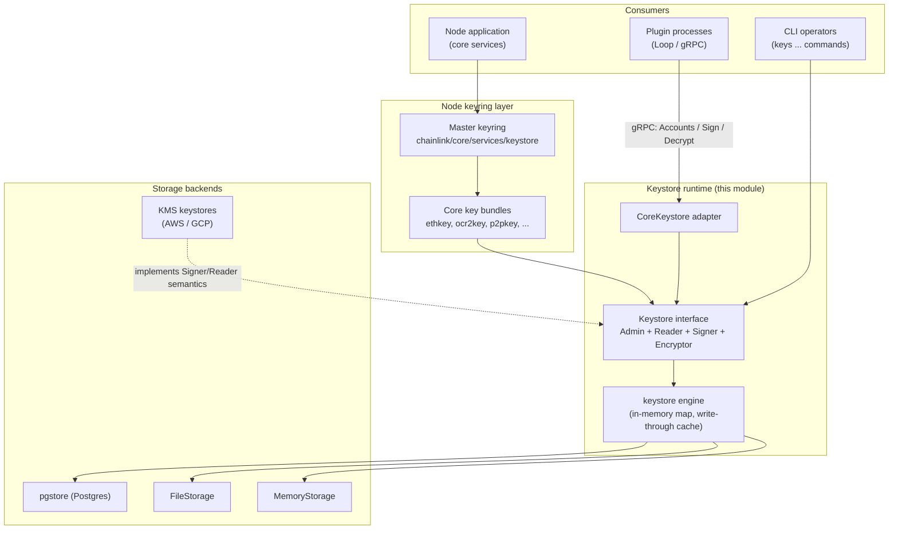
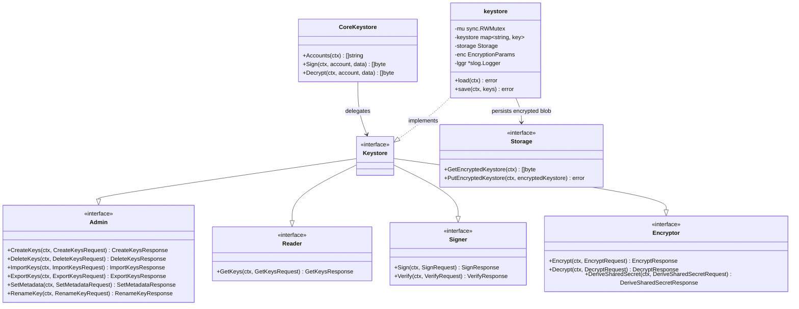
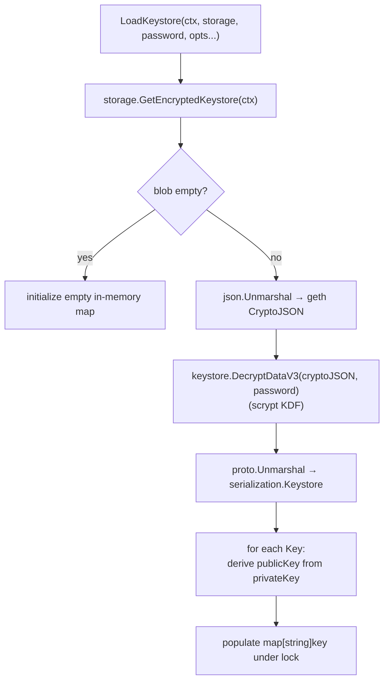
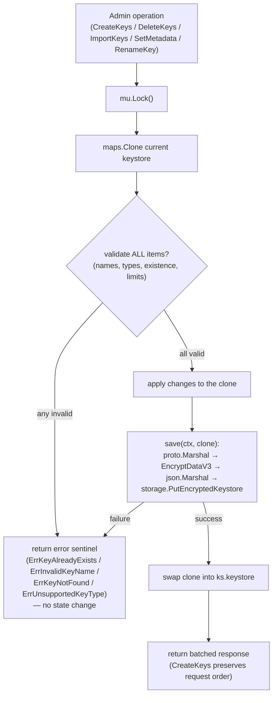
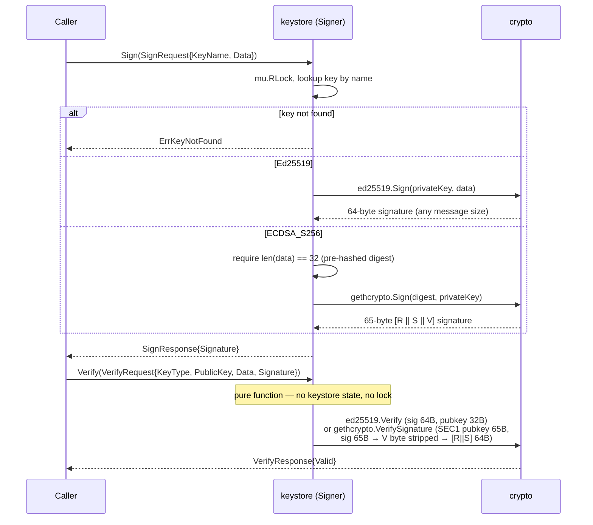

# Keystore Runtime

The **keystore runtime** is the chain-family-agnostic, dependency-minimized key management library that lives in its own Go module at `chainlink-common/keystore` (`chainlink-common/keystore/go.mod::go.mod`). It provides a unified, storage-abstracted runtime for generating, storing, reading, signing with, verifying with, and (hybrid-)encrypting with cryptographic keys. It is the substrate on which the node's [keyring](keystore_node_keyring.md), the [chain-specific core keys](keystore_core_keys.md), the [KMS keystores](keystore_kms.md), and the plugin-facing keystore RPC surface of the [Loop plugin framework](../../Plugin_Process_Framework_(Loop)/loop-plugin-core.md) are built.

This page documents the runtime itself: its public interfaces, internal engine, persistence model, serialization/encryption-at-rest scheme, and its integration surfaces. For how the node wires the runtime into per-chain key stores, see [keystore_node_keyring](keystore_node_keyring.md); for chain-specific key bundles, see [keystore_core_keys](keystore_core_keys.md); for cloud-HSM-backed keystores, see [keystore_kms](keystore_kms.md).

---

## 1. Purpose and Scope

The runtime answers one question for every consumer in the node and its plugin ecosystem: *given a named key, perform a cryptographic operation without ever leaking the private key material*.

Design principles (from `chainlink-common/keystore/README.md`):

- **Storage abstract** — the runtime operates on a pluggable `Storage` interface (memory, file, Postgres, and KMS-backed implementations). In-memory keys and persisted keys are kept in sync via write-through caching.
- **Admin interface for mutations** — only the `Admin` interface mutates the keystore; all other interfaces are read-only. Admin operations are plural/batched and atomic.
- **Client-side key naming** — the runtime does not impose which algorithm/curve is used in which context; callers name keys to reflect their intended use (e.g., `evm/tx/my-key`).
- **Common serialization/encryption** — key material is serialized with protobuf (compact, versioned) and encrypted with a passphrase (geth `CryptoJSON` / scrypt) before persistence.
- **Embeddable CLI** — a cobra-based CLI package that downstream applications can embed to share a consistent operator experience.

Supported key families:

| Family | Key types | Notes |
|---|---|---|
| Digital signatures | `Ed25519`, `ECDSA_S256` (secp256k1) | KMS-backed implementations also support these |
| Hybrid encryption | `X25519` (NaCl box / ChaCha20-Poly1305), `ECDH_P256` (AES-GCM + HKDF-SHA256) | ⚠️ `ECDH_P256` is **pending audit** — do not use in production |

---

## 2. Position in the System

The runtime module sits at the bottom of the keystore stack within **Node Platform Services**:



Key relationships:

- **Node keyring (legacy path).** The node's `Master` keyring (`chainlink/core/services/keystore/master.go`) and its per-chain key stores consume the runtime's types (`keystore.ScryptParams`, `internal.Raw`, `corekeys` bundles). See [keystore_node_keyring](keystore_node_keyring.md).
- **Chain-specific key bundles.** The `corekeys` packages (`ethkey`, `ocr2key`, `solkey`, `starkkey`, `cosmoskey`, `stellarkey`, `tonkey`, `tronkey`, `suikey`, `aptoskey`, `vrfkey`, `workflowkey`, `csakey`, `p2pkey`, `dkgrecipientkey`, `ocrkey`) implement chain-specific encrypted export/import on top of the runtime's generic export utilities. See [keystore_core_keys](keystore_core_keys.md).
- **KMS keystores.** The `kms` (AWS) and `gcpkms` (Google Cloud) packages implement the runtime's `Signer`/`Reader` semantics with keys held in cloud KMS/HSM, so private keys never exist in node memory. See [keystore_kms](keystore_kms.md).
- **Plugin exposure.** The `CoreKeystore` adapter implements `core.Keystore` (`Accounts`/`Sign`/`Decrypt`), which the Loop framework exposes over gRPC to plugin processes via `GRPCPluginKeystore` and the `loop/internal/pb/keystore.proto` service. See [types-core](../../Shared_Foundation_Libraries___Domain_Types/types-core.md) and [loop-plugin-core](../../Plugin_Process_Framework_(Loop)/loop-plugin-core.md).
- **Durable storage.** The Postgres backend persists the encrypted keystore blob in the `encrypted_keystore` table created by migration `0280_create_keystore_table.sql` (referenced in `pgstore/pgstore.go`), complementing the general persistence layer described in [database_persistence](../database_persistence.md) and its [pg layer](../database_persistence/database_persistence_pg_layer.md).

---

## 3. Architecture

### 3.1 Interface Composition

The top-level `Keystore` interface is a composition of four capability interfaces (in `keystore.go`), each of which has an `Unimplemented*` embeddable stub for forward compatibility:



Component map (source files in `chainlink-common/keystore/`):

| Component | File | Role |
|---|---|---|
| `Keystore`, `key`, `EncryptionParams`, `KeyType`, `KeyInfo`, `LoadKeystore`, `load`/`save` | `keystore.go` | Runtime engine, key types, load/save (write-through cache) |
| `Admin` + request/response types | `admin.go` | Atomic, batched mutations (create/delete/import/export/metadata/rename) |
| `Reader`, `GetKeyRequest` | `reader.go` | Read-only key enumeration, sorted by name |
| `Signer` | `signer.go` | Ed25519 / ECDSA-S256 signing and pure-function verification |
| `Encryptor` | `encryptor.go` | X25519 / ECDH-P256 hybrid (anonymous) encryption, shared-secret derivation |
| `Storage` | `storage.go` | Contract for encrypted keystore persistence (atomic replace) |
| `FileStorage` | `file.go` | File backend with atomic writes (mode `0600`) |
| `MemoryStorage` | `memory.go` | In-memory backend (defensive copies) |
| `pgstore.Storage` | `pgstore/pgstore.go` | Postgres backend (`encrypted_keystore` table) |
| `serialization.Keystore` / `serialization.Key` | `serialization/keystore.proto` | Protobuf schema for key material before encryption |
| `Encrypted`, `Key`, `FromEncryptedJSON`, `ToEncryptedJSON` | `internal/exportutils.go` | Generic encrypted-JSON export/import used by chain-specific keys |
| `Raw` | `internal/raw.go` | Private-key wrapper that resists accidental logging |
| `CoreKeystore` | `core_keystore.go` | Backwards-compatible adapter to `core.Keystore` |
| CLI (`keys` command tree) | `cli/cli.go`, `cmd/keystore/main.go` | Embeddable cobra CLI + standalone binary |

### 3.2 Runtime Internals

The `keystore` struct is the single implementation of all four interfaces:

- `mu sync.RWMutex` — guards the in-memory map; read operations (`Sign`, `Decrypt`, `DeriveSharedSecret`, `GetKeys`, `ExportKeys`) take read locks, mutations take write locks. `Verify` is a pure package-level function and takes no lock.
- `keystore map[string]key` — the in-memory key cache. Each `key` holds `keyType`, `privateKey` (`internal.Raw`), `createdAt`, `metadata`, and a `publicKey` derived once on load.
- `storage Storage` — the persistence backend.
- `enc EncryptionParams` — the master password plus `ScryptParams{N, P}`. Defaults are geth's `StandardScryptN`/`StandardScryptP`; `FastScryptParams` (`N: 1<<14, P: 1`) is available for tests.
- `lggr *slog.Logger` — **a discard logger in production binaries** (logging is only enabled when running under `go test`), preventing key-related leakage through logs.

Construction is via `LoadKeystore(ctx, storage, password, opts...)` with functional options `WithLogger` and `WithScryptParams`. `LoadKeystore` immediately calls `load`, which decrypts and hydrates the in-memory cache (see [Data Flows](#5-data-flows)).

Key naming uses slash-separated `KeyPath` values (`NewKeyPath("evm", "tx", "my-key")` → `evm/tx/my-key`) with `HasPrefix` support for namespacing, but any non-empty string up to `MaxKeyNameLength` (1000) is accepted. Metadata is an opaque per-key byte blob capped at `MaxMetadataLength` (1 MB).

---

## 4. Persistence, Serialization, and Encryption at Rest

### 4.1 Storage Contract

`Storage` (`storage.go`) is deliberately minimal — the runtime persists the keystore as **one encrypted blob**:

- `GetEncryptedKeystore(ctx)` — fetch the current encrypted blob (empty means "no keystore yet").
- `PutEncryptedKeystore(ctx, encryptedKeystore)` — **must atomically replace the entire encrypted keystore**.

Provided implementations:

| Backend | Behavior |
|---|---|
| `FileStorage` (`file.go`) | `os.ReadFile` on get; `atomicfile.WriteFile` (temp-file + rename, mode `0600`) on put |
| `MemoryStorage` (`memory.go`) | Copies on both get and put to prevent aliasing |
| `pgstore.Storage` (`pgstore/pgstore.go`) | `SELECT encrypted_data FROM encrypted_keystore WHERE name = $1`; upsert (`INSERT ... ON CONFLICT(name) DO UPDATE`) on put. Named keystores are supported; versioning is intentionally left to DB triggers, not Go code |
| KMS keystores (`kms`, `gcpkms`) | Do not implement this blob contract — they implement `Signer`/`Reader` semantics directly with keys held in the cloud service. See [keystore_kms](keystore_kms.md). Note: the GCP backend requires explicit key names in `GetKeys` (it cannot list key rings) |

The Postgres backend uses `sqlutil.DataSource` from the shared [sqlutil](../../Shared_Foundation_Libraries___Domain_Types/sqlutil.md) library and stores one row per named keystore in the `encrypted_keystore` table created by migration `0280_create_keystore_table.sql` (path referenced in `pgstore/pgstore.go`; migrations are covered in [database_persistence_migrations](../database_persistence/database_persistence_migrations.md)).

### 4.2 Serialization Schema

`serialization/keystore.proto` defines the pre-encryption wire format:

```protobuf
message Keystore {
  repeated Key keys = 1;
}

message Key {
  string name = 1;
  bytes private_key = 2;
  int64 created_at = 3;   // unix seconds
  string key_type = 4;    // "X25519" | "ECDH_P256" | "Ed25519" | "ECDSA_S256"
  bytes metadata = 5;
}
```

The generated Go code (`serialization/keystore.pb.go`) is produced by `go:generate` (`serialization/generate.go` runs `protoc` with `paths=source_relative`); the `chainlink-common` repository toolchain installs protoc and plugins via `make generate` / `make install-protoc` (`chainlink-common/Makefile`, `chainlink-common/script/install-protoc.sh`).

### 4.3 Encryption at Rest

The whole serialized `Keystore` message is encrypted with geth's `keystore.EncryptDataV3` (AES-128-CTR + scrypt KDF, controlled by `EncryptionParams.ScryptParams`) and stored as a JSON `CryptoJSON` envelope. On load the process is inverted: JSON → `CryptoJSON` → `DecryptDataV3` with the master password → `proto.Unmarshal` → per-key public-key derivation (`publicKeyFromPrivateKey` supports Ed25519, secp256k1 SEC1-uncompressed, X25519, and P-256, and returns an empty public key for types without one).

The same `CryptoJSON` mechanism is reused for **single-key import/export**: `Admin.ExportKeys` marshals an individual `serialization.Key`, encrypts it with per-request `EncryptionParams` (independent password and scrypt cost), and returns the JSON envelope; `Admin.ImportKeys` reverses this and can rename keys on the way in.

---

## 5. Data Flows

### 5.1 Load (hydration at startup)



### 5.2 Mutate (write-through cache, copy-on-write)

Every `Admin` mutation follows the same atomic pattern — this is what makes multi-key operations all-or-nothing:



Error sentinels (`admin.go`): `ErrKeyAlreadyExists`, `ErrInvalidKeyName`, `ErrKeyNotFound`, `ErrUnsupportedKeyType`. `ExportKeys` is read-only (read lock) and does not touch storage.

### 5.3 Sign / Verify



Important caller contracts: `ECDSA_S256` **only signs 32-byte digests** (callers must hash first, e.g. SHA-256), its public keys are SEC1 uncompressed (65 bytes, the format from which EVM addresses derive), and signatures carry the recovery `V` byte which `Verify` strips before calling geth's `VerifySignature`.

### 5.4 Hybrid Encryption (Encryptor)

The `Encryptor` implements *anonymous* encryption — the sender needs only the recipient's public key. Payloads are capped at `MaxEncryptionPayloadSize` (100 KB); all failure paths return opaque sentinels (`ErrEncryptionFailed`, `ErrDecryptionFailed`, `ErrSharedSecretFailed`) to prevent information leakage.

- **X25519**: `box.SealAnonymous` / `box.OpenAnonymous` (X25519 ECDH + ChaCha20-Poly1305).
- **ECDH_P256** (⚠️ pending audit): ephemeral keypair per message → ECDH with recipient public key → deterministic nonce `SHA-256(ephPubKey ‖ recipientPubKey)[:12]` → HKDF-SHA256 (salt = nonce, info = `"keystore:ecdh-p256:aes-gcm:hkdf-sha256:v1"`) → AES-256-GCM with `AAD = nonce ‖ ephPubKey` → wire format `[12B nonce][65B ephPub][ciphertext]`.
- **DeriveSharedSecret**: raw ECDH for custom schemes (X25519 expects a 32-byte remote key, P-256 a 65-byte SEC1 key). The API docs warn this should be used only when the caller knows exactly what it is doing.

---

## 6. Key Export/Import Utilities (`internal/exportutils.go`)

While `Admin.ImportKeys`/`ExportKeys` operate on whole runtime keys, chain-specific key bundles (see [keystore_core_keys](keystore_core_keys.md)) need per-key encrypted JSON with chain-specific fields. `internal/exportutils.go` provides two generic helpers built on geth `CryptoJSON`:

- `ToEncryptedJSON[E Encrypted, K Key](identifier, key, password, scryptN, scryptP, passwordFunc, buildExport)` — encrypts `key.Raw()` bytes with `EncryptDataV3`, then delegates to a caller-supplied `buildExport` to produce the chain-specific JSON envelope (e.g. `EncryptedKeyExport{KeyType, PublicKey, Crypto}`).
- `FromEncryptedJSON[E Encrypted, K any](identifier, keyJSON, password, passwordFunc, privKeyToKey)` — unmarshals the envelope, decrypts with `DecryptDataV3`, and converts the raw private key into the typed key bundle.

The `Encrypted` interface (`GetCrypto() keystore.CryptoJSON`) and the `Key` interface (`Raw() Raw`) are the two seams chain-specific keys must implement. `passwordFunc` lets each key family apply its own password prefixing convention.

---

## 7. Integration Surfaces

### 7.1 `CoreKeystore` Adapter

`CoreKeystore` (`core_keystore.go`) adapts the runtime to the narrower `core.Keystore` interface used by the node's capability/plugin layer — `Accounts` (list key names via `GetKeys`), `Sign(account, data)`, `Decrypt(account, data)`. This is the seam through which the runtime satisfies the platform's core service contracts defined in [types-core](../../Shared_Foundation_Libraries___Domain_Types/types-core.md).

### 7.2 Plugin (Loop) Exposure

The Loop plugin framework proxies `Accounts`/`Sign`/`Decrypt` over gRPC to external plugin processes (`GRPCPluginKeystore` in `chainlink-common/pkg/loop/plugin_keystore.go`, backed by `loop/internal/pb/keystore.proto`, which defines exactly the `Accounts`, `Sign`, and `Decrypt` RPCs). Plugin processes therefore get key operations without ever receiving private key material — the gRPC boundary is the trust boundary. Details in [loop-plugin-core](../../Plugin_Process_Framework_(Loop)/loop-plugin-core.md).

### 7.3 Embeddable CLI

`cli/cli.go` builds a cobra `keys` command tree (`list`, `get`, `create`, `delete`, `export`, `import`, `set-metadata`, `rename`, `sign`, `verify`, `encrypt`, `decrypt`) designed to be embedded in downstream applications; `cmd/keystore/main.go` is the standalone binary. Backend selection is environment-driven:

| Variable | Meaning |
|---|---|
| `KEYSTORE_PASSWORD` | Master password for encryption at rest (required for file/DB modes) |
| `KEYSTORE_FILE_PATH` | File backend path (file must already exist, e.g. `touch ./keystore.json`) |
| `KEYSTORE_DB_URL` | Postgres backend URL; the database must contain the `encrypted_keystore` table (DDL documented in the CLI help text) |
| `KEYSTORE_KMS_PROFILE` | AWS profile enabling KMS mode (CLI KMS mode is AWS-only; the GCP backend is programmatic only) |

When KMS mode is active, admin/encryption commands (`create`, `delete`, `export`, `import`, `set-metadata`, `rename`, `encrypt`, `decrypt`) are hidden — keys are managed externally. A 10 s `KeystoreLoadTimeout` bounds backend loading.

### 7.4 Relationship to the Node Keyring

The node's `Master` keyring (`chainlink/core/services/keystore/master.go`) is the legacy, ORM-based per-chain keyring (CSA, Eth, OCR, OCR2, P2P, Solana, StarkNet, Aptos, Stellar, Tron, TON, Sui, VRF, Workflow, DKGRecipient stores). It consumes runtime types (`keystore.ScryptParams`, `internal.Raw`, `corekeys` bundles) and is progressively converging with this runtime: the runtime's Postgres backend targets the same `encrypted_keystore` table, and `CoreKeystore` exists explicitly "for backwards compatibility with the old keystore". Migration status and wiring are tracked in [keystore_node_keyring](keystore_node_keyring.md).

---

## 8. Security Model Summary

- **Private keys never leave the runtime unencrypted.** In-memory they are wrapped in `internal.Raw`, whose `String`/`GoString`/`Format` methods render `<Raw Private Key>` so accidental logging or `fmt` usage cannot leak bytes; the bytes are reachable only via the package-internal `Bytes` function.
- **Encryption at rest** uses geth `CryptoJSON` (scrypt KDF + AES-128-CTR) with a master password; cost is tunable per keystore (`StandardScryptParams` default, `FastScryptParams` for tests) and per export (`ExportKeyParam.Enc`).
- **Atomicity**: every mutation validates the entire batch against a cloned map and persists the clone before swapping it into memory; storage writes are atomic by contract (file backend writes via temp-file rename with `0600`).
- **Least-information errors**: the `Encryptor` returns opaque sentinels and logs details only to the (production-disabled) logger; `Sign`/`Admin` return typed sentinels that avoid embedding key material.
- **No runtime logging in production binaries**: the default logger writes to `io.Discard` unless running under tests.
- **Trust boundary for plugins**: plugin processes interact only through the gRPC `Accounts`/`Sign`/`Decrypt` surface; private keys and the master password never cross it.
- **Known caveat**: `ECDH_P256` hybrid encryption is pending security audit (per the package README) and should not be used in production.

---

## 9. Module Dependencies and Build

`chainlink-common/keystore/go.mod` declares this as an **independent Go module** (`github.com/smartcontractkit/chainlink-common/keystore`, Go 1.27.1) that depends on `chainlink-common` — this keeps the keystore's dependency footprint small and lets non-node consumers (CLI tooling, chain-specific repositories such as chainlink-evm and chainlink-solana per the README) import it without the full node. Notable direct dependencies:

- `github.com/ethereum/go-ethereum` — secp256k1 ECDSA, `accounts/keystore` (`CryptoJSON`, `EncryptDataV3`/`DecryptDataV3`, scrypt params)
- `golang.org/x/crypto` — `curve25519`, `hkdf`, `nacl/box`; `hdevalence/ed25519consensus`
- `google.golang.org/protobuf` — serialization
- `github.com/jmoiron/sqlx` + `github.com/lib/pq` — Postgres storage backend
- `github.com/aws/aws-sdk-go-v2/service/kms` and `cloud.google.com/go/kms` — KMS keystores ([keystore_kms](keystore_kms.md))
- Chain-family SDKs used by `corekeys` bundles and tests: Solana (`gagliardetto/solana-go`), Stellar, TON (`xssnick/tonutils-go`), Cosmos, Starknet (`NethermindEth/starknet.go`), plus `smartcontractkit/smdkg` (DKG recipient keys), `libocr`, and `wsrpc`

Regeneration of the serialization schema is part of the module toolchain: `serialization/generate.go` carries the `protoc` `go:generate` directive, and the repository-level `make generate` target (`chainlink-common/Makefile`) installs protoc and plugins and runs `go generate ./...`. Linting uses the shared golangci configuration (`chainlink-common/script/lint.sh`).

---

## 10. Related Documentation

- [Keystore (parent overview)](../keystore.md)
- [keystore_node_keyring](keystore_node_keyring.md) — node `Master` keyring and per-chain key stores built on this runtime
- [keystore_core_keys](keystore_core_keys.md) — chain-specific key bundles (`ethkey`, `ocr2key`, …) using the export utilities
- [keystore_kms](keystore_kms.md) — AWS KMS and GCP KMS keystores implementing the same Signer/Reader semantics
- [database_persistence](../database_persistence.md) and [database_persistence_pg_layer](../database_persistence/database_persistence_pg_layer.md) — the Postgres layer hosting the `encrypted_keystore` table
- [types-core](../../Shared_Foundation_Libraries___Domain_Types/types-core.md) — `core.Keystore` contract implemented by `CoreKeystore`
- [loop-plugin-core](../../Plugin_Process_Framework_(Loop)/loop-plugin-core.md) — gRPC keystore exposure to plugin processes
- [Node Platform Services](../../Node_Platform_Services.md) — sibling platform services
