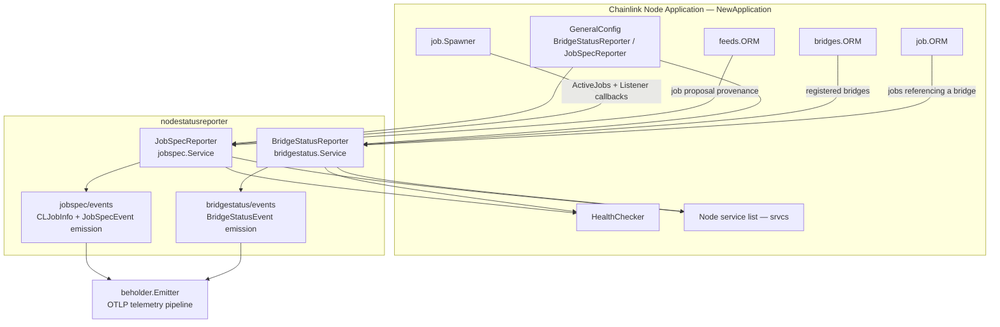
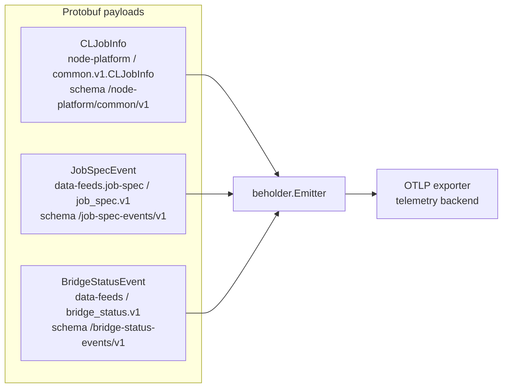
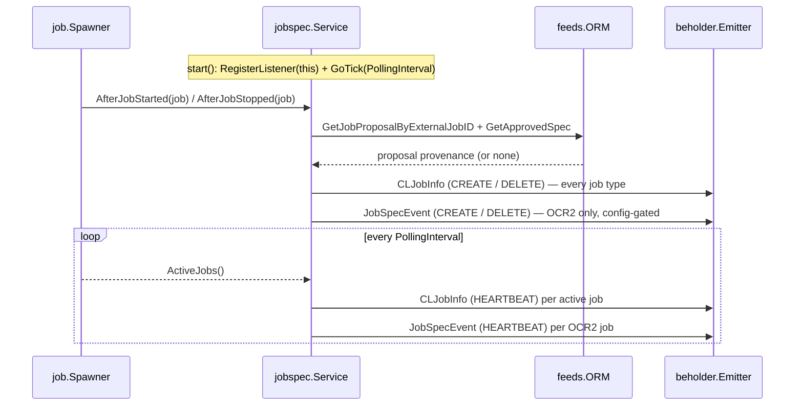
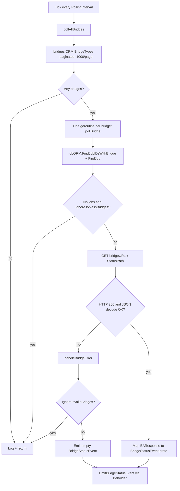

# Node Status Reporter (`nodestatusreporter`)

> Parent module: [Node Platform Services](../Node_Platform_Services.md)

## 1. Overview

The `node_status_reporter` module (`chainlink/core/services/nodestatusreporter/`) contains two long-running, telemetry-only services that export node-internal state to the **Beholder** observability platform (see [beholder-telemetry](../Telemetry___Observability_Platform/beholder-telemetry.md)):

| Service | Package | What it reports |
|---|---|---|
| **JobSpecReporter** | `.../nodestatusreporter/jobspec` | Job definitions and lifecycle events for **every active job** on the node (create/delete/heartbeat), plus a legacy OCR2-only `JobSpecEvent` payload |
| **BridgeStatusReporter** | `.../nodestatusreporter/bridgestatus` | Health, version, endpoints, configuration and associated jobs of every registered **External Adapter (bridge)**, fetched from the adapter's own status endpoint |

Key characteristics:

- **Observability-only**: neither service is on the transactional or oracle data path. Emission failures are logged as warnings and never affect node operation.
- **Beholder-backed**: both services serialize protobuf events and hand them to the global `beholder.Emitter` (`beholder.GetEmitter()`). Where Beholder is disabled (the default), emission is effectively a no-op, although the services themselves still run.
- **Periodic + event-driven**: both use the shared `services.Engine` ticker (`chainlink-common/pkg/services`) for periodic polls; the jobspec reporter additionally reacts to job start/stop events.
- **Health-checked**: both expose `HealthReport()` keyed by their service name (`JobSpecReporter`, `BridgeStatusReporter`) and are registered with the node's `HealthChecker`.

## 2. Architecture

### 2.1 Component graph



### 2.2 Wiring into the node

Both reporters are constructed in `NewApplication` (`chainlink/core/services/chainlink/application.go`) and appended to the node's service list, which is started by `Node.Start` via a multi-start and registered with the health checker:

```go
// application.go
bridgeStatusReporter := bridgestatus.NewBridgeStatusReporter(
        cfg.BridgeStatusReporter(), bridgeORM, jobORM, unrestrictedHTTPClient,
        beholder.GetEmitter(), globalLogger,
)
srvcs = append(srvcs, bridgeStatusReporter)
...
jobSpecReporter := jobspec.NewJobSpecReporter(
        cfg.JobSpecReporter(), jobSpawner, feedsORM, beholder.GetEmitter(),
        csaPubKeyHex, static.Version, hostname, globalLogger,
)
srvcs = append(srvcs, jobSpecReporter)
```

Dependency notes:

- The JobSpecReporter receives the node's **CSA public key** (built from the keystore), the **node version** and the **hostname** as static identity fields stamped onto every event.
- The `feeds.ORM` passed to the JobSpecReporter is `nil` unless the `Feature.FeedsManager` feature is enabled; the reporter treats a nil ORM as "no provenance available".
- The BridgeStatusReporter deliberately receives the **unrestricted** HTTP client, since it makes outbound calls to third-party adapter hosts.

### 2.3 Event flow to Beholder



All three schemas live as generated protobuf code under each sub-package's `events/` directory (e.g. `bridgestatus/events/bridge_status.proto`).

## 3. Sub-modules

The module splits cleanly along its two service packages:

### 3.1 `jobspec` — Job Spec Reporter

📄 Detailed documentation: [node_status_reporter_jobspec](node_status_reporter/node_status_reporter_jobspec.md) → `Node_Platform_Services/node_status_reporter/node_status_reporter_jobspec.md`

A `job.Listener` service that reports job lifecycle for **all job types** through a dual-payload design:

- **CLJobInfo track (current, universal)**: emitted for CREATE/DELETE triggers and per-job HEARTBEAT ticks. Carries node identity (CSA key, version, hostname), job metadata, the entire job spec serialized as TOML, and — when available — Feeds Manager provenance (feeds manager ID, remote UUID, spec version, proposed/approved timestamps).
- **JobSpecEvent track (legacy, OCR2-only)**: gated by `JobSpecReporter.Enabled()` plus the OCR2 plugin-type allowlist. Carries rich OCR2 detail: pipeline DOT-DAG source, extracted bridge names, and typed OCR2 EVM relay config (`OCR2EVMRelayConfig`) / median plugin config (`OCR2MedianPluginConfig`).

### 3.2 `bridgestatus` — Bridge Status Reporter

📄 Detailed documentation: [node_status_reporter_bridgestatus](node_status_reporter/node_status_reporter_bridgestatus.md)

A polling service that, on each tick, pages through **all registered bridges** (1,000 per page), fetches each adapter's status endpoint concurrently, decodes the `EAResponse` JSON (adapter name/version/uptime, runtime, metrics, endpoints, configuration items), enriches it with the jobs that reference the bridge, and emits a `BridgeStatusEvent`. Error handling is configurable: invalid or jobless bridges can be ignored, or an empty event can still be emitted to signal "unreachable" on the telemetry side.

## 4. Configuration

Both reporters are driven by config interfaces defined in `chainlink/core/config`:

| Interface | File | Knobs |
|---|---|---|
| `config.BridgeStatusReporter` | `chainlink/core/config/bridge_status_config.go` | `Enabled`, `StatusPath` (path appended to the bridge URL), `PollingInterval` (enforced minimum: `MinimumPollingInterval = time.Minute`), `IgnoreInvalidBridges`, `IgnoreJoblessBridges` |
| `config.JobSpecReporter` | `chainlink/core/config/job_spec_reporter_config.go` | `Enabled` (legacy OCR2 track only), `PollingInterval`, `EnabledOCR2PluginTypes` (allowlist of OCR2 plugin types, e.g. `["median"]`; `["all"]` enables everything; empty disables the legacy track) |

Operational behavior implied by config:

- The JobSpecReporter's `start()` **always runs** (registers the listener and ticker) because the CLJobInfo track requires no per-node opt-in — only the legacy `JobSpecEvent` track is gated by `Enabled()` (see `ShouldEmit`).
- The BridgeStatusReporter's `start()` is a **no-op when disabled**.
- Actual event delivery additionally requires Beholder to be configured; with Beholder disabled (default) both reporters emit nothing.

## 5. Runtime flow

### 5.1 JobSpecReporter lifecycle



A failure on one track never suppresses the other: `emit()` logs a warning for a failed CLJobInfo and still attempts the legacy event, and vice versa. If a job spec cannot be TOML-encoded, the CLJobInfo is still emitted without `spec_toml` and the error is returned for logging.

### 5.2 BridgeStatusReporter polling cycle



## 6. Relationship to other modules

| Dependency | Relationship | Documentation |
|---|---|---|
| `job.Spawner` / `job.Listener` | The jobspec reporter registers as a listener and reads `ActiveJobs()`; lifecycle contracts defined by the job service | [job_service](job_service.md) |
| `feeds.ORM` | Source of job-proposal provenance (feeds manager ID, remote UUID, spec version, approval timestamps) | [feeds_service](feeds_service.md) |
| `pipeline` package | Parsing of job DOT-DAG sources to extract bridge task names for the legacy event | [pipeline](../Oracle_Engines___Data_Pipelines/pipeline.md) |
| `bridges.ORM` | Registry of configured bridges polled by the bridge status reporter | [bridges](../Node_Application_Core___Interfaces/bridges.md) |
| Beholder | Emission transport for all protobuf telemetry payloads | [beholder-telemetry](../Telemetry___Observability_Platform/beholder-telemetry.md) |
| `core/config` | `JobSpecReporter` / `BridgeStatusReporter` config interfaces and TOML docs | [core_config](../Node_Application_Core___Interfaces/core_config.md) |

## 7. Source map

```
chainlink/core/services/nodestatusreporter/
├── jobspec/
│   ├── job_spec_reporter.go        # Service, dual-track emission, OCR2 spec mapping
│   ├── cl_job_info.go              # BuildCLJobInfo / EmitCLJobInfo, NodeIdentity, JobProposal
│   ├── events/                     # JobSpecEvent proto + emit helpers
│   ├── job_spec_reporter_test.go
│   └── cl_job_info_test.go
└── bridgestatus/
    ├── bridge_status_reporter.go   # Service, polling, EAResponse → BridgeStatusEvent mapping
    ├── types.go                    # EAResponse schema, JobInfo
    ├── events/                     # BridgeStatusEvent proto + emit helpers
    ├── mocks/, fixtures/           # Test support
    └── bridge_status_reporter_test.go
```
