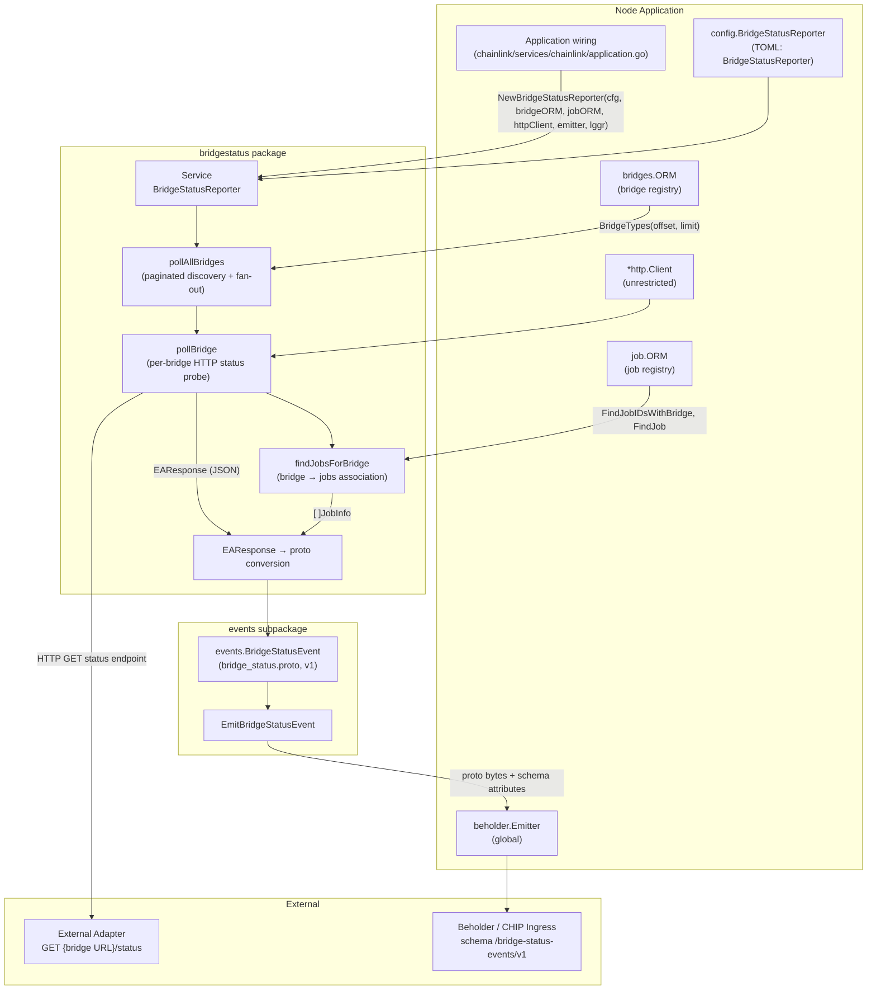
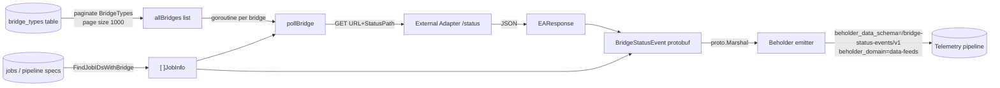
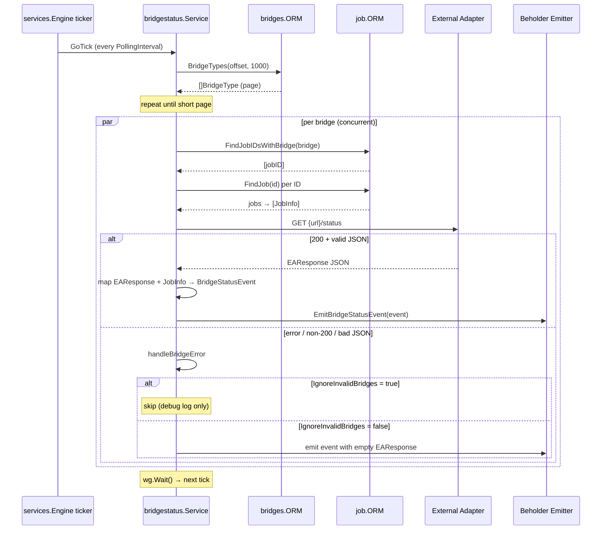
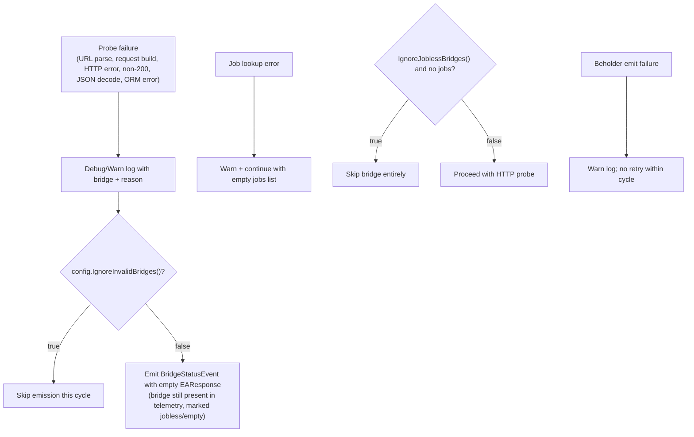

# Node Status Reporter: Bridge Status (`bridgestatus`)

## Introduction

The `bridgestatus` package (`chainlink/core/services/nodestatusreporter/bridgestatus`) implements the **Bridge Status Reporter** service: a background service that periodically polls the *status endpoints* of every registered [External Adapter (bridge)](../../Node_Application_Core___Interfaces/bridges.md), converts each adapter's self-described status into a versioned protobuf event, and emits that event to the [Beholder telemetry platform](../../Telemetry___Observability_Platform/beholder-telemetry.md).

Its purpose is observability: operators and downstream pipelines gain a continuously refreshed, structured inventory of which bridges a node uses, which adapter versions and endpoints they expose, how they are configured, which node jobs consume them, and whether they are alive. The service is entirely read-only with respect to node state and off-node with respect to data (nothing is persisted locally — events go straight to telemetry).

It is one of two reporters under the [Node Status Reporter](../node_status_reporter.md) umbrella; the sibling [Job Spec Reporter](node_status_reporter_jobspec.md) emits job-spec telemetry using the same service framework and Beholder emitter.

| Aspect | Detail |
|---|---|
| Package path | `chainlink/core/services/nodestatusreporter/bridgestatus` |
| Service name | `BridgeStatusReporter` |
| Core types | `EAResponse`, `JobInfo` (`types.go`), `Service` (`bridge_status_reporter.go`) |
| Runtime trigger | Periodic ticker at `BridgeStatusReporter.PollingInterval` |
| Output | `bridge_status.v1.BridgeStatusEvent` protobuf → Beholder emitter |
| Enabled by default | No (`[BridgeStatusReporter].Enabled = false`) |

---

## Architecture

The service is assembled in the node's application wiring (`chainlink/core/services/chainlink/application.go`) with five injected dependencies: the reporter configuration slice of `GeneralConfig`, the bridges ORM, the job ORM, an unrestricted HTTP client, and the global Beholder emitter. Once constructed it joins the node's standard service list and is lifecycle-managed (Start/Close) by the [job service lifecycle](../job_service/job_service_lifecycle.md) pattern shared by all core services (`chainlink-common/pkg/services`).



### Key files

| File | Role |
|---|---|
| `bridgestatus/types.go` | Wire schemas: `EAResponse` (External Adapter status response contract) and `JobInfo` (bridge→job association) |
| `bridgestatus/bridge_status_reporter.go` | `Service`: polling loop, HTTP probing, error handling, event conversion and emission |
| `bridgestatus/events/bridge_status.proto` | Protobuf v1 schema for the emitted telemetry event |
| `bridgestatus/events/emit.go` | `EmitBridgeStatusEvent`: timestamping, proto marshalling, attributed emission |
| `bridgestatus/events/types.go` | Telemetry constants: `bridge_status.v1` package, `BridgeStatusEvent` entity, `/bridge-status-events/v1` schema |
| `bridgestatus/events/generate.go` | `go:generate` directive for protobuf codegen |
| `bridgestatus/mocks/` | Test doubles: config, HTTP client, Beholder emitter |

---

## Core Data Types

### `EAResponse` — External Adapter status contract

`EAResponse` mirrors the JSON response schema of the External Adapter *status endpoint* (by default `GET {bridge-URL}/status`). It is the single place where the adapter-side contract is defined:

| Section | Fields | Meaning |
|---|---|---|
| `adapter` | `name`, `version`, `uptimeSeconds` | Adapter identity and process uptime |
| `endpoints` | `name`, `aliases[]`, `transports[]` | The adapter's advertised API surface |
| `defaultEndpoint` | string | Endpoint used when a job does not specify one |
| `configuration` | `name`, `value`, `type`, `description`, `required`, `default`, `customSetting`, `envDefaultOverride` | Self-described configuration knobs of the adapter |
| `runtime` | `nodeVersion`, `platform`, `architecture`, `hostname` | Host environment running the adapter |
| `metrics` | `enabled`, `port?`, `endpoint?` | Whether/how the adapter exposes its own metrics |

### `JobInfo` — bridge-to-job association

`JobInfo` (the module's registered core type) is the minimal, stable identity of a node job that references a bridge:

```go
type JobInfo struct {
    ExternalJobID string
    Name          string
}
```

- `ExternalJobID` is the job's UUID (from `job.Job.ExternalJobID`), the canonical cross-reference key used in telemetry.
- `Name` is the human-readable job name, defaulting to `"unknown"` when unset/empty.

On the telemetry side this maps to `events.JobInfo` (`external_job_id`, `job_name`) in the protobuf event, allowing consumers to correlate adapter health with the node jobs that depend on it.

---

## Configuration

Configuration is exposed through the `[BridgeStatusReporter]` TOML stanza (parsed into `config/toml.BridgeStatusReporter`, surfaced on `GeneralConfig` via `cfg.BridgeStatusReporter()`), consumed by the service through the `config.BridgeStatusReporter` interface (`chainlink/core/config/bridge_status_config.go`):

```go
type BridgeStatusReporter interface {
    Enabled() bool
    StatusPath() string
    PollingInterval() time.Duration
    IgnoreInvalidBridges() bool
    IgnoreJoblessBridges() bool
}
```

Defaults (from `chainlink/core/config/docs/core.toml`, section `[BridgeStatusReporter]`; the package also declares `MinimumPollingInterval = time.Minute`):

| Setting | Default | Effect |
|---|---|---|
| `Enabled` | `false` | Service is a no-op if disabled — `start()` logs and returns without arming the ticker |
| `StatusPath` | `"/status"` | Path appended to each bridge's URL to form the status endpoint |
| `PollingInterval` | `"5m"` | Cadence of the polling ticker |
| `IgnoreInvalidBridges` | `true` | Skip emitting telemetry for bridges that error or return non-200/invalid payloads |
| `IgnoreJoblessBridges` | `false` | Skip bridges that have no associated jobs |

The service deliberately receives the **unrestricted** HTTP client at wiring time (bridge URLs are operator-configured external endpoints, not chain RPCs). For the companion reporter and its own TOML stanza, see the [Job Spec Reporter](node_status_reporter_jobspec.md).

---

## Data Flow

One poll cycle moves data through four stages: discovery → association → probing → emission.



Stage details:

1. **Discovery** — `pollAllBridges` pages through `bridgeORM.BridgeTypes(ctx, offset, limit)` in fixed pages of 1,000 (`bridgePollPageSize`) until a short page marks the end. If the ORM call fails, the cycle is abandoned for that tick (debug-logged, retried next tick). Zero bridges is also a quiet no-op.
2. **Association** — for each bridge, `findJobsForBridge` resolves `jobORM.FindJobIDsWithBridge(ctx, bridgeName)` and then hydrates each ID via `jobORM.FindJob`. Individual hydration failures are skipped (logged at debug), so a partially-broken job row does not block the bridge probe. This is the only source of the `JobInfo` values carried in the event.
3. **Probing** — the bridge URL is parsed; the status URL is rebuilt as *scheme + host + `path.Join(originalPath, StatusPath())`* and fetched with a context-carrying GET. Any non-200 response or JSON decode failure is treated as an invalid bridge.
4. **Emission** — `emitBridgeStatus` maps `EAResponse` fields and `[]JobInfo` into an `events.BridgeStatusEvent`, then `events.EmitBridgeStatusEvent` stamps `Timestamp` (RFC3339Nano, if not already set), proto-marshals the message and hands the bytes to the Beholder emitter annotated with the schema/domain/entity attributes defined in `events/types.go`.

All probes in a cycle run concurrently (one goroutine per bridge, joined by a `sync.WaitGroup`), so a single slow or hanging adapter does not linearly extend the cycle.

---

## Polling Sequence



---

## Error-Handling Semantics

The service has a deliberately simple, telemetry-centric failure model:



Notable behaviours:

- **Disappearance is observable.** When `IgnoreInvalidBridges = false`, a dead adapter still produces an event (with empty adapter fields), letting dashboards distinguish "adapter down" from "bridge removed / never polled".
- **No local persistence or retry.** A failed emission is warned about and lost until the next tick; delivery guarantees, if needed, come from the Beholder/CHIP Ingress pipeline itself (see [Beholder telemetry](../../Telemetry___Observability_Platform/beholder-telemetry.md) and the node's durable-emitter settings under `[Telemetry]`).
- **Health reporting.** `HealthReport()` returns `{ServiceName: s.Ready()}`, integrating the service into the node's standard health-check surfaces.

---

## Telemetry Event Schema

The emitted contract is generated from `bridgestatus/events/bridge_status.proto` (package `bridge_status.v1`):

| Message | Contents |
|---|---|
| `BridgeStatusEvent` | `bridge_name`, `adapter_name`, `adapter_version`, `adapter_uptime_seconds`, `default_endpoint`, `runtime`, `metrics`, `endpoints[]`, `configuration[]`, `jobs[]`, `timestamp` |
| `RuntimeInfo` | `node_version`, `platform`, `architecture`, `hostname` |
| `MetricsInfo` | `enabled` |
| `EndpointInfo` | `name`, `aliases[]`, `transports[]` |
| `ConfigurationItem` | `name`, `value`, `type`, `description`, `required`, `default_value`, `custom_setting`, `env_default_override` |
| `JobInfo` | `external_job_id`, `job_name` |

Conversion notes: `EAResponse` values of type `any` (configuration `value`, `default`, `envDefaultOverride`) are rendered with `fmt.Sprintf("%v")` and `nil` becomes `""` — the schema intentionally stringifies adapter-reported configuration. Emission attributes: `beholder_data_schema = /bridge-status-events/v1`, `beholder_domain = data-feeds`, `beholder_entity = bridge_status.v1.BridgeStatusEvent`.

---

## Integration with the Node

In `chainlink/core/services/chainlink/application.go`, `NewApplication` constructs the service after the ORM graph exists:

```go
bridgeStatusReporter := bridgestatus.NewBridgeStatusReporter(
        cfg.BridgeStatusReporter(),
        bridgeORM,
        jobORM,
        unrestrictedHTTPClient,
        beholder.GetEmitter(),
        globalLogger,
)
srvcs = append(srvcs, bridgeStatusReporter)
```

Consequences of this wiring:

- **Shared registry state.** It reads the same `bridge_types` rows managed through the [bridges](../../Node_Application_Core___Interfaces/bridges.md) module (CLI/Web API CRUD) and the same job store maintained by the [job service](../job_service.md) — no separate persistence of its own.
- **Standard lifecycle.** As a `services.ServiceCtx` it starts/stops with the node; the ticker only arms when `Enabled()` is true.
- **Platform-scoped telemetry.** Together with the [Job Spec Reporter](node_status_reporter_jobspec.md) it is part of the node-status telemetry family under [Node Platform Services](../node_status_reporter.md); events share the Beholder transport used by [CHIP Ingress](../../Telemetry___Observability_Platform/chip-ingress.md)-backed telemetry.

---

## Testing Support

The module ships first-party mocks and fixtures enabling isolated tests:

- `mocks/config.go` — `TestBridgeStatusReporterConfig` / `NewTestBridgeStatusReporterConfig(enabled, statusPath, pollingInterval)` (and a variant accepting the two ignore flags), implementing the `config.BridgeStatusReporter` interface.
- `mocks/beholder_emitter.go`, `mocks/http_client.go` — captured emissions and scriptable HTTP responses.
- `fixtures/` — sample adapter status JSON payloads decoded into `EAResponse` by the test helpers.
- `bridge_status_reporter_test.go` — exercises construction, pagination, jobless/invalid-bridge flag behaviour, and end-to-end proto emission against an `httptest` server, using `bridges/mocks.ORM` and `services/job/mocks.ORM`.

---

## Related Documentation

- [Node Status Reporter (parent)](../node_status_reporter.md)
- [Job Spec Reporter (sibling reporter)](node_status_reporter_jobspec.md)
- [Bridges — bridge registry and External Adapter types](../../Node_Application_Core___Interfaces/bridges.md)
- [Job Service — job ORM and lifecycle](../job_service.md)
- [Beholder Telemetry — emitter platform and schemas](../../Telemetry___Observability_Platform/beholder-telemetry.md)
- [CHIP Ingress — telemetry transport](../../Telemetry___Observability_Platform/chip-ingress.md)
