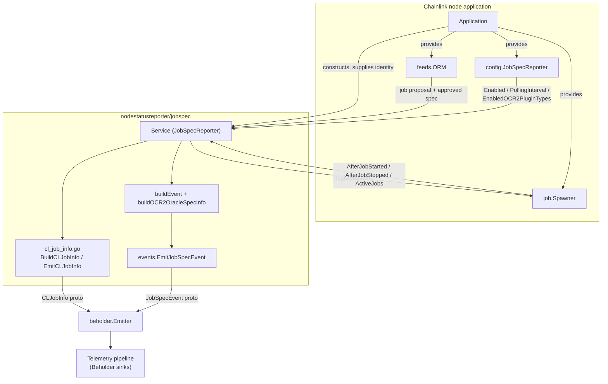
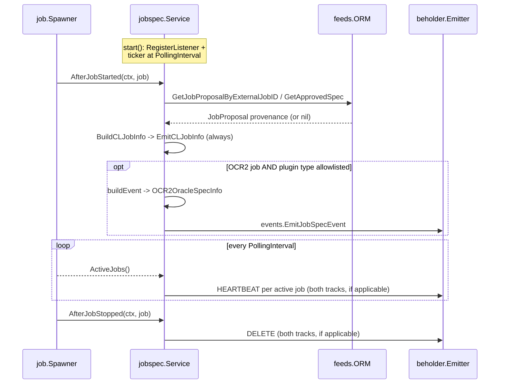
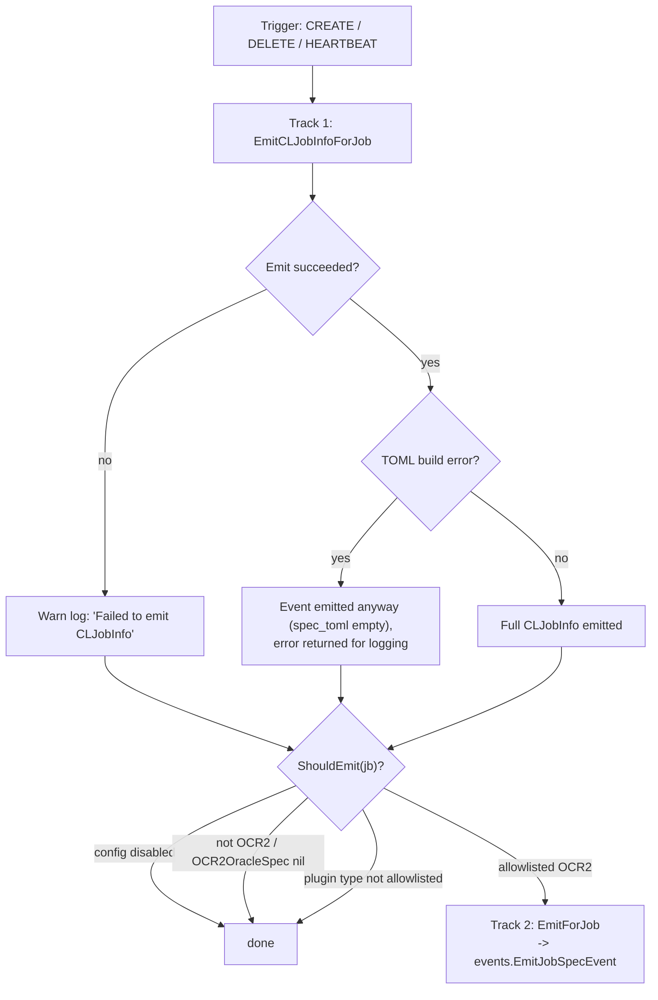
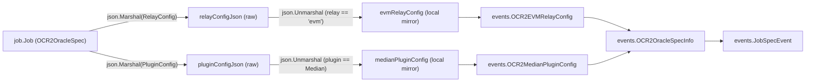

# Node Status Reporter — Job Spec Reporter (`jobspec`)

The `jobspec` module (`chainlink/core/services/nodestatusreporter/jobspec`) implements the **JobSpecReporter**, a node-side telemetry service that reports the node's *job inventory and job lifecycle* to off-node consumers. It polls active jobs and pushes their specifications to [Beholder](../../Telemetry___Observability_Platform/beholder-telemetry.md), and additionally emits create/delete events as jobs are started and stopped through the node's job spawner.

Every emission is published on **two tracks** from a single `emit()` call:

| Track | Payload | Scope | Gating |
|---|---|---|---|
| **CLJobInfo** (new, canonical) | `commonv1.CLJobInfo` proto | Every job type | Always emitted while the service runs — no per-node opt-in |
| **JobSpecEvent** (legacy) | `events.JobSpecEvent` proto | OCR2 (`OffchainReporting2`) jobs only | Gated by `[JobSpecReporter]` config; retained until its consumers migrate |

The service is a pure observer: it never mutates job state, writes to the database, or affects oracle operation. All it does is build protocol-buffer payloads and hand them to the Beholder emitter.

---

## 1. Position in the system

- **Parent:** [Node Status Reporter](../node_status_reporter.md) — the observability sub-group of [Node Platform Services](../../Node_Platform_Services.md), alongside the sibling [Bridge Status Reporter](node_status_reporter_bridgestatus.md) (which reports *bridge task run* status rather than job specs).
- **Consumed services:**
  - [Job service lifecycle](../job_service/job_service_lifecycle.md) — `job.Spawner` (job discovery + listener callbacks) and `job.Job` from the [job domain model](../job_service/job_service_domain_model.md).
  - [Feeds Service](../feeds_service.md) — `feeds.ORM` provides Job-Distributor provenance (job proposals / approved specs).
  - [Beholder telemetry](../../Telemetry___Observability_Platform/beholder-telemetry.md) — the outbound telemetry transport.
  - [Pipeline engine](../../Oracle_Engines___Data_Pipelines/pipeline.md) — `pipeline.Parse` used to re-hydrate a job's DAG when extracting bridge names.
- **Wiring:** constructed by the node application (see [Node Application Core & Interfaces](../../Node_Application_Core___Interfaces.md)), which supplies the `coreconfig.JobSpecReporter` config, the job `Spawner`, the feeds ORM, the Beholder emitter, and node identity fields (CSA public key, node version, hostname).

---

## 2. Architecture

### 2.1 Component overview



### 2.2 Service internals

The `Service` struct (source: `chainlink/core/services/nodestatusreporter/jobspec/job_spec_reporter.go`) embeds the common `services.Service` lifecycle engine and holds:

| Field | Role |
|---|---|
| `config coreconfig.JobSpecReporter` | Runtime configuration (see §3) |
| `spawner job.Spawner` | Source of active jobs and listener notifications |
| `feedsORM feeds.ORM` | Resolves Feeds-Manager provenance for jobs |
| `emitter beholder.Emitter` | Outbound telemetry transport |
| `csaPublicKey`, `nodeVersion`, `hostname` | Node identity stamped onto every event |

It satisfies the `job.Listener` interface (compile-time checked with `var _ job.Listener = (*Service)(nil)`):

```go
func NewJobSpecReporter(
    config coreconfig.JobSpecReporter,
    spawner job.Spawner,
    feedsORM feeds.ORM,
    emitter beholder.Emitter,
    csaPublicKey string,
    nodeVersion string,
    hostname string,
    lggr logger.Logger,
) *Service
```

The lifecycle is built with the standard [services engine](../job_service/job_service_lifecycle.md) (`services.Config{Name: ServiceName, Start: s.start}.NewServiceEngine(lggr)`), where `ServiceName = "JobSpecReporter"`.

---

## 3. Configuration

The service is configured through the `JobSpecReporter` config interface (`chainlink/core/config/job_spec_reporter_config.go`), backed by the TOML type in `chainlink/core/config/toml/types.go`; documented defaults live in `chainlink/core/config/docs/core.toml`:

| Method | TOML field | Meaning |
|---|---|---|
| `Enabled() bool` | `Enabled` | Gates the **legacy JobSpecEvent track only**. The CLJobInfo track never consults this flag. |
| `PollingInterval() time.Duration` | `PollingInterval` | Cadence of the heartbeat ticker. |
| `EnabledOCR2PluginTypes() []string` | `EnabledOCR2PluginTypes` | Allowlist of OCR2 plugin types to report (e.g. `["median"]`). An **empty slice disables all**; `["all"]` enables every plugin type. |

> Note: where Beholder itself is disabled (the node default), both tracks degrade to a no-op regardless of this configuration.

---

## 4. Runtime behavior and data flow

### 4.1 Startup and triggers

`start()` performs two actions:

1. `spawner.RegisterListener(s)` — subscribes to job start/stop notifications (safe before or after spawner start).
2. Starts a ticker at `config.PollingInterval()` whose tick runs `pollAllJobs`.

Three triggers feed the same `emit()` funnel:

| Trigger | Source | Emission semantics |
|---|---|---|
| `CREATE` | `AfterJobStarted(ctx, jb)` callback | Emitted once when a job starts successfully |
| `DELETE` | `AfterJobStopped(ctx, jb)` callback | Emitted once when a job is removed |
| `HEARTBEAT` | `pollAllJobs` ticker | Iterates `spawner.ActiveJobs()` (only jobs whose services started without error) and emits one event per job |



### 4.2 Dual-track emission funnel

Every trigger flows through `emit()`, which guarantees **a failure on one track never suppresses the other** — each failure is downgraded to a warning log:



---

## 5. Emission tracks in detail

### 5.1 Track 1 — `CLJobInfo` (generic, always on)

Implemented in `cl_job_info.go`:

- `BuildCLJobInfo(jb, trigger, identity, prop, now)` converts **any** `job.Job` into a `commonv1.CLJobInfo`: node identity (`CsaPublicKey`, `NodeVersion`, `Hostname`), job identity (`ExternalJobId`, `JobId`, `Name`, `JobType`, `SchemaVersion`, `ForwardingAllowed`, `GasLimit`, `StreamId`), timing fields as epoch milliseconds (`CreatedAtMs`, `TimestampMs`, `ProposedAtMs`, `ApprovedAtMs` — unset times map to `nil` rather than the epoch), and the **entire job definition serialized as TOML** (`SpecToml`), which is why no per-job-type code is needed.
- `EmitCLJobInfo` proto-marshals and publishes with Beholder attributes.

Beholder routing metadata:

| Payload | Domain | Entity | Data schema |
|---|---|---|---|
| `CLJobInfo` | `node-platform` | `common.v1.CLJobInfo` | `/node-platform/common/v1` |
| `JobSpecEvent` | `data-feeds.job-spec` | `job_spec.v1.JobSpecEvent` | `/job-spec-events/v1` (partition key = `ExternalJobId`) |

**Graceful degradation:** if TOML-encoding a job fails, `BuildCLJobInfo` still returns a fully populated payload with an empty `SpecToml` *and* the error, so the event is emitted and the problem is only logged.

### 5.2 Track 2 — legacy `JobSpecEvent` (OCR2 only)

`ShouldEmit(j *job.Job)` gates this track with, in order:

1. `jb == nil` or `!s.config.Enabled()` → **false**
2. `jb.Type != job.OffchainReporting2` or `jb.OCR2OracleSpec == nil` → **false**
3. Allowlist `EnabledOCR2PluginTypes()`: empty → **false**; contains `"all"` → **true**; otherwise contains `string(jb.OCR2OracleSpec.PluginType)` → **true**

`EmitForJob` builds the event via `buildEvent` and publishes it through `events.EmitJobSpecEvent` (the `events` package is a thin import shim over `github.com/smartcontractkit/chainlink-protos/data-feeds/job_spec/v1`, per `events/job_spec.pb.go`; constants in `events/types.go`).

`buildEvent` populates:

- Core identity: `ExternalJobId`, `Name`, `JobType`, `SchemaVersion`, `ForwardingAllowed`, `CreatedAt` (RFC3339Nano), `CsaPublicKey`, `NodeVersion`, `Hostname`, `EmissionTrigger`, `Timestamp`, optional `GasLimit` and `StreamId`.
- `ObservationSource` = the job's `PipelineSpec.DotDagSource`, plus `BridgeNames` (see §8).
- Feeds-Manager lifecycle fields (see §7), failures here are logged as warnings and do not abort emission.
- `Ocr2OracleSpec` — the deeply-parsed OCR2 spec info (see §6).

The `EmissionTrigger` enum (`EMISSION_TRIGGER_UNSPECIFIED | HEARTBEAT | CREATE | DELETE`) mirrors the CLJobInfo triggers one-to-one; `emit()` always translates between the two so the tracks stay in lock-step.

---

## 6. Core components: `evmRelayConfig` and `medianPluginConfig`

These two unexported structs are the module's named core components. They exist because the reporter must surface *typed* fields of OCR2 relay/plugin configuration in telemetry **without importing the EVM relay or median plugin packages** — each is a decode-only mirror of the corresponding config JSON, keeping `nodestatusreporter` decoupled from relay implementations.



### 6.1 `evmRelayConfig` → `OCR2EVMRelayConfig`

Applied only when `spec.Relay == "evm"`. Raw JSON is first unmarshalled into the mirror struct, then mapped onto the proto message:

| Mirror field (JSON key) | Go type | Proto field | Notes |
|---|---|---|---|
| `FromBlock` (`fromBlock`) | `*uint64` | `FromBlock` | Omitted when unset |
| `EffectiveTransmitterID` (`effectiveTransmitterID`) | `*string` | `EffectiveTransmitterId` | Overrides `spec.TransmitterID` when present |
| `EnableDualTransmission` (`enableDualTransmission`) | `*bool` | `EnableDualTransmission` | Optional |
| `EnableTriggerCapability` (`enableTriggerCapability`) | `*bool` | `EnableTriggerCapability` | Optional |
| `LLODonID` (`lloDonID`) | `*uint64` | `LloDonId` | Optional |
| `FeedID` (`feedID`) | `*string` | `FeedId` | Optional |
| `SendingKeys` (`sendingKeys`) | `[]string` | `SendingKeys` | Copied as-is |
| `ProviderType` (`providerType`) | `*string` | `ProviderType` | Optional |

Two values are sourced *outside* the JSON:

- `ChainId` — from `ocr2ChainID(spec)`: the spec's explicit `ChainID`, falling back to `spec.RelayID().ChainID` (empty string if neither resolves).
- `EffectiveTransmitterId` — `spec.TransmitterID` unless the relay config carries an explicit `effectiveTransmitterID` override.

### 6.2 `medianPluginConfig` → `OCR2MedianPluginConfig`

Applied only when `spec.PluginType == commontypes.Median`:

| Mirror field (JSON key) | Go type | Proto field |
|---|---|---|
| `JuelsPerFeeCoinPipeline` (`juelsPerFeeCoinSource`) | `*string` | `JuelsPerFeeCoinSource` |

### 6.3 Assembly: `buildOCR2OracleSpecInfo`

`buildOCR2OracleSpecInfo` converts a `*job.OCR2OracleSpec` into the proto `OCR2OracleSpecInfo`:

1. Marshals `spec.RelayConfig` and `spec.PluginConfig` to raw JSON strings (`RelayConfigJson`, `PluginConfigJson`) — preserving the complete config even for fields the reporter does not understand.
2. Copies scalar fields: `ContractId`, `Relay`, `PluginType`, `CaptureEaTelemetry`, and the optional `FeedId` (hex-encoded), `TransmitterId`, `OcrKeyBundleId`.
3. Conditionally attaches the parsed sub-messages: `EvmRelayConfig` for `relay == "evm"` and `MedianPluginConfig` for the median plugin (§6.1–6.2).

---

## 7. Provenance enrichment via the Feeds Manager

Jobs created through a Feeds Manager (Job Distributor) arrive as approved job proposals. Both tracks enrich their payloads with that provenance via the [Feeds Service ORM](../feeds_service.md):

- `jobProposal(ctx, jb)` — used by the CLJobInfo track. Returns `nil` (no provenance) when the feeds ORM is absent, the job has no external ID, or `GetJobProposalByExternalJobID` finds no rows (`sql.ErrNoRows`). If a proposal exists but has **no approved spec** (e.g. mid-cancellation), a partial `JobProposal{FeedsManagerID, RemoteUUID}` is returned. Errors are treated as enrichment failures, never as preconditions — a warning is logged and emission continues.
- `populateProposalLifecycle(ctx, jb, event)` — used by the legacy track to fill `FeedsManagerId`, `RemoteUuid`, `SpecVersion`, `ProposedAt`, `ApprovedAt`, and the derived **`AcceptLatencySeconds`** (`ApprovedAt − ProposedAt`). All `sql.ErrNoRows` cases are silent no-ops; real errors are logged and the event is still emitted.

Jobs created directly (CLI, UI, TOML on disk) simply carry no provenance fields.

---

## 8. Bridge name extraction

`extractBridgeNames(jb)` returns the names of `pipeline.BridgeTask` tasks contained in a job's **top-level pipeline**:

1. If the in-memory `jb.Pipeline` is available, names are read directly from its tasks.
2. Otherwise, if `PipelineSpec.DotDagSource` is non-empty, the DAG is re-parsed with `pipeline.Parse` (from the [pipeline module](../../Oracle_Engines___Data_Pipelines/pipeline.md)) and scanned again.
3. Tasks inside *sub-pipelines* (e.g. the `juelsPerFeeCoinSource` of a median job) are deliberately **not** included — only the top-level task list is scanned.

The result lands in `JobSpecEvent.BridgeNames`, complementing the [Bridge Status Reporter](node_status_reporter_bridgestatus.md), which reports on individual bridge *runs*.

---

## 9. Reliability and operational notes

- **Never fatal:** telemetry failures are logged via the service engine (`eng.Warnw`) and never propagate into job execution or node health. A job's start/stop path cannot be blocked by the reporter.
- **Health reporting:** `HealthReport()` returns `map[string]error{ServiceName: s.Ready()}`, integrating with the node's health checker (exposed by the [Application](../../Node_Application_Core___Interfaces.md)).
- **Single goroutine:** all work runs on the engine's goroutines (`eng.GoTick` for the heartbeat); there is no internal concurrency to reason about.
- **Memory-safety details:** optional fields are pointer-typed in the protos and only set when the source value is present (`GasLimit`, `StreamId`, `FeedId`, `TransmitterId`, `OcrKeyBundleId`, and every optional field in `OCR2EVMRelayConfig`); zero timestamps become `nil` epoch-millis rather than epoch values.
- **Dual-format costs:** during the migration window the node emits ~two payloads per trigger; the legacy track should be disabled (`[JobSpecReporter] Enabled = false`) once consumers are on `CLJobInfo`.

---

## 10. Testing

Unit tests live alongside the code:

- `chainlink/core/services/nodestatusreporter/jobspec/job_spec_reporter_test.go` — service lifecycle, trigger handling, gating logic.
- `chainlink/core/services/nodestatusreporter/jobspec/cl_job_info_test.go` — `CLJobInfo` building and TOML encoding behavior.
- `chainlink/core/services/nodestatusreporter/jobspec/events/emit_test.go` — proto marshalling and Beholder attribute routing.

---

## 11. Related documentation

- [Node Status Reporter (parent)](../node_status_reporter.md) and [Bridge Status Reporter (sibling)](node_status_reporter_bridgestatus.md)
- [Job Service — Lifecycle](../job_service/job_service_lifecycle.md) · [Job Service — Domain Model](../job_service/job_service_domain_model.md)
- [Feeds Service](../feeds_service.md)
- [Beholder Telemetry](../../Telemetry___Observability_Platform/beholder-telemetry.md) · [Telemetry & Observability Platform](../../Telemetry___Observability_Platform.md)
- [Pipeline Engine](../../Oracle_Engines___Data_Pipelines/pipeline.md)
- [Node Platform Services (root)](../../Node_Platform_Services.md) · [Node Application Core & Interfaces](../../Node_Application_Core___Interfaces.md)
