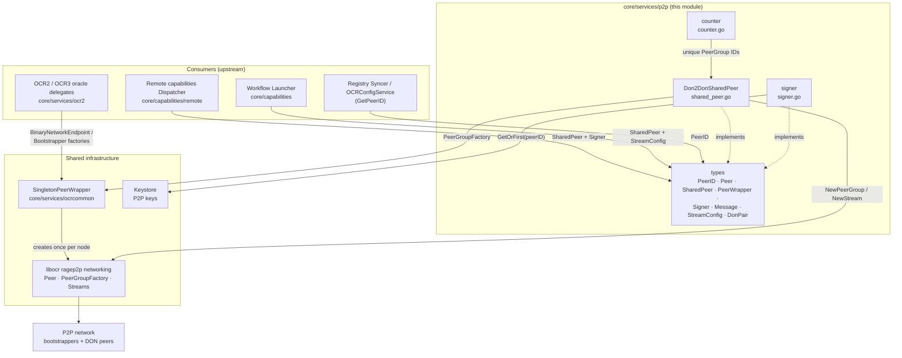
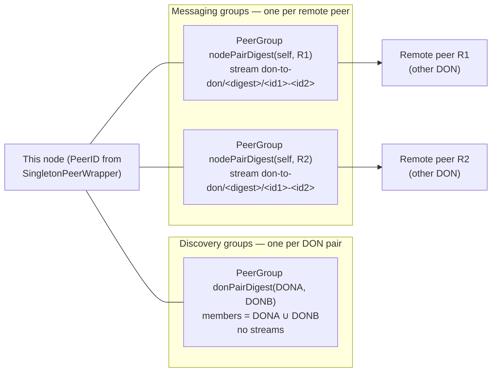
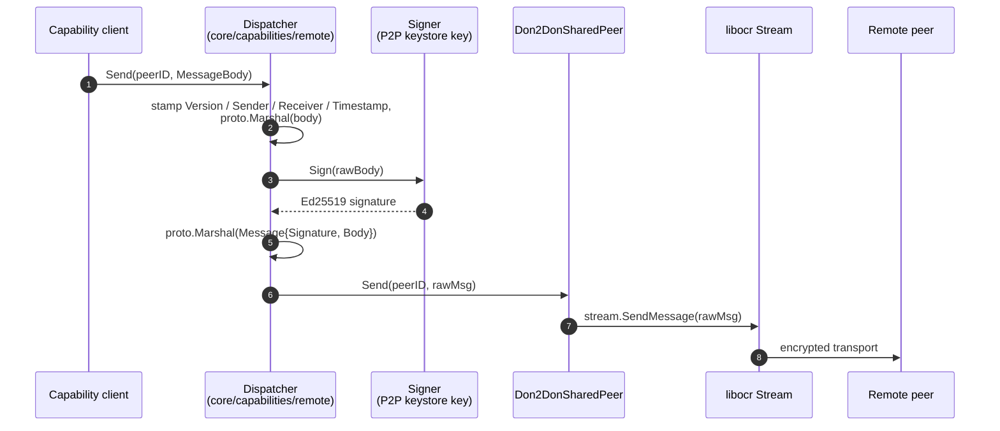
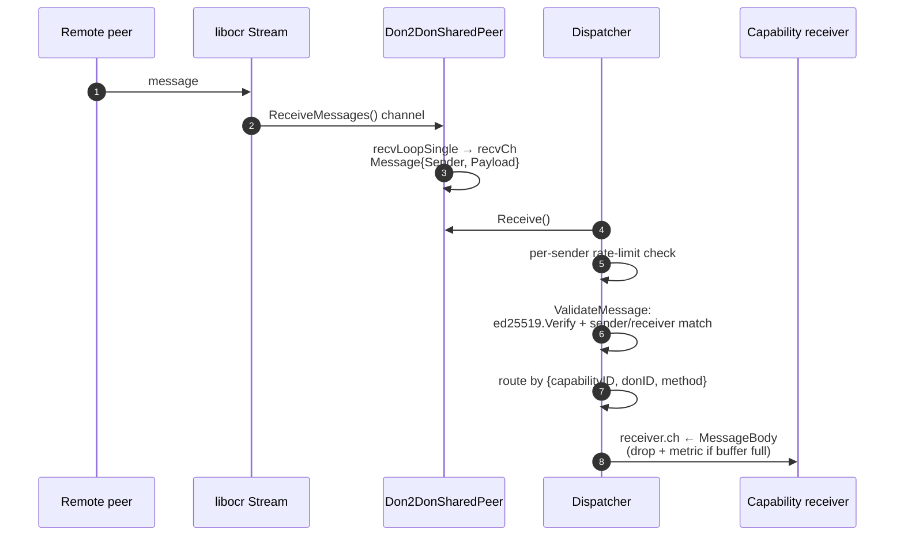
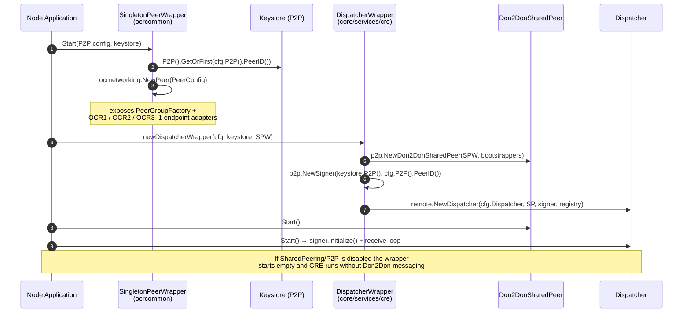

# P2P Networking Service (`chainlink/core/services/p2p`)

## Introduction

The `p2p` module provides the Chainlink node's **peer-to-peer messaging abstractions** — a small, transport-agnostic contract layer that all inter-node communication is built on. It defines the shared `Peer`, `SharedPeer`, `PeerWrapper` and `Signer` interfaces plus the wire types (`PeerID`, `Message`, `StreamConfig`), and ships two production implementations:

- **`Don2DonSharedPeer`** — a shared, DON-aware messaging peer that manages [libocr](https://github.com/smartcontractkit/libocr) `PeerGroup`s and per-peer streams for Don-to-Don (Don2Don) traffic, used primarily by the **remote capabilities dispatcher** in the CRE engine.
- **`signer`** — a lazily-initialized Ed25519 message signer backed by the node's P2P keystore key.

The module is intentionally thin: the actual networking (encryption, peer discovery, bootstrapping, rate limiting at the transport level) is delegated to libocr's `ragep2p` stack, which is instantiated once per node by the `SingletonPeerWrapper` (see [Integration](#integration-with-the-node)).

This module is a leaf of the [Node Platform Services](../Node_Platform_Services.md) group. It sits *below* the oracle engines and the capability runtime, and *above* nothing — it has no downstream consumers other than the network itself.

---

## Core Abstractions

All public contracts live in `chainlink/core/services/p2p/types/types.go`:

| Identifier | Kind | Description |
|---|---|---|
| `PeerID` | type alias (= `ragetypes.PeerID`) | 32-byte node identity. Fixed length `PeerIDLength = 32`. Doubles as the Ed25519 public key used to verify signed messages. Derived from the P2P keystore key. |
| `Peer` | interface | A single logical peer: lifecycle (`services.Service`), `ID()`, `UpdateConnections(map[PeerID]StreamConfig)`, `Send(peerID, msg)`, `Receive() <-chan Message`, `IsBootstrap()`. |
| `SharedPeer` | interface | Extends `Peer` with `UpdateConnectionsByDONs(ctx, donPairs []DonPair, streamConfig)`. Lets a single shared peer re-wire its connectivity from a declarative set of DON pairs instead of raw peer maps. |
| `DonPair` | type (`[2]capabilities.DON`) | An ordered pair of DON descriptors whose `Members` are `PeerID`s. Used to compute discovery group identity. See [capabilities](../Workflow___Capability_Runtime_(CRE_Engine)/capabilities.md). |
| `PeerWrapper` | interface | A service that vends a `Peer` via `GetPeer()`. The historical single-peer access path used by OCR2 job wiring. |
| `Signer` | interface | `Initialize()` (loads the key from the keystore) + `Sign(data)`. Initialization is deferred because the keystore is only usable after it is started and unlocked. |
| `Message` | struct | Wire envelope surfaced to consumers: `Sender PeerID` + raw `Payload []byte`. |
| `StreamConfig` | struct | Per-stream tuning: incoming/outgoing buffer sizes, `MaxMessageLenBytes`, and two `ragep2p.TokenBucketParams` rate limiters (`MessageRateLimiter`, `BytesRateLimiter`). |

### Design contract

Everything in the module implements [`services.Service`](../Shared_Foundation_Libraries___Domain_Types/services.md), so peers participate in the node's standard start/health/close lifecycle (see [node application lifecycle](../Node_Application_Core___Interfaces/node_application/node_application_lifecycle.md)).

---

## Module Architecture

The module operates on **two planes**, which is the key architectural fact to internalize:

1. **Oracle reporting plane** — OCR1/OCR2/OCR3.1 reporting plugins never talk to this module's `Peer` interface directly. They consume `BinaryNetworkEndpoint` / `BootstrapperFactory` adapters exposed by the `SingletonPeerWrapper`, which wraps the same underlying libocr peer. This module's role in that plane is limited to the `PeerWrapper` contract and the shared `types` vocabulary. See [OCR engines](../Oracle_Engines___Data_Pipelines/ocr.md).
2. **Don2Don capability plane** — a single shared `Peer` instance multiplexes arbitrary DON-to-DON traffic for the CRE engine (remote capabilities, workflow triggers/executables). This is the module's primary implementation surface.

---

## Don2Don Shared Peer (`don2DonSharedPeer`)

`shared_peer.go` implements `SharedPeer` on top of the `PeerGroupFactory` obtained from a started `SingletonPeerWrapper`. It manages two kinds of libocr `PeerGroup`s:

| Group type | Membership | Purpose | Streams |
|---|---|---|---|
| **Discovery groups** | *all* peers of exactly two DONs | Gossip-based peer discovery between DONs | none |
| **Messaging groups** | exactly two peers — this node + one remote peer | Don2Don message exchange | exactly one per group |

### Key behaviors

- **Deterministic identity.** Group identities are derived from DON IDs and sorted, SHA-256-hashed member lists (`pairID`), then folded into an `ocr2types.ConfigDigest` with the `ConfigDigestPrefixDONToDONDiscoveryGroup` / `...MessagingGroup` prefixes. Because DONs and member lists are canonically sorted, both endpoints of a pair independently compute the *same* group digest — this is what makes the peers meet in the same libocr group.
- **Declarative reconciliation.** `UpdateConnectionsByDONs` computes the desired set of DON pairs and remote peers, short-circuits when current state already matches (`stateEqual`), and otherwise closes obsolete groups *before* creating new ones (avoiding stale groups and duplicate DON-pair registrations) under a single write lock. Bootstrap nodes only build discovery groups — they never create messaging streams.
- **Reception fan-in.** Each remote-peer stream gets a `recvLoopSingle` goroutine that forwards `Message{Sender, Payload}` into a shared receive channel (default capacity `10000`).
- **Concurrency contract.** After `Start`, `Send` may be called concurrently from many goroutines; `UpdateConnectionsByDONs` may run concurrently with `Send` but only from a single goroutine.
- **Bootstrap detection.** `IsBootstrap()` is true when the node's own peer ID appears in the configured bootstrapper list.
- **`counter`** (`counter.go`) is a monotonic 64-bit helper that renders as a 32-byte value, used to generate unique PeerGroup IDs where a deterministic digest is not available.

### Metrics

`metrics.go` registers Beholder (OpenTelemetry) instruments on start:

| Metric | Type | Meaning |
|---|---|---|
| `platform_don2don_discovery_groups` | gauge | Current number of discovery PeerGroups (≥ number of remote DONs expected on non-bootstrap nodes) |
| `platform_don2don_messaging_groups` | gauge | Current number of messaging PeerGroups (= number of remote nodes connected to) |
| `platform_don2don_group_update_failure_total` | counter | Failed `UpdateConnectionsByDONs` calls |
| `platform_don2don_group_update_duration_ms` | histogram | Latency of connection updates |

See [Beholder telemetry](../Telemetry___Observability_Platform/beholder-telemetry.md) for how these are exported.

---

## Message Signing, Transport and Validation

Security of Don2Don traffic is layered:

1. **Transport** — libocr `ragep2p` handles authenticated, encrypted transport and peer identity (listen/announce addresses, bootstrappers).
2. **Application** — every capability `MessageBody` is Ed25519-signed with the sender's P2P keystore key. Because a `PeerID` *is* the Ed25519 public key, receivers verify signatures with no key lookup: `ed25519.Verify(body.Sender, topLevelMessage.Body, topLevelMessage.Signature)`.
3. **Policy** — token-bucket rate/size limits per stream (`StreamConfig`) plus an application-level per-sender rate limiter in the dispatcher.

### Outbound path

### Inbound path

`ValidateMessage` (in the remote-capabilities consumer) enforces three invariants before a message is accepted: valid protobuf framing, a signature that verifies against the claimed sender `PeerID`, and agreement between the envelope sender and the actual p2p sender (no relaying) and the expected receiver.

---

## Integration With the Node

The module is wired by the node application at startup. `chainlink/core/services/cre/cre.go` (`dispatcherWrapper.newSubservices`) performs the composition, and requires:

- top-level **`P2P.Enabled`** — peering must be enabled,
- **`Capabilities.SharedPeering.Enabled`** — the Don2Don plane must be enabled,
- a started **`SingletonPeerWrapper`** — source of the `PeerGroupFactory`.

Downstream effects of this wiring:

- The **workflow launcher** receives the `SharedPeer` plus a `StreamConfig` snapshot, so every workflow-capable service shares the same connectivity (see [core capabilities runtime](../Workflow___Capability_Runtime_(CRE_Engine)/core_capabilities_runtime.md) and [workflows](../Workflow___Capability_Runtime_(CRE_Engine)/workflows.md)).
- The **capabilities registry syncer** and **OCR config service** obtain the node identity through `dispatcherWrapper.GetPeerID()` (`core/services/cre/cre.go`), which simply forwards `SharedPeer.ID()`.
- If the shared peer is not configured, `GetPeerID` fails fast and the registry syncer is skipped — CRE services degrade gracefully rather than half-starting.

Bootstrapper precedence in `cre.go`: `Capabilities.SharedPeering.Bootstrappers` if non-empty, otherwise `P2P.V2.DefaultBootstrappers`.

---

## Configuration

Configuration interfaces consumed by this module (see [core config](../Node_Application_Core___Interfaces/core_config.md)):

### `P2P` (top-level, `core/config`)

| Accessor | Used for |
|---|---|
| `Enabled()` | Master switch; required for SharedPeering |
| `PeerID()` | Selects which keystore P2P key identifies this node |
| `IncomingMessageBufferSize()`, `OutgoingMessageBufferSize()` | Default stream buffer sizes for the oracle plane |
| `TraceLogging()`, `EnableExperimentalRageP2P()` | Diagnostics and opt-in ragep2p behavior |
| `V2().Enabled()` | libp2p-based peering generation |
| `V2().ListenAddresses()` | **Required** — `ValidatePeerWrapperConfig` rejects startup with "no P2P.V2.ListenAddresses specified" |
| `V2().AnnounceAddresses()` | Externally reachable addresses |
| `V2().DefaultBootstrappers()` | Fallback bootstrapper list for shared peering |
| `V2().DeltaDial()`, `V2().DeltaReconcile()` | libocr dial/reconcile intervals |

### `Capabilities.SharedPeering` (`core/config`)

| Accessor | Maps to |
|---|---|
| `Enabled()` | Gate for the Don2Don plane |
| `Bootstrappers()` | Explicit bootstrapper list (overrides `P2P.V2.DefaultBootstrappers`) |
| `StreamConfig()` | Translated 1:1 into `p2ptypes.StreamConfig`: `IncomingMessageBufferSize`, `OutgoingMessageBufferSize`, `MaxMessageLenBytes`, `MessageRateLimiter{Rate, Capacity}`, `BytesRateLimiter{Rate, Capacity}` |

### `Capabilities.Dispatcher` (`core/config`)

| Accessor | Used for |
|---|---|
| `ReceiverBufferSize()` | Per-capability receiver channel size in the dispatcher |
| `RateLimit()` | `GlobalRPS/GlobalBurst/PerSenderRPS/PerSenderBurst` applied to inbound messages |

---

## Testing Support

- `types/mocks/` — generated mocks for `Peer`, `PeerWrapper`, `SharedPeer` and `Signer` (see `chainlink/.mockery.yaml`).
- Unit tests cover the signer (`signer_test.go`), the shared peer group lifecycle (`shared_peer_test.go`) and the counter (`counter_test.go`).
- Test environments construct the same wiring through the `Opts.CapabilitiesDispatcher` / `Opts.CapabilitiesSharedPeer` injection points in `cre.go`, bypassing shared peering — the same pattern used by [system tests](../Dev,_Test___Simulation_Environments/system-tests.md).

---

## Related Documentation

- [Node Platform Services](../Node_Platform_Services.md) — sibling platform services.
- [Keystore](keystore.md) — owns the P2P (Ed25519) key that backs `PeerID` and `Signer`.
- [Node application lifecycle](../Node_Application_Core___Interfaces/node_application/node_application_lifecycle.md) — where `SingletonPeerWrapper` and CRE services start/stop.
- [OCR engines](../Oracle_Engines___Data_Pipelines/ocr.md) — the oracle plane sharing the same libocr peer via `SingletonPeerWrapper` adapters.
- [Core capabilities runtime](../Workflow___Capability_Runtime_(CRE_Engine)/core_capabilities_runtime.md) — dispatcher and launcher, the primary Don2Don consumers.
- [Job service](job_service.md) — the service lifecycle framework every peer embeds.
- [Beholder telemetry](../Telemetry___Observability_Platform/beholder-telemetry.md) — export of the `platform_don2don_*` metrics.

> **Source anchors:** core contracts in `chainlink/core/services/p2p/types/types.go`; implementations in `shared_peer.go`, `signer.go`, `counter.go`, `metrics.go`; wiring in `chainlink/core/services/cre/cre.go` and `chainlink/core/services/ocrcommon/peer_wrapper.go`; all part of the `chainlink` Go module (`chainlink/go.mod`).
