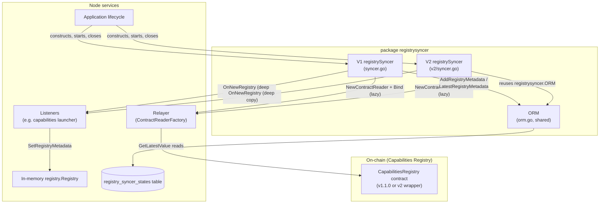
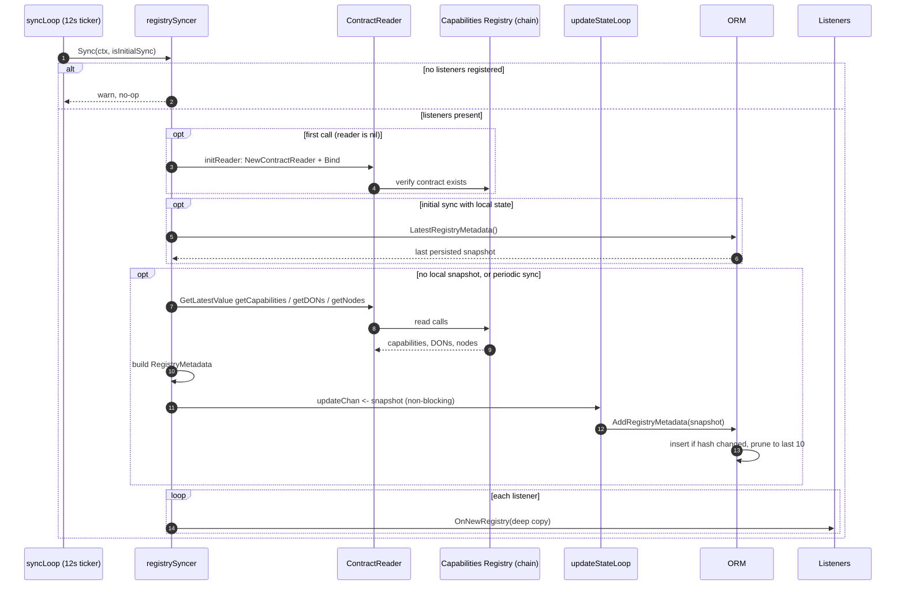
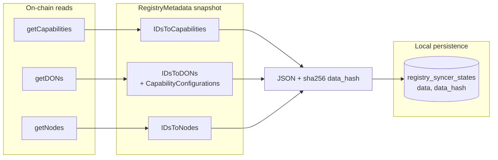

# Registry Syncer (`registrysyncer`)

The **Registry Syncer** is the node-side mirror of the on-chain **Capabilities Registry** contract used by Keystone / CRE. It periodically reads the registry's authoritative state — registered *capabilities*, *DONs* (Decentralized Operator Networks) and *nodes* — from the blockchain, assembles it into a `registry.RegistryMetadata` snapshot, persists that snapshot locally, and publishes it to in-process listeners that consume registry knowledge (most importantly the node's capabilities launcher / in-memory capability registry).

Because the on-chain contract exists in two generations, the package ships two syncer implementations that share the same skeleton:

| Package | Contract generation | Notes |
|---|---|---|
| `chainlink/core/services/registrysyncer` | Keystone `CapabilitiesRegistry` v1.1.0 | the original syncer; owns the shared `ORM` |
| `chainlink/core/services/registrysyncer/v2` | `CapabilitiesRegistry` v2 wrapper | richer reader surface, on-chain capability IDs, DON families |

The package lives in the main `chainlink` Go module (`chainlink/go.mod`), so the syncer is compiled directly into the node binary rather than running as a Loop plugin.

## Purpose and responsibilities

1. **Poll the chain** — every 12 seconds (and once immediately on startup) read `getCapabilities`, `getDONs` and `getNodes` from the Capabilities Registry via a `types.ContractReader`.
2. **Materialize a snapshot** — convert raw contract return values into a `registry.RegistryMetadata` (capabilities by full ID, DONs by ID with their capability configurations, nodes keyed by P2P peer ID).
3. **Persist locally** — store the JSON snapshot plus its SHA-256 hash in the `registry_syncer_states` table so the node can restore its last-known registry after a restart without waiting for a chain read.
4. **Notify consumers** — hand a deep copy of the snapshot to every registered `Listener` via `OnNewRegistry`. The production listener is the capabilities launcher, which installs the metadata into the in-memory [`*registry.Registry`](../Workflow___Capability_Runtime_(CRE_Engine)/capabilities.md) exposed by the application (`GetCapabilitiesRegistry()`).
5. **Self-observe** — expose health through the standard `services.Service` lifecycle and emit failure counters through Beholder/OpenTelemetry.

## Architecture overview

Each syncer runs two goroutines after `Start()`:

- `syncLoop` — performs the initial sync immediately, then ticks every 12 seconds (`defaultTickInterval`).
- `updateStateLoop` — consumes remote-import snapshots from `updateChan` and hands them to the `ORM` for persistence.

### Startup ordering and the lazy reader

`newReader` deliberately runs **inside** the sync loop, not during construction: `ContractReader.Bind` performs an on-chain call to verify the contract address, which fails with a *"no live nodes"* error if executed while the node's chain connectivity is still being established. Deferring reader initialization to the first `Sync` call avoids that race.

### Initial sync vs. periodic sync

- **Initial sync (`isInitialSync=true`)** — the syncer first tries `orm.LatestRegistryMetadata`. Restoring the last persisted snapshot lets the node resume with a known-good registry view without a chain round-trip. If the DB read fails (e.g. empty table), it logs a warning and falls back to importing the remote registry.
- **Periodic sync (`isInitialSync=false`)** — always imports the remote registry and pushes it through `updateChan` for persistence.

Only *remote* imports are pushed to `updateChan`; a restored local snapshot is delivered straight to listeners. The `updateChan` hand-off is non-blocking (`select` with a `default` branch) so a syncer whose state loop is not running (e.g. in tests without `Start()`) cannot deadlock.

## The synchronized data model

The unit of synchronization is `registry.RegistryMetadata` (from `chainlink-common/pkg/capabilities/registry`):

| Map | Key | Content |
|---|---|---|
| `IDsToCapabilities` | full capability ID (e.g. `write-chain@1.0.1` in v2; `name@version` reconstructed from hashed IDs in v1) | capability type (trigger / action / consensus / target) |
| `IDsToDONs` | `registry.DonID` | DON info (members as peer IDs, `F`, `IsPublic`, `AcceptsWorkflows`, config version; v2 adds `Name`, `Families`, `Config`) plus per-capability `CapabilityConfigurations` |
| `IDsToNodes` | P2P peer ID | node operator, signer, encryption public key, workflow + capabilities DON IDs, capability IDs (v2 adds `CsaKey`) |

The `RegistryMetadata` itself is the shared currency of the capabilities stack: the in-memory `registry.Registry` implements `CapabilitiesRegistryMetadata` over it, answering queries such as `LocalNode`, `DONsForCapability` and `ConfigForCapability` for the workflow engine. See [capabilities](../Workflow___Capability_Runtime_(CRE_Engine)/capabilities.md) for the consumer side.

## Sub-modules

Detailed documentation for each part of the module is generated under `registry_syncer/`:

| Sub-module | Contents | Documentation |
|---|---|---|
| **Persistence (ORM)** | `ORM` interface and PostgreSQL implementation over `registry_syncer_states`, hash-based deduplication and retention pruning | [registry_syncer/registry_syncer_persistence.md](registry_syncer/registry_syncer_persistence.md) |
| **V1 Syncer** | The original `RegistrySyncer` targeting the Keystone Capabilities Registry v1.1.0, listener fan-out, lifecycle and conversion helpers | [registry_syncer/registry_syncer_v1.md](registry_syncer/registry_syncer_v1.md) |
| **V2 Syncer** | `RegistrySyncer`/`Syncer` for the v2 Capabilities Registry: extended reader config, on-chain capability IDs, capability metadata parsing, DON families | [registry_syncer/registry_syncer_v2.md](registry_syncer/registry_syncer_v2.md) |

Note: the `ORM` documented in [registry_syncer/registry_syncer_persistence.md](registry_syncer/registry_syncer_persistence.md) is the single persistence implementation **shared by both** syncer generations — the V2 syncer imports `registrysyncer.ORM` from the parent package rather than defining its own.

### V1 vs. V2 at a glance

| Aspect | V1 (`registrysyncer`) | V2 (`registrysyncer/v2`) |
|---|---|---|
| Contract ABI | `capabilities_registry_1_1_0` generated wrapper | `capabilities_registry_wrapper_v2` |
| Reader methods | `getCapabilities`, `getDONs`, `getNodes` | adds `getDONsInFamily`, `getHistoricalDONInfo`, `getNode`, `getNodeOperator(s)`, `getNodesByP2PIds`, `isCapabilityDeprecated` |
| Capability identity | contract returns *hashed* IDs; syncer maps them back to full `name@version` IDs | contract returns full IDs; hash is computed locally via `HashCapabilityID` (shared CCIP helper) |
| Capability metadata | type from contract enum | JSON metadata `{capabilityType, responseType}` parsed per capability; unparseable entries are skipped with a warning |
| DON fields | ID, config count, members, F, isPublic, acceptsWorkflows | adds `Name`, DON `Families`, raw `Config` |
| Node fields | standard set | adds `CsaKey`; capability DON IDs kept as `*big.Int` |
| Reads | unpaginated | paginated with `Start=0, Limit=1024` (pagination TODO) |
| ORM dependency | defines the shared `ORM` interface | reuses the parent package's `ORM` |
| Shutdown ordering | `close(updateChan)` then `wg.Wait()` | `wg.Wait()` then `close(updateChan)` |

## Observability

Each syncer registers two OpenTelemetry counters through [Beholder](../Telemetry___Observability_Platform/beholder-telemetry.md) (see `monitoring.go` / `v2/monitoring.go`):

- `platform_registrysyncer_sync_failures` — incremented when a periodic remote sync fails.
- `platform_registrysyncer_launch_failures` — incremented when a listener's `OnNewRegistry` returns an error.

Health is surfaced through the standard `services.Service` contract (`HealthReport`, `Ready`, `Name`); the same lifecycle primitives used across the node are described in the [node application lifecycle](../Node_Application_Core___Interfaces/node_application/node_application_lifecycle.md) documentation.

## How it fits into the node

- **Wiring** — the [node application](../Node_Application_Core___Interfaces/node_application.md) constructs a syncer with a logger, a peer-ID getter, a `ContractReaderFactory` (the [relayer](../Shared_Foundation_Libraries___Domain_Types/types-core.md) bound to the configured chain), the Capabilities Registry address from node configuration, and the `ORM` backed by the node's [database layer](database_persistence.md). It starts the syncer during application start and closes it on shutdown.
- **Consumers** — listeners receive snapshots and feed the in-memory capability [registry](../Workflow___Capability_Runtime_(CRE_Engine)/capabilities.md) used by the [workflow/CRE runtime](../Workflow___Capability_Runtime_(CRE_Engine)/workflows.md).
- **Deployment counterpart** — the contract being mirrored is deployed and configured by the [CRE capabilities registry deployment suite](../CRE___Keystone_Deployment_Suite/cre-capabilities-registry.md); the syncer is read-only with respect to the chain.
- **Analogous pattern** — the [workflows registry syncer](../Workflow___Capability_Runtime_(CRE_Engine)/workflows.md) follows the same listener/service skeleton for workflow definitions.

## Related modules

- [keystore](keystore.md) — sibling platform service managing node keys.
- [job_service](job_service.md) — job ORM/spawner sharing the same service + ORM structuring conventions.
- [database_persistence](database_persistence.md) — the PostgreSQL primitives (`sqlutil.DataSource`, transactions) the ORM builds on.
- [capabilities](../Workflow___Capability_Runtime_(CRE_Engine)/capabilities.md) — capability types and the registry that consumes synced metadata.
