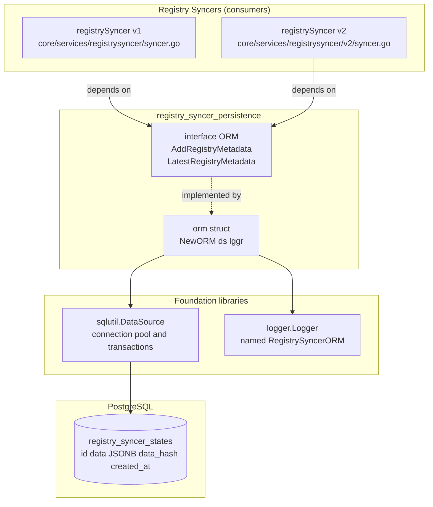
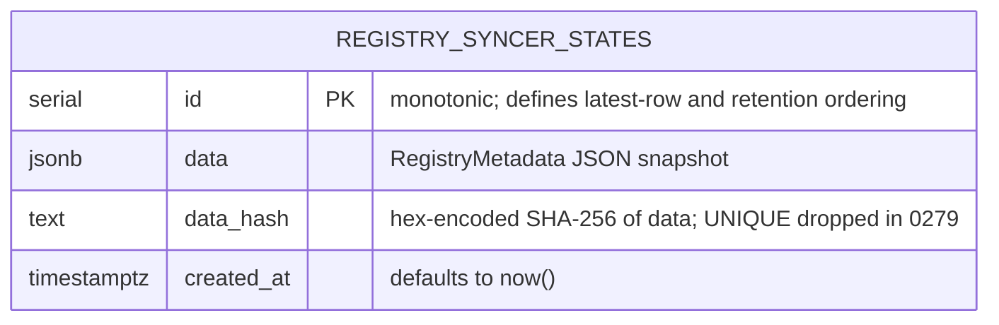
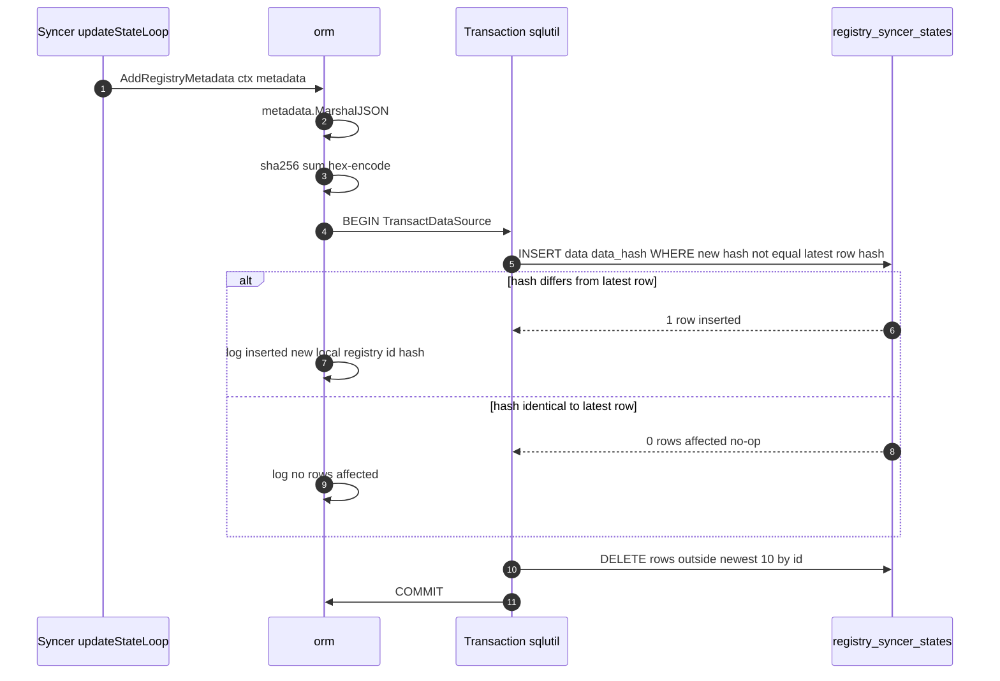
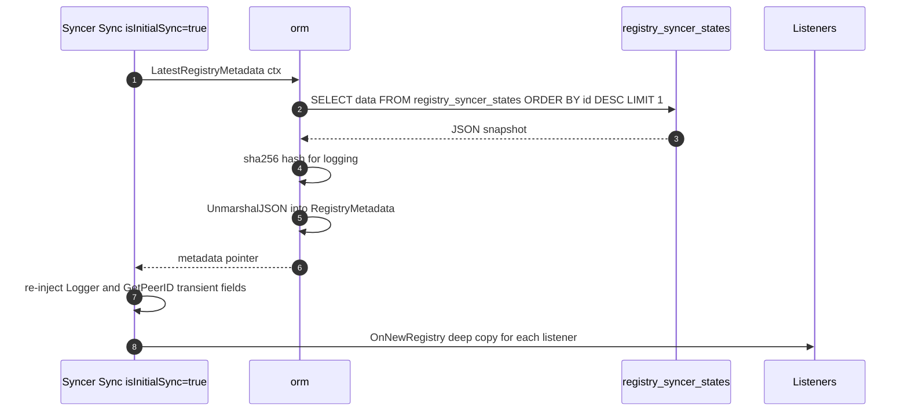
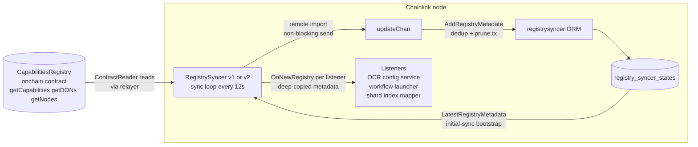

# Registry Syncer Persistence (`registrysyncer.ORM`)

## 1. Introduction

The **registry_syncer_persistence** module provides the durable storage layer for the [Registry Syncer](../registry_syncer.md) subsystem. It is a small, focused package — a single file, `chainlink/core/services/registrysyncer/orm.go` — that defines the `ORM` interface and its PostgreSQL-backed implementation.

Its single responsibility is to persist **snapshots of on-chain `CapabilitiesRegistry` metadata** (DONs, nodes, and capabilities) so that a node can:

- **Bootstrap quickly at startup** — hydrate the local registry view from the database instead of waiting for on-chain reads via a relayer (`Sync(ctx, isInitialSync=true)` path).
- **Survive RPC unavailability** — if the on-chain registry cannot be read at startup, the node still starts with the last-known-good registry state.
- **Avoid redundant writes** — content-hash deduplication means unchanged registry state is never re-written during the syncer's 12-second polling cycle.
- **Bound storage growth** — a retention rule keeps only the 10 most recent snapshots.

The module is consumed by both registry syncer generations, [registry_syncer_v1](registry_syncer_v1.md) and [registry_syncer_v2](registry_syncer_v2.md), which share this same ORM.

| Aspect | Detail |
|---|---|
| Source file | `chainlink/core/services/registrysyncer/orm.go` |
| Public interface | `ORM` |
| Implementation | unexported `orm` struct; constructed via `NewORM(ds, lggr)` |
| Storage | PostgreSQL table `registry_syncer_states` |
| Persisted payload | `registry.RegistryMetadata` (JSONB) |
| Retention | 10 most recent snapshots |
| Deduplication | SHA-256 hash compared against the latest row only |
| Consumed by | Registry Syncer v1, Registry Syncer v2 (via `core/services/cre` wiring) |

---

## 2. Architecture

### 2.1 Component overview



### 2.2 The `ORM` interface

```go
type ORM interface {
    AddRegistryMetadata(ctx context.Context, registryMetadata *registry.RegistryMetadata) error
    LatestRegistryMetadata(ctx context.Context) (*registry.RegistryMetadata, error)
}
```

| Method | Purpose |
|---|---|
| `AddRegistryMetadata` | Persist a registry snapshot inside a transaction, if and only if it differs from the most recent snapshot; then prune history to 10 rows. |
| `LatestRegistryMetadata` | Load the most recent snapshot and deserialize it into a `registry.RegistryMetadata`. |

### 2.3 The implementation

The unexported `orm` struct is compiled-time verified against the interface (`var _ ORM = (*orm)(nil)`) and holds exactly two dependencies:

```go
type orm struct {
    ds   sqlutil.DataSource  // Postgres access (see [pg layer])
    lggr logger.Logger       // named "RegistrySyncerORM"
}
```

`NewORM(ds, lggr)` wraps the provided logger with `logger.Named(lggr, "RegistrySyncerORM")` so every log line emitted by this module is attributable to the persistence layer. The implementation is stateless beyond its dependencies — it has no goroutines, no lifecycle (`Start`/`Close`) of its own, and is safe to share as long as the underlying `sqlutil.DataSource` is shared (which it is: the node passes its common connection pool; see [Database Persistence — pg layer](../database_persistence/database_persistence_pg_layer.md)).

---

## 3. Data model

### 3.1 Table: `registry_syncer_states`

The table is created by goose migration [`chainlink/core/store/migrate/migrations/0249_registry_syncer_state.sql`](../database_persistence/database_persistence_migrations.md):

```sql
CREATE TABLE registry_syncer_states (
    id SERIAL PRIMARY KEY,
    data JSONB NOT NULL,
    data_hash TEXT NOT NULL UNIQUE,
    created_at TIMESTAMPTZ NOT NULL DEFAULT now()
);
```

A later migration, [`0279_allow_duplicate_registry_hash.sql`](../database_persistence/database_persistence_migrations.md), **drops the `UNIQUE` constraint on `data_hash`**:

```sql
ALTER TABLE registry_syncer_states DROP CONSTRAINT registry_syncer_states_data_hash_key;
```

This is deliberate: the ORM only compares a new hash against the *latest* row, so a registry that oscillates A → B → A legitimately re-inserts hash A. The original unique constraint would reject that second occurrence.



### 3.2 What is serialized: `registry.RegistryMetadata`

The payload is `registry.RegistryMetadata` from `chainlink-common/pkg/capabilities/registry/metadata.go` — the shared domain type for capability-registry state (see [Capabilities & Registry](../../Workflow___Capability_Runtime_(CRE_Engine)/capabilities.md)). It holds three index maps:

- `IDsToDONs map[DonID]DON` — DON definitions plus per-capability configurations,
- `IDsToNodes map[PeerID]NodeInfo` — node operator, signer, P2P ID, encryption key, DON memberships,
- `IDsToCapabilities map[string]Capability` — capability IDs and types.

Serialization details that matter for persistence:

- The type defines custom `MarshalJSON`/`UnmarshalJSON` which convert node fields (signer, P2P ID, big.Int DON IDs) to JSON-safe representations.
- **Only the three maps are serialized.** The `Logger` and `GetPeerID` function fields are transient and never persisted; the syncer re-injects them after loading (see §5).
- The embedded `sync.RWMutex` used for local-node caching is also not serialized.

---

## 4. Write path — `AddRegistryMetadata`

### 4.1 Flow



### 4.2 Step-by-step

1. **Serialize & fingerprint.** The metadata is marshaled to JSON and hashed with SHA-256; the hex-encoded digest becomes `data_hash`. The hash is both the dedup key and a cheap audit fingerprint (it is logged without parsing the payload).
2. **Conditional insert.** Both the insert and the pruning happen inside a single transaction (`sqlutil.TransactDataSource`, from the shared [sqlutil](../../Shared_Foundation_Libraries___Domain_Types/sqlutil.md) package):

    ```sql
    INSERT INTO registry_syncer_states (data, data_hash)
    SELECT $1, $2
    WHERE $2 NOT IN (
        SELECT data_hash FROM registry_syncer_states
        ORDER BY id DESC LIMIT 1
    )
    ```

    The `WHERE` clause makes the write **idempotent**: if the new hash equals the hash of the most recent row, nothing is inserted (`RowsAffected() == 0`) and the ORM logs `"No rows affected, local registry updated."`. Because the syncer polls the on-chain registry every 12 seconds (`defaultTickInterval`), this check prevents an unbounded stream of identical rows.
3. **Retention prune.** Still inside the same transaction:

    ```sql
    DELETE FROM registry_syncer_states
    WHERE data_hash NOT IN (
        SELECT data_hash FROM registry_syncer_states
        ORDER BY id DESC LIMIT 10
    );
    ```

    This keeps the 10 most recent snapshots. The combination of dedup + retention means the table converges to at most 10 rows, holding up to 10 *distinct* historical registry states.
4. **Error wrapping.** Insert failures are wrapped as `failed to insert into registry_syncer: %w`; marshal errors and transaction failures propagate to the caller.

### 4.3 Failure semantics for callers

Persistence errors are **non-fatal to the sync loop**. Both syncer implementations invoke `AddRegistryMetadata` from a dedicated `updateStateLoop` goroutine that drains the `updateChan` channel; a failed save is only logged (`"failed to save state to local registry"`). The channel send from `Sync()` is deliberately non-blocking (`select` with a `default` case), so a slow or failing persistence layer never stalls on-chain reads or listener notification — it merely means the next cold start may bootstrap from an older snapshot (or fall back to on-chain import).

---

## 5. Read path — `LatestRegistryMetadata`

### 5.1 Flow



### 5.2 Step-by-step

1. **Fetch newest row only.** `SELECT data FROM registry_syncer_states ORDER BY id DESC LIMIT 1` — the monotonic `id` defines recency; `data_hash` is not read back, but a fresh SHA-256 of the returned JSON is computed for the debug log line.
2. **Deserialize.** The JSON is unmarshaled via `RegistryMetadata.UnmarshalJSON`, which rebuilds the typed maps (including `big.Int` DON IDs and `[32]byte` keys).
3. **Logging note.** The method logs the full registry at debug level; because logging the value copies `RegistryMetadata`'s embedded `sync.RWMutex`, the line carries `//nolint:govet // copylocks` with a comment explaining the mutex is not held here. This is intentional, not a bug.
4. **Transient field re-injection.** `Logger` and `GetPeerID` are `nil` after deserialization. The syncer's `Sync(ctx, isInitialSync=true)` path restores them immediately after a successful read:

    ```go
    latestRegistry.Logger = s.lggr
    latestRegistry.GetPeerID = s.getPeerID
    ```

5. **Caller fallback.** If the read fails (e.g., empty table on first boot, or DB error), the syncer logs a warning (`"failed to sync with local registry, using remote registry instead"`) and falls back to importing the registry from the on-chain `CapabilitiesRegistry` contract — which, once imported, is persisted back through the write path (§4).

---

## 6. End-to-end data flow

The diagram below shows the module's place in the wider system: the on-chain registry is the source of truth, the ORM snapshots it locally, and listeners re-hydrate from either source.



### 6.1 Runtime wiring

The ORM is instantiated inside the CRE service wiring at `chainlink/core/services/cre/cre.go` (`newRegistrySyncerV2`):

```go
registrySyncer, err := registrysyncerV2.New(
    lggr,
    getPeerID,
    relayer,
    registryAddress,
    registrysyncerV1.NewORM(ds, lggr), // shared node DB pool
)
```

Key integration facts:

- The node's shared `sqlutil.DataSource` (PostgreSQL pool) and root logger are passed through; the ORM adds its own `"RegistrySyncerORM"` logging namespace.
- The v2 syncer is the active consumer; the external registry contract version must be major `2` or startup fails with `"unsupported external registry version"`.
- The syncer (and therefore this persistence layer) is only created when peering is configured (a dispatcher exists) and `Capabilities.ExternalRegistry.Address` is set; otherwise startup logs `"Skipping capabilities registry syncer, not configured"`.
- Listeners registered on the syncer include the OCR config service, the workflow launcher, and the shard index mapper — all of which receive `OnNewRegistry` callbacks with deep copies of the metadata that this module persists.

---

## 7. Dependencies

| Dependency | Role | Documentation |
|---|---|---|
| `sqlutil.DataSource` | Connection pool access, `TransactDataSource`, `ExecContext`, `GetContext` | [sqlutil](../../Shared_Foundation_Libraries___Domain_Types/sqlutil.md) · [pg layer](../database_persistence/database_persistence_pg_layer.md) |
| `logger.Logger` | Structured logging, named child `"RegistrySyncerORM"` | [logger](../../Shared_Foundation_Libraries___Domain_Types/logger.md) |
| `registry.RegistryMetadata` | The persisted domain type (DONs, nodes, capabilities) | [capabilities & registry](../../Workflow___Capability_Runtime_(CRE_Engine)/capabilities.md) |
| Goose migrations | Table creation (`0249`) and constraint change (`0279`) | [migrations](../database_persistence/database_persistence_migrations.md) |
| Registry Syncer v1 / v2 | Consumers implementing the sync loop that drives reads and writes | [v1](registry_syncer_v1.md) · [v2](registry_syncer_v2.md) |

Schema lifecycle (creation, constraints, backups) is owned by the broader [Database Persistence](../database_persistence.md) module; this module only owns the queries against `registry_syncer_states`.

---

## 8. Testing

Tests live in `chainlink/core/services/registrysyncer/orm_test.go` and run against a real PostgreSQL instance via `pgtest.NewSqlxDB(t)`:

- **Retention & dedup round-trip:** inserts 11 distinct registry states and asserts that exactly **10 rows** remain in `registry_syncer_states` (retention prune works), and that `LatestRegistryMetadata` returns the 11th (newest) state.
- **Round-trip fidelity** is implicitly covered: the state read back equals the state written, exercising the custom `MarshalJSON`/`UnmarshalJSON` pair.

For unit-testing the syncers without a database, a mockery-generated mock is available at `chainlink/core/services/registrysyncer/mocks/orm.go` (generated per `chainlink/.mockery.yaml`).

---

## 9. Operational notes & edge cases

- **Dedup scope.** The insert condition compares against the **latest row only**, not the whole history. Registry state A → B → A inserts a third row (two rows with the same `data_hash`); this is why migration `0279` dropped the unique constraint.
- **Retention vs. duplicates.** The prune keeps the 10 rows with the newest `id`. In an oscillating scenario, duplicated hashes can consume retention slots, so the effective distinct-history depth can be smaller than 10.
- **Bootstrapping an empty DB.** `LatestRegistryMetadata` returns a raw `sql.ErrNoRows`-style error when the table is empty; the syncer treats this as "use the remote registry" rather than a fatal condition.
- **Hash is not validated on read.** `LatestRegistryMetadata` recomputes the SHA-256 purely for logging/observability; it does not verify it against the stored `data_hash` column. Integrity is delegated to PostgreSQL storage guarantees.
- **JSONB storage.** The `data` column is `JSONB`, so snapshots are queryable and diffable with plain SQL, at the cost of slight write-time parsing overhead.
- **Write amplification bound.** With the default 12 s sync interval, the table sees at most one insert per registry *change*, plus one prune statement per sync tick, all inside one short transaction.

---

## 10. Related documentation

- [Registry Syncer](../registry_syncer.md) — parent module: sync loop, listener contract, service lifecycle.
- [Registry Syncer v1](registry_syncer_v1.md) — first-generation on-chain registry syncer.
- [Registry Syncer v2](registry_syncer_v2.md) — current-generation syncer (the active consumer of this ORM).
- [Database Persistence](../database_persistence.md) — connection management, migrations, backups, versioning.
- [Capabilities & Registry](../../Workflow___Capability_Runtime_(CRE_Engine)/capabilities.md) — the `RegistryMetadata` domain type and capabilities registry.
- [sqlutil](../../Shared_Foundation_Libraries___Domain_Types/sqlutil.md) — `DataSource` and transaction helpers used by this module.
