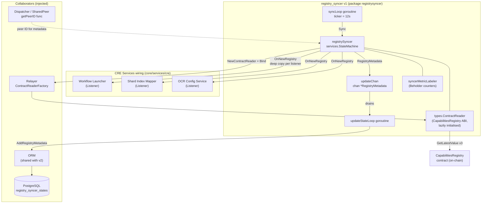
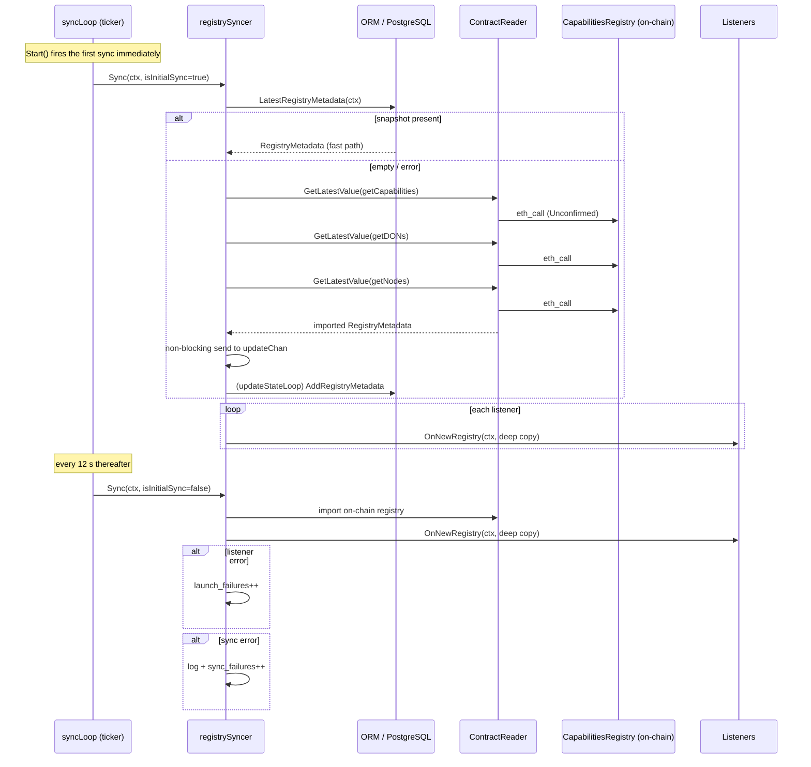
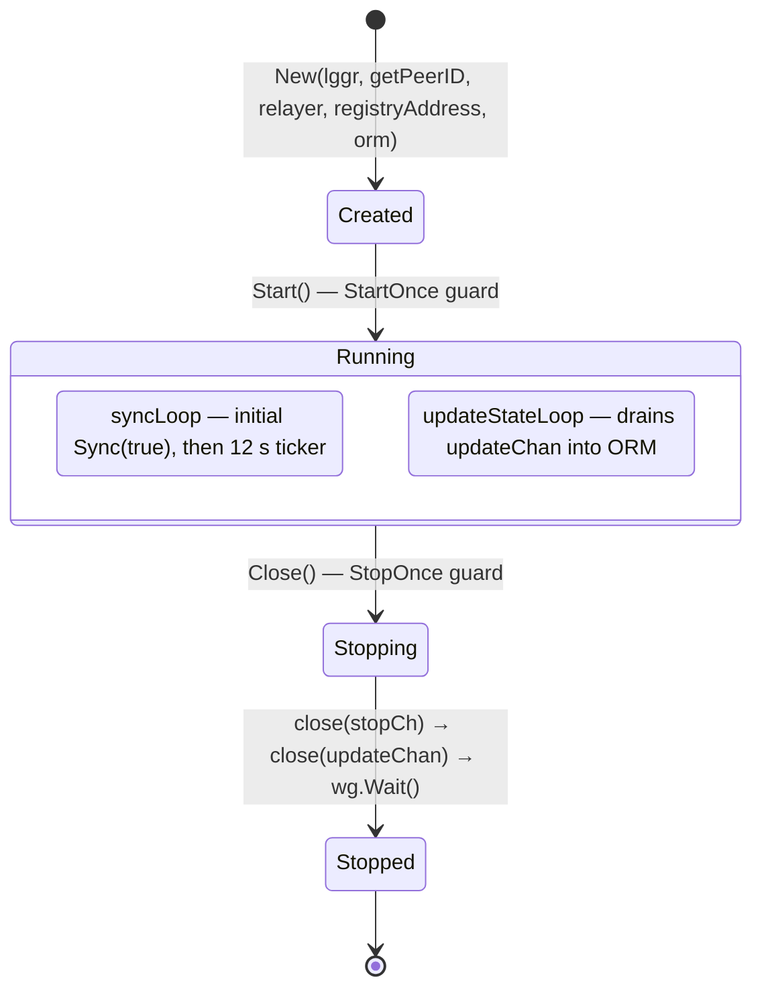
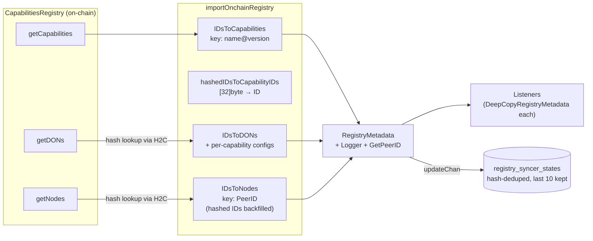
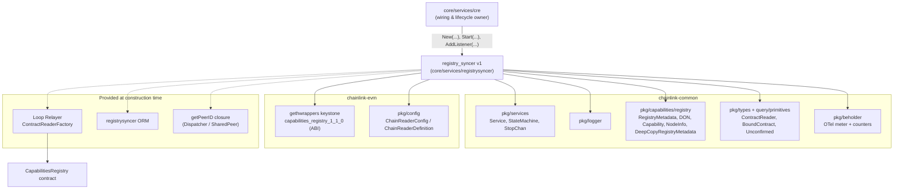

# Registry Syncer v1 (registrysyncer)

> **Source:** `chainlink/core/services/registrysyncer/syncer.go` — package `registrysyncer`
> **Part of:** [Node Platform Services](../../Node_Platform_Services.md) → [Registry Syncer](../registry_syncer.md)

## 1. Introduction

The Registry Syncer v1 is a long-running node service that keeps a local, in-memory-and-persistent view of the **Capabilities Registry** — the on-chain contract that records which **capabilities** exist, which **DECENTRALIZED OPERATOR NETWORKs (DONs)** are configured, and which **nodes** (peer IDs) belong to those DONs.

It periodically imports the complete registry state from the blockchain, converts it into a `registry.RegistryMetadata` snapshot (defined in `chainlink-common/pkg/capabilities/registry`), and fans that snapshot out to registered **listeners**. The first snapshot after startup is served from the local database when available (fast startup path); all subsequent snapshots are imported directly from the chain every 12 seconds.

The v1 syncer targets the **Keystone Capabilities Registry v1.1.0** contract (`kcr.CapabilitiesRegistryABI`). Its sibling, the [Registry Syncer v2](registry_syncer_v2.md), targets the v2 registry contract and is the version instantiated by the current node wiring; the v1 package's `ORM` remains the shared persistence layer for both (see [Registry Syncer Persistence](registry_syncer_persistence.md)).

### At a glance

| Aspect | Value |
|---|---|
| Go package | `chainlink/core/services/registrysyncer` |
| Primary type | `RegistrySyncer` (interface) / `registrySyncer` (implementation) |
| Service lifecycle | Implements `services.Service` (`Start`, `Close`, `Ready`, `HealthReport`, `Name`) |
| Sync interval | 12 seconds (`defaultTickInterval`) |
| On-chain source | `CapabilitiesRegistry` contract — `getCapabilities`, `getDONs`, `getNodes` |
| Persistence | `registry_syncer_states` table via the package `ORM` |
| Metrics | `platform_registrysyncer_sync_failures`, `platform_registrysyncer_launch_failures` (Beholder/OTel) |
| Consumer | [CRE Engine](../../Workflow___Capability_Runtime_(CRE_Engine).md) service wiring (`core/services/cre`) |

---

## 2. Purpose and Core Functionality

### 2.1 Why it exists

Capabilities and DON topology are configured **on-chain** (via governance/MCMS proposals), but they are consumed **off-chain** by node subsystems: the workflow [Launcher](../../Workflow___Capability_Runtime_(CRE_Engine)/core_capabilities_runtime.md), OCR config services, and shard-ownership mapping. The Registry Syncer bridges the two worlds by producing a consistent, typed snapshot of on-chain state and delivering it to every subscriber whenever it changes (or on every tick).

### 2.2 Functional responsibilities

1. **On-chain import** — `importOnchainRegistry` reads the full registry via a `types.ContractReader` bound to the `CapabilitiesRegistry` contract:
   - `getCapabilities` → capability entries (labelled name, version, type, hashed ID)
   - `getDONs` → DON info (members, F, config count, per-capability configs)
   - `getNodes` → node info (operator ID, signer, encryption key, P2P ID, DON memberships)
2. **Type mapping** — converts raw contract structs (`kcr.*`) into shared domain types (`registry.Capability`, `registry.DON`, `registry.NodeInfo`), including:
   - Capability ID synthesis: `fmt.Sprintf("%s@%s", c.LabelledName, c.Version)` (e.g. `cron@1.0.0`)
   - Hashed-ID backfill: the contract stores `[32]byte` hashed capability IDs in DON configs and node registrations; the syncer maintains a `hashedIDsToCapabilityIDs` map to resolve them back to full IDs. A missing hash inside a DON configuration is an **invariant violation** (hard error); a missing hash on a node is **logged and skipped** (warning).
   - Capability type coercion via the exported `ContractCapabilityType` enum (`Trigger`, `Action`, `Consensus`, `Target`; anything else → `CapabilityTypeUnknown`).
3. **Startup fast path** — the first `Sync(isInitialSync=true)` attempt reads `ORM.LatestRegistryMetadata`. If the DB has a snapshot, listeners are served immediately without waiting for chain reads; if the read fails or is empty, the syncer falls back to the on-chain import.
4. **Periodic remote sync** — a ticker fires `Sync(isInitialSync=false)` every 12 seconds, which always imports from the chain.
5. **Local persistence of remote state** — each on-chain import is pushed (non-blocking `select`) onto `updateChan`; the `updateStateLoop` goroutine drains the channel and stores the snapshot through the `ORM` (hash-deduplicated, retention-managed — details in [persistence](registry_syncer_persistence.md)).
6. **Listener fan-out** — every listener receives a `registry.DeepCopyRegistryMetadata` copy of the snapshot, so listeners can mutate their copy safely. Listener errors are logged and counted but do not abort the fan-out.
7. **Observability** — OpenTelemetry counters via [Beholder](../../Telemetry___Observability_Platform.md) (see §8).

---

## 3. Architecture

### 3.1 Component structure

*Note: the diagram shows the canonical listener set. In the current production wiring (`newRegistrySyncerV2` in `core/services/cre/cre.go`) these listeners are attached to the **v2** syncer, which shares this package's `ORM`; see [Registry Syncer v2](registry_syncer_v2.md).*

### 3.2 Key types

| Type | Kind | Role |
|---|---|---|
| `RegistrySyncer` | interface | Public contract: `Sync`, `AddListener`, `Start`, `Close`, `Ready`, `HealthReport`, `Name` |
| `Syncer` | interface | Minimal embed of `services.Service` + `AddListener` (used by wiring helpers) |
| `Listener` | interface | `OnNewRegistry(ctx, *registry.RegistryMetadata) error` — callback for each snapshot |
| `ContractReaderFactory` | interface | `NewContractReader(ctx, configJSON)` — satisfied by the Loop `Relayer` |
| `registrySyncer` | struct | Implementation: state machine, two goroutines, reader cache, listener list, ORM, update channel |
| `ContractCapabilityType` | enum | On-chain capability type codes (`Trigger`=0, `Action`, `Consensus`, `Target`) |
| `syncerMetricLabeler` | struct | OTel counter wrappers (`monitoring.go`) |
| `ORM` | interface | `AddRegistryMetadata` / `LatestRegistryMetadata` — defined in `orm.go`, documented in [persistence](registry_syncer_persistence.md) |

### 3.3 Data model produced

`Sync` builds a single `registry.RegistryMetadata` containing three maps:

| Source call | On-chain type | Mapped type | Map key |
|---|---|---|---|
| `getCapabilities` | `kcr.CapabilitiesRegistryCapabilityInfo` | `registry.Capability` | `"{labelledName}@{version}"` |
| `getDONs` | `kcr.CapabilitiesRegistryDONInfo` | `registry.DON` + `CapabilityConfigurations` | `registry.DonID` |
| `getNodes` | `kcr.INodeInfoProviderNodeInfo` | `registry.NodeInfo` (capability IDs backfilled) | `p2ptypes.PeerID` |

The snapshot is hydrated with the syncer's own `Logger` and `getPeerID` closure before delivery.

---

## 4. Process Flows

### 4.1 Sync sequence

Key behaviours visible in the sequence:

- **Reader is lazily initialised** on the first `Sync` call, never in `New`. `cr.Bind()` performs an on-chain verification of the contract address, which would fail with a *"no live nodes"* error during early application startup before RPC connectivity exists (documented in the source).
- **Non-blocking channel send**: the remote snapshot is pushed to `updateChan` with a `select` that has a `default` branch, so a stopped or not-yet-started `updateStateLoop` can never block the sync path (also keeps tests that never call `Start()` from hanging).
- **Failure isolation**: listener errors and periodic-sync errors are logged and counted per metric; the sync loop itself never exits due to a failed tick.

### 4.2 Service lifecycle

- `Start` launches both goroutines under a `sync.WaitGroup`; `Close` closes the stop channel, closes `updateChan` (which terminates `updateStateLoop`), and waits for both goroutines.
- Both loops derive a cancellable context from `s.stopCh.NewCtx()`, so in-flight chain reads are cancelled on shutdown.
- `HealthReport` surfaces `Healthy()` from the embedded `services.StateMachine`, keyed by the logger name `"RegistrySyncer"`.

### 4.3 Data transformation flow

---

## 5. Dependencies

- **Upstream (this module →):**
  - [Shared Foundation Libraries & Domain Types](../../Shared_Foundation_Libraries___Domain_Types.md) — `registry.RegistryMetadata` and the capability/DON/node domain types; `types.ContractReader` is the chain-agnostic read interface; `pkg/services` supplies the lifecycle state machine.
  - [Plugin Process Framework (Loop)](../../Plugin_Process_Framework_(Loop).md) — the relayer obtained via `RelayerChainInterops.Get(RelayID)` implements `NewContractReader`, routing reads to the appropriate chain provider.
  - [Telemetry & Observability Platform](../../Telemetry___Observability_Platform.md) — Beholder meter registration for the failure counters.
  - [Database Persistence](../database_persistence.md) — PostgreSQL data source wrapped by the ORM.
- **Downstream (→ this module):** the [CRE Engine](../../Workflow___Capability_Runtime_(CRE_Engine).md) service assembly in `core/services/cre` constructs, wires, and owns the lifecycle of the syncer (see §6).
- **Peer module:** [Registry Syncer v2](registry_syncer_v2.md) — same structure and contract, but reads the v2 registry ABI. It imports `registrysyncer.ORM` from this package, making the [persistence](registry_syncer_persistence.md) layer the shared component between versions.

---

## 6. Integration with the Node

The syncer is wired inside `Services.newSubservices` / `newRegistrySyncer` in `chainlink/core/services/cre/cre.go`:

1. **Gating.** The registry syncer is only created when a capabilities **dispatcher** is configured (peering enabled) **and** `Capabilities.ExternalRegistry.Address` is non-empty. Otherwise startup logs a warning and skips it.
2. **Relayer selection.** `Capabilities.ExternalRegistry.RelayID` selects the relayer through `RelayerChainInterops.Get`, which supplies the `ContractReaderFactory`.
3. **Version selection.** The current wiring parses `Capabilities.ExternalRegistry.ContractVersion` and requires **major version 2**, instantiating `registrysyncerV2.New(...)` with `registrysyncerV1.NewORM(ds, lggr)`. The **v1 syncer remains the reference implementation for registry major version 1** (Keystone `capabilities_registry_1_1_0` ABI) and is the origin of the structure, contract, and persistence schema reused by v2. Registering `Listener`s is identical in both versions (`AddListener`).
4. **Listener wiring order matters.** In the production wiring, listeners are registered as `AddListener(ocrConfigService, wfLauncher, shardIndexMapper)`: the OCR config service must consume each snapshot *before* the launcher starts capabilities that depend on its dynamic config trackers. When implementing new listeners for a v1 deployment, preserve this ordering convention.
5. **Lifecycle ownership.** The returned services are appended to the node's service list and started/stopped by the [Application lifecycle](../../Node_Application_Core___Interfaces/node_application/node_application_lifecycle.md).

---

## 7. Concurrency and Correctness Notes

| Concern | Mechanism |
|---|---|
| Listener registration vs. sync | `mu sync.RWMutex`: `AddListener` takes the write lock; `Sync` holds a read lock for the whole call, making listener list access race-free |
| Listener isolation | Each listener receives `DeepCopyRegistryMetadata(latestRegistry)` — mutation of one listener's copy cannot affect others |
| Startup RPC availability | Reader construction deferred to first `Sync` (see §4.1) |
| Shutdown backpressure | Non-blocking send to `updateChan`; stop-aware `select` in `Sync`, `syncLoop`, and `updateStateLoop` |
| Exactly-once start/stop | `StartOnce` / `StopOnce` from `services.StateMachine` |
| Snapshot durability | Hash-deduplicated inserts and bounded retention in the ORM — see [persistence](registry_syncer_persistence.md) |

---

## 8. Observability

The `syncerMetricLabeler` (in `monitoring.go`) extends the shared metrics labeler with two Beholder OTel counters:

| Metric | Type | Incremented when |
|---|---|---|
| `platform_registrysyncer_sync_failures` | Int64Counter | A **periodic** remote sync fails. The very first (initial) sync failure is logged but **not** counted, per the comment in `syncLoop`. |
| `platform_registrysyncer_launch_failures` | Int64Counter | A listener's `OnNewRegistry` returns an error during fan-out. |

Counter attributes are derived from the labeler's labels via `beholder.OtelAttributes(...).AsStringAttributes()`. For the wider telemetry stack (exporters, dashboards), see [Beholder telemetry](../../Telemetry___Observability_Platform/beholder-telemetry.md). The syncer also participates in the node's standard `HealthReport` mechanism.

---

## 9. Testing

- `syncer_test.go` — covers import mapping (capabilities/DONs/nodes), initial-sync fast path and fallback, listener fan-out (including error cases), and channel behaviour.
- `monitoring_test.go` — metric labeler construction and counter increments.
- `mocks/` — generated mocks for `ORM` and `RegistrySyncer` (see `chainlink/.mockery.yaml`), so dependent services (e.g., v2 wiring tests) can stub the syncer.

---

## 10. Related Documentation

- [Registry Syncer (parent module)](../registry_syncer.md) — overview of v1/v2/persistence and how they relate.
- [Registry Syncer Persistence](registry_syncer_persistence.md) — the `ORM`, `registry_syncer_states` schema, hashing and retention.
- [Registry Syncer v2](registry_syncer_v2.md) — current production syncer for the v2 registry contract.
- [Node Platform Services](../../Node_Platform_Services.md) — sibling platform services (job service, keystore, gateway, …).
- [Workflow & Capability Runtime (CRE Engine)](../../Workflow___Capability_Runtime_(CRE_Engine).md) — the consuming runtime; the [Launcher](../../Workflow___Capability_Runtime_(CRE_Engine)/core_capabilities_runtime.md) is a typical `Listener`.
- [Shared Foundation Libraries & Domain Types](../../Shared_Foundation_Libraries___Domain_Types.md) — `RegistryMetadata` and capability domain types.
- [Plugin Process Framework (Loop)](../../Plugin_Process_Framework_(Loop).md) — the relayer contract that provides the `ContractReader`.
