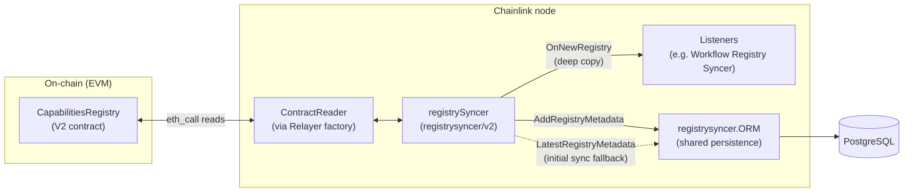
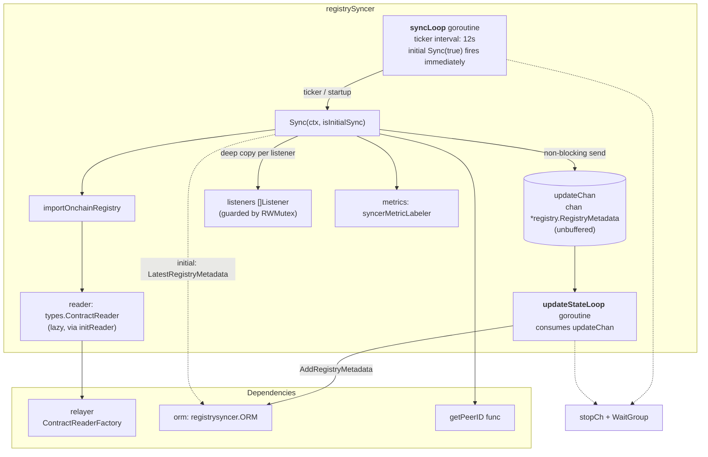
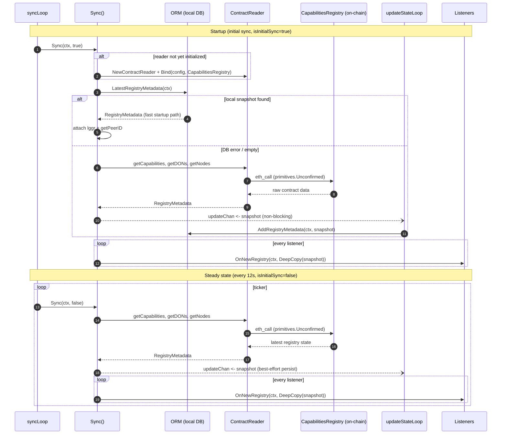
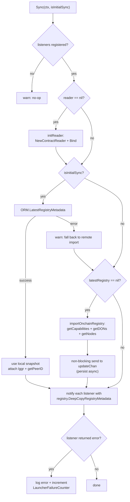
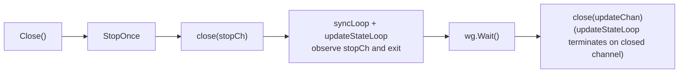
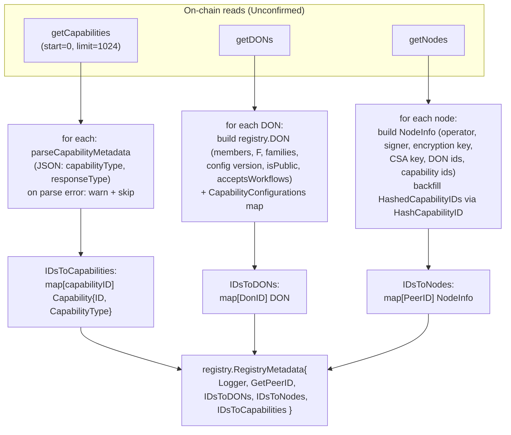
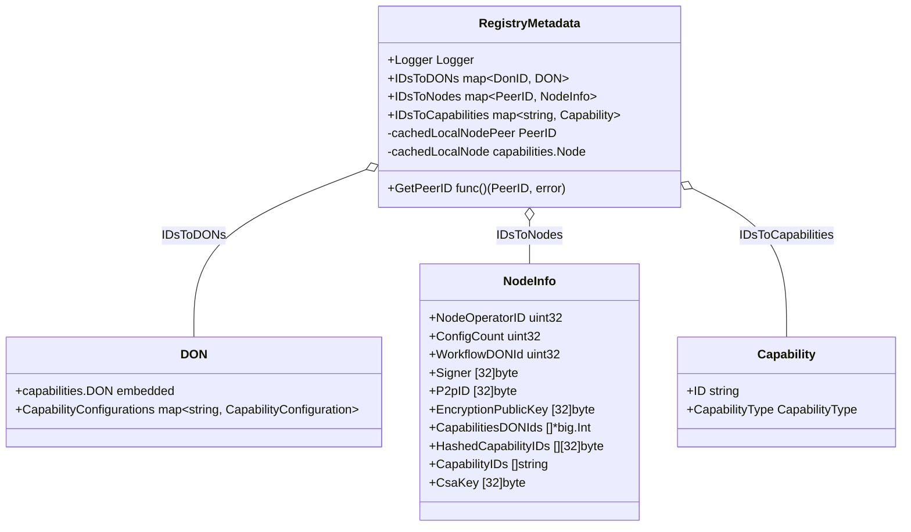
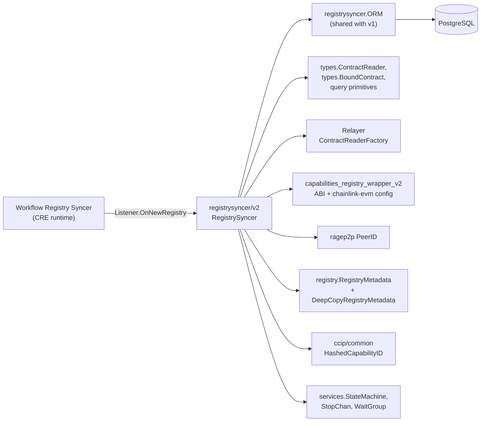

# Registry Syncer V2 (`registrysyncer/v2`)

The **Registry Syncer V2** is a node background service that keeps an up-to-date local mirror of the on-chain **Capabilities Registry (V2)** smart contract. On startup and then on a fixed 12-second interval, it reads the registry's DONs, nodes and capabilities through a chain-agnostic `ContractReader`, packages them into an immutable `registry.RegistryMetadata` snapshot, asynchronously persists that snapshot via the shared [Registry Syncer persistence ORM](registry_syncer_persistence.md), and fans it out to in-process `Listener`s (principally the Workflow Registry syncer in the CRE runtime).

- **Module path:** `chainlink/core/services/registrysyncer/v2/syncer.go`
- **Parent:** [Registry Syncer](../registry_syncer.md) — see also [V1 syncer](registry_syncer_v1.md) and [Persistence ORM](registry_syncer_persistence.md)
- **Group:** [Node Platform Services](../../Node_Platform_Services.md)

---

## 1. Purpose and scope

A Chainlink node participating in CRE needs to answer questions like *"which DONs does this node belong to?"*, *"which capabilities are registered?"*, and *"which nodes are in DON X?"* without issuing an on-chain read on every request. The Registry Syncer V2 solves this by:

1. **Pulling** the full state of the on-chain `CapabilitiesRegistry` (V2 ABI) on a schedule.
2. **Transforming** raw contract return values into the shared `registry.RegistryMetadata` domain object (from `chainlink-common/pkg/capabilities/registry`).
3. **Persisting** snapshots locally so a restarting node can serve registry data immediately (fast startup path) instead of waiting for the first on-chain read.
4. **Publishing** each snapshot to registered `Listener`s, each receiving an isolated deep copy.

The module owns no chain connectivity of its own: all reads go through the platform `ContractReader` abstraction (see [Shared types: core](../../Shared_Foundation_Libraries___Domain_Types/types-core.md)), which is instantiated from a `Relayer`-provided factory (see [Loop relayer services](../../Plugin_Process_Framework_(Loop)/loop-relayer-services.md)).

### What it is *not*

- It does not write to the chain (registration/updates happen via governance/deployment flows).
- It does not own the database schema; persistence is delegated to the shared [registry syncer ORM](registry_syncer_persistence.md).
- It is not the V1 syncer; see the [v1 → v2 comparison](#9-v1-vs-v2) below.

---

## 2. Position in the system



The snapshot type `registry.RegistryMetadata` and the capability/DON/node model come from `chainlink-common` and are documented as part of the [Capabilities registry types](../../Workflow___Capability_Runtime_(CRE_Engine)/capabilities.md). The `PeerID` types used to key node entries come from `libocr/ragep2p`, covered in [P2P](../p2p.md).

---

## 3. Public interfaces

### 3.1 `RegistrySyncer` — the full service contract

```go
type RegistrySyncer interface {
    Sync(ctx context.Context, isInitialSync bool) error
    AddListener(listeners ...Listener)
    Start(ctx context.Context) error
    Close() error
    Ready() error
    HealthReport() map[string]error
    Name() string
}
```

This is what `New(...)` returns. It combines lifecycle management (`Start`/`Close`/`Ready`/`HealthReport`/`Name`, following the standard [`services.StateMachine`](../../Shared_Foundation_Libraries___Domain_Types/services.md) pattern) with manual control over synchronization (`Sync`) and subscription (`AddListener`).

### 3.2 `Syncer` — the minimal subscription contract

```go
type Syncer interface {
    services.Service
    AddListener(h ...Listener)
}
```

A narrower view of the same object for callers that only need lifecycle + subscription (e.g. wiring code that should not be able to force a manual sync).

### 3.3 `Listener` — snapshot consumers

```go
type Listener interface {
    OnNewRegistry(ctx context.Context, registry *registry.RegistryMetadata) error
}
```

`OnNewRegistry` is invoked synchronously for **every** registered listener on **every** successful sync, with a `registry.DeepCopyRegistryMetadata` copy, so a listener mutating the snapshot cannot corrupt state seen by others. A single failing listener does **not** abort the fan-out: the error is logged and counted in metrics, then the next listener is called.

### 3.4 `ContractReaderFactory` — chain connectivity seam

```go
type ContractReaderFactory interface {
    NewContractReader(context.Context, []byte) (types.ContractReader, error)
}
```

This is the subset of the relayer interface the syncer requires. It decouples the syncer from any particular chain family and makes the syncer trivially testable.

---

## 4. Construction

```go
New(
    lggr             logger.Logger,
    getPeerID        func() (p2ptypes.PeerID, error),
    relayer          ContractReaderFactory,
    registryAddress  string,
    orm              registrysyncer.ORM,
) (RegistrySyncer, error)
```

| Argument | Purpose |
|---|---|
| `lggr` | Base logger; the service wraps it as `RegistrySyncer` via `logger.Named`. |
| `getPeerID` | Returns the local node's ragep2p `PeerID`; injected into every snapshot so consumers can identify "this node" in `IDsToNodes`/DON memberships. |
| `relayer` | Factory used to build the configured `ContractReader` (lazily, at first sync — see [operational notes](#10-operational-notes)). |
| `registryAddress` | On-chain address of the V2 `CapabilitiesRegistry`; bound under the contract name `"CapabilitiesRegistry"`. |
| `orm` | Shared [persistence ORM](registry_syncer_persistence.md), used for both loading (initial sync) and storing (async write-behind) snapshots. |

---

## 5. Internal architecture

The `registrySyncer` implementation embeds `services.StateMachine` and runs **two goroutines** plus one channel:



### Struct field reference

| Field | Type | Role |
|---|---|---|
| `metrics` | `*syncerMetricLabeler` | Prometheus failure counters (see [Metrics](#8-metrics-and-observability)). |
| `stopCh` | `services.StopChan` | Cancellation channel; context for both loops is derived from it. |
| `listeners` | `[]Listener` | Registered snapshot consumers; appended under `mu` (write lock). |
| `reader` | `types.ContractReader` | Bound contract reader, created lazily inside `Sync` (never at construction). |
| `initReader` | `func(...) (types.ContractReader, error)` | Reader factory function, defaults to package-level `newReader`; injectable for tests. |
| `relayer` | `ContractReaderFactory` | Chain access seam used by `initReader`. |
| `capabilitiesContract` | `types.BoundContract` | `{Address: registryAddress, Name: "CapabilitiesRegistry"}`. |
| `getPeerID` | `func() (p2ptypes.PeerID, error)` | Local node identity accessor, copied into every snapshot. |
| `orm` | `registrysyncer.ORM` | Persistence seam (shared with v1). |
| `updateChan` | `chan *registry.RegistryMetadata` | Unbuffered hand-off from `Sync` → `updateStateLoop` (write-behind persistence). |
| `wg` / `mu` | `sync.WaitGroup` / `sync.RWMutex` | Goroutine lifetime and listener/reader access control. |

---

## 6. Sync process and data flow

### 6.1 Sequence overview



### 6.2 Decision logic inside `Sync`



Key behaviors captured by this flow:

- **Initial-sync fast path:** on the very first tick the syncer prefers the last persisted snapshot from the database, so a restarting node immediately serves registry data. If the DB read fails or is empty, it falls back to a full on-chain import.
- **Periodic sync always goes on-chain:** for `isInitialSync=false`, `latestRegistry` stays `nil`, so every tick performs a fresh `importOnchainRegistry` and re-notifies listeners even if nothing changed.
- **Persistence is best-effort and never blocks:** the snapshot is pushed onto the unbuffered `updateChan` inside a `select` with a `default` branch. If `updateStateLoop` is not ready (or the syncer was stopped), the DB write is skipped with a debug log — sync and listener fan-out are never delayed by database latency.
- **Listener fan-out is failure-isolated:** each listener receives its own deep copy; listener errors increment the launcher failure counter but do not stop iteration or fail `Sync`.

### 6.3 Shutdown flow



---

## 7. On-chain data model

### 7.1 Contract reader configuration

`buildV2ContractReaderConfig()` marshals a `config.ChainReaderConfig` (from `chainlink-evm/pkg/config`) describing every read identifier the syncer may use, keyed to the generated V2 ABI (`capabilities_registry_v2.CapabilitiesRegistryABI` from `chainlink-evm/gethwrappers` — see `chainlink/go.mod` for the pinned module versions). Configured read identifiers:

| Read identifier | Used by syncer | Notes |
|---|---|---|
| `getCapabilities` | ✅ `importOnchainRegistry` | All registered capabilities (paginated batch, see below). |
| `getDONs` | ✅ `importOnchainRegistry` | All DON infos incl. per-capability configurations. |
| `getNodes` | ✅ `importOnchainRegistry` | All node infos keyed by P2P ID. |
| `getDONsInFamily` | configured only | Available for consumers of the same reader. |
| `getHistoricalDONInfo` | configured only | Historical DON lookup. |
| `getNode` | configured only | Single-node lookup. |
| `getNodeOperator` / `getNodeOperators` | configured only | Node-operator lookups. |
| `getNodesByP2PIds` | configured only | Batch node lookup. |
| `isCapabilityDeprecated` | configured only | Deprecation flag. |

All reads use `GetLatestValue(..., primitives.Unconfirmed, ...)` — i.e., the latest chain state, not log-poller-confirmed state.

> **Pagination note (from source):** `getCapabilities`/`getDONs`/`getNodes` are read with a single batch of `Start=0, Limit=1024` ("we don't expect to have that many capabilities"); a TODO marks that pagination may be required if the registry outgrows this limit.

### 7.2 Snapshot construction (`importOnchainRegistry`)



The resulting `RegistryMetadata` (defined in `chainlink-common/pkg/capabilities/registry/metadata.go`) is the exchange format consumed by the CRE runtime:



The private `cachedLocalNode`/`cachedLocalNodePeer` fields are how a snapshot lazily resolves *this* node using the injected `GetPeerID` function — the syncer itself only populates `GetPeerID`.

### 7.3 Capability metadata and ID handling (V2 specifics)

- **Metadata schema:** each capability carries JSON metadata `{"capabilityType": uint8, "responseType": uint8}` parsed by `parseCapabilityMetadata`. Empty or invalid metadata causes the capability to be **skipped with a warning** (not a sync failure).
- **Capability type mapping:** the on-chain `uint8` is mapped through the `ContractCapabilityType` enum:

  | On-chain value | Constant | Mapped `capabilities.CapabilityType` |
  |---|---|---|
  | 0 | `ContractCapabilityTypeTrigger` | `CapabilityTypeTrigger` |
  | 1 | `ContractCapabilityTypeAction` | `CapabilityTypeAction` |
  | 2 | `ContractCapabilityTypeConsensus` | `CapabilityTypeConsensus` |
  | 3 | `ContractCapabilityTypeTarget` | `CapabilityTypeTarget` |
  | other | — | `CapabilityTypeUnknown` |

- **Capability IDs:** V2 IDs have the form `name@version` (e.g. `write-chain@1.0.1`), validated by `parseCapabilityID` (exactly one `@` separator).
- **Hashing:** `HashCapabilityID(name@version)` delegates to `common.HashedCapabilityID` from the CCIP common package, producing a `[32]byte` hash. Node entries store both the raw `CapabilityIDs` and the derived `HashedCapabilityIDs` (per-capability hash failures are skipped with a warning).
- **V2-only node field:** `NodeInfo.CsaKey` is new in the V2 registry model.

---

## 8. Metrics and observability

| Signal | Emitted when | Location |
|---|---|---|
| Remote registry failure counter | A periodic (non-initial) `Sync` fails (reader init or on-chain import) | `syncLoop`, via `metrics.incrementRemoteRegistryFailureCounter` |
| Launcher failure counter | A `Listener.OnNewRegistry` call returns an error | `Sync`, via `metrics.incrementLauncherFailureCounter` |

Additional operational signals:

- `HealthReport()` returns `{Name(): Healthy()}` — the service reports unhealthy only through the standard `services.StateMachine` state.
- `Ready()` reflects `StartOnce` completion; note the first successful sync can occur *after* `Ready()` because the initial sync runs asynchronously (and its failure is only logged on the first iteration, not counted as a remote-registry failure).
- All sync failures and skipped items are logged with structured fields (`capabilityID`, `error`).

---

## 9. V1 vs V2

The v2 syncer reuses the v1 module's shared interfaces (`registrysyncer.ORM`, `Listener`, and the identical `RegistrySyncer` service contract) while changing *what* is synced and *how* it is interpreted:

| Aspect | [V1](registry_syncer_v1.md) | V2 (this module) |
|---|---|---|
| Package | `registrysyncer` | `registrysyncer/v2` |
| Contract ABI | Legacy `CapabilitiesRegistry` wrapper | `capabilities_registry_wrapper_v2.CapabilitiesRegistryABI` |
| Reader config | v1 chain-reader definitions | `buildV2ContractReaderConfig()` with V2 identifiers (`getDONsInFamily`, `getHistoricalDONInfo`, `getNodesByP2PIds`, `isCapabilityDeprecated`, …) |
| Capability metadata | v1 metadata schema | JSON `{capabilityType, responseType}` via `parseCapabilityMetadata` |
| Capability IDs | unversioned | `name@version`, hashed to `[32]byte` via CCIP's `HashedCapabilityID` |
| Node info | v1 fields | adds `CsaKey` (V2-specific) |
| Persistence | `registrysyncer.ORM` | **same shared ORM** — see [persistence module](registry_syncer_persistence.md) |
| Snapshot type | `registry.RegistryMetadata` | same shared type |

Because both versions share the ORM and the listener contract, the same database rows and downstream consumers serve both syncer generations.

---

## 10. Operational notes

- **Reader initialization is deliberately deferred.** `newReader` performs `ContractReader.Bind`, which makes an on-chain call to verify the contract address exists. Calling it during node initialization would fail with a *"no live nodes"* error before chains/RPC are up, so `initReader` is only invoked from inside the sync loop (see comment in source).
- **First-sync failure tolerance.** The initial `Sync(ctx, true)` runs immediately when `syncLoop` starts (before the first ticker fire) and its failure is only logged — the failure counter deliberately is *not* incremented for this first attempt.
- **Single-writer sync.** `Sync` holds the RWMutex read lock for its duration and mutates `s.reader` inside it; in production `Sync` is called only from the single `syncLoop` goroutine. `AddListener` takes the write lock, so it blocks until any in-flight sync completes.
- **Unbuffered persistence hand-off.** Because `updateChan` is unbuffered and sends are non-blocking (`select`/`default`), a slow or absent `updateStateLoop` (e.g., in unit tests that call `Sync` without `Start`) results in a skipped DB write with a debug log — never a hang.
- **No pagination yet.** Registry reads assume ≤1024 capabilities/DONs/nodes per batch; revisit if registry size grows (TODO in source).

---

## 11. Dependencies and integration map

Module dependency graph (Markdown links in the table below):



| Dependency | Provided by | Documentation |
|---|---|---|
| `registrysyncer.ORM` (`AddRegistryMetadata`, `LatestRegistryMetadata`) | `registrysyncer` root package | [Registry Syncer persistence](registry_syncer_persistence.md) |
| `types.ContractReader`, `types.BoundContract`, `primitives.Unconfirmed` | `chainlink-common/pkg/types` | [Shared types: core](../../Shared_Foundation_Libraries___Domain_Types/types-core.md) |
| `ContractReaderFactory` (relayer subset) | Relayer/Loop plugin process | [Loop relayer services](../../Plugin_Process_Framework_(Loop)/loop-relayer-services.md) |
| V2 registry ABI + `config.ChainReaderConfig` | `chainlink-evm` (`gethwrappers`, `pkg/config`) | pinned in `chainlink/go.mod` |
| `p2ptypes.PeerID` | `libocr/ragep2p` | [P2P](../p2p.md) |
| `registry.RegistryMetadata`, `registry.DON`, `registry.NodeInfo`, `registry.Capability` | `chainlink-common/pkg/capabilities/registry` | [Capabilities](../../Workflow___Capability_Runtime_(CRE_Engine)/capabilities.md) |
| `common.HashedCapabilityID` | `chainlink/v2/core/capabilities/ccip/common` | [CCIP](../../CCIP_Cross-Chain_Protocol/ccip.md) |
| `services.StateMachine` / `StopChan` lifecycle | `chainlink-common/pkg/services` | [Services library](../../Shared_Foundation_Libraries___Domain_Types/services.md) |
| Snapshot consumers (`Listener` implementations) | Workflow Registry syncer & CRE runtime | [Workflows](../../Workflow___Capability_Runtime_(CRE_Engine)/workflows.md) |
| Underlying database layer (Postgres, migrations, backups) | Node platform services | [Database persistence](../database_persistence.md) |

The syncer is a plain `services.Service` — it is constructed with `New(...)` and started by the node's application assembly during service bootstrap (see [Node application lifecycle](../../Node_Application_Core___Interfaces/node_application/node_application_lifecycle.md)); it requires no configuration of its own beyond the registry contract address, the relayer, the ORM, and the `getPeerID` accessor.

---

## 12. Related documentation

- [Registry Syncer (parent module)](../registry_syncer.md)
- [Registry Syncer persistence ORM](registry_syncer_persistence.md)
- [Registry Syncer V1](registry_syncer_v1.md)
- [Workflow & Capability Runtime (CRE Engine)](../../Workflow___Capability_Runtime_(CRE_Engine)/workflows.md) — primary snapshot consumer
- [Shared Foundation Libraries: types-core](../../Shared_Foundation_Libraries___Domain_Types/types-core.md) — `ContractReader`/`BoundContract` contracts
- [Database persistence](../database_persistence.md) — storage layer underneath the ORM
