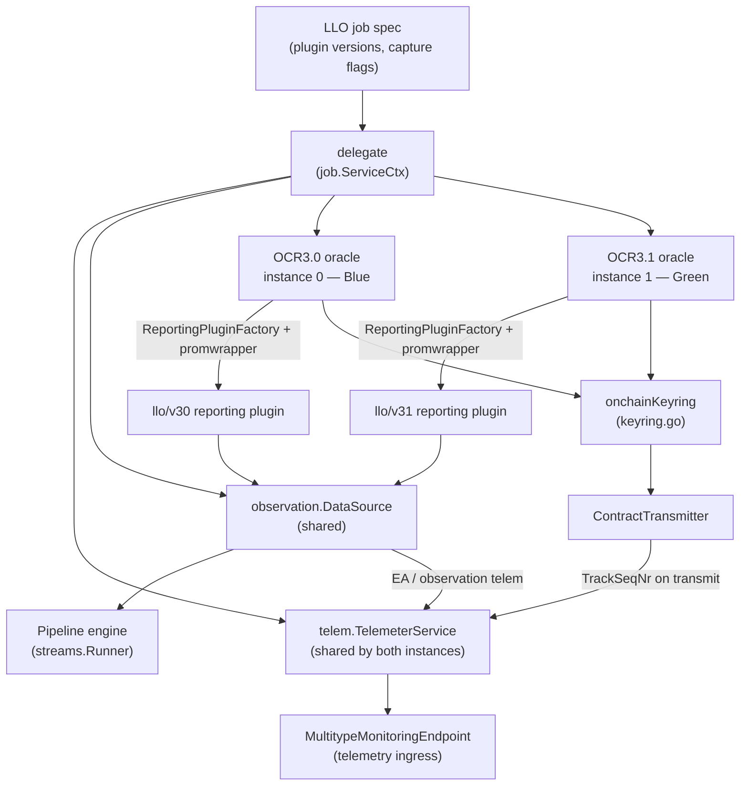
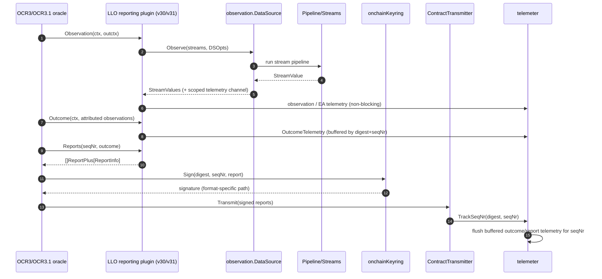

# LLO — Low-Latency Oracle Services

## 1. Overview

The `llo` module implements the node-side runtime of Chainlink's **Low-Latency Oracle (LLO)** — the consensus engine that powers **Data Streams**. LLO Decentralized Oracle Networks (DONs) observe large numbers of data streams at high frequency and produce compact, signed on-chain reports, trading the generic purpose machinery of classic OCR jobs for a specialized, low-overhead report pipeline.

This module covers three concerns of the LLO engine:

| Concern | Location | Core components |
|---|---|---|
| **Report signing & verification** | `chainlink/core/services/llo/keyring.go` | `Key`, `NewOnchainKeyring` (`onchainKeyring`) |
| **Telemetry pipeline** | `chainlink/core/services/llo/telem/telemetry.go` | `Telemeter`/`TelemeterService`, `TelemeterParams`, `nullTelemeter`, `TelemetryObserve` |
| **Performance benchmarks** | `chainlink/core/services/ocr2/plugins/llo/bench/harness_test.go` | `workload`, round drivers, v30/v31 plugin builders |

The LLO protocol logic itself (channel definitions, observation aggregation, report codecs, retirement, the v30/v31 reporting plugins) lives in the external `chainlink-data-streams/llo` module. This module **integrates** that logic into the Chainlink node:

- `delegate.go` exposes a `job.ServiceCtx` (consumed by the [job spawner](../Node_Platform_Services/job_service.md)) that starts up to two OCR oracles — a **Blue** and a **Green** instance for blue/green handover — each running either the OCR3.0 (`llo/v30`) or OCR3.1 (`llo/v31`) LLO reporting plugin.
- A shared **DataSource** (`observation/`) executes the stream's [Pipeline](pipeline.md) via the [Streams runner](streams.md) to produce `StreamValue`s and feeds them to both plugin versions.
- The **OnchainKeyring** signs every accepted report before the `ContractTransmitter` submits it on-chain.
- The **Telemeter** captures observation, EA, outcome, report and attributed-observation telemetry with bounded memory and never blocks the hot path.

### Report model

Every LLO report is typed by `llotypes.ReportInfo` (defined in [types-mercury-llo](../Shared_Foundation_Libraries___Domain_Types/types-mercury-llo.md)):

```go
type ReportInfo struct {
    LifeCycleStage LifeCycleStage
    ReportFormat   ReportFormat
}
```

The node registers one `ReportCodec` per supported format in `report_codecs.go::NewReportCodecs`: `JSON`, `EVMPremiumLegacy`, `EVMABIEncodeUnpacked`, `EVMABIEncodeUnpackedExpr`, `EVMStreamlined`, and `HistoryBackfill`. Both the report codecs and the keyring branch on `ReportFormat`, which is the central axis of the module's behavior.

## 2. Architecture



Key wiring facts (from `delegate.go`):

- **One oracle per `ContractConfigTracker`** (1 or 2), positionally aligned with `PluginVersions` (`v30`/`v31`). Running any v31 instance requires an `ocr3_1types.KeyValueDatabaseFactory` and an OCR3.1 `BinaryNetworkEndpoint2Factory`.
- **Shared dependencies**: both instances share one `ShouldRetireCache`, one `DataSource` (lifecycle-gated per round via `DSOpts`), one `TelemeterService`, and one report-codec map. Only outcome/report/attributed-observation channels are gated per plugin version through `enabledCh(...)`.
- **Transmit notification**: if the `ContractTransmitter` implements `transmitter.TransmitNotifier`, the delegate registers `t.TrackSeqNr` via `OnTransmit` — this is what triggers the telemetry flush of buffered outcome/report telemetry.

## 3. Data flow of a round



## 4. Sub-modules

Detailed documentation for each sub-module lives in its own page under `Oracle_Engines___Data_Pipelines/llo/`:

- **[llo_keyring](llo/llo_keyring.md)** (`llo/llo_keyring.md`) — the `OnchainKeyring` that signs and verifies LLO reports, dispatching per `ReportFormat` across three signing paths (legacy report context, Keccak-hashed blob, and native `Sign3`/`Verify3`). Source: `chainlink/core/services/llo/keyring.go`.
- **[llo_telemetry](llo/llo_telemetry.md)** (`llo/llo_telemetry.md`) — the `TelemeterService`: a high-throughput, non-blocking telemetry hub with per-config-digest buffering, transmission-triggered flushing, TTL eviction, sampling, and a `NullTelemeter` fallback. Source: `chainlink/core/services/llo/telem/telemetry.go`.
- **[llo_benchmarks](llo/llo_benchmarks.md)** (`llo/llo_benchmarks.md`) — the micro-benchmark harness comparing the OCR3.0 (`llo/v30`) and OCR3.1 (`llo/v31`) LLO plugins at steady state, including workload definition, round drivers and warmup logic. Source: `chainlink/core/services/ocr2/plugins/llo/bench/harness_test.go`.

## 5. Dependencies on other modules

| Dependency | Used for | Documentation |
|---|---|---|
| OCR engine | Consensus framework LLO builds on (OCR3/OCR3.1 oracles, plugin pattern, `ocrcommon` EA telemetry parsing) | [OCR](ocr.md) |
| Pipeline engine | Execution of each stream's pipeline (source → aggregation tasks) inside `observation.DataSource` | [Pipeline](pipeline.md) |
| Streams runtime | `streams.Runner` executes pipelines for LLO data sources | [Streams](streams.md) |
| Job service | `delegate` is a `job.ServiceCtx` managed by the job spawner/ORM | [Job service](../Node_Platform_Services/job_service.md) |
| Shared domain types | `ReportInfo`, `ReportFormat`, `ChannelDefinitionCache` (mercury/llo types) | [types-mercury-llo](../Shared_Foundation_Libraries___Domain_Types/types-mercury-llo.md) |
| Telemetry platform | `MultitypeMonitoringEndpoint` sends typed protobuf logs to telemetry ingress | [Telemetry ingress](../Telemetry___Observability_Platform/telemetry_ingress.md) |
| `chainlink-data-streams/llo` (external module) | v30/v31 reporting plugins, protocol types, report codecs, retirement, transmitter interfaces | external repository |

## 6. Operational notes

- **Telemetry flags** come from the job config (`CaptureEATelemetry`, `CaptureObservationTelemetry`, `CaptureOutcomeTelemetry`, `CaptureReportTelemetry`, plus v31-only `CaptureAttributedObservationTelemetry`). The delegate OR-merges the per-version flags so one shared telemeter serves both instances. When no monitoring endpoint is configured, `NewTelemeterService` returns the zero-cost `NullTelemeter`.
- **Never-block policy**: every telemetry entry point is non-blocking (buffered channels with drop-on-full semantics). Telemetry is considered strictly best-effort — a slow consumer must never delay observations or reports.
- **Blue/green safety**: buffered telemetry is keyed by config digest and flushed only by that digest's own transmissions, so concurrent blue/green instances never cross-flush; digests that stop transmitting are evicted after a 1-minute TTL.
- **Benchmarks** are run via `chainlink/core/services/ocr2/plugins/llo/bench/run.sh`, with checked-in results in `bench_baseline.txt`. The harness deliberately uses an in-memory key-value database and static data sources to isolate plugin CPU/allocation cost.
