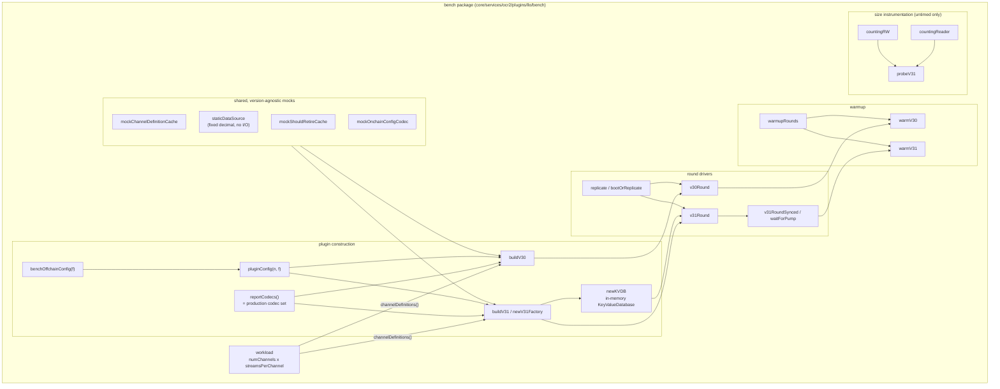
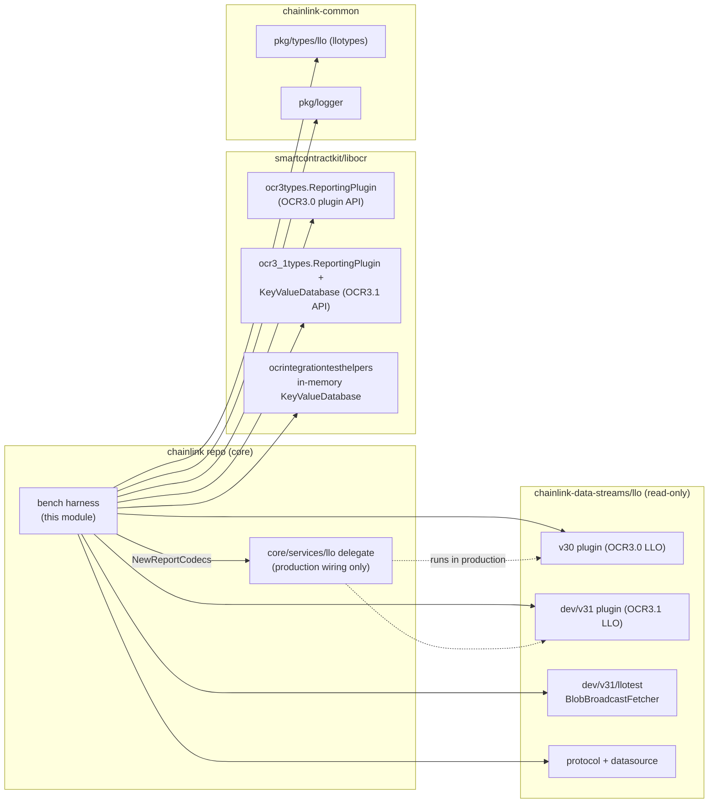
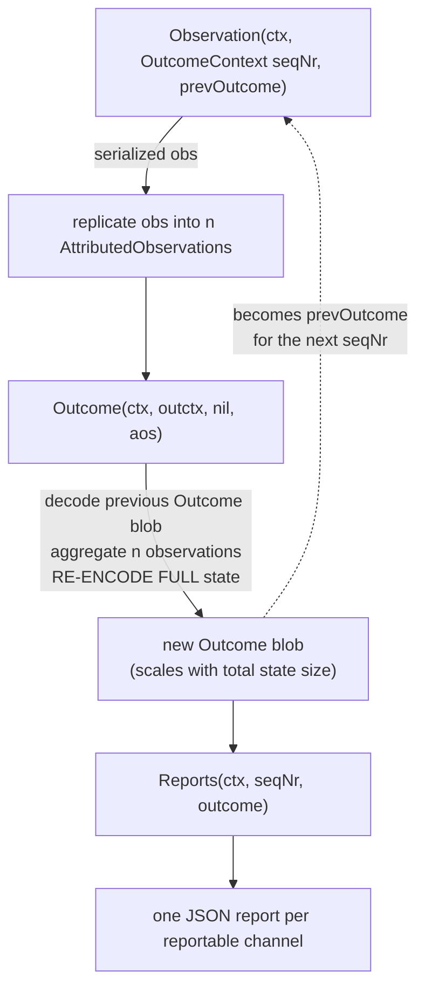
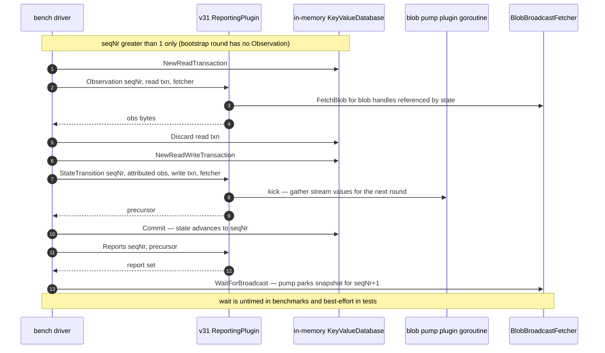
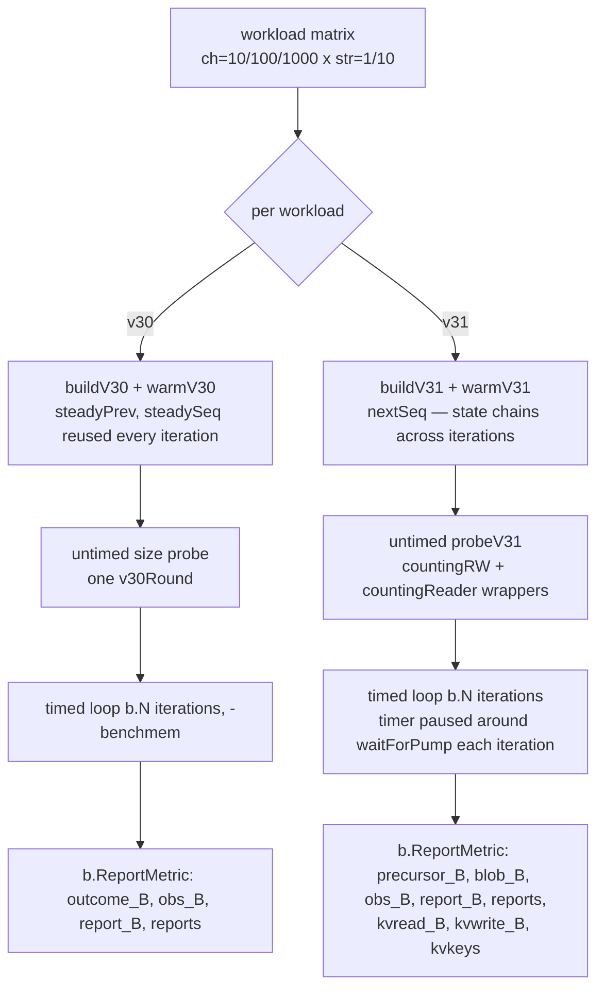
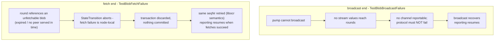

# LLO Benchmarks (`llo_benchmarks`)

> **Module location:** `chainlink/core/services/ocr2/plugins/llo/bench` · **Language:** Go (test-only package) · **Parent:** [LLO](../llo.md) · **Group:** [Oracle Engines & Data Pipelines](../../Oracle_Engines___Data_Pipelines.md)

## 1. Introduction

`llo_benchmarks` is a self-contained **comparative micro-benchmark and correctness harness** for the two generations of the Low-Latency Oracle (LLO) reporting plugin:

| Plugin | Import path | OCR protocol | State model |
|---|---|---|---|
| **v30** | `chainlink-data-streams/llo/v30` | OCR3.0 | Single **Outcome blob**, decoded from the previous round and **re-encoded in full every round** — per-round cost scales with *total* state size |
| **v31** | `chainlink-data-streams/llo/dev/v31` | OCR3.1 | Replicated **KeyValueState** (a pebble database in production) — per-round cost scales with per-round **churn** |

Both plugins implement identical LLO application logic on top of different OCR protocols. The performance question this module answers is: **what does that protocol difference cost at steady state?**

The harness drives both plugins *exclusively through their exported `ReportingPlugin` APIs* (`Observation` / `Outcome` / `StateTransition` / `Reports`), so nothing in the read-only `chainlink-data-streams` or `libocr` modules is modified. In addition to timing, the package provides a **correctness gate** (`TestParity`) and **blob-path failure-semantics tests**, making it simultaneously a benchmark, a differential test, and executable documentation of the v30↔v31 contract.

### Module contents

| File | Role |
|---|---|
| `harness_test.go` | **Core harness** — the `workload` model, shared mocks, plugin construction, round drivers, warmup routines, and KV size instrumentation |
| `plugin_bench_test.go` | Benchmark entry points (`BenchmarkFullRound`, `BenchmarkObservation`, `BenchmarkStateAdvance`, `BenchmarkReports`), the `TestParity` correctness gate, and the `probeV31` size probe |
| `blob_failure_test.go` | Blob-path failure-semantics tests (`TestBlobBroadcastFailure`, `TestBlobFetchFailure`, `TestBlobRoundBounds`) using a `fetchController` wrapper |
| `run.sh` | Runner script for the full workload matrix with optional `benchstat` summary |
| `bench_baseline.txt` | Checked-in baseline results (Apple M5 Max, darwin/arm64) for regression comparison |

The package is deliberately **test-only** (`*_test.go` files): it produces no production code, no fixtures shipped to nodes, and no database or network dependencies. It is referenced by the node because it lives inside the OCR2 plugin tree that wires LLO into the node (see [OCR](../ocr.md) and [LLO](../llo.md)).

---

## 2. Architecture

### 2.1 Component map

The harness is layered: a workload model feeds plugin construction, plugins are exercised by round drivers, drivers are chained by warmup routines, and a separate instrumentation layer (never on the timed path) measures state I/O.



### 2.2 Dependencies

The harness sits at the seam of three module families and depends on one piece of production core code — the report codecs — to guarantee that both plugins are measured against the exact codec set used in production (`corello.NewReportCodecs(logger.Nop(), 0)`, the same call the LLO delegate makes; see [LLO](../llo.md)).



| Dependency | Used for |
|---|---|
| `libocr/…/ocr3types` | v30 `ReportingPlugin` API, `AttributedObservation`, `Outcome`, `ReportPlus`, `ReportingPluginConfig` |
| `libocr/…/ocr3_1types` | v31 `ReportingPlugin` API, `KeyValueDatabase`/transactions, `BlobBroadcastFetcher` |
| `libocr/…/ocrintegrationtesthelpers` | `NewStatelessInMemoryKeyValueDatabaseFactory` — the btree-backed in-memory KV store |
| `chainlink-data-streams/llo/v30`, `/dev/v31` | The plugins under test (read-only, never modified) |
| `chainlink-data-streams/llo/dev/v31/llotest` | `BlobBroadcastFetcher` — in-memory broadcaster/fetcher with failure injection |
| `chainlink-data-streams/llo/protocol`, `/datasource` | `Decimal`, onchain/offchain config codecs, `StreamValues` |
| `chainlink-common/pkg/types/llo` | `ChannelDefinitions`, `ChannelDefinition`, `Stream`, `StreamID`, `ReportInfo`, `ReportFormat*` (see [types-mercury-llo](../../Shared_Foundation_Libraries___Domain_Types/types-mercury-llo.md)) |
| `core/services/llo` (corello) | `NewReportCodecs` — the production codec set (see [LLO](../llo.md)) |

Related production infrastructure that this module deliberately does **not** model: the oracle-level OCR3 protocol `Database` (owned by the LLO delegate, see [LLO](../llo.md)), report signing keyrings (see [LLO keyring](llo_keyring.md)), and telemetry emission (see [LLO telemetry](llo_telemetry.md)).

---

## 3. The workload model

The single core component of the module, `workload` (in `harness_test.go`), describes the size of the report-production problem:

```go
type workload struct {
    numChannels       int
    streamsPerChannel int
}
```

- Each channel observes `streamsPerChannel` **distinct streams** via the **median aggregator** and emits a **JSON** report.
- Stream IDs are **unique across the whole workload**, so total observed streams per round is `numChannels × streamsPerChannel`. The benchmark matrix keeps this at or below the protocol limit `MaxObservationStreamValuesLength = 10_000`.
- Report format is held constant (JSON) because it is orthogonal to the v30-vs-v31 delta: both plugins use the identical report codec, so its cost cancels out of the comparison.
- The benchmark matrix (`benchWorkloads` in `plugin_bench_test.go`):

| Workload | Channels | Streams/channel | Total streams |
|---|---|---|---|
| `ch=10_str=1` | 10 | 1 | 10 |
| `ch=100_str=1` | 100 | 1 | 100 |
| `ch=100_str=10` | 100 | 10 | 1,000 |
| `ch=1000_str=1` | 1,000 | 1 | 1,000 |
| `ch=1000_str=10` | 1,000 | 10 | 10,000 |

**Channel-establishment pacing:** the protocol caps channel-definition additions at `channelsPerRound = 5` per round, so establishing `C` channels takes `⌈C/5⌉` rounds. Warmup budgets are `channels/5 + warmupRoundSlack` (`warmupRoundSlack = 32`) to absorb the bootstrap round and the final reportability delay.

---

## 4. Measurement methodology

The harness makes several deliberate engineering choices so that the two plugins are measured **like for like**. These are the behavioral invariants to preserve when modifying the package:

1. **Production codecs, identical for both versions.** `reportCodecs()` calls `corello.NewReportCodecs(logger.Nop(), 0)` — the same factory the LLO delegate uses in production. Only the JSON codec is exercised by the workload.
2. **Comparable offchain config.** `benchOffchainConfig(f)` selects protocol **version 1** (full nanosecond timestamp resolution — version 0 truncates v30's timestamps to whole seconds and would diverge from v31) with a **1 ns** minimum report interval, so both plugins report every round, and `AggregationFaultTolerance = F` (the maximum the v31 factory accepts), so both aggregate over the same observation set.
3. **Data source out of the critical path.** `staticDataSource` fills every requested stream with a fixed decimal (`123456`) — no I/O, no allocation-heavy pipeline — so the benchmark isolates plugin cost. (In production the data source comes from the job registry and telemetry pipeline; see [pipeline](../pipeline.md).)
4. **In-memory state for v31.** v31's `KeyValueState` is backed by libocr's in-memory `KeyValueDatabase` (a btree behind the production `KeyValueDatabaseFactory` interface, commit applies to memory with no WAL/fsync) rather than the production pebble factory. Pebble's per-round `fsync` would dwarf and obscure the plugin's own work; the in-memory store makes v31's numbers directly comparable to v30's in-memory Outcome blob.
5. **Blob offloading disabled by scope.** v31 offloads large observation payloads to libocr blobs above `BlobThreshold`, but a `BlobHandle` cannot be constructed by application code outside libocr's oracle runtime, so blob offloading **cannot be exercised** in this harness. Observations therefore always inline, which also makes observation-transport cost directly comparable to v30 (which is always inline). Blob *behavior* is covered separately by `blob_failure_test.go` and by integration tests at the node level.
6. **Deterministic observations.** `replicate(obs, n)` builds `n` identical copies of one serialized observation. Real oracles observe slightly different values; identical copies are representative and keep the workload deterministic (the aggregation still processes `n` observations per stream).
7. **v30 steady state is frozen; v31 must chain.** `warmV30` returns a `(prevOutcome, seqNr)` pair whose stored watermarks are in the past, so every measured iteration (with a fresh wall-clock observation timestamp) reports every channel from the *same* state. v31's state lives in the mutated `KeyValueDatabase`, so measured iterations **continue** from the seqNr produced by `warmV31`.
8. **Instrumentation never on the timed path.** The `countingRW` / `countingReader` KV wrappers tally `KeyValueState` read/write volume for the one-off size probe (`probeV31`) only. The timed loop uses the raw transactions so counter overhead cannot pollute latency numbers.
9. **Pump synchronization is untimed.** v31 gathers stream values on an internal blob-pump goroutine, off the round path: a round kicks the pump and consumes whatever the previous kick parked. A driver spinning rounds in a tight loop outruns the pump, so the benchmark pauses the timer (`b.StopTimer` / `waitForPump` / `b.StartTimer`) between v31 iterations so every measured round carries stream values. The wait is best-effort (`pumpWaitTimeout = 250 ms`, ~100× headroom); a timeout is not fatal because the caller's own round budget is the real failure signal.

---

## 5. Execution flows

### 5.1 v30 round (OCR3.0: decode-all / re-encode-all)



The defining property: **every round pays for the whole state**, regardless of how little changed.

### 5.2 v31 round (OCR3.1: incremental state + blob value dissemination)



The defining properties:

- The round **reads only the keys it needs** and the `StateTransition` batch writes only changed keys; the commit advances the replicated state to `seqNr`.
- Stream values travel **exclusively via blobs**: the pump broadcasts a blob of observed values, and each round fetches the blobs the observations reference. A nil fetcher yields a plugin whose observations never carry stream values.
- The bootstrap round (`seqNr = 1`) has **no Observation** and empty observations (only 2f+1 are needed; n is fine), and never kicks the pump.

### 5.3 Benchmark lifecycle



Custom metrics are reported **after** the timed loop because `b.ResetTimer()` deletes user metrics.

---

## 6. Benchmarks and tests reference

### 6.1 Benchmarks (`plugin_bench_test.go`)

Configuration: `benchN = 4` oracles, `benchF = 1` fault tolerance (2f+1 = 3 quorum), fixed `benchConfigDigest`.

| Benchmark | Measures |
|---|---|
| `BenchmarkFullRound` | A complete steady-state round: `Observation → (Outcome \| StateTransition) → Reports` |
| `BenchmarkObservation` | Observation stage only — data-source gather + observation encode (for v31 also the KeyValueState read) |
| `BenchmarkStateAdvance` | The state-generation stage: v30 `Outcome` (decode previous, aggregate, re-encode full state) vs. v31 `StateTransition` (incremental reads/writes) **plus the KeyValueDatabase commit** that libocr performs after every `StateTransition` |
| `BenchmarkReports` | Reports stage only — turning a committed outcome/precursor into signed report payloads |
| `TestParity` | **Correctness gate** — for each workload, both plugins must reach a report-producing steady state and emit the same number of reports, all in JSON format. If the two drivers diverge, the latency numbers are not comparing like for like. |

### 6.2 Reported metrics

| Metric | Version | Meaning |
|---|---|---|
| `sec/op` (ns/op) | both | Wall-clock time per op (one full round or one stage) |
| `B/op`, `allocs/op` | both | Standard `-benchmem` heap/allocation counters |
| `outcome_B/op` | v30 | Size of the re-serialized state blob — v30's *total-state* cost signature |
| `precursor_B/op` | v31 | Size of the precursor returned by `StateTransition` |
| `obs_B/op` | both | Serialized observation payload (inline; blob offloading disabled — see §4.5) |
| `blob_B/op` | v31 | Payload the blob broadcast added in the probed round — the wire cost `obs_B` alone understates for v31 |
| `report_B/op` | both | Sum of serialized report payloads |
| `reports/op` | both | Number of reports produced |
| `kvkeys/op` | v31 | Distinct keys written by the probed round |
| `kvread_B/op` | v31 | Bytes read from KeyValueState in the probed round |
| `kvwrite_B/op` | v31 | Bytes written (key+value) in the probed round |

### 6.3 Blob-path failure tests (`blob_failure_test.go`)

These tests exist because neither end of the v31 blob path can be made to fail from node-level integration tests: the blob knobs are not plumbed through the LLO job spec, and the real transport does not drop blobs on demand. They drive the plugin directly, as `TestParity` does.



| Test | Scenario | Expected behavior |
|---|---|---|
| `TestBlobBroadcastFailure` | `SetBroadcastError` on the broadcaster | No channel becomes reportable while blobs cannot be broadcast; the pump still attempts broadcasts; reporting resumes once broadcasting works again |
| `TestBlobFetchFailure` | `fetchController` fails `FetchBlob` | A round referencing an unfetchable blob **aborts** (`failed to fetch blob for observation`) — dropping the observation would make the state transition non-deterministic across oracles. Nothing is committed; the same seqNr is retried; reporting resumes when fetches succeed |
| `TestBlobRoundBounds` | Factory validation of blob knobs | A blob lifetime that does not outlive the snapshots referencing it is rejected (must span `MaxSnapshotRounds + BlobFetchMarginRounds`); a lifetime past `MaxBlobLifetimeRounds` is rejected; the tightest valid pairing still reports |

---

## 7. Running the benchmarks

The checked-in runner script `chainlink/core/services/ocr2/plugins/llo/bench/run.sh` executes the full matrix and, if `benchstat` is installed, prints a summarized table with per-benchmark variance:

```bash
cd chainlink/core/services/ocr2/plugins/llo/bench

# Full matrix (count=6, benchtime=1s by default); results land in bench_results.txt
./run.sh

# Just the full-round benchmark with more samples
./run.sh BenchmarkFullRound 10 2s

# A single workload, fixed iteration count
./run.sh 'FullRound/ch=10' 6 200x
```

The script runs `go test . -run '^$' -bench "$BENCH" -benchmem -count -benchtime -timeout=60m` and writes `bench_results.txt` for `benchstat` consumption. Read the `/v30` and `/v31` rows for the same workload side by side; the v31 rows additionally carry `precursor_B`, `kvread_B`, `kvwrite_B`, and `kvkeys` per op. Practical notes:

- Runs can be long (`-timeout=60m`); individual sub-benchmarks can be selected by regex to iterate quickly.
- `TestParity` and the blob tests are regular tests (skipped under `-short`); run them with `go test .` before trusting a new benchmark number.
- This harness complements the system-level benchmark tooling (`benchspy` in [system-tests](../../Dev,_Test___Simulation_Environments/system-tests.md)), which measures whole-network behavior rather than per-plugin plugin cost.

---

## 8. Baseline results

`bench_baseline.txt` records a full run on **darwin/arm64, Apple M5 Max (18 threads)**. Key excerpts (`FullRound`, steady state, `sec/op`):

| Workload | v30 | v31 | v31 vs v30 |
|---|---|---|---|
| `ch=10_str=1` | 34.72µ | 39.77µ | +15% |
| `ch=100_str=1` | 315.7µ | 397.1µ | +26% |
| `ch=100_str=10` | 2.205ms | 2.236ms | ~+1% |
| `ch=1000_str=1` | 3.229ms | 4.317ms | +34% |
| `ch=1000_str=10` | 22.96ms | 23.15ms | ~+1% |

v31-only state I/O per round (`probeV31`, bytes):

| Workload | `kvkeys/op` | `kvread_B/op` | `kvwrite_B/op` | `precursor_B/op` |
|---|---|---|---|---|
| `ch=10_str=1` | 11 | 456 | 152 | 482 |
| `ch=100_str=1` | 101 | 4.236k | 1.412k | 4.622k |
| `ch=100_str=10` | 101 | 16.78k | 1.412k | 27.97k |
| `ch=1000_str=1` | 1.001k | 43.78k | 14.01k | 49.51k |
| `ch=1000_str=10` | 1.001k | 169.8k | 14.01k | 283.5k |

Reading the baseline (machine-specific — regenerate with `run.sh` before drawing conclusions):

- **High-churn workloads are at parity.** When `streamsPerChannel = 10` (1,000 or 10,000 streams observed per round), both plugins' cost is dominated by stream-value processing and the v30-vs-v31 protocol delta vanishes (≤ ~1%).
- **Low-churn workloads favor v30.** With one stream per channel, v31's per-round overhead (its own bookkeeping plus the in-memory KV round trip) shows up as a 15–34% per-round delta — microseconds at small scale, milliseconds at 1,000 channels.
- **v31's write volume scales with churn, not total state.** `kvwrite_B` holds at ~1.4k regardless of streams-per-channel at 100 channels, and ~14k at 1,000 channels — i.e., it tracks the number of channels whose definitions/watermarks changed, not the number of observed streams. Read volume, by contrast, grows with observed streams (`kvread_B` 4.2k → 16.8k from `_str=1` to `_str=10` at 100 channels).
- **v31 is more allocation-efficient on the observation path.** At `ch=1000_str=10`, v31 allocates 4.75Mi/op vs. v30's 9.12Mi/op in `BenchmarkObservation`, and 36.5Mi vs. 43.7Mi in `BenchmarkFullRound`.
- **The `outcome_B` / `precursor_B` columns are the state-size fingerprints:** v30's outcome blob grows with the full channel set (482B → 283.5k), while v31's precursor mirrors the same range — but v31's *persistent* state delta is only `kvwrite_B` (152B → 14k).

---

## 9. Relationship to the rest of the system

- **[LLO](../llo.md)** — the node-side LLO service. Its delegate is the production counterpart of this harness's construction layer: it calls the same `NewReportCodecs`, wires the same v30/v31 plugin factories, and owns the oracle-level OCR3 protocol `Database` that this harness intentionally does *not* model. The production data source (registry-backed, with telemetry) is what `staticDataSource` replaces.
- **[OCR](../ocr.md)** — the OCR engine family the LLO plugins plug into; the harness imports only libocr's plugin APIs (`ocr3types` for OCR3.0, `ocr3_1types` for OCR3.1) and never the oracle runtime itself.
- **[LLO keyring](llo_keyring.md)** — report and blob signing in production (e.g., the `Key` interface's `Sign3`/`SignBlob` variants). The harness stops at `Reports` and does not exercise signing or transmission.
- **[LLO telemetry](llo_telemetry.md)** — production observation/round telemetry; replaced here by `logger.Nop()` to keep measurement noise out.
- **[types-mercury-llo](../../Shared_Foundation_Libraries___Domain_Types/types-mercury-llo.md)** — the `llotypes` domain types (`ChannelDefinitions`, `StreamID`, `ReportInfo`, report formats) that define the workload and report payloads.
- **[Pipeline](../pipeline.md)** — the general job pipeline used by other oracle engines; the LLO plugins bypass it (their data source interface is direct), which is why a static data source suffices here.
- **[System tests](../../Dev,_Test___Simulation_Environments/system-tests.md)** — the system-level benchmarking layer (`benchspy`); micro-benchmarks here isolate per-plugin CPU/allocation cost that end-to-end latency numbers cannot attribute.

## 10. Maintenance notes

- **Keep both drivers symmetric.** Any change to one round driver or mock that is not mirrored in the other invalidates the like-for-like guarantee; `TestParity` is the guard — run it after harness changes.
- **Never time the pump wait or the KV counters.** `waitForPump` must stay inside `b.StopTimer`/`b.StartTimer` in benchmark loops, and `countingRW`/`countingReader` must remain probe-only.
- **Respect the `MaxObservationStreamValuesLength` cap (10,000)** when extending `benchWorkloads`; the largest current workload sits exactly at it.
- **Warmup budgets** assume `channelsPerRound = 5`; if the protocol constant changes, `warmupRounds` must change with it, or both warmup routines will fail with "did not reach N reportable channels".
- **Blob offloading remains out of scope by construction** (no constructible `BlobHandle` outside libocr's oracle runtime); if that ever changes upstream, revisit the scope note in the package comment before adding blob-offloading measurements.
- **Update `bench_baseline.txt` deliberately** (document the hardware and command) — it is the regression reference for plugin-cost discussions.
