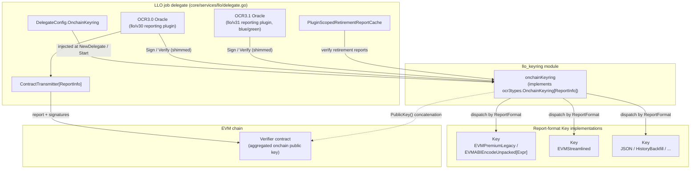
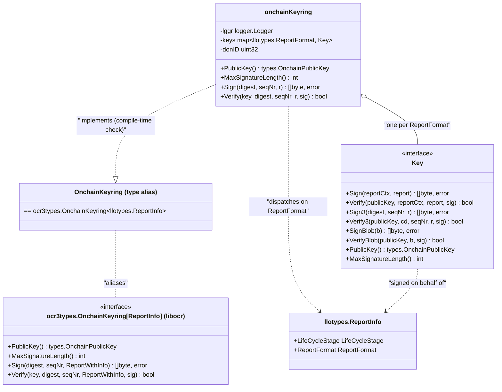
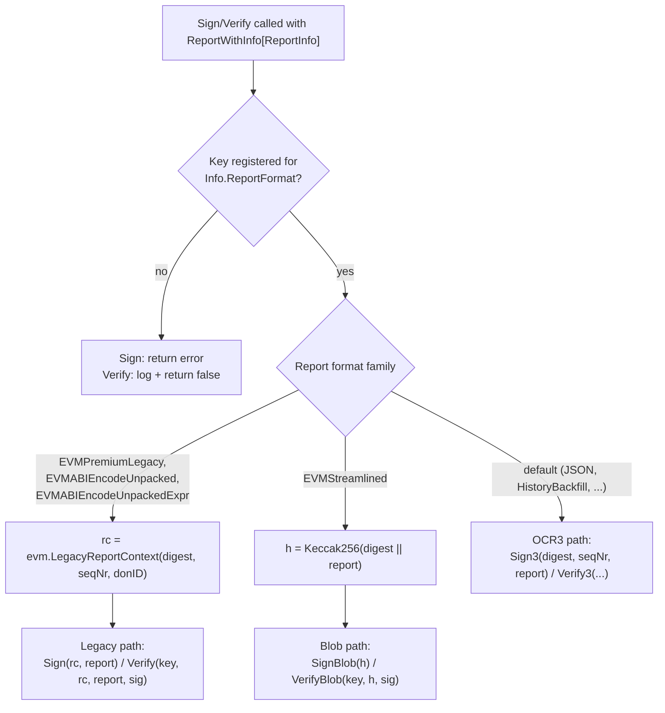
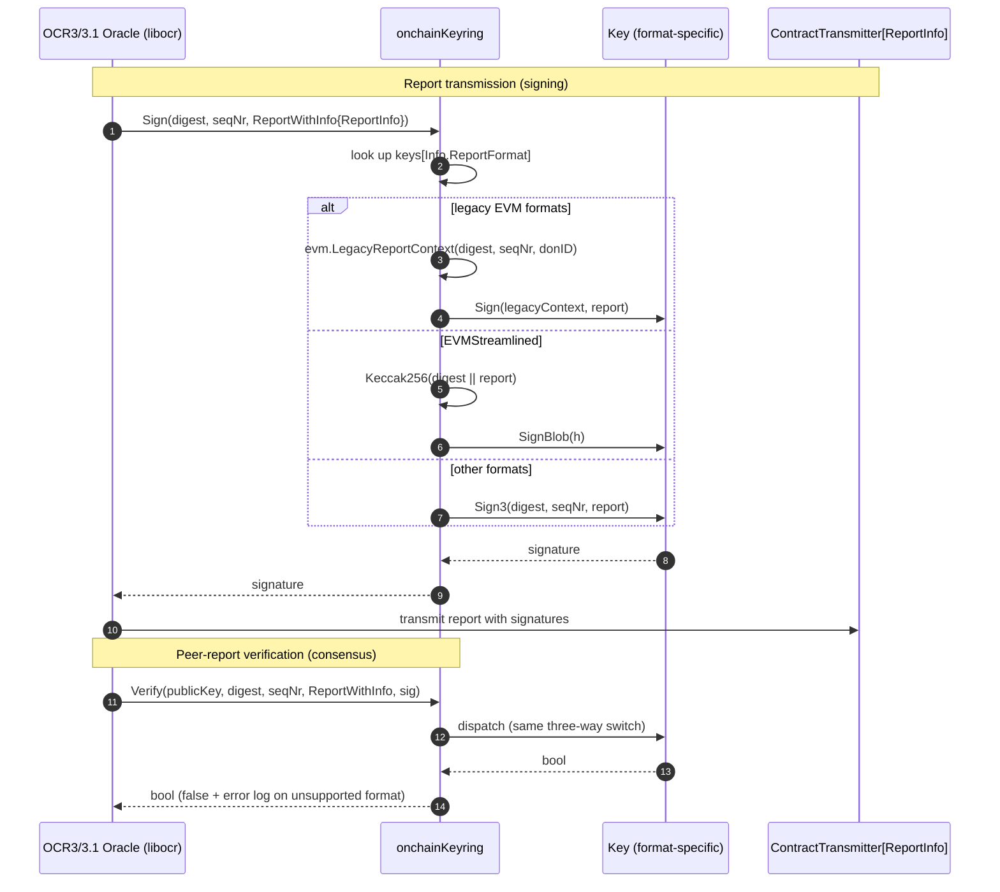

# LLO Keyring (`chainlink/core/services/llo/keyring.go`)

## 1. Introduction

The **LLO Keyring** module implements the *onchain keyring* used by the **LLO (Low-Latency Oracle)** reporting plugins when they run under the OCR3/OCR3.1 consensus protocol. It is the component that turns the OCR3 oracle's abstract "sign this report" / "verify this report" requests into concrete cryptographic operations, and it does so **per LLO report format** — because LLO supports multiple report encodings (legacy premium, ABI-unpacked, streamlined, JSON, history-backfill), each of which has its own signature scheme and onchain verification rules.

The module lives in the main `chainlink` Go module (`github.com/smartcontractkit/chainlink/v2`, see `chainlink/go.mod`) at `chainlink/core/services/llo/keyring.go`. It exposes a single core abstraction:

* the **`Key`** interface — a report-format-specific signer/verifier, and
* the **`onchainKeyring`** aggregator — which implements `ocr3types.OnchainKeyring[llotypes.ReportInfo]` by dispatching to the right `Key` for the report format found in each report's `ReportInfo` metadata.

For the wider picture of LLO inside the node (delegate, observation data source, telemetry), see the parent page [LLO](../llo.md). Sibling pages cover [LLO Benchmarks](llo_benchmarks.md) and [LLO Telemetry](llo_telemetry.md).

---

## 2. Purpose and Responsibilities

The keyring module is responsible for:

1. **Format-aware report signing.** When the OCR3 oracle produces a report for transmission, the keyring signs it using the correct scheme for the report's `llotypes.ReportFormat`.
2. **Format-aware report verification.** When reports are received from other DON members during consensus, the keyring verifies signatures, again dispatching on report format.
3. **Aggregated onchain public key.** It exposes a single, deterministically-ordered `types.OnchainPublicKey` formed by concatenating the (unique) public keys of all registered format keys — this is what the onchain contract uses to verify transmitted reports.
4. **Signature length accounting.** It exposes `MaxSignatureLength()`, an upper bound (the *sum* across all registered keys) used by libocr to size signature buffers during consensus.
5. **Legacy compatibility.** For the EVM legacy/ABI-unpacked report formats it reconstructs a *legacy v0.3 report context* (`evm.LegacyReportContext`) so signatures remain compatible with the older v0.3 onchain verification path, and therefore uses the legacy `Sign`/`Verify` methods of `Key`.

Out of scope for this module (handled elsewhere):

* **Offchain keyring** (config-signing / offchain transmissions): supplied separately as `ocr2types.OffchainKeyring` in `DelegateConfig` — see [OCR2 Delegate](../ocr/ocr2_delegate.md).
* **Storage / import / export of key material**: managed by the node keystore — see [Node Keystore & Master Keys](../../Node_Platform_Services/keystore/keystore_node_keyring.md) and [Keystore Runtime (Signer/Reader/Storage)](../../Node_Platform_Services/keystore/keystore_runtime.md).

---

## 3. Context: How the Keyring Fits into the System

`NewOnchainKeyring` produces an `OnchainKeyring` (a type alias for `ocr3types.OnchainKeyring[llotypes.ReportInfo]`). That value is injected into the LLO job via `DelegateConfig.OnchainKeyring` and consumed by the LLO delegate in three places:

1. **OCR3.0 oracle construction** (`newOracleV30`): passed to libocr through the shim `ocr3shims.OnchainKeyringAsOnchainKeyring2(...)` as the oracle's onchain keyring. libocr calls it to sign every report it transmits and to verify reports received from peers.
2. **OCR3.1 oracle construction** (`newOracleV31`): identical treatment for blue/green plugin version handover (a second oracle instance running the v31 plugin).
3. **Retirement report verification**: wrapped by `retirement.NewPluginScopedRetirementReportCache(cfg.RetirementReportCache, cfg.OnchainKeyring, cfg.RetirementReportCodec)` so plugin-scoped retirement reports are verified with the same key material.



The per-format `Key` implementations are supplied by the caller that builds `DelegateConfig` (the LLO job wiring, backed by the node's keystore-backed signers — see [Node Keystore & Master Keys](../../Node_Platform_Services/keystore/keystore_node_keyring.md)). This module itself is purely an aggregation and dispatch layer: it holds no private key material of its own.

---

## 4. Architecture and Component Relationships

### 4.1 Class-level view



### 4.2 The `Key` interface

`Key` (declared in `chainlink/core/services/llo/keyring.go`) is the per-format signer/verifier contract. It intentionally exposes *three* signing styles so that a single implementation can serve several report-format families:

| Method | Purpose | Used by keyring path |
|---|---|---|
| `Sign(reportCtx types.ReportContext, report types.Report) ([]byte, error)` | Legacy signing against a full OCR report context. Required for **v0.3 report compatibility**; *new keys may stub this out*. | EVM legacy formats (`EVMPremiumLegacy`, `EVMABIEncodeUnpacked`, `EVMABIEncodeUnpackedExpr`) |
| `Verify(publicKey, reportCtx, report, signature) bool` | Legacy verification counterpart of `Sign`. | Same as above |
| `Sign3(digest types.ConfigDigest, seqNr uint64, r types.Report) ([]byte, error)` | OCR3-style signing bound to the config digest and sequence number. | Default path (e.g. `JSON`, `HistoryBackfill`, and any future formats) |
| `Verify3(publicKey, cd, seqNr, r, signature) bool` | OCR3-style verification. | Default path |
| `SignBlob(b []byte) ([]byte, error)` | Sign an arbitrary pre-hashed blob. | `EVMStreamlined` (keyring pre-hashes `digest ‖ report`) |
| `VerifyBlob(publicKey, b, sig) bool` | Verify an arbitrary blob signature. | `EVMStreamlined` |
| `PublicKey() types.OnchainPublicKey` | This key's onchain public key (concatenated into the keyring aggregate). | `PublicKey()` aggregation |
| `MaxSignatureLength() int` | Upper bound on signature size produced by this key. | `MaxSignatureLength()` summation |

### 4.3 The `onchainKeyring` aggregator

The unexported `onchainKeyring` struct implements the aggregated behaviour and satisfies the libocr interface via the compile-time assertion `var _ OnchainKeyring = &onchainKeyring{}`:

* `lggr logger.Logger` — a sugared logger named `"OnchainKeyring"` (created in `NewOnchainKeyring` via `logger.Sugared(lggr).Named("OnchainKeyring")`).
* `keys map[llotypes.ReportFormat]Key` — the registered per-format keys.
* `donID uint32` — the DON ID, needed only to reconstruct the *legacy* report context for the EVM legacy formats.

Constructor:

```go
func NewOnchainKeyring(lggr logger.Logger, keys map[llotypes.ReportFormat]Key, donID uint32) OnchainKeyring
```

---

## 5. Report-Format Dispatch Logic

Both `Sign` and `Verify` perform the same three-way dispatch, driven by `r.Info.ReportFormat` (the `ReportInfo` carried with every OCR3 report):

| Report format(s) | Signature scheme | Context preparation | `Key` method used |
|---|---|---|---|
| `ReportFormatEVMPremiumLegacy`, `ReportFormatEVMABIEncodeUnpacked`, `ReportFormatEVMABIEncodeUnpackedExpr` | Legacy EVM scheme (v0.3-compatible) | `evm.LegacyReportContext(digest, seqNr, okr.donID)` reconstructs the full OCR report context | `Sign` / `Verify` |
| `ReportFormatEVMStreamlined` | Signature over `Keccak256(digest ‖ report)` | The keyring hashes `digest` concatenated with the report itself — the timestamp is guaranteed unique per round and always included in the report, so it does not need to be part of the context | `SignBlob` / `VerifyBlob` |
| Everything else (`JSON`, `HistoryBackfill`, future formats) | Generic OCR3 scheme | Config digest + sequence number passed straight through | `Sign3` / `Verify3` |

If no `Key` is registered for the requested format:

* `Sign` returns an error: `"Sign failed; unsupported report format: %q"`.
* `Verify` logs `"Verify failed; unsupported report format: %q"` and returns `false` (the oracle will treat the peer report as invalid).

Other error paths:

* `Sign` with a legacy format but a failing `LegacyReportContext` → wrapped error `"failed to get legacy report context: %w"`.
* `Sign` with `EVMStreamlined` and a hashing failure → `"failed to hash report: %w"`.
* `Verify` logs (rather than returns) legacy-context and hashing errors and evaluates to `false`.



---

## 6. Signing Flow in a Round (Sequence)



The identical keyring instance also verifies **retirement reports** through the plugin-scoped retirement report cache created in `delegate.Start` (`retirement.NewPluginScopedRetirementReportCache`).

---

## 7. Public Key Aggregation and Signature Sizing

### 7.1 `PublicKey()` — deterministic concatenation

The onchain contract verifies a transmitted report against a single onchain public key. Because a DON may be configured with keys for several report formats, `PublicKey()` builds a canonical aggregate:

1. Collect the `PublicKey()` bytes of every registered format key.
2. Sort them in ascending byte order (`bytes.Compare`).
3. Concatenate, skipping entries that compare equal to their predecessor.

Key behavioural details:

* **Determinism**: sorting guarantees every node in the DON derives the identical aggregate public key, independent of map iteration order — this is essential, since `OffchainConfigDigester`-derived onchain config must match across nodes.
* **Empty keyring**: returns an empty byte string.
* **Deduplication caveat**: the "already seen" check compares *`Key` interface values* (`keys[i] != keys[i-1]`, i.e. identity of the registered implementations), not public-key bytes. Because the slice is sorted by public-key bytes, two *identical registered key instances* land adjacent and are deduplicated; two *distinct instances that happen to hold the same public key* would both be appended. In practice each format registers a distinct key, so the aggregate is the plain concatenation of all format keys in public-key order.

### 7.2 `MaxSignatureLength()` — safe upper bound

libocr requires one worst-case signature size for buffer/validity purposes. Since a given report only uses one format, but the oracle must accept *any* configured format, the keyring returns the **sum** of `MaxSignatureLength()` across all registered keys — a strict upper bound (`MaxSignatureLength = Σ per-format maxima`). With an empty keyring this is `0`.

---

## 8. Integration Points and Dependencies

### 8.1 Direct dependencies of `keyring.go`

| Dependency | Used for |
|---|---|
| `github.com/smartcontractkit/libocr/offchainreporting2plus/ocr3types` | `OnchainKeyring[ReportInfo]` interface, `ReportWithInfo` |
| `github.com/smartcontractkit/libocr/.../types` | `ReportContext`, `ConfigDigest`, `OnchainPublicKey`, `Report` |
| `github.com/smartcontractkit/chainlink-common/pkg/logger` | Sugared/named logging |
| `github.com/smartcontractkit/chainlink-common/pkg/types/llo` (`llotypes`) | `ReportInfo`, `ReportFormat` constants (see [types-mercury-llo](../../Shared_Foundation_Libraries___Domain_Types/types-mercury-llo.md)) |
| `github.com/smartcontractkit/chainlink-data-streams/llo/reportcodec/evm` | `LegacyReportContext` reconstruction |
| `github.com/smartcontractkit/chainlink/v2/core/utils/crypto` | `Keccak256` hashing for the streamlined path |

### 8.2 Callers

* **`chainlink/core/services/llo/delegate.go`** — `DelegateConfig.OnchainKeyring` is consumed in `Start` (via `newOracleV30`/`newOracleV31` and `NewPluginScopedRetirementReportCache`). The delegate lifecycle (blue/green instances, one per `ContractConfigTracker`) is documented on the parent page [LLO](../llo.md).
* **LLO job wiring** — builds the per-format `keys` map (keystore-backed signers) and the DON ID, then calls `NewOnchainKeyring`. Key custody and management belong to the platform keystore — see [Node Keystore & Master Keys](../../Node_Platform_Services/keystore/keystore_node_keyring.md) and the cross-process keystore surfaces in the [Loop Plugin Process Framework](../../Plugin_Process_Framework_(Loop)/loop-plugin-core.md).

### 8.3 Relationship to other oracle engines

The same libocr `OnchainKeyring` contract is used by other OCR3-based engines in this domain (e.g. OCR2/OCR3 delegates, CCIP OCR impls); the LLO variant is unique in being **report-format multiplexed** — see [OCR](../ocr.md) and [OCR2 Delegate](../ocr/ocr2_delegate.md) for the single-format pattern used elsewhere.

---

## 9. Error Handling and Operational Notes

| Scenario | `Sign` behaviour | `Verify` behaviour |
|---|---|---|
| Format has no registered `Key` | Returns error `"Sign failed; unsupported report format: %q"` (the round fails to produce a transmission) | Logs error, returns `false` (peer report discarded by consensus) |
| `LegacyReportContext` construction fails (legacy formats) | Returns wrapped error `"failed to get legacy report context: %w"` | Logs `"Verify failed; unable to get legacy report context"`, returns `false` |
| `Keccak256` hash fails (`EVMStreamlined`) | Returns wrapped error `"failed to hash report: %w"` | Logs `"failed to hash report"`, returns `false` |

Operational guidance:

* **Register keys for every format you can produce or receive.** A missing key for a format another DON member transmits will make the node vote those reports invalid; a missing key for the *node's own* configured format prevents it from signing at all.
* **`donID` must match the DON configuration**, otherwise reconstructed legacy report contexts (and therefore legacy signatures) will not verify onchain.
* **Verification never panics and never returns an error** — by libocr convention it degrades to `false` with a log, keeping consensus resilient to malformed peer reports.
* The module performs no key storage or persistence; rotation is managed upstream in the keystore (see [Keystore Runtime](../../Node_Platform_Services/keystore/keystore_runtime.md)).

---

## 10. Testing

Behaviour is covered by `chainlink/core/services/llo/keyring_test.go`:

* A `mockKey` implements the full `Key` interface and is registered for `ReportFormatEVMPremiumLegacy`, `ReportFormatJSON`, and `ReportFormatEVMStreamlined`.
* **Sign+Verify round-trip**: for each registered format, `Sign` routes to the expected `Key` method (asserted via the mock's format-tagged signature) and `Verify` routes to the same key.
* **`MaxSignatureLength`** asserts summation (1 + 2 + 6 = 9 in the test fixture).
* **`PublicKey`** asserts deterministic sorted concatenation of the per-key public keys.
* The [LLO benchmarks](llo_benchmarks.md) harness (`core/services/ocr2/plugins/llo/bench`) exercises the keyring implicitly as part of full-plugin end-to-end signing throughput measurements.

---

## 11. Related Documentation

* [LLO — Oracle Engines & Data Pipelines (parent)](../llo.md) — delegate lifecycle, blue/green OCR3/3.1 instances, data sources.
* [LLO Telemetry](llo_telemetry.md) — observation/outcome/report telemetry emitted by the LLO pipeline.
* [LLO Benchmarks](llo_benchmarks.md) — plugin benchmarking harness.
* [OCR](../ocr.md) and [OCR2 Delegate](../ocr/ocr2_delegate.md) — sibling OCR engine where offchain keyrings and single-format keyrings are wired.
* [Node Keystore & Master Keys](../../Node_Platform_Services/keystore/keystore_node_keyring.md) — where signing key material originates.
* [Keystore Runtime (Signer/Reader/Storage)](../../Node_Platform_Services/keystore/keystore_runtime.md) — storage and runtime interfaces behind key custody.
* [types-mercury-llo](../../Shared_Foundation_Libraries___Domain_Types/types-mercury-llo.md) — `ReportInfo`, `ReportFormat`, and related shared LLO types.

---

## 12. Source References

* `chainlink/core/services/llo/keyring.go` — `Key` interface, `onchainKeyring` implementation, `NewOnchainKeyring` constructor (this module).
* `chainlink/core/services/llo/keyring_test.go` — unit tests (`Test_Keyring`, `mockKey`).
* `chainlink/core/services/llo/delegate.go` — `DelegateConfig`, `NewDelegate`, `newOracleV30`/`newOracleV31`, retirement-report-cache wiring.
* `chainlink/core/services/llo/report_codecs.go` — the full set of supported `llotypes.ReportFormat` values (`NewReportCodecs`).
* `chainlink-common/pkg/types/llo/types.go` — `ReportInfo{LifeCycleStage, ReportFormat}`.
* `chainlink/go.mod` — module `github.com/smartcontractkit/chainlink/v2`; libocr, `chainlink-data-streams`, and `chainlink-common` dependencies.
