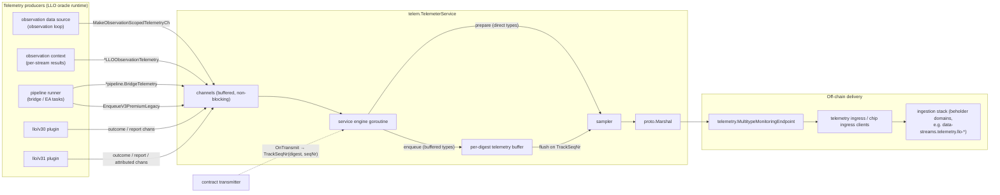
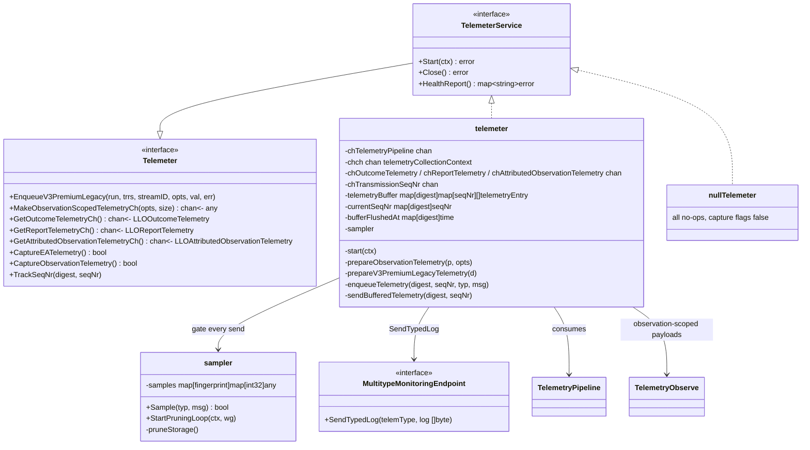
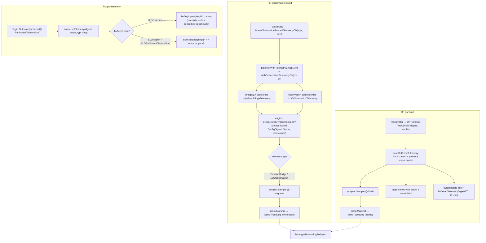
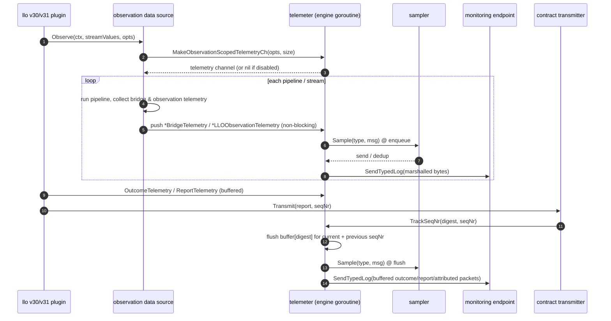
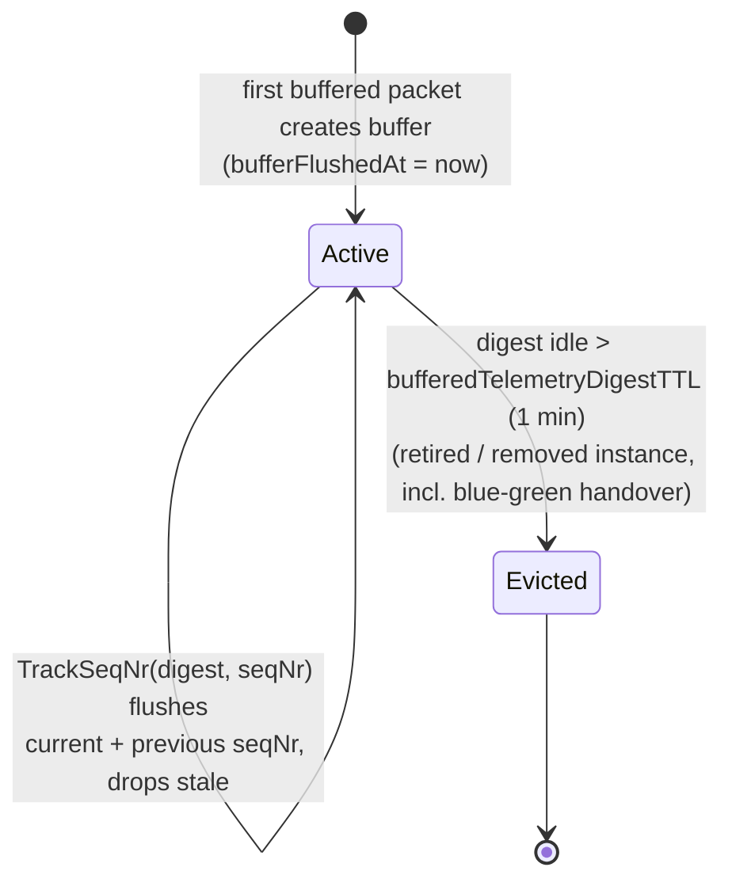
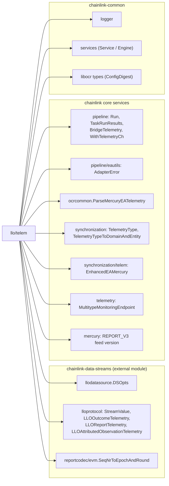

# LLO Telemetry (`llo_telemetry`)

## Overview

The `llo_telemetry` module (Go package `chainlink/core/services/llo/telem`) is the **telemetry collection and export service for the Low-Latency Oracle (LLO) / Data Streams reporting pipeline**. It sits between the hot-path producers inside an LLO OCR oracle — the observation data source, the pipeline runner, and the v30/v31 reporting plugins — and the node's off-chain telemetry delivery infrastructure (`telemetry.MultitypeMonitoringEndpoint`, which is backed by the telemetry-ingress and Chip-Ingress clients).

Its primary design goal is **zero impact on the observation hot path**: telemetry capture is strictly non-blocking (packets are dropped, never queued against the producer), and the optional per-type **sampling** and **transmission-scoped buffering** keep downstream volume predictable.

Core file: `chainlink/core/services/llo/telem/telemetry.go`, supported by `sampling.go` (sampler), `telem_streams.proto` / `telem_streams.pb.go` (wire messages) and `generate.go` (protobuf generation).

---

## Where the module fits

The module is a leaf service of the **LLO** family inside *Oracle Engines & Data Pipelines*:

- The parent module [LLO](../llo.md) assembles an OCR3(1)-based oracle per `llo` job via `llo.NewDelegate`. The delegate:
  1. builds a `TelemeterService` from `TelemeterParams` (`telem.NewTelemeterService`),
  2. injects it into the shared LLO data source (`observation.NewDataSource`), which uses it for observation- and bridge-scoped telemetry,
  3. registers `telem.TrackSeqNr` as the transmitter's `OnTransmit` callback so telemetry flushes exactly when reports are transmitted on-chain,
  4. hands the outcome/report/attributed-observation channels (`GetOutcomeTelemetryCh`, `GetReportTelemetryCh`, `GetAttributedObservationTelemetryCh`) into the v30/v31 reporting-plugin factory params — a channel is `nil` when that capture flag is disabled, so an instance only emits the telemetry its own plugin version enables.
- Consumed pipeline machinery is documented in [Pipeline](../pipeline.md) and [Streams](../streams.md); the Mercury EA telemetry parser it reuses is part of [OCR common](../ocr/ocrcommon_shared.md).
- Deliverable messages travel through the node's observability platform: see [Telemetry Ingress](../../Telemetry___Observability_Platform/telemetry_ingress.md), [Chip Ingress](../../Telemetry___Observability_Platform/chip-ingress.md) and [Beholder](../../Telemetry___Observability_Platform/beholder-telemetry.md). Endpoint configuration (node-level) is described in [Core Config — Observability](../../Node_Application_Core___Interfaces/core_config/core_config_observability.md).

---

## Supported telemetry types

The module classifies every packet by a `synchronization.TelemetryType` (defined in `core/services/synchronization/common.go`, which also maps each type to the beholder `domain`/`entity` pair used downstream):

| Telemetry type | Origin | Delivery strategy | Message schema |
|---|---|---|---|
| `pipeline-bridge` | Bridge/EA task executions inside a pipeline run (`*pipeline.BridgeTelemetry`, via `pipeline.WithTelemetryCh`) | **Direct** — sent immediately, sampled at enqueue | `telem.LLOBridgeTelemetry` (`telem_streams.proto`) |
| `llo-observation` | One per observed stream per round (`observationContext.enqueueObservationTelemetry`) | **Direct** — sent immediately, sampled at enqueue | `telem.LLOObservationTelemetry` (`telem_streams.proto`) |
| `enhanced-ea-mercury` | Legacy "V3 premium" EA telemetry parsed from bridge task results (`EnqueueV3PremiumLegacy` → `ocrcommon.ParseMercuryEATelemetry`) | **Direct** — sent immediately, sampled at enqueue | `telem.EnhancedEAMercury` (legacy `synchronization/telem` protos), `Version = 1000 + mercury.REPORT_V3` |
| `llo-outcome` | v30/v31 plugin `Outcome()` (one per round) | **Buffered** per config digest — *overwritten* per seqNr (last committed epoch wins), flushed on transmit, sampled at flush | `lloprotocol.LLOOutcomeTelemetry` |
| `llo-report` | v30/v31 plugin report construction (one per reportable channel; multiple per seqNr) | **Buffered** per config digest — *appended* per seqNr, flushed on transmit, sampled at flush | `lloprotocol.LLOReportTelemetry` |
| `llo-attributed-observation` | v31 rotating emitters (one per observer per round; more when large observations are split) | **Buffered** per config digest — appended per seqNr, flushed on transmit, sampled at flush | `lloprotocol.LLOAttributedObservationTelemetry` |

Rationale: outcome/report/attributed packets describe rounds that are only meaningful once a report is actually **transmitted** (after commit-quorum), so they are held in a digest-scoped buffer and released by `TrackSeqNr`. Observation and bridge packets are independently useful even when a round never transmits, so they go straight out.

---

## Architecture and components

### Public surface

| Identifier | Role |
|---|---|
| `Telemeter` | Producer-facing interface: `EnqueueV3PremiumLegacy`, `MakeObservationScopedTelemetryCh`, `GetOutcomeTelemetryCh`, `GetReportTelemetryCh`, `GetAttributedObservationTelemetryCh`, `CaptureEATelemetry`, `CaptureObservationTelemetry`, `TrackSeqNr` |
| `TelemeterService` | `Telemeter` + `services.Service` (standard Start/Close/HealthReport lifecycle) |
| `TelemeterParams` | Construction parameters: logger, `MultitypeMonitoringEndpoint`, `DonID`, and the capture flags (`CaptureEATelemetry`, `CaptureObservationTelemetry`, `CaptureOutcomeTelemetry`, `CaptureReportTelemetry`, `CaptureAttributedObservationTelemetry` — v31 only — and `SampleTelemetry`) |
| `NewTelemeterService` | Factory: returns the no-op `NullTelemeter` when `MonitoringEndpoint == nil`, otherwise the real `telemeter` |
| `NullTelemeter` / `nullTelemeter` | Null-object implementation — every method is a safe no-op and the capture getters report `false`/`nil`. Guarantees that jobs with telemetry disabled (or endpoints unconfigured) share the same code path with no nil-checks at call sites |
| `DSOpts` | Type alias for `llodatasource.DSOpts` (shared by llo/v30 and llo/v31); carries the round's config digest, seqNr, observation timestamp, lifecycle stage and verbose flag used to stamp telemetry |
| `TelemetryPipeline` | Internal payload bundling a pipeline run + task-run results, stream ID, `DSOpts`, resolved stream value, and a DP-invariant-violation flag, for the V3-premium-legacy EA path |
| `TelemetryObserve` | Small struct pairing `DSOpts` with an arbitrary telemetry payload, used by producers that push observation-scoped packets |

### Internal machinery

| Identifier | Role |
|---|---|
| `telemeter` | The engine: owns all channels, the digest buffer maps, seqNr tracking, and the single `services.Engine` goroutine that drains everything |
| `sampler` (`sampling.go`) | Dedup gate — see [Sampling](#sampling) |
| `telemetryEntry` | Buffered `{TelemetryType, proto.Message}` pair |
| `telemetryCollectionContext` | `{in <-chan any, opts DSOpts}` — binds one observation-scoped channel to the `DSOpts` of the round that created it |

### Lifecycle

- **Start** (`services.Config` engine): spawns the single drain goroutine and the sampler pruning loop. The LLO delegate starts the telemeter **before** the oracles and closes it **after** them.
- **Close**: closes every input channel. Any enqueue attempted afterwards is a programming error — the engine enforces it via the `Ready()` check in `EnqueueV3PremiumLegacy` (packet is dropped and an error is logged).
- **Engine loop** multiplexes over: new observation-scoped channels (`chch`), pipeline packets, outcome/report/attributed packets, transmission events, and context cancellation (worker `WaitGroup` drained on shutdown).

---

## Construction and wiring

`llo.NewDelegate` (`chainlink/core/services/llo/delegate.go`) is the sole production constructor. It assembles `TelemeterParams` from `DelegateConfig` — the v30 job fields and the v31 plugin config flags are OR-merged (`CaptureOutcomeTelemetry: cfg.CaptureOutcomeTelemetry || cfg.V31Config.CaptureOutcomeTelemetry`, and similarly for reports), while `CaptureAttributedObservationTelemetry` is only honoured by llo/v31 instances. `SampleTelemetry` comes from the job-level configuration.

Key wiring rules to be aware of when modifying the delegate:

1. `NewTelemeterService` returns `NullTelemeter` when no monitoring endpoint is configured — callers never nil-check.
2. The observation data source creates **one observation-scoped channel per round** via `MakeObservationScopedTelemetryCh(opts, size)`; the *caller must close it* (the data source does, at the end of each iteration) or the per-round goroutine leaks. The returned channel is `nil` when neither EA nor observation capture is enabled.
3. `enabledCh(enabled, ch)` nils out the plugin telemetry channels when a flag is off, so a protocol instance only receives the channels its own version enables (blue/green instances may differ).
4. `notifier.OnTransmit(t.TrackSeqNr)` binds buffered-telemetry flushes to actual transmissions; the transmitter must implement `transmitter.TransmitNotifier` for buffering to drain.

---

## Data flow

### Sequence of one LLO round

### Buffered-telemetry lifecycle (per config digest)

Notable behaviours of `sendBufferedTelemetry`:

- **Straggler inclusion**: entries from the *previous* seqNr that were enqueued after that seq's transmission are flushed together with the current seqNr, so no packet is lost to a race between `enqueueTelemetry` and `TrackSeqNr`.
- **Stale pruning**: all entries with `seqNr ≤ transmitted seqNr` are dropped.
- **Blue/green independence**: buffers are keyed by config digest and flushed by their own transmissions, so concurrent blue and green instances (different digests) never interfere; an instance that stops transmitting has its buffer garbage-collected after `bufferedTelemetryDigestTTL = 1 minute` (see `bufferFlushedAt` eviction).
- Flushing marshals and sends **asynchronously** in a goroutine, keeping the engine loop free.

---

## Sampling

Implemented in `sampling.go`:

- Enabled by `TelemeterParams.SampleTelemetry`. When disabled, every packet passes (`Sample` always returns `true`).
- A **fingerprint** is derived per telemetry type from its identity traits (e.g. `donId-streamId-configDigest` for observations; `donId-observer-configDigest-lowestStreamId` for attributed observations, so split parts of a large observation sample independently) plus the **observation timestamp truncated to seconds**. Only *one packet per fingerprint per observation-second* is forwarded.
- Unsupported telemetry types fail fingerprinting and are always sent (fail-open), rather than silently dropping data.
- A pruning goroutine (`StartPruningLoop`, 10 s period, started by the telemeter engine and shut down with it) evicts fingerprints older than the prune period.
- Sampling is applied **at flush time** for buffered telemetry (so a buffered outcome that is later overwritten is never sampled twice) and **at enqueue time** for direct types.

---

## Concurrency and reliability invariants

1. **Never block observations.** Every enqueue path (`EnqueueV3PremiumLegacy`, `MakeObservationScopedTelemetryCh`, plugin channels, `TrackSeqNr`) uses `select { case ch <- x: default: }` — under overload packets are dropped (with a warning) instead of stalling the OCR round. Channel sizes are tuned for the expected load (e.g. `chTelemetryPipeline` holds ~5 s of worst-case traffic for 2 000 feeds at 250 ms rounds; outcome buffer 100; report buffer `(2+2)·MaxReportCount`; attributed-observation buffer 1 000; `chch` 1 000).
2. **Single engine goroutine.** All marshalling/buffer state transitions except per-digest maps are owned by one goroutine; the digest buffer and current-seqNr maps have their own mutexes (`telemetryBufferMu`, `currentSeqNrMu`).
3. **Timestamps are nanoseconds** (`UnixNano`) in the protobuf messages; the sampler deliberately stores seconds as `int32` so nanosecond/second values cannot be confused.
4. **Failure containment.** A failed observation is still reported (both the generic V3-premium path and the newer observation telemetry), including adapter errors: the special `AdapterLWBAError` (low-watermark bid/ask) from `eautils` is surfaced as `DpInvariantViolationDetected` in `EnhancedEAMercury` telemetry rather than being ignored like other errors.
5. **Shutdown discipline.** Telemeter is started before, and closed after, the oracles; `Close` closes all input channels, making post-close enqueues detectable.

---

## Dependencies

- **Pipeline / EA** — run and task-run results feeding `EnqueueV3PremiumLegacy` and bridge telemetry; see [Pipeline](../pipeline.md).
- **ocrcommon** — `ParseMercuryEATelemetry` extracts per-bridge EA datapoints (benchmark/bid/ask decimals, provider timestamps) from task-run results; see [OCR common](../ocr/ocrcommon_shared.md).
- **chainlink-data-streams llo** — `DSOpts`, protocol telemetry structs, and the seqNr→(epoch, round) conversion used for legacy Mercury telemetry.
- **synchronization / telemetry** — telemetry type registry, domain/entity mapping, and the endpoint interface that fronts the ingress clients; see [Telemetry Ingress](../../Telemetry___Observability_Platform/telemetry_ingress.md) and [types-core](../../Shared_Foundation_Libraries___Domain_Types/types-core.md) (`core/telemetry.go`).
- **mercury types** — `REPORT_V3` versioning; see [types-mercury-llo](../../Shared_Foundation_Libraries___Domain_Types/types-mercury-llo.md).

---

## Sibling LLO modules

- [LLO Keyring](llo_keyring.md) — report signing keys used by the same delegate/oracles.
- [LLO Benchmarks](llo_benchmarks.md) — benchmark harness exercising the LLO plugin stack.

---

## File inventory

| File | Contents |
|---|---|
| `telemetry.go` | `Telemeter`/`TelemeterService` interfaces, `TelemeterParams`, `NewTelemeterService`, the `telemeter` engine, buffering + transmission tracking, `TelemetryPipeline`, `TelemetryObserve`, `NullTelemeter` |
| `sampling.go` | `sampler`, per-type fingerprints, pruning loop |
| `telem_streams.proto` / `telem_streams.pb.go` | `LLOBridgeTelemetry` and `LLOObservationTelemetry` message schemas (generated via `generate.go`) |
| `telemetry_test.go` / `sampling_test.go` | Behaviour and sampling tests |
