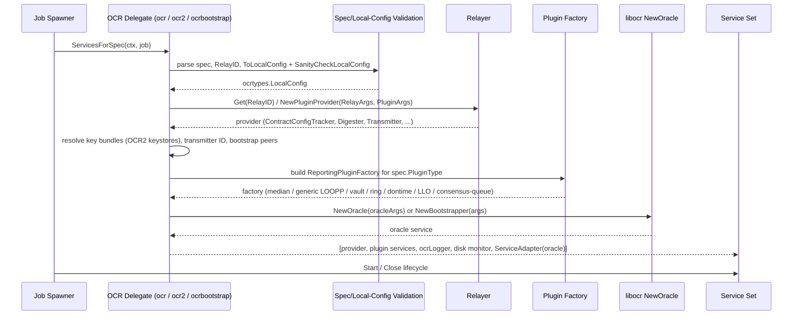
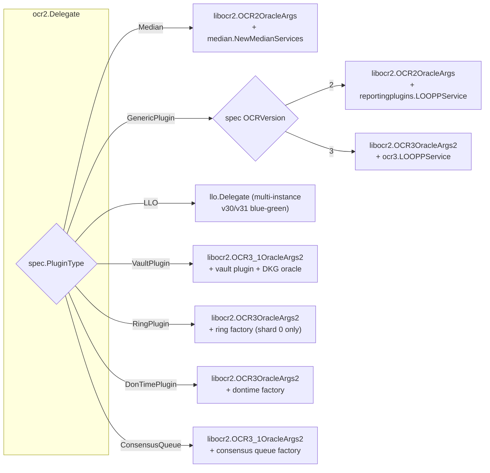

# OCR (Off-Chain Reporting) Oracle Engines

## Overview

The `ocr` module implements the node-side oracle engines for Chainlink's **Off-Chain Reporting (OCR)** protocols. OCR is a threshold-signature consensus protocol in which a committee ("Decentralised Oracle Network", or DON) observes data, agrees on a report off-chain, and transmits a single aggregated, signature-verified report on-chain — dramatically reducing gas costs compared to per-node reporting.

This module is the bridge between the Chainlink node's **job system** and the **libocr** library (`libocr/offchainreporting` for OCR1, `libocr/offchainreporting2plus` for OCR2/OCR3). It consists of four cooperating packages:

| Package | Role |
|---|---|
| `core/services/ocr` | **OCR1** oracle support: job-spec validation, on-chain contract tracking, config-overriding ("hibernation"), and the OCR1 `job.Delegate` |
| `core/services/ocr2` | **OCR2/OCR3** oracle support: the `Delegate` that instantiates oracle instances for all plugin types (Median, Generic/LOOPP, LLO, Vault, DonTime, Ring, ConsensusQueue) |
| `core/services/ocrbootstrap` | **Bootstrap node** delegate: the lightweight rendezvous nodes that seed P2P connectivity for OCR networks |
| `core/services/ocrcommon` | Shared plumbing used by all three: local-config helpers, bootstrap-peer parsing, pipeline-backed data sources, OCR logging adapter, telemetry |

All three delegates implement the [`job.Delegate`](../Node_Platform_Services/job_service/job_service_lifecycle.md) contract: the node's job spawner calls `ServicesForSpec(ctx, job)` when an OCR job is created or reloaded, and the delegate assembles and returns the long-running `job.ServiceCtx` services that make up one oracle instance.

## Architecture

### Component Map

```mermaid
flowchart TB
    subgraph JobSystem["Node Job System"]
        JS[Job Spawner / ORM]
    end

    subgraph OCRModule["ocr module"]
        subgraph OCR1["core/services/ocr (OCR1)"]
            D1[Delegate]
            V[ValidatedOracleSpecToml]
            CT[ContractTracker]
            CO[ConfigOverriderImpl]
            CF[ContractFlags / Flags]
            C1[Config -> LocalConfig]
        end

        subgraph OCR2["core/services/ocr2 (OCR2/OCR3)"]
            D2[Delegate]
            VC[validate.ToLocalConfig]
            DB[(ocr2 database /db)]
            subgraph Plugins["plugins/"]
                MP[median]
                GP[generic / LOOPP]
                VP[vault]
                RP[ring]
                LLOP[llo]
                OPC[plugin.OraclePlugin interface]
                PC[median / ring / vault PluginConfig]
            end
        end

        subgraph BOOT["core/services/ocrbootstrap"]
            D3[Delegate<br/>Bootstrap nodes]
        end

        subgraph COMMON["core/services/ocrcommon (shared)"]
            BP[Bootstrap-peer parsing<br/>GetValidatedBootstrapPeers]
            DS[Data sources<br/>dataSource / dataSourceV2 / cache]
            OW[OCR logger wrapper]
            PW[SingletonPeerWrapper]
            TEL[EA / Enhanced telemetry]
        end
    end

    subgraph External["External systems"]
        LIBOCR["libocr<br/>(OCR1 / OCR2+ / OCR3.1 oracles)"]
        CHAIN[(On-chain aggregator<br/>contracts)]
        P2P["libp2p P2P network"]
        RELAYERS["Relayers<br/>(EVM, Solana, Aptos, ...)"]
        PIPE["Pipeline Runner"]
        KS["Keystores<br/>(OCR2, Eth, Workflow, DKG)"]
    end

    JS -->|"ServicesForSpec()"| D1
    JS -->|"ServicesForSpec()"| D2
    JS -->|"ServicesForSpec()"| D3

    C1 --> V
    V --> D1
    CT --> CHAIN
    CO --> CF
    CF --> CHAIN
    D1 --> LIBOCR

    D2 --> VC
    D2 --> DB
    D2 --> MP
    D2 --> GP
    D2 --> VP
    D2 --> RP
    D2 --> LLOP
    GP -.->|implements| OPC
    D2 --> LIBOCR
    D2 --> RELAYERS

    D3 --> LIBOCR
    D3 --> RELAYERS

    D1 --> PW
    D2 --> PW
    D3 --> PW
    D1 --> BP
    D2 --> BP
    D3 --> BP
    MP --> DS
    DS --> PIPE
    D1 --> KS
    D2 --> KS

    LIBOCR --> P2P
```

### How an OCR job becomes a running oracle

### Relationship to other modules

* **[Job Service](../Node_Platform_Services/job_service/job_service_lifecycle.md)** — all three delegates plug into the job spawner through the `job.Delegate` / `job.ServiceCtx` contracts.
* **[Pipeline](pipeline.md)** & **[Streams](streams.md)** — OCR observations are computed by running *data pipelines*; `ocrcommon` adapts pipeline runs into the `median.DataSource` interface used by libocr.
* **[LLO](llo.md)** — Large Language Oracle (data streams) is dispatched by the same OCR2 delegate as the `types.LLO` plugin type.
* **[VRF](vrf.md)** — separate oracle engine with its own delegate; not part of this module.
* **[Keystore](../Node_Platform_Services/keystore/keystore_node_keyring.md)** — supplies OCR2 signing key bundles, ETH transmitter accounts, workflow and DKG-recipient keys.
* **[P2P](../Node_Platform_Services/p2p.md)** — `ocrcommon.SingletonPeerWrapper` provides the shared libp2p v2/v3 peer endpoints every oracle instance transmits over.
* **[Plugin Process Framework (Loop)](../Plugin_Process_Framework_(Loop).md)** — generic OCR2 plugins run reporting plugins in external LOOPP processes over gRPC.

## Sub-module Documentation

The module is split into four sub-module pages, mirroring the underlying packages:

| Sub-module | Package | Core Components | Contents |
|---|---|---|---|
| [ocr_config_and_validation](ocr/ocr_config_and_validation.md) | `core/services/ocr` | `Config`, `OracleValidationConfig`, `configOverriderUni`, `contractTrackerUni` | OCR1 job-spec validation (TOML → `job.Job`), `Config` → `libocr LocalConfig` conversion, on-chain `ContractTracker` (round/head tracking with DB persistence), and the hibernating `ConfigOverriderImpl` driven by the `Flags` contract |
| [ocr2_delegate](ocr/ocr2_delegate.md) | `core/services/ocr2` | `connProvider`, `OraclePlugin`, median/ring/vault `PluginConfig` | The OCR2/OCR3 `Delegate`: `ServicesForSpec` and registry-driven `NewServices`, per-plugin service assembly (Median, Generic/LOOPP, LLO, Vault+DKG, Ring, DonTime, ConsensusQueue), and per-plugin configuration validation |
| [ocrbootstrap_delegate](ocr/ocrbootstrap_delegate.md) | `core/services/ocrbootstrap` | `relayConfig` | Bootstrap-node `Delegate`: hosts the libocr `Bootstrapper` rendezvous endpoint, resolves config providers via relayers, including the router-proxy (`DONID`) relay-config hack |
| [ocrcommon_shared](ocr/ocrcommon_shared.md) | `core/services/ocrcommon` | `Config`, `DataSourceCacheService` | Shared helpers used by all delegates: bootstrap-peer parsing/validation, pipeline-backed data sources (`dataSource`, `dataSourceV2`, in-memory and cached variants) with run persistence and EA telemetry |

Each page covers that sub-module's core components, responsibilities, dependencies, and data flow in detail.

## Key Concepts

### LocalConfig and spec validation
Every delegate converts a persisted job spec plus node configuration into a `ocrtypes.LocalConfig` (timeouts, poll intervals, confirmations) which is sanity-checked by libocr *before* any network resources are created. OCR1 does this in `services/ocr/config.go` (`toLocalConfig`) and `validate.go`; OCR2/OCR3 and bootstrap use `services/ocr2/validate.ToLocalConfig`. Development mode (`Insecure.OCRDevelopmentMode()`) relaxes these checks for testing.

### Contract interaction
The oracle must read two things from the on-chain aggregator contract: its **configuration** (a contract-set version, digested into a `ConfigDigest`) and the **latest round/epoch**. OCR1 uses `ContractTracker` (log-driven, with DB persistence of `RoundRequested` events and head tracking). OCR2/OCR3 get equivalent abstractions (`ContractConfigTracker`, `OffchainConfigDigester`, `ContractTransmitter`) from the relayer's plugin provider. The optional `OCRConfigService` (`services/ocr/capregconfig`) can override contract-derived config for registry-driven capabilities.

### Transmitter identity
The *transmitter ID* is the address a node signs and transmits from. For EVM, `GetEVMEffectiveTransmitterID` resolves it to a forwarder contract when `ForwardingAllowed` is set (with special handling for Median aggregators' transmitter allow-lists). LLO requires a 32-byte hex transmitter ID instead.

### Bootstrap peers
OCR networks need at least one *bootstrap node* to join first. Spec-level `P2PV2Bootstrappers` take precedence, then node-wide defaults; `AllowNoBootstrappers` permits zero peers for testing. Bootstrap *nodes themselves* are ordinary jobs created by the `ocrbootstrap` delegate, which hosts the libocr `Bootstrapper` endpoint rather than a reporting plugin.

### Data sources
OCR1 and the OCR2 Median plugin obtain observations by executing the job's pipeline spec (`observationSource`). `ocrcommon` provides:
* `dataSource` (OCR1 `ocr1types.DataSource`), `dataSourceV2` (OCR2 `median.DataSource`) — both run the pipeline, persist runs asynchronously via `RunSaver`, emit EA/prometheus metrics and optionally enhanced telemetry.
* `inMemoryDataSource` — no persistence.
* `inMemoryDataSourceCache` (`DataSourceCacheService`) — a time-based cache for the Juels-per-fee-coin feed that smooths over transient pipeline failures, with persistence in the job KV store and staleness alerting.

## OCR to OCR3 evolution in this module

The OCR2 delegate hosts several generations of the protocol side-by-side, selected per job spec:

Registry-driven launch (`Delegate.NewServices`, used by the LocalCapabilityManager) reuses the same plugin builders for capabilities such as `dontime@1.0.0` without a job spec, resolving key bundles, transmitters, and bootstrappers from the on-chain capabilities registry instead.
