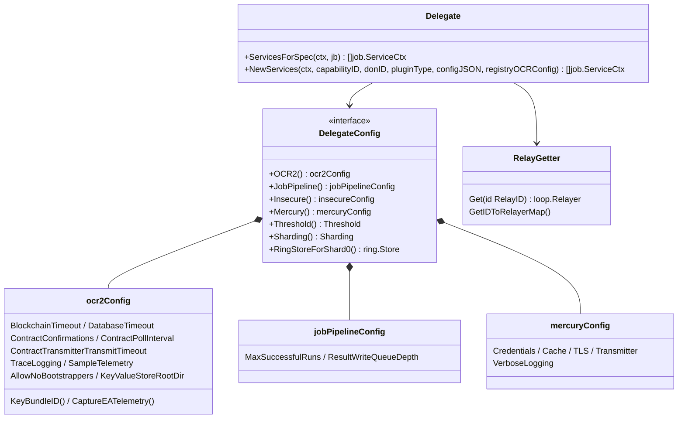
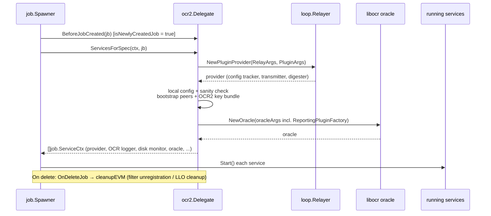
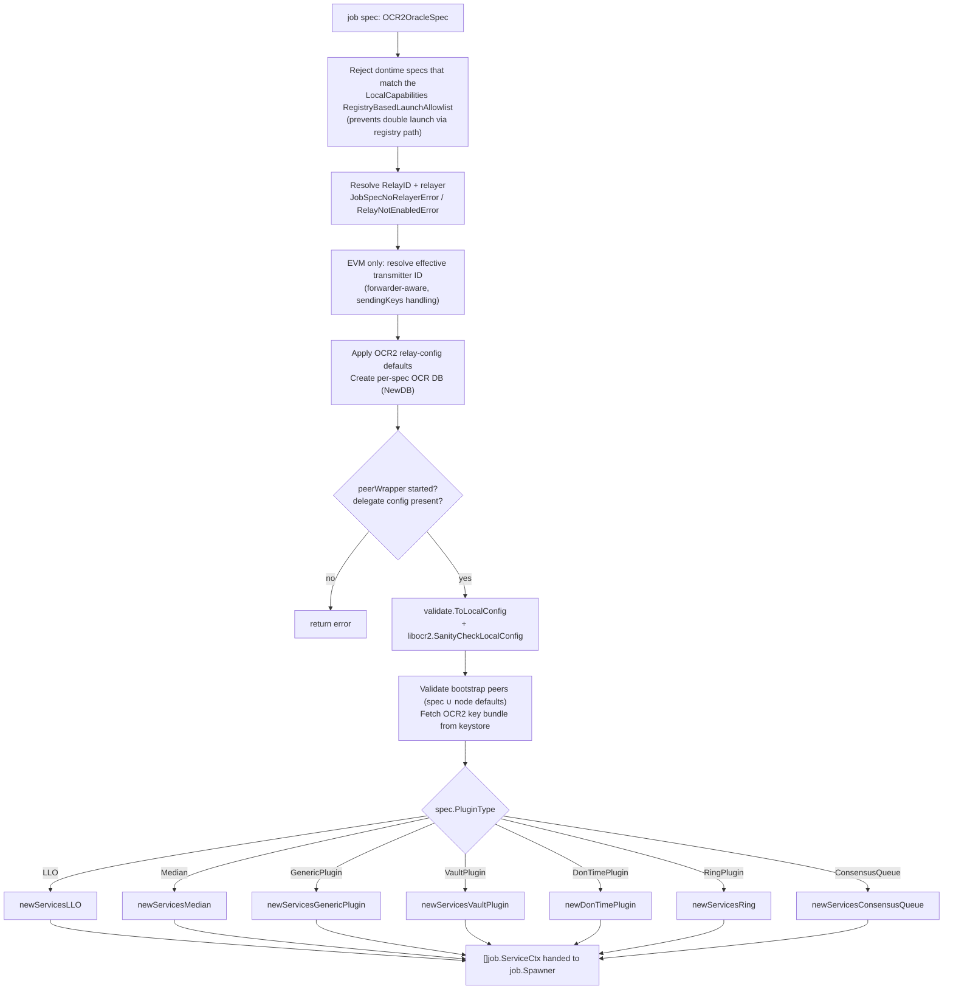
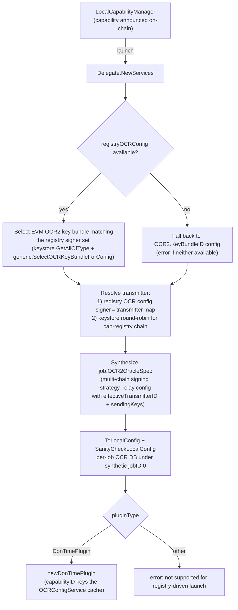
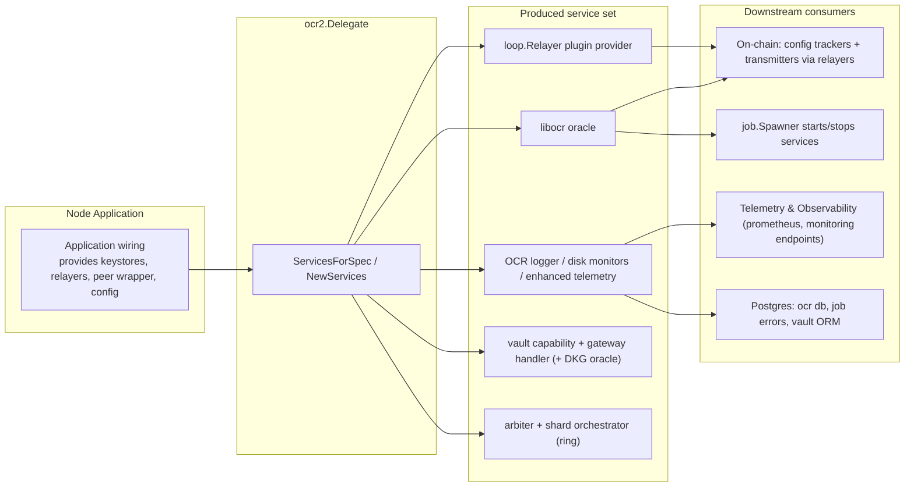

# OCR2 Delegate — `core/services/ocr2`

> Parent: [OCR](../ocr.md) · Group: [Oracle Engines & Data Pipelines](../../Oracle_Engines___Data_Pipelines.md)
>
> Siblings: [OCR Config & Validation](ocr_config_and_validation.md) · [OCRBootstrap Delegate](ocrbootstrap_delegate.md) · [OCRCommon Shared](ocrcommon_shared.md)

## 1. Purpose and Scope

`core/services/ocr2` implements the **OCR2 job delegate** — the assembly point that converts an
`OffchainReporting2` job spec (or, in newer flows, a capability announced by the on-chain capabilities
registry) into a running set of services for Off-Chain Reporting oracles. It is the single dispatch
hub for every OCR2/OCR3/OCR3.1 oracle variant shipped in the node:

| Plugin type (`types.OCR2PluginType`) | Builder in `delegate.go` | Oracle generation | Notes |
|---|---|---|---|
| `Median` | `newServicesMedian` | OCR2 | Data-streams median, pipeline-driven, enhanced EA telemetry |
| `LLO` | `newServicesLLO` | OCR3 (+OCR3.1 for v31 plugin instances) | Low-Latency Oracle; v30→v31 blue/green handover support |
| `GenericPlugin` | `newServicesGenericPlugin` | OCR2 **or** OCR3 (`pCfg.OCRVersion`) | External LOOP plugin process or embedded provider |
| `VaultPlugin` | `newServicesVaultPlugin` | OCR3.1 | Vault capability + auxiliary **DKG** oracle in parallel |
| `DonTimePlugin` | `newDonTimePlugin` | OCR3 | DON time service; supports registry-driven launch |
| `RingPlugin` | `newServicesRing` | OCR3 | Sharded; only runs on **shard 0**; starts Arbiter + ShardOrchestrator |
| `ConsensusQueue` | `newServicesConsensusQueue` | OCR3.1 | Queue plugin; pebble-backed KV store |

The delegate itself does **not** implement any consensus or reporting logic. It:

1. Resolves configuration ([OCR Config & Validation](ocr_config_and_validation.md)), peers ([P2P](../../Node_Platform_Services/p2p.md)),
   keys ([Keystore](../../Node_Platform_Services/keystore.md)) and relay providers ([Loop](../../Plugin_Process_Framework_(Loop).md));
2. Builds a `ReportingPluginFactory` for the requested plugin;
3. Hands a fully populated `libocr2.OCR2OracleArgs` / `OCR3OracleArgs2` / `OCR3_1OracleArgs2` struct to
   `libocr2.NewOracle` and returns the resulting services to the [Job Service](../../Node_Platform_Services/job_service.md) spawner.

The core consensus machinery comes from the external `libocr` dependency
(`github.com/smartcontractkit/libocr`, pinned in `chainlink/go.mod`).

## 2. Core Components

| Component | File | Role |
|---|---|---|
| `Delegate` | `chainlink/core/services/ocr2/delegate.go` | Implements `job.Delegate` for `job.OffchainReporting2` jobs; owns all service assembly logic |
| `DelegateConfig` / `delegateConfig` | `delegate.go` | Explicit composite of node config views consumed by OCR2 (timeouts, pipelines, Mercury, thresholds, sharding, ring store) |
| `RelayGetter` | `delegate.go` | Fetches `loop.Relayer` instances by `types.RelayID` |
| `connProvider` | `delegate.go` | Marker interface (`ClientConn() grpc.ClientConnInterface`) distinguishing **LOOP** providers from embedded providers |
| `JobSpecNoRelayerError`, `RelayNotEnabledError` | `delegate.go` | Typed errors distinguishing "spec has no relay ID" from "relay not enabled" |
| `errorLog` | `delegate.go` | Implements `loop.ErrorLog`; persists plugin error messages to `job.ORM.RecordError` |
| `OraclePlugin` | `chainlink/core/services/ocr2/plugins/plugin.go` | Contract for plugins runnable from the generic `ServicesForSpec` path (`GetPluginFactory` + `GetServices`) |
| `median/config.PluginConfig` | `plugins/median/config/config.go` | Median plugin arguments + `ValidatePluginConfig` |
| `ring/config.PluginConfig` | `plugins/ring/config/config.go` | Ring shard-config address + `Unmarshal`/`Validate` |
| `vault.Config` | `plugins/vault/config.go` | Vault request expiry, DKG contract, Auth0 settings + `Validate` |

## 3. Architecture

The `Delegate` is constructed once per node (`NewDelegate`) with a wide set of collaborators, and is
registered with the job spawner as the handler for `job.OffchainReporting2` specs.

```mermaid
flowchart TB
    subgraph JobSvc["Node Platform Services — Job Service"]
        SP["job.Spawner (CreateJob / StartService)"]
        JORM["job.ORM (error recording)"]
    end

    subgraph Ocr2["core/services/ocr2"]
        DLG["Delegate<br/>implements job.Delegate"]
        DC["DelegateConfig = ocr2Config + jobPipelineConfig<br/>+ insecureConfig + mercuryConfig + thresholdConfig<br/>+ Sharding + ring.Store + RegistrarConfig"]
    end

    subgraph Collab["Collaborators"]
        KS["keystore.OCR2 / Eth / Workflow / DKGRecipient"]
        RG["RelayGetter → loop.Relayer per RelayID"]
        P2P["ocrcommon.SingletonPeerWrapper<br/>(libp2p v2 + 3.1 peers, must be started)"]
        PR["pipeline.Runner (median, LLO, generic)"]
        MEG["telemetry.MonitoringEndpointGenerator"]
        CR["registry.CapabilitiesRegistry"]
        OCS["capregconfig.OCRConfigService"]
        GW["gatewayconnector.ServiceWrapper (vault)"]
        WRS["workflows/syncer/v2 WorkflowRegistrySyncer (vault)"]
        LC["legacyevm.LegacyChainContainer (EVM cleanup, log poller)"]
    end

    subgraph LibOcr["libocr (offchainreporting2plus)"]
        OR["libocr2.NewOracle<br/>OCR2 / OCR3 / OCR3.1 oracle args"]
    end

    SP -->|"ServicesForSpec / NewServices"| DLG
    DLG --> DC
    DLG --> KS
    DLG --> RG
    DLG --> P2P
    DLG --> PR
    DLG --> MEG
    DLG --> CR
    DLG --> OCS
    DLG --> GW
    DLG --> WRS
    DLG --> LC
    DLG --> JORM
    DLG -->|"assembles args for"| OR
```

Key dependency bindings:

- **Keystore** — `ks.Get(kbID)` fetches OCR2 key bundles (off-chain + EVM on-chain signing keys); the
  workflow and DKG-recipient keystores serve the vault plugin. See [Keystore](../../Node_Platform_Services/keystore.md).
- **Relayers** — every plugin path resolves a `loop.Relayer` via the embedded `RelayGetter` and requests
  a provider (`NewPluginProvider` or `NewLLOProvider`) with `types.RelayArgs` / `types.PluginArgs`
  (defined in [types-core](../../Shared_Foundation_Libraries___Domain_Types/types-core.md)). Generic plugins additionally
  build a `RelayerSet` spanning all relayers.
- **P2P** — the delegate refuses to build services unless `peerWrapper.IsStarted()`; the peer factories
  (`Peer2`, `Peer3_1`) are wired into every oracle's `BinaryNetworkEndpointFactory`.
- **Pipeline** — median, LLO and generic plugins receive the [pipeline Runner](../pipeline.md) so reporting
  plugins can execute job pipelines.
- **Capabilities / registry** — `CapabilitiesRegistry`, `OCRConfigService`, the workflow registry syncer
  and the gateway connector tie OCR2 oracles into the [Workflow/CRE runtime](../../Workflow___Capability_Runtime_(CRE_Engine).md)
  (vault + dontime plugins) and to registry-managed OCR config.

### Delegate configuration surface

`DelegateConfig` is an explicit composition so it can be built from node TOML config in tests and wiring
code without depending on the full `GeneralConfig` (see [Node Application Config](../../Node_Application_Core___Interfaces/node_application/node_application_config.md)):

## 4. Job Lifecycle Integration

`Delegate` implements the `job.Delegate` hooks consumed by the [Job Service spawner](../../Node_Platform_Services/job_service.md):

1. **`JobType()`** → `job.OffchainReporting2`.
2. **`BeforeJobCreated`** marks the job as newly created (`isNewlyCreatedJob = true`); this flag is
   forwarded as `RelayArgs.New` so providers can initialize on-chain state (e.g. register filters).
3. **`ServicesForSpec`** (below) builds and returns the service list; the spawner starts each
   `job.ServiceCtx` (oracles are wrapped by `job.NewServiceAdapter`).
4. **`OnDeleteJob`** — for EVM relays, `cleanupEVM` unregisters log-poller filters via the legacy chain
   container; for LLO jobs it also tears down channel-definition caches. Malformed specs are logged and
   **do not block deletion** (deletion errors are only returned when removing an active filter fails, to
   avoid leaving the DB inconsistent).

## 5. `ServicesForSpec` — Assembly Flow

`ServicesForSpec` is the main dispatch. The ordered stages are:

### Shared assembly concerns

- **Transmitter resolution (EVM)** — `GetEVMEffectiveTransmitterID` defaults the transmitter to the node
  EOA, honors `sendingKeys`, and resolves the **forwarder contract** when `ForwardingAllowed` is set
  (`evm.GetForwarderForEOA`); forwarding failures fall back to the EOA with a warning. LLO jobs are
  exempt (they use a 32-byte transmitter ID instead of an address).
- **Local config** — `validate.ToLocalConfig` (see [OCR Config & Validation](ocr_config_and_validation.md)) converts
  node + spec config into `ocrtypes.LocalConfig`, which is then sanity-checked by libocr before any
  services are built.
- **Registry-based dynamic config** — `maybeWrapConfigService` optionally wraps the provider's
  `ContractConfigTracker` / `OffchainConfigDigester` with the node-level `OCRConfigService`, keyed by a
  capability ID and OCR-config key (e.g. `vault@1.0.0`/`vault`, `vault`/`dkg`, dontime capability ID /
  `OCR3ConfigDefaultKey`). When active, the local config is adjusted via
  `generic.AdjustLocalConfigForRegistryBasedConfig`.
- **Keyrings** — plugins that support the `multi-chain` on-chain signing strategy collect key bundles per
  chain into `ocrcommon.NewOCR3OnchainKeyringMultiChainAdapter`; otherwise the single bundle is wrapped
  directly and shimmed to the OCR3 onchain keyring interface.
- **Observability** — every oracle gets an `ocrcommon.NewOCRWrapper` logger whose error callback persists
  to `job.ORM.RecordError`, a monitoring endpoint from `MonitoringEndpointGenerator` (typed per plugin),
  and Prometheus metrics registered under `job_name`. See [Telemetry & Observability](../../Telemetry___Observability_Platform.md).

## 6. Plugin Builders in Detail

### Median (`newServicesMedian`)

Assembles `libocr2.OCR2OracleArgs` with the pipeline runner and delegates to `median.NewMedianServices`
(provider, transmitter, DataSource plumbing are inside the median package). When
`ocrcommon.ShouldCollectEnhancedTelemetry` is enabled, an `EnhancedTelemetryService` is appended, fed by
a buffered `enhancedTelemChan`. Transmission telemetry is force-enabled (`EnableTransmissionTelemetry`).

Configuration is `median/config.PluginConfig`:

- `juelsPerFeeCoinSource` / `gasPriceSubunitsSource` — pipeline specs (the latter optional),
- `juelsPerFeeCoinCache` — disabled by default; update interval clamped to **30s–20min**,
- `deviationFunc` — deviation function definition.

`ValidatePluginConfig` parses both pipelines with `pipeline.Parse` at job-create time.
⚠️ **DON-wide consistency requirement** (from the source): to avoid a catastrophic libocr codec error,
either *all* nodes in a DON configure `gasPriceSubunitsSource` or *none* do.

### LLO (`newServicesLLO`)

- Requires a 64-hex-char (32-byte) transmitter ID, validated with `hex.DecodeString`.
- Requests an **LLO provider** via `relayer.NewLLOProvider` instead of `NewPluginProvider`.
- Builds a per-report-format on-chain keyring (`llo.NewOnchainKeyring`): explicit `KeyBundleIDs` from the
  plugin config, plus a default EVM bundle for the standard signed report formats (JSON, EVM premium
  legacy, retirement, ABI-encoded, capability trigger, streamlined).
- `llo.DelegateConfig` wires the [stream registry](../streams.md), [pipeline runner](../pipeline.md), channel
  definition cache, retirement report cache, and both Mercury and OCR3 monitoring endpoints; verbose
  logging combines `Mercury.VerboseLogging` with `OCR2.TraceLogging`.
- Supports **plugin versions per protocol instance** (`PluginVersions`, `V31Config`) for v30→v31
  blue/green handovers; when any instance is v31, a pebble-backed `KeyValueDatabaseFactory` and the
  OCR3.1 peer factory (`Peer3_1`) are attached, with the KV store rooted at
  `OCR2().KeyValueStoreRootDir()/<externalJobID>`.
- Deletion-time cleanup (`llo.Cleanup`) is handled in `cleanupEVM`; see also [LLO](../llo.md).

### Generic LOOP plugins (`newServicesGenericPlugin`)

Runs arbitrary reporting plugins as **external processes** (LOOP) or against an embedded provider:

1. Parse `validate.OCR2GenericPluginConfig` (`pluginName`, `command`, `providerType`, `ocrVersion`,
   telemetry type, pipelines, env vars). Validation happens at job creation; here the default
   `__DEFAULT_PIPELINE__` (the job's pipeline source) is appended.
2. Resolve the command via `env.NewPlugin(...)` (env override) and build the environment from
   `plugins.ParseEnvFile` + explicit `EnvVars`.
3. `cfg.RegisterLOOP(...)` registers the child process; `errorLog` persists plugin errors to the job ORM.
4. **LOOP vs embedded provider** — the `connProvider` interface probes whether the provider exposes a
   gRPC `ClientConn`. LOOP providers do; embedded providers (e.g. the in-process EVM relayer) get a
   `loop.NewProviderServer` bridge appended to the service list. This keeps the workaround for
   non-LOOPP EVM providers localized (flagged in source for later removal).
5. Build `core.ReportingPluginServiceConfig` and a pipeline-runner adapter + telemetry adapter, then:
   - **OCR version 2** → `reportingplugins.NewLOOPPService` with `OCR2OracleArgs`
     (`OnchainKeyring: kb`, provider transmitter/tracker/digester).
   - **OCR version 3** → `ocr3.NewLOOPPService` with `OCR3OracleArgs2`; the provider transmitter is
     adapted through `ocrcommon.NewOCR3ContractTransmitterAdapter` unless the provider natively implements
     `types.OCR3ContractTransmitter`; keyring honors the multi-chain signing strategy.

The plugin-process RPC surface (gRPC bindings for reporting plugins, relayers, contract readers, etc.)
is documented in [Loop — Plugin Process Framework](../../Plugin_Process_Framework_(Loop).md); plugin binaries are built
and installed with the `chainlink/GNUmakefile` targets (`docker-plugins`, `install-plugins`,
`install-plugins-private`, `install-plugins-local`, `install-loopinstall`).

### Vault (`newServicesVaultPlugin`)

The most composite builder — it stands up a full vault stack from one OCR2 spec:

- **Config** (`vault.Config`): `requestExpiryDuration` (must be > 0), optional `dkg.dkgContractID`,
  optional `auth0` (requires `issuerURL` and `audience` when present). Validated by `Config.Validate`.
- **Capability services**: `vaultcap.NewCapability` (with lazy public key, request store/handler and
  request-lifecycle tracker from the DKG recipient keystore) and `vaultcap.NewGatewayHandler` bound to
  the **gateway connector** wrapper and the workflow-registry syncer (see
  [Gateway](../../Node_Platform_Services/gateway.md) and [Workflow/CRE runtime](../../Workflow___Capability_Runtime_(CRE_Engine).md)).
- **OCR3.1 oracle** for the vault plugin: plugin provider via the relayer
  (`ProviderType: OCR3Capability`), disk monitor (`platform_vault_disk_usage_bytes`), pebble KV factory
  under `KeyValueStoreRootDir()/<externalJobID>`, OCR3.1 onchain keyring multichain adapter, config
  tracker/digester wrapped by the OCRConfigService under the `vault@1.0.0`/`vault` keys, and a
  reporting-plugin factory backed by `vaultocrplugin.NewVaultORM(d.ds)`.
- **Auxiliary DKG oracle** run in parallel against `cfg.DKG.ContractID`: its own provider, pebble KV
  path (`.../_dkg`), DKG monitoring endpoint, OCRConfigService-wrapped tracker/digester
  (`vault@1.0.0`/`dkg`), and oracle args from `oracleargs.OCR3_1OracleArgsForSanMarinoDKG` (smdkg).

### DonTime (`newDonTimePlugin`)

OCR3 oracle with a `dontime.NewTransmitter` (backed by the node-level `dontime.Store`) and a
`dontime.NewFactory` reporting-plugin factory wrapped by the OCR3 beholder wrapper. The on-chain keyring
honors the `multi-chain` signing strategy (key bundles fetched per chain name from `keystore.OCR2`).
Config tracker/digester are wrapped by the OCRConfigService keyed on the **capability ID**
(`dontime@1.0.0` in the job-spec path; the real registry ID in the registry-driven path) and
`capabilitiespb.OCR3ConfigDefaultKey`. Local config is adjusted for registry-based config.

### Ring (`newServicesRing`)

Only allowed on **shard 0** (`cfg.Sharding().ShardIndex() != 0` → error), since Ring jobs own the
sharding infrastructure:

- Starts an **Arbiter** service (`arbiter.New` — reads the shard-config contract through a
  `relayer.NewContractReader` factory, config from `ring/config.PluginConfig.ShardConfigAddr`, which must
  be a valid hex address) and a **ShardOrchestrator** (`shardorchestrator.New`, bound to the shard-0
  `ring.Store` from `RingStoreForShard0()`).
- Builds an in-process `RingArbiterClient` against the arbiter's scaler server, then a ring transmitter
  and `ring.NewFactory` (consensus defaults: batch size 100, 1s time-to-sync).
- OCR3 oracle with multi-chain-aware keyring, provider tracker/digester/transmitter.

### ConsensusQueue (`newServicesConsensusQueue`)

OCR3.1 oracle (`OCR3_1OracleArgs2`) with `queue.NewConsensusQueuePluginFactory` (limits-factory aware),
wrapped by the OCR3.1 beholder wrapper; disk monitor (`platform_consensus_queue_usage_bytes`), pebble KV
store per job, OCRConfigService wrapping under `consensus-queue@1.0.0`/`consensus-queue`. The contract
transmitter is still a TODO in the current code (set to `nil` with a source comment).

## 7. Registry-Driven Launch — `NewServices`

Beyond the job-spec path, `Delegate.NewServices` builds OCR2 services for capabilities launched by the
`LocalCapabilityManager` from the **on-chain capabilities registry**, with no job spec at all. A guard in
`ServicesForSpec` rejects dontime job specs whose capability matches
`[Capabilities.Local].RegistryBasedLaunchAllowlist` so a capability is never started by both paths.

Design points (from source):

- Defaults that a job spec would normally supply come from the delegate options:
  `DefaultBootstrappers` (falling back to the node's P2P v2 defaults), `CapRegistryAddress`,
  `CapRegistryChainID`, and `LocalCfg`.
- A synthetic `job.Job` (ID 0, fresh UUID external ID) lets the existing plugin builders be reused
  unchanged; `configJSON` from the registry is unmarshalled into the spec's `PluginConfig`.
- Registry launch is currently restricted to `DonTimePlugin`; other plugin types return a
  "not supported for registry-driven launch" error.

## 8. Interaction with the Rest of the Node

- **Job Service** — the delegate is one of several `job.Delegate` implementations; `Spawner.CreateJob` /
  `StartService` drive it and own service lifecycles. Details: [Job Service](../../Node_Platform_Services/job_service.md).
- **Bootstrap path** — OCR2 oracles need reachability to bootstrap nodes; the bootstrap-node delegate
  that runs those nodes is documented separately in [OCRBootstrap Delegate](ocrbootstrap_delegate.md).
- **Shared plumbing** — `ocrcommon` provides the OCR logger wrapper, keyring adapters, `NewDB`
  (per-spec OCR persistence), `GetValidatedBootstrapPeers` and `SingletonPeerWrapper`:
  [OCRCommon Shared](ocrcommon_shared.md).
- **Median data sources** — the median plugin consumes `median.DataSource` implementations, including the
  cached `DataSourceCacheService` from ocrcommon.
- **Keystore** — OCR2 key bundles (`corekeys/ocr2key`), workflow keys and DKG recipient keys:
  [Keystore](../../Node_Platform_Services/keystore.md).

## 9. Error Semantics

| Error | Meaning | Behaviour |
|---|---|---|
| `JobSpecNoRelayerError` | The OCR2 spec could not produce a `RelayID` (missing relay/chain ID) | Returned from `ServicesForSpec`; on delete, logged and **ignored** so deletion proceeds |
| `RelayNotEnabledError` | The spec's relay (network) is not enabled on the node | Fails service creation |
| Generic validation errors | Peer wrapper missing/not started, delegate config missing, invalid local config, unknown plugin type, unsupported OCR version | Fail fast before any services are created |

## 10. Key Source References

- `chainlink/core/services/ocr2/delegate.go` — `Delegate`, `DelegateConfig`, all plugin builders,
  `NewServices`, `connProvider`, `errorLog`, `GetEVMEffectiveTransmitterID`.
- `chainlink/core/services/ocr2/plugins/plugin.go` — `OraclePlugin` interface (`GetPluginFactory`,
  `GetServices`) that plugins implement to be runnable from the generic delegate path.
- `chainlink/core/services/ocr2/plugins/median/config/config.go` — median `PluginConfig` +
  `ValidatePluginConfig` (separate package so job creation can validate it).
- `chainlink/core/services/ocr2/plugins/ring/config/config.go` — ring `PluginConfig` (`shardConfigAddr`)
  + `Unmarshal`/`Validate`.
- `chainlink/core/services/ocr2/plugins/vault/config.go` — vault `Config` (+ `DKGConfig`, Auth0) +
  `Validate`.
- `chainlink/go.mod` — pins `github.com/smartcontractkit/libocr` (consensus core),
  `chainlink-data-streams` (LLO plugin config/protocol), `chainlink-evm` (legacy chains),
  `chainlink-common` (loop, types, keystore) and `smdkg` (DKG oracle args).
- `chainlink/GNUmakefile` — builds/installs LOOP plugin binaries consumed by the generic plugin path
  (`docker-plugins`, `install-plugins*`, `install-loopinstall`).
