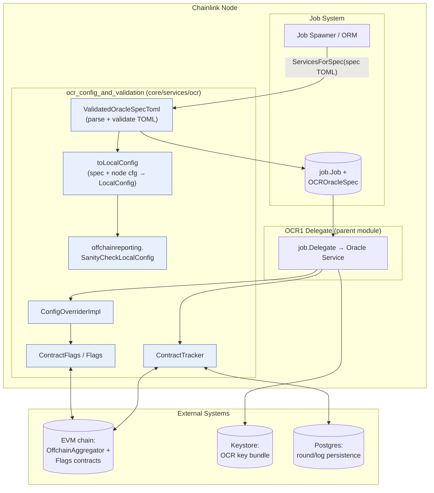
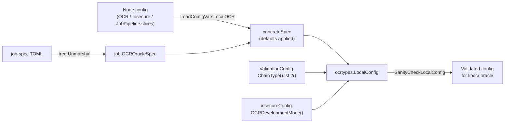
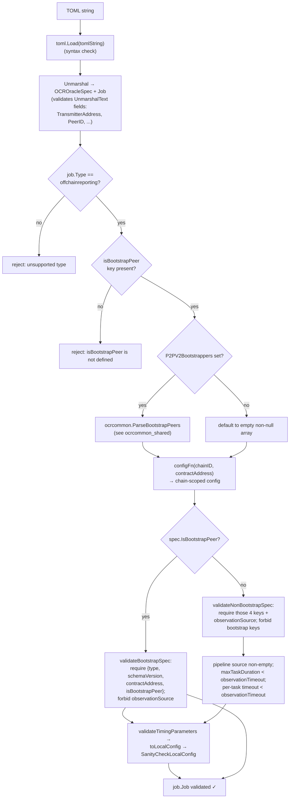
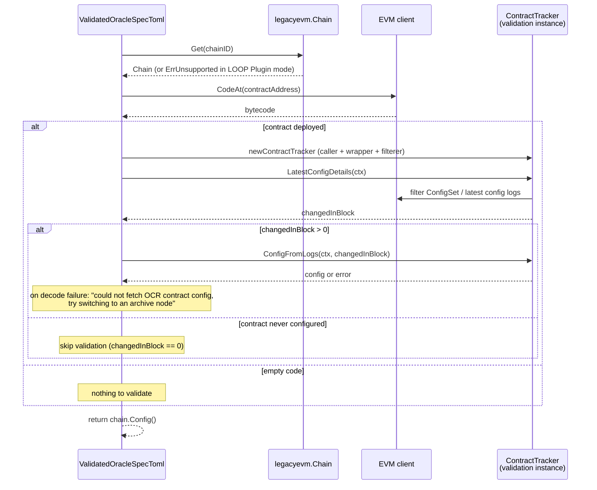
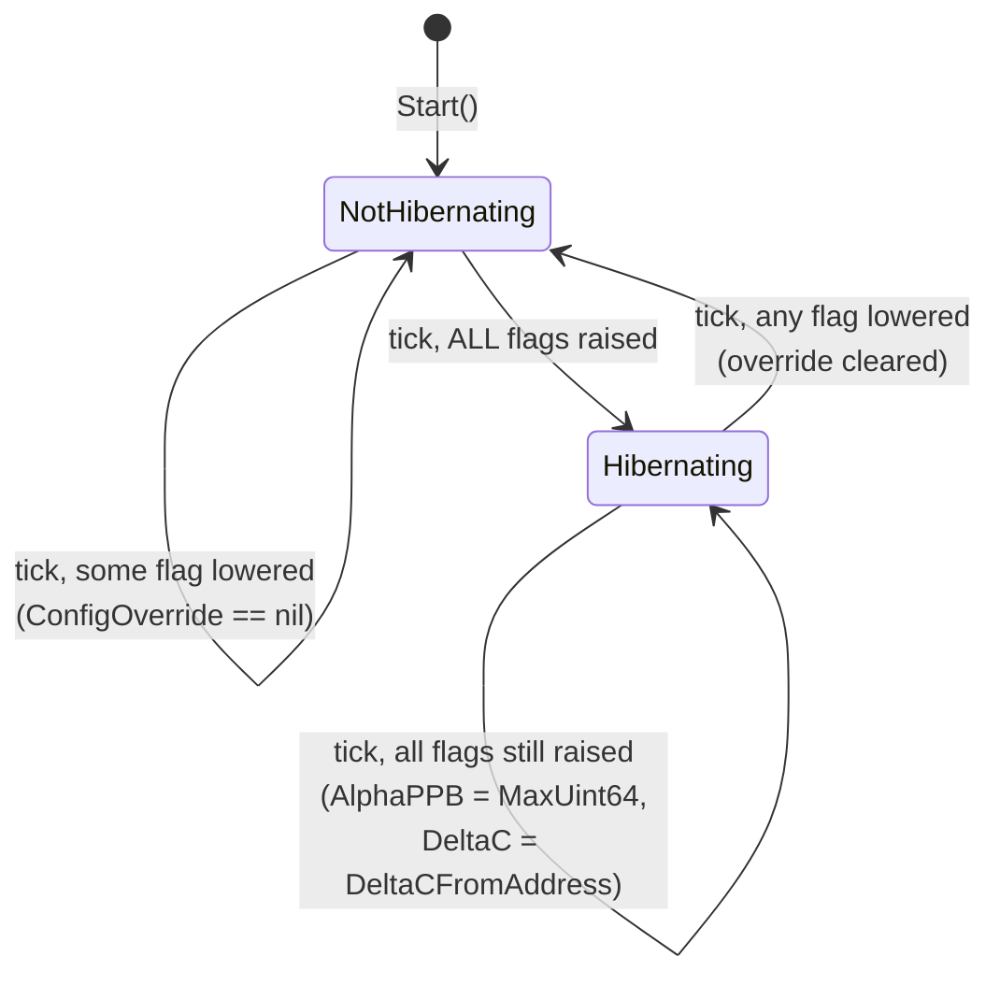
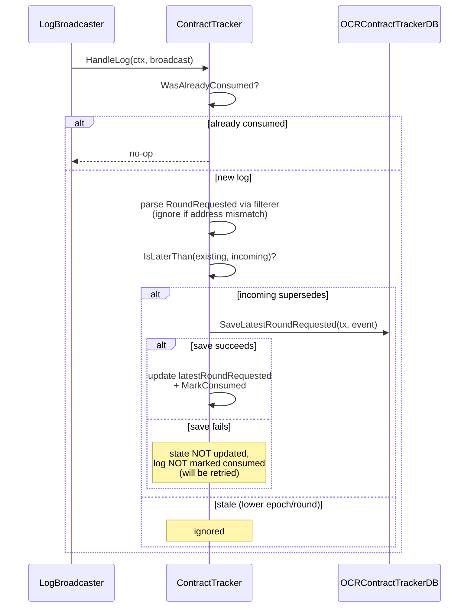

# OCR Configuration & Validation

## Introduction

The `ocr_config_and_validation` sub-module (`core/services/ocr/config.go` + `validate.go`, exercised by `config_overrider_test.go` and `contract_tracker_test.go`) is the **configuration gateway for OCR1 (Off-Chain Reporting v1) oracles**. It sits at the boundary between the Chainlink node's [job system](../../Node_Platform_Services/job_service.md) and the `libocr` consensus library, and is responsible for four things:

1. **Config bundling** — exposing the node-wide configuration slices (OCR, Insecure, JobPipeline) that a job-scoped oracle needs.
2. **Spec validation** — parsing and validating OCR job-spec TOML (`type = "offchainreporting"`) before a job is accepted, including mutually-exclusive bootstrap vs. non-bootstrap parameter sets and on-chain timing sanity checks.
3. **Runtime config overriding** — the `ConfigOverriderImpl` ("hibernation") service that reads a Flags contract and raises `AlphaPPB` to `MaxUint64` while the associated aggregator contract is flagged as down.
4. **On-chain state tracking** — the `ContractTracker` service that follows the `OffchainAggregator` contract (latest block height, config-change logs, `RoundRequested` events) and feeds that state into the libocr oracle instance.

For the surrounding context — the OCR1 delegate that consumes these services, the OCR2/OCR3 delegate, bootstrap nodes, and shared helpers — see the parent module [Oracle Engines: ocr](../ocr.md).

---

## Component Inventory

| File | Component | Kind | Responsibility |
|---|---|---|---|
| `core/services/ocr/config.go` | `Config` | interface | Job-scoped bundle of `Insecure()`, `JobPipeline()`, `OCR()` node configuration |
| `core/services/ocr/config.go` | `toLocalConfig` (internal) | func | Translates validated spec + node config into a `libocr` `ocrtypes.LocalConfig` |
| `core/services/ocr/validate.go` | `OracleValidationConfig`, `ValidationConfig`, `GeneralConfig`, `insecureConfig` | interfaces | Narrow config views consumed by validation, enabling mocking |
| `core/services/ocr/validate.go` | `ValidatedOracleSpecToml` / `ValidatedOracleSpecTomlCfg` | funcs | Parse + validate OCR job-spec TOML, returning a `job.Job` |
| `core/services/ocr/validate.go` | `validateBootstrapSpec` / `validateNonBootstrapSpec` / `validateTimingParameters` | funcs | Key-set, pipeline and timing validation |
| `core/services/ocr/validate.go` | `validateContractConfig` / `validateContractLogs` | funcs | Optional on-chain validation of the aggregator contract's stored config |
| `core/services/ocr/config_overrider.go` | `ConfigOverriderImpl` (tested by `config_overrider_test.go`) | service | Polls Flags contract; toggles libocr `ConfigOverride` (hibernation) |
| `core/services/ocr/contract_tracker.go` | `ContractTracker` (tested by `contract_tracker_test.go`) | service | Tracks aggregator contract logs, rounds and block height |
| `core/services/ocr/config_overrider_test.go` | `configOverriderUni` | test harness | Unit-integration fixture for the config overrider |
| `core/services/ocr/contract_tracker_test.go` | `contractTrackerUni` | test harness | Unit-integration fixture for the contract tracker |

---

## Architecture

The module is consumed by the OCR1 delegate (see parent page [ocr](../ocr.md)). When an `offchainreporting` job is created, the [job spawner](../../Node_Platform_Services/job_service/job_service_lifecycle.md) calls the delegate, which first validates the spec through this module and then instantiates a libocr oracle wired to the `ContractTracker` (as `ContractConfigTracker` / log source) and the `ConfigOverriderImpl`.



Key external collaborators:

- **`libocr/offchainreporting`** — provides `LocalConfig`, `SanityCheckLocalConfig`, and `ConfigOverride`; the oracle itself runs in-process for OCR1 (unlike OCR2+ plugins, which run via the [Loop plugin framework](../../Plugin_Process_Framework_(Loop)/loop-plugin-core.md)).
- **`chainlink-evm`** — `evmconfig.OCR` (chain-scoped OCR settings), `legacyevm.Chain`, the `OffchainAggregator` wrapper/caller/filterer bindings, and the block translator.
- **Node core config** — the [core config](../../Node_Application_Core___Interfaces/core_config.md) tree supplies the `OCR()`, `Insecure()`, and `JobPipeline()` slices surfaced by the `Config` interface.
- **Keystore** — the validated spec's `keyBundleID` resolves to an OCR signing key via the [node keyring](../../Node_Platform_Services/keystore/keystore_node_keyring.md).

---

## Configuration Model & `LocalConfig` Translation

### Job-scoped `Config` interface

```go
type Config interface {
    Insecure() config.Insecure
    JobPipeline() config.JobPipeline
    OCR() config.OCR
}
```

This is the subset of node-wide configuration that OCR jobs depend on: insecure/development toggles, pipeline (V1 job pipeline) settings, and OCR-specific settings.

### Translating a spec into `libocr`'s `LocalConfig`

`toLocalConfig` resolves the raw spec fields through `job.LoadConfigVarsLocalOCR` (which applies node-config defaults and variable substitution), then maps them one-to-one onto `ocrtypes.LocalConfig`:

| `ocrtypes.LocalConfig` field | Source |
|---|---|
| `BlockchainTimeout` | spec `BlockchainTimeout` |
| `ContractConfigConfirmations` | spec `ContractConfigConfirmations` |
| `SkipContractConfigConfirmations` | `true` when `ValidationConfig.ChainType().IsL2()` |
| `ContractConfigTrackerPollInterval` | spec `ContractConfigTrackerPollInterval` |
| `ContractConfigTrackerSubscribeInterval` | spec `ContractConfigTrackerSubscribeInterval` |
| `ContractTransmitterTransmitTimeout` | spec `ContractTransmitterTransmitTimeout` |
| `DatabaseTimeout` | spec `DatabaseTimeout` |
| `DataSourceTimeout` | spec `ObservationTimeout` |
| `DataSourceGracePeriod` | spec `ObservationGracePeriod` |
| `DevelopmentMode` | `EnableDangerousDevelopmentMode` when `insecureConfig.OCRDevelopmentMode()` is set |

Two behaviours worth noting:

- **L2 shortcut**: L2 chains skip on-chain config confirmation confirmations entirely (`SkipContractConfigConfirmations`).
- **Development mode**: when the node runs with `OCRDevelopmentMode` enabled, `SanityCheckLocalConfig` restrictions are deliberately bypassed so tests can use aggressive timings (e.g. a very short `ContractConfigTrackerPollInterval`). This switch is exposed through the `Insecure()` slice of the [core config](../../Node_Application_Core___Interfaces/core_config.md).



---

## Spec Validation Pipeline

### Entry points

- **`ValidatedOracleSpecToml(gcfg, legacyChains, tomlString)`** — the production entry point. Resolves the chain from the `LegacyChainContainer` by EVM chain ID and, when `gcfg.OCR().ConfigLogValidation()` is enabled, additionally validates the on-chain contract config.
- **`ValidatedOracleSpecTomlCfg(gcfg, configFn, tomlString)`** — the testable core; the chain-scoped-config resolver is injected as `configFn`, which is what unit tests stub out.

The returned `job.Job` (with `jb.OCROracleSpec` populated) is what the [job service](../../Node_Platform_Services/job_service.md) persists and hands to the OCR1 delegate.

### Validation flow



### Explicitly-set key policy

The validator enforces a strict, mutually-exclusive key policy between the two oracle flavours (deliberate operator intent — nothing is silently defaulted):

- **Always required**: `type`, `schemaVersion`, `contractAddress`, `isBootstrapPeer`.
- **Bootstrap oracles** must set *only* those keys — setting `observationSource` is an error (bootstrap nodes run no data pipeline; see [ocrbootstrap_delegate](ocrbootstrap_delegate.md)).
- **Non-bootstrap (transmitting) oracles** must additionally set `observationSource`, which must be a non-empty V1 [pipeline](../pipeline.md) spec.

### Timing consistency checks (non-bootstrap)

1. The pipeline source must be non-empty.
2. The effective observation timeout is the spec's `observationTimeout`, falling back to the global `gcfg.OCR().ObservationTimeout()`.
3. `spec.MaxTaskDuration` must be strictly less than the observation timeout.
4. Any individual pipeline task that declares its own `timeout` must also be less than the observation timeout.

Finally, `validateTimingParameters` re-derives the `LocalConfig` (through `toLocalConfig`) and delegates to libocr's `offchainreporting.SanityCheckLocalConfig`, wrapping any failure with a clear error message. Errors here reject the job before any oracle service is started.

### Optional on-chain contract validation

When `gcfg.OCR().ConfigLogValidation()` is enabled, `ValidatedOracleSpecToml` goes beyond static parsing and inspects the live aggregator contract:



Notes:

- In LOOP Plugin mode (node core running as a plugin), the chain is not a `legacyevm.Chain` and OCR1 is explicitly unsupported (`errors.ErrUnsupported` with `"ocr is not available in LOOP Plugin mode"`). OCR2+ jobs use the [ocr2 delegate](ocr2_delegate.md) instead.
- `newContractTracker` wires the go-ethereum `OffchainAggregator` caller, contract wrapper, event filterer and a chain-type-aware block translator (the same tracker type used at runtime, see below).
- The archive-node hint is a deliberate operational diagnostic: decoding historical config logs requires full log history.

---

## Config Overrider (Hibernation)

`ConfigOverriderImpl` is a long-running service (a `services.StateMachine`) attached to OCR1 oracle instances. It polls a **Flags contract** for the aggregator address and, if the contract is flagged as down, returns a libocr `ConfigOverride` that pushes the oracle into "hibernation" — effectively neutering its reporting incentives until the flag is lowered.

### Construction

`NewConfigOverriderImpl(logger, DeltaCConfig, contractAddress, *ContractFlags, pollTicker)`:

- **Fails fast** if the Flags contract instance is missing: `"OCRConfigOverrider: Flags contract instance is missing, the contract does not exist: <address>. Please create the contract or remove the OCR.TransmitterAddress configuration variable"`. Because the overrider is only attached when a transmitter address is configured, the operator-facing fix is either to deploy the Flags contract or drop the transmitter setting.
- **Derives a deterministic `DeltaC`** from the aggregator address: `DeltaC = DeltaCOverride + (address mod (DeltaCJitterOverride / time.Second)) × time.Second`. This spreads the hibernation-entering/exit shock across aggregators instead of letting all of them react in the same block.



### Behaviour under test (`configOverriderUni`)

The `configOverriderUni` fixture builds a real `ConfigOverriderImpl` against a mocked Flags contract, a `utils.TickerBase` (real `PausableTicker` for integration tests, a `FakeTicker` for unit tests), and a `deltaCConfig` stub (`DeltaCOverride = 168h`, `DeltaCJitterOverride = 1h`). Covered behaviours:

| Test case | Assertion |
|---|---|
| Enters hibernation (integration, `servicetest.Run` + 3s ticker) | override transitions from `nil` → `&ConfigOverride{AlphaPPB: MaxUint64, DeltaC: DeltaCFromAddress}` within ~10s of all flags raising |
| Before first tick / manual `ExportedUpdateFlagsStatus` | override stays `nil` until flags are actually polled; the exported hook makes the state transition deterministic in unit tests |
| Exits hibernation | override returns to `nil` once any flag is lowered |
| Missing Flags contract | constructor errors with the "Flags contract instance is missing" message |
| DeltaC stability per address | identical addresses produce identical `DeltaC` (`168h46m40s` for address `0x…2710`), different addresses produce different, deterministic jitters (`168h31m30s` for `0x…499602D2`) — i.e. `(10000 mod 3600) = 2800s` and `(1234567890 mod 3600) = 1890s` seconds of jitter added to the 168h base |
| Flags queried for the right addresses | the mock asserts `GetFlags` is called with `[ZeroAddress, aggregatorAddress]` |

---

## Contract Tracker

`ContractTracker` is the runtime's eyes on the `OffchainAggregator` contract. The OCR1 delegate hands it to libocr as the config tracker and log source; it is also reused by `validateContractConfig` above.

### Composition

```mermaid
flowchart TB
    subgraph CT["ContractTracker (services.StateMachine)"]
        EC[ethClient] --> BT[blockTranslator<br/>(chain-type aware)]
        WR[contract wrapper] 
        FL[contractFilterer]
        CL[contractCaller]
        LB[logBroadcaster]
        HB[headBroadcaster]
        DB[(ocrDB:<br/>ContractTrackerDB)]
        DS[(sqlutil.DataSource)]
        MB[mailbox[ocrtypes.ContractConfig]<br/>+ chConfigs]
        LRR[latestRoundRequested<br/>(RWMutex-guarded)]
        BH[latestBlockHeight<br/>(RWMutex-guarded, init −1)]
    end
    EVM[("EVM chain")] --> EC
    EVM --> FL
    LB --> CT
    HB --> CT
    DB --> CT
```

Constructor dependencies (see `NewOCRContractTracker`): the aggregator wrapper/filterer/caller, the EVM client, the [log broadcaster](../../Shared_Foundation_Libraries___Domain_Types/services.md) and head broadcaster it registers with, the job ID, a mailbox monitor, chain-scoped config (only `ChainType` is needed, via `ocrcommon.Config`), and the OCR persistence layer.

### Block-height tracking (`LatestBlockHeight`)

1. On `Start`, the tracker subscribes to the head broadcaster and takes the broadcaster's current head as its initial value; it also restores the latest `RoundRequested` from the database.
2. `OnNewLongestChain` updates the cached height as new heads arrive.
3. Before any head has been seen (cache = `−1`), `LatestBlockHeight` performs a direct `HeadByNumber(nil)` RPC; a `nil` head or client error is surfaced as an error (`"got nil head"`).

This "cache-first, RPC-fallback" pattern means libocr's config tracker never blocks on RPC once the node is synced.

### `RoundRequested` log handling (`HandleLog`)

The tracker subscribes to `RoundRequested` events for *its* aggregator address and maintains the highest (epoch, round) pair observed:



Supersession rules (verified by `Test_OCRContractTracker_HandleLog_OCRContractLatestRoundRequested` and the `IsLaterThan` table tests):

- A log is "later" if it has a higher block number; ties break on higher tx index, then higher log index (lexicographic `(BlockNumber, TxIndex, Index)` comparison).
- A higher **epoch** supersedes regardless of round (e.g. epoch 2 / round 1 beats epoch 1 / round 9).
- Within the same epoch, a higher round supersedes; equal (epoch, round) pairs do not.
- Persistence is transactional: if `SaveLatestRoundRequested` fails, the in-memory state is not updated and the log broadcast is left unconsumed so it can be retried.
- On restart, `LoadLatestRoundRequested` rehydrates the state so libocr sees a consistent "latest round" across node restarts. Fixtures for these tests live in `core/testdata/jsonrpc/round_requested_log_*.json`.

The tracker also forwards `ContractConfig` changes (received via its log subscription) through a bounded mailbox (`configMailboxSanityLimit`) and the `chConfigs` channel to libocr's config digester.

---

## Testing Strategy

Both test files follow the repo's "uni" (unit-integration) pattern: a small fixture struct wires the real production service with mocked collaborators, so behaviour is exercised through real code paths rather than reimplementations.

| Harness | Real components | Mocks / fakes |
|---|---|---|
| `configOverriderUni` | `ConfigOverriderImpl`, `ContractFlags` wrapper | `mocks.Flags` (on-chain Flags contract), `PausableTicker` / `FakeTicker`, `servicetest.Run` lifecycle runner |
| `contractTrackerUni` | `ContractTracker`, `NewOCRContractTracker` wiring, `IsLaterThan`, block translator | `ocrmocks.OCRContractTrackerDB`, `logmocks.Broadcaster`, `headstest.Broadcaster`, `clienttest.Client`, `mailboxtest.Monitor`, real Postgres via `pgtest.NewSqlxDB`, `configtest`/`evmtest` chain-scoped configs |

Because the tests import `core/internal/testutils/pgtest`, the tracker tests require a PostgreSQL instance (provided by the repo's test harness). All tests live in the `chainlink` Go module (`chainlink/go.mod`) and run through its standard targets in `chainlink/GNUmakefile` (e.g. `make test`); the integration test (`TestIntegration_OCRConfigOverrider_EntersHibernation`) skips itself under `testing.Short()`.

The lifecycle helpers used to start/stop the services come from `chainlink-common/pkg/services/servicetest`; see [Shared Foundation: services](../../Shared_Foundation_Libraries___Domain_Types/services.md).

---

## Related Documentation

- [Oracle Engines: ocr (parent module)](../ocr.md) — the OCR1 delegate that consumes validated specs, the tracker and the overrider.
- [ocr2_delegate](ocr2_delegate.md) — the OCR2/OCR3 equivalent (plugin-based, LOOP mode); shares the `ocrcommon` plumbing but not this module's TOML validator.
- [ocrbootstrap_delegate](ocrbootstrap_delegate.md) — bootstrap oracle jobs (the `isBootstrapPeer = true` branch of the validator).
- [ocrcommon_shared](ocrcommon_shared.md) — `ParseBootstrapPeers`, `ValidateExplicitlySetKeys`, and the `Config` (ChainType) interface used here.
- [Pipeline engine](../pipeline.md) — the V1 pipeline whose source and per-task timeouts are validated by `validateNonBootstrapSpec`.
- [Job service](../../Node_Platform_Services/job_service.md) — persistence and spawning of the validated `job.Job`.
- [Core config](../../Node_Application_Core___Interfaces/core_config.md) — the `OCR()`, `Insecure()`, and `JobPipeline()` config slices exposed by the `Config` interface.
- [Keystore: node keyring](../../Node_Platform_Services/keystore/keystore_node_keyring.md) — resolution of the spec's `keyBundleID` to an OCR signing key.
