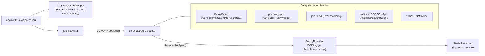
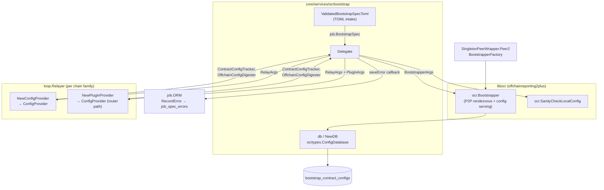
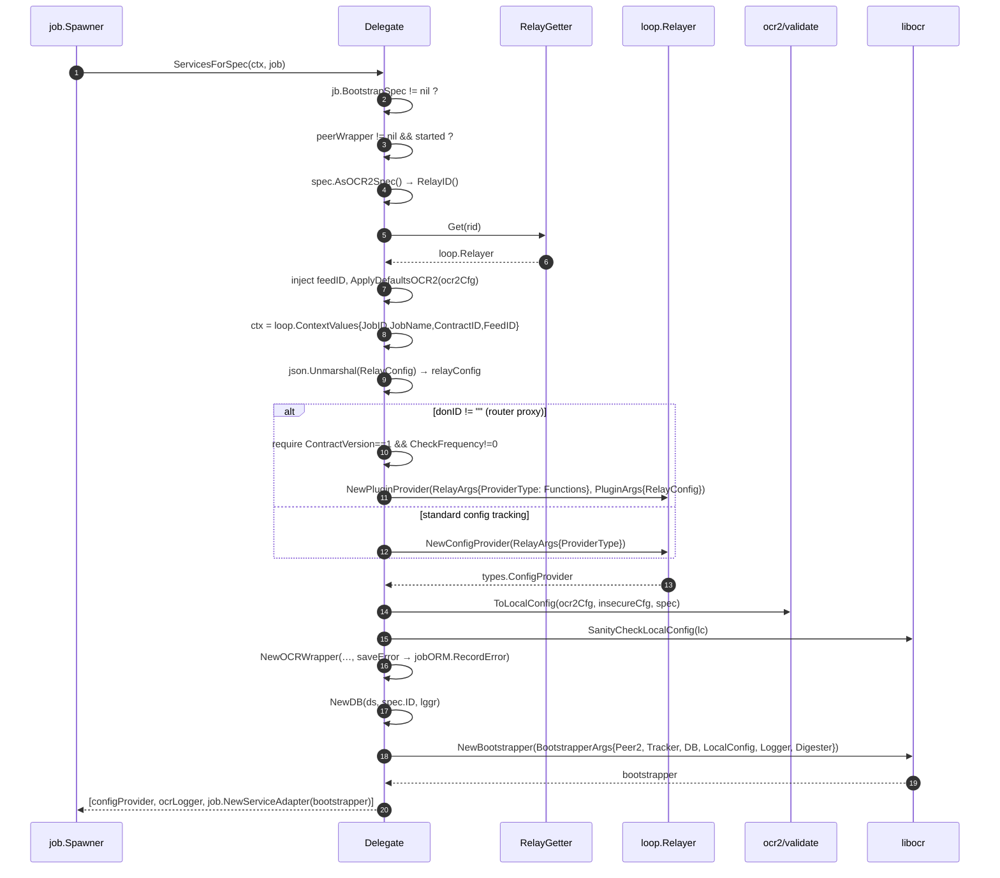
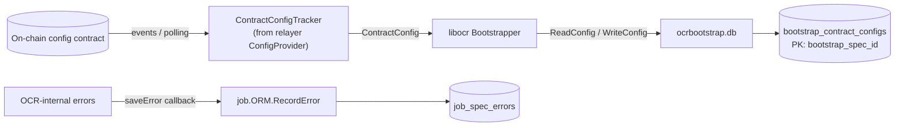

# OCR Bootstrap Delegate (`core/services/ocrbootstrap`)

## 1. Overview

The `ocrbootstrap` package implements the **delegate for the `bootstrap` job type** (`job.Bootstrap`). A *bootstrap node* is a lightweight participant of an OCR2/OCR3-style offchain reporting network: it does **not** observe, sign, or transmit reports. Instead it runs libocr's `Bootstrapper`, which

1. acts as the **static P2P rendezvous point** (peer discovery hub) that all oracle nodes dial first, and
2. **tracks the on-chain configuration contract** so that the network can discover the latest contract configuration (signers, transmitters, `f`, on/offchain config).

The module's central component is `Delegate` (defined in `chainlink/core/services/ocrbootstrap/delegate.go`), which satisfies the [`job.Delegate`](../../Node_Platform_Services/job_service/job_service_lifecycle.md) contract. It translates a persisted `job.BootstrapSpec` into a set of runnable services — a relayer-provided `ConfigProvider`, an OCR telemetry/error logger, and the libocr `Bootstrapper` — that the [Job Spawner](../../Node_Platform_Services/job_service.md) starts and stops.

> **Parent module:** [OCR / OCR2 Oracle Engines](../ocr.md) · **Sibling delegates:** [OCR2 Delegate](ocr2_delegate.md) (full reporting oracles) · [OCR config & validation](ocr_config_and_validation.md)

| File | Contents |
|---|---|
| `chainlink/core/services/ocrbootstrap/delegate.go` | `Delegate`, `RelayGetter`, `relayConfig`, `NewDelegateBootstrap` |
| `chainlink/core/services/ocrbootstrap/database.go` | `NewDB` — libocr `ConfigDatabase` backed by the `bootstrap_contract_configs` table |
| `chainlink/core/services/ocrbootstrap/validate.go` | `ValidatedBootstrapSpecToml` — TOML job-spec parsing/validation |

---

## 2. System Context

The delegate is wired once, at node startup, inside `chainlink.NewApplication` (`chainlink/core/services/chainlink/application.go`):

- A single `*ocrcommon.SingletonPeerWrapper` (the node's libocr P2P stack) is created **iff OCR or OCR2 is enabled and `P2P.Enabled()` is true** and is registered as a node-level service, so the peer is running before any job starts.
- When `cfg.OCR2().Enabled()`, the delegate is registered as:

  ```go
  delegates[job.Bootstrap] = ocrbootstrap.NewDelegateBootstrap(
      opts.DS, jobORM, peerWrapper, globalLogger,
      cfg.OCR2(),        // validate.OCR2Config
      cfg.Insecure(),    // validate.InsecureConfig
      relayChainInterops, // RelayGetter
  )
  ```

- The `delegates` map is handed to `job.NewSpawner(...)`, which routes every job spec of type `bootstrap` to this delegate.

For the surrounding lifecycle machinery (`Spawner`, `Delegate`, `ServiceCtx`, `ServiceAdapter`), see the [Job Service](../../Node_Platform_Services/job_service.md) documentation; for how relayers are constructed per chain family, see [Node Application](../../Node_Application_Core___Interfaces/node_application.md) and the [LOOP plugin framework](../../Plugin_Process_Framework_(Loop)/loop-plugin-core.md).



---

## 3. Components

### 3.1 `Delegate`

Implements `job.Delegate` for `job.Bootstrap`. Construction happens via `NewDelegateBootstrap(ds, jobORM, peerWrapper, lggr, ocr2Cfg, insecureCfg, relayers)`.

| Field | Type | Role |
|---|---|---|
| `ds` | `sqlutil.DataSource` | Database handle passed to the OCR `ConfigDatabase` (`NewDB`). |
| `jobORM` | `job.ORM` | Persists OCR-internal errors against the job (`RecordError`). |
| `peerWrapper` | `*ocrcommon.SingletonPeerWrapper` | Shared libocr P2P stack; supplies `Peer2`, the OCR2 `BootstrapperFactory`. See [ocrcommon shared helpers](ocrcommon_shared.md). |
| `ocr2Cfg` | `validate.OCR2Config` | Global OCR2 defaults: `BlockchainTimeout`, `ContractConfirmations`, `ContractPollInterval`, transmit/database timeouts, tx-queue defaults, trace logging. |
| `insecureCfg` | `validate.InsecureConfig` | `OCRDevelopmentMode()` — enables libocr dangerous development mode (skips config sanity limits). |
| `RelayGetter` (embedded) | `RelayGetter` | Resolves a `types.RelayID` to a `loop.Relayer`. |
| `isNewlyCreatedJob` | `bool` | Set to `true` by `BeforeJobCreated` (which is only invoked on first-time job creation); forwarded as `RelayArgs.New` so relayers can distinguish fresh jobs from restarts. |

Implemented `job.Delegate` methods:

| Method | Behaviour |
|---|---|
| `JobType()` | Returns `job.Bootstrap`. |
| `BeforeJobCreated(spec)` | Marks `isNewlyCreatedJob = true`. |
| `ServicesForSpec(ctx, jb)` | Core logic — builds and returns the service set (see [§5](#5-servicesforspec-flow)). |
| `AfterJobCreated(spec)` | No-op. |
| `BeforeJobDeleted(spec)` | No-op. |
| `OnDeleteJob(ctx, jb)` | No-op (returns `nil`). |

### 3.2 `relayConfig`

A private projection of the job's `RelayConfig` JSON. It is unmarshalled inside `ServicesForSpec` to decide *which kind of config-tracking provider* to request from the relayer.

```go
type relayConfig struct {
    ProviderType string `json:"providerType"`
    // HACK: extra fields enabling router-proxy contract support.
    // Must match field names of functions' PluginConfig.
    DONID                           string `json:"donID"`
    ContractVersion                 uint32 `json:"contractVersion"`
    ContractUpdateCheckFrequencySec uint32 `json:"contractUpdateCheckFrequencySec"`
    // donID is already reserved (as a string) for Functions; LLO needs a uint32 (Baku).
    LLODONID uint32 `json:"lloDonID"`
}
```

| JSON key | Type | Semantics |
|---|---|---|
| `providerType` | `string` | Passed verbatim as `RelayArgs.ProviderType` to `NewConfigProvider`; tells the relayer which contract type to track configuration on. |
| `donID` | `string` | **Presence triggers the router-proxy path** (`NewPluginProvider`). Intentionally re-uses the Functions `PluginConfig` field names (marked `HACK` in source). |
| `contractVersion` | `uint32` | Router contract version; on the router path it **must be `1`**. |
| `contractUpdateCheckFrequencySec` | `uint32` | Router config re-check frequency; on the router path it **must be non-zero**. |
| `lloDonID` | `uint32` | LLO DON identifier. Kept separate because `donID` is reserved as a string for Functions and Baku requires a numeric ID. |

### 3.3 `RelayGetter`

```go
type RelayGetter interface {
    Get(types.RelayID) (loop.Relayer, error)
    GetIDToRelayerMap() map[types.RelayID]loop.Relayer
}
```

Implemented by `CoreRelayerChainInteroperators` (see [Node Application](../../Node_Application_Core___Interfaces/node_application.md)). `Get` returns the chain-family/chain-ID-scoped relayer for the spec; if the chain is disabled or missing, `ServicesForSpec` fails with *"failed to get relay … is it enabled?"*. The `loop.Relayer` interface itself (including `NewConfigProvider` / `NewPluginProvider`) is documented in the [LOOP plugin-core module](../../Plugin_Process_Framework_(Loop)/loop-plugin-core.md); the shared `RelayArgs`/`PluginArgs`/`ConfigProvider` types live in [types-core](../../Shared_Foundation_Libraries___Domain_Types/types-core.md).

### 3.4 `database.go` — OCR `ConfigDatabase`

`NewDB(ds, bootstrapSpecID, lggr)` returns a `db` implementing libocr's `ocrtypes.ConfigDatabase`:

- **`ReadConfig`** selects the single row for `bootstrap_spec_id` from `bootstrap_contract_configs` and rehydrates `ocrtypes.ContractConfig` (digest, count, signers, transmitters, `f`, onchain/offchain config). `sql.ErrNoRows` is mapped to `(nil, nil)`.
- **`WriteConfig`** upserts (`INSERT … ON CONFLICT (bootstrap_spec_id) DO UPDATE`) the latest config observed by the contract-config tracker.

This is what allows a restart of the bootstrap node to immediately serve the last known configuration.

### 3.5 `validate.go` — TOML spec validation

`ValidatedBootstrapSpecToml(tomlString)` unmarshals a TOML job spec into `job.BootstrapSpec` (and the enclosing `job.Job`), enforcing:

- `type` must be exactly `bootstrap`;
- **required keys**: `type`, `schemaVersion`, `contractID`, `relay`, `relayConfig`;
- **forbidden keys**: `isBootstrapPeer`, `juelsPerFeeCoinSource`, `observationSource` (bootstrap jobs have no pipeline).

Note that bootstrap jobs require no pipeline spec (`requiresPipelineSpec[Bootstrap] == false` in `chainlink/core/services/job/models.go`). The `BootstrapSpec.AsOCR2Spec()` adapter (also in `models.go`) reshapes it into an `OCR2OracleSpec` so the delegate can reuse OCR2 tooling.

---

## 4. Architecture



Key relationships:

- The **`ConfigProvider`** returned by the relayer supplies the `ContractConfigTracker` (watches the on-chain config contract) and the `OffchainConfigDigester` (computes config digests). Its lifecycle is owned by the returned service list.
- The **`Bootstrapper`** receives the peer factory from `SingletonPeerWrapper.Peer2` — the node-wide P2P v2 peer — and the per-spec `ConfigDatabase`.
- The **OCR logger wrapper** (`ocrcommon.NewOCRWrapper`, see [ocrcommon shared](ocrcommon_shared.md)) adapts node logging to libocr's logger interface and, on OCR-internal errors, invokes a callback that records the error via `jobORM.RecordError`.

---

## 5. `ServicesForSpec` Flow



Step highlights:

1. **Preconditions** — a missing `BootstrapSpec` or an absent/not-started P2P peer aborts startup (`"peerWrapper is not started. OCR2 jobs require a started and running p2p v2 peer"`).
2. **Relay resolution** — `spec.AsOCR2Spec().RelayID()` derives `types.RelayID{Network, ChainID}`; for EVM the chain ID must parse as an integer.
3. **Config enrichment** — if `spec.FeedID` is set it is copied into `RelayConfig["feedID"]`, then `ApplyDefaultsOCR2` fills `defaultTransactionQueueDepth` and `simulateTransactions` from global OCR2 config (see `JSONConfig.ApplyDefaultsOCR2` in `chainlink/core/services/job/models.go`).
4. **Context propagation** — `loop.ContextValues{JobID, JobName, ContractID, FeedID}` is attached to the context so in-process and LOOP (gRPC) plugins can attribute work to the job.
5. **Local config** — `validate.ToLocalConfig` merges spec-level overrides with global defaults (`BlockchainTimeout`, `ContractConfigConfirmations`, `ContractConfigTrackerPollInterval`, …) and honours `Insecure.OCRDevelopmentMode` via `EnableDangerousDevelopmentMode`; see the validation module notes in [OCR config & validation](ocr_config_and_validation.md). The chosen values are logged at info level.
6. **Service ordering** — the returned slice `[configProvider, ocrLogger, bootstrapper]` is **started in order and stopped in reverse**, per the `job.Delegate` contract, so the tracker/digester and logger outlive the bootstrapper.

---

## 6. Provider Selection Logic

```mermaid
flowchart TD
    A["relayConfig parsed from spec.RelayConfig"] --> B{"donID != \"\" ?"}
    B -- "no" --> C["NewConfigProvider<br/>RelayArgs.ProviderType = relayConfig.providerType"]
    B -- "yes (router proxy)" --> D{"contractVersion == 1<br/>and contractUpdateCheckFrequencySec != 0 ?"}
    D -- "no" --> E["error: invalid router contract config"]
    D -- "yes" --> F["NewPluginProvider<br/>RelayArgs.ProviderType = string(types.Functions)<br/>PluginArgs.PluginConfig = full RelayConfig bytes"]
    C --> G["ConfigProvider:<br/>ContractConfigTracker + OffchainConfigDigester"]
    F --> G
```

The router-proxy branch exists so a single bootstrap job can track a *router proxy contract* (e.g. for Chainlink Functions) rather than a plain OCR config contract; the full relay config is forwarded as `PluginConfig` because the plugin's own config parser expects those same field names (`donID`, `contractVersion`, `contractUpdateCheckFrequencySec`).

---

## 7. Data Flow & Persistence



- `bootstrap_contract_configs` holds exactly one row per bootstrap spec (upsert semantics in `database.go`), so the bootstrapper survives restarts with the latest digest/config.
- OCR runtime errors (timeout, tracker failures, etc.) surfaced through the wrapped logger are persisted as spec errors and visible through the jobs API/Operator UI.
- P2P-level peer discovery state is managed by the shared peer wrapper's `OCRDiscovererDatabase` — see [ocrcommon shared helpers](ocrcommon_shared.md) and the [P2P module](../../Node_Platform_Services/p2p.md).

---

## 8. Configuration Reference

### Job spec (TOML) — required shape

```toml
type            = "bootstrap"
schemaVersion   = 1
name            = "example-ocr2-bootstrap"
contractID      = "0x…"          # config contract (or router proxy) address
relay           = "evm"          # RelayID.Network
relayConfig     = '{ ... }'      # JSON: providerType, and optionally donID/contractVersion/
                                 # contractUpdateCheckFrequencySec/lloDonID/chainID/feedID
```

Validation rules are enforced by `ValidatedBootstrapSpecToml` ([§3.5](#35-validatego--toml-spec-validation)).

### Precedence of timeouts

| Setting | Source |
|---|---|
| `blockchainTimeout`, `contractConfigConfirmations`, `contractConfigTrackerPollInterval` | Job spec value if non-zero, else global `cfg.OCR2()` (`validate.OCR2Config`). |
| `contractTransmitterTransmitTimeout`, `databaseTimeout` | Global `cfg.OCR2()` (bootstrap nodes do not transmit). |
| `DefaultMaxDurationInitialization` | Hard-coded 30s in `ToLocalConfig`. |
| `developmentMode` | Enabled only when `Insecure.OCRDevelopmentMode()` is set. |

---

## 9. Failure Modes

| Condition | Error | Effect |
|---|---|---|
| `jb.BootstrapSpec == nil` | `Bootstrap.Delegate expects an *job.BootstrapSpec…` | Job fails to start. |
| `peerWrapper == nil` | `cannot setup OCR2 job service, libp2p peer was missing` | Job fails to start (OCR/OCR2 or P2P disabled). |
| Peer not started | `peerWrapper is not started…` | Job fails to start (startup-order violation). |
| Relay/chain disabled | `failed to get relay %s is it enabled?` | Job fails to start. |
| Malformed `relayConfig` JSON | `failed to unmarshal relay config for bootstrap job` | Job fails to start. |
| Router path with `contractVersion != 1` or zero check frequency | `invalid router contract config` | Job fails to start. |
| Relayer provider error | `error calling 'relayer.NewConfigWatcher'` (wrapped) | Job fails to start. |
| `SanityCheckLocalConfig` / `NewBootstrapper` failure | wrapped libocr errors | Job fails to start. |
| OCR runtime error | recorded via `jobORM.RecordError` | Surfaces as job spec error; job keeps running. |

---

## 10. Related Documentation

- [Oracle Engines & Data Pipelines — OCR](../ocr.md) — parent module covering the OCR/OCR2 oracle engine family.
- [OCR2 Delegate](ocr2_delegate.md) — full reporting oracles; shares the `AsOCR2Spec`/`ToLocalConfig`/peer-wrapper machinery with this module.
- [OCR config & validation](ocr_config_and_validation.md) — OCR1 config structs and oracle validation.
- [ocrcommon shared helpers](ocrcommon_shared.md) — `SingletonPeerWrapper`, OCR logger wrapper, data-source caching.
- [Job Service](../../Node_Platform_Services/job_service.md) — `Spawner`, `Delegate`, `ServiceCtx`, `ServiceAdapter` lifecycle semantics.
- [Node Application Core & Interfaces](../../Node_Application_Core___Interfaces/node_application.md) — application wiring of delegates and the peer wrapper.
- [LOOP Plugin Framework](../../Plugin_Process_Framework_(Loop)/loop-plugin-core.md) — `loop.Relayer`, gRPC plugin process model.
- [Shared Foundation Types — types-core](../../Shared_Foundation_Libraries___Domain_Types/types-core.md) — `RelayArgs`, `PluginArgs`, `ConfigProvider`, `RelayID`.

## 11. Source References

- `chainlink/core/services/ocrbootstrap/delegate.go` — `Delegate`, `RelayGetter`, `relayConfig`, `NewDelegateBootstrap`
- `chainlink/core/services/ocrbootstrap/database.go` — `NewDB`, `bootstrap_contract_configs` persistence
- `chainlink/core/services/ocrbootstrap/validate.go` — `ValidatedBootstrapSpecToml`
- `chainlink/core/services/job/models.go` — `Job`, `BootstrapSpec`, `AsOCR2Spec`, `ApplyDefaultsOCR2`
- `chainlink/core/services/job/spawner.go` — `Spawner`, `Delegate` interfaces
- `chainlink/core/services/ocr2/validate/config.go` — `OCR2Config`, `InsecureConfig`, `ToLocalConfig`
- `chainlink/core/services/ocrcommon/peer_wrapper.go`, `ocrcommon/ocr_logger.go` — shared peer and logger adapters
- `chainlink/core/services/chainlink/application.go` — delegate registration (`delegates[job.Bootstrap]`)