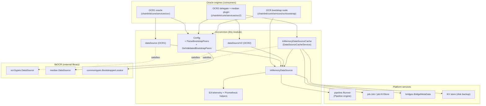
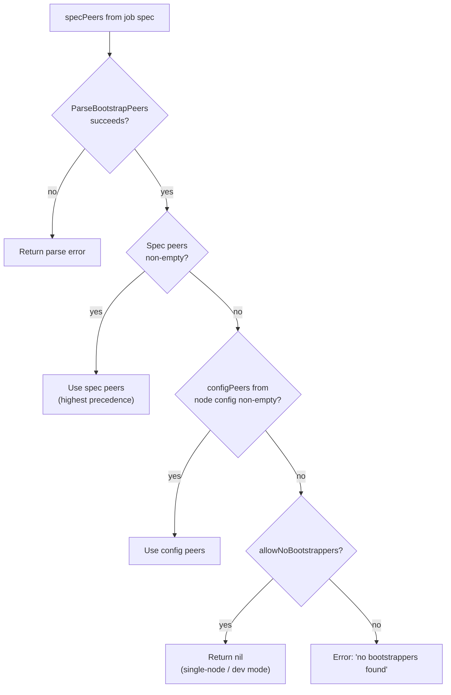
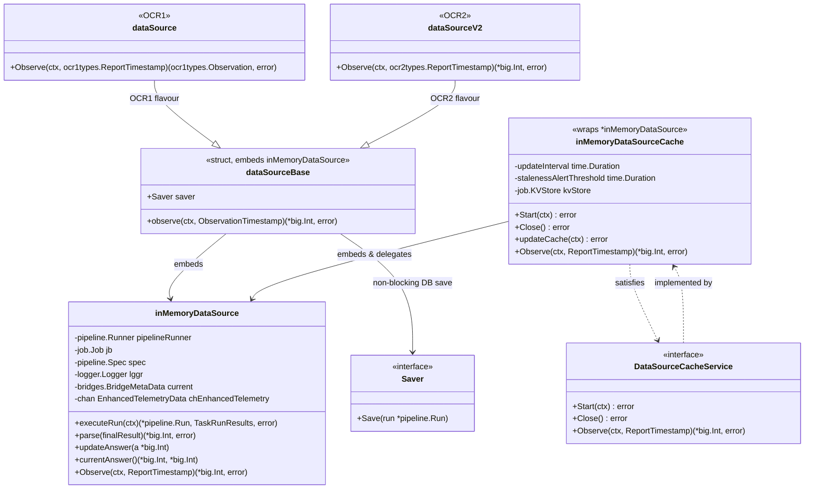
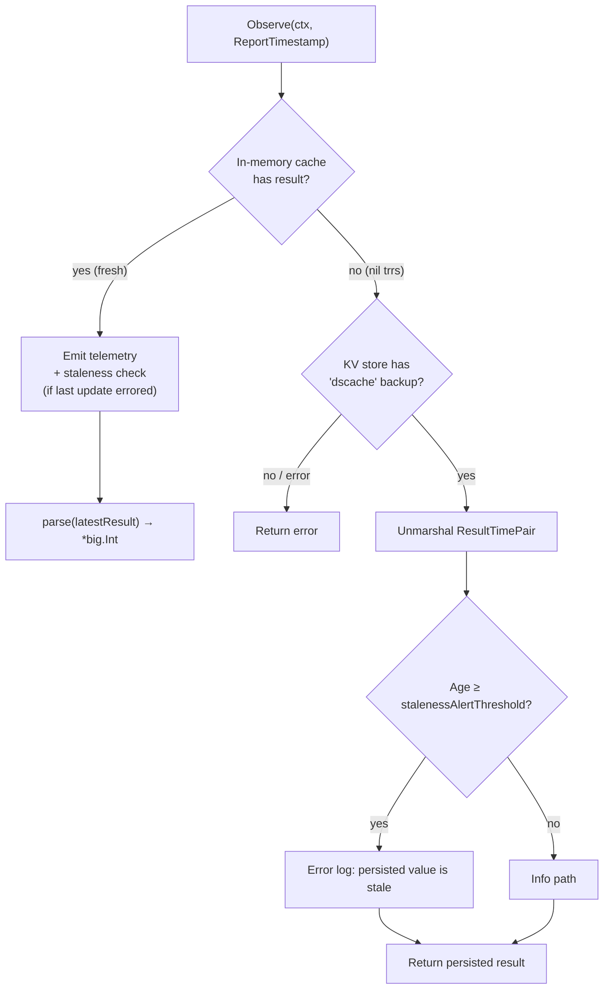
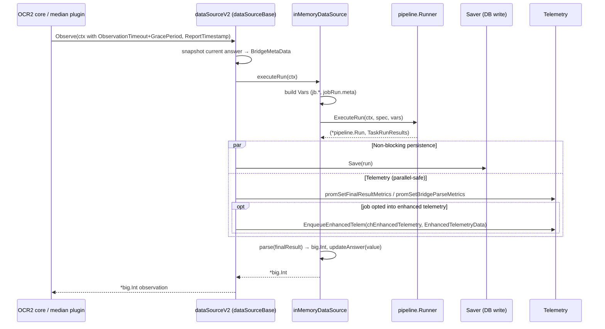
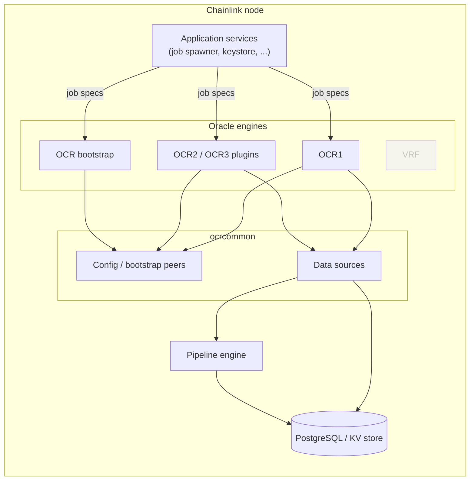

# OCR Common Shared Services (`ocrcommon`)

> **Module location:** `chainlink/core/services/ocrcommon` (Go module `github.com/smartcontractkit/chainlink/v2`, see [`chainlink/go.mod`](../../../repo/chainlink/go.mod))
>
> **Core components:** [`config.go::Config`](#1-configuration-helpers-configgo) · [`data_source.go::DataSourceCacheService`](#2-data-sources-data_sourcego)

## Introduction

`ocrcommon` is the shared support package used by every off-chain reporting implementation in the Chainlink node — the original OCR oracle (OCR1), the OCR2/OCR3 reporting plugins, and the OCR bootstrap node. It deliberately contains no oracle consensus logic itself; instead it supplies the two cross-cutting concerns that all oracle variants need:

1. **Configuration plumbing** (`config.go`) — a minimal `Config` interface exposing the chain type, plus helpers for parsing and validating OCR *bootstrapper* peers declared in job specs and node configuration.
2. **Data sources** (`data_source.go`) — adapters that turn a [Pipeline](../pipeline.md) job spec into the `DataSource` interfaces required by libOCR (`ocr1types.DataSource` for OCR1, `median.DataSource` for OCR2), including an optional time-based **cache service** with on-disk persistence for expensive auxiliary feeds (e.g. `juelsPerFeeCoinSource`).

Because it sits below the oracle engines and above the pipeline runner, this package is the **bridge between the [Pipeline engine](../pipeline.md) and the OCR observation loop**. The parent engine page — [OCR Engines](../ocr.md) — describes how the delegates ([OCR config & validation](ocr_config_and_validation.md), [OCR2 delegate](ocr2_delegate.md), [OCR bootstrap delegate](ocrbootstrap_delegate.md)) assemble these building blocks into running oracles.

---

## 1. Architecture and Component Relationships



**Key relationships**

| Relationship | Direction | Meaning |
|---|---|---|
| Oracle delegates → `Config` | consumer → this module | Resolves chain type and bootstrapper lists when building an oracle from a job spec (see [OCR config & validation](ocr_config_and_validation.md), [OCR bootstrap delegate](ocrbootstrap_delegate.md)). |
| Oracle delegates → data sources | consumer → this module | The delegate passes a `pipeline.Runner`, `job.Job` and `pipeline.Spec`; `ocrcommon` returns a libOCR-compatible `DataSource`. |
| Data sources → [Pipeline engine](../pipeline.md) | this module → dependency | Each `Observe` call triggers `pipeline.Runner.ExecuteRun` on the job's DOT spec. |
| Cache → `job.KVStore` | this module → dependency | The cache persists the last successful observation so a node reboot can still serve a (possibly stale) answer. |

---

## 2. Core Components

### 2.1 Configuration helpers (`config.go`)

#### The `Config` interface

```go
type Config interface {
    ChainType() chaintype.ChainType
}
```

A deliberately narrow abstraction: oracle delegates need to know the chain family (EVM, Solana, Aptos, …) to pick the correct contract tracker, transmitter and codec, but nothing else. Concrete implementations live with each delegate's job config (e.g. in the OCR1 job configuration covered by [OCR config & validation](ocr_config_and_validation.md)).

#### Bootstrap peer handling

| Function | Purpose |
|---|---|
| `ParseBootstrapPeers(peers []string)` | Parses each textual peer (e.g. a `web3`/v2 bootstrapper URI) into a libOCR `commontypes.BootstrapperLocator`. Returns an error on the first unparsable entry. |
| `GetValidatedBootstrapPeers(specPeers, configPeers, allowNoBootstrappers)` | Merges the two sources of bootstrappers and enforces the validation rules below. |

**Validation rules** (`GetValidatedBootstrapPeers`):

1. Parse `specPeers` (job-spec-provided). Any parse error fails immediately.
2. If the spec list is non-empty → use it (spec values win over node config).
3. Otherwise, if node-config `configPeers` is non-empty → use those.
4. Otherwise (both empty):
   - `allowNoBootstrappers == true` → return `nil` with no error. This is legal when the node performs no real consensus (`f = 0, n = 1`), which is useful for testing/development.
   - `allowNoBootstrappers == false` → return the error `"no bootstrappers found"`.



> The peer lists produced here are consumed by the oracle factories described in [OCR config & validation](ocr_config_and_validation.md) and [OCR bootstrap delegate](ocrbootstrap_delegate.md); libOCR uses bootstrappers as the discovery entry points for the OCR2 P2P network (see also the [P2P service](../../Node_Platform_Services/p2p.md)).

### 2.2 Data sources (`data_source.go`)

The data source layer answers the OCR observation phase: *"go fetch the current value for this job"*. It is implemented as a small family of structs around one shared behaviour:



#### `inMemoryDataSource` — the engine behind every observation

- **Input wiring:** constructed with a `pipeline.Runner`, the owning `job.Job`, the job's `pipeline.Spec` and a logger.
- **`executeRun(ctx)`:** serialises the current answer/`UpdatedAt` as `bridges.BridgeMetaData` and injects them into pipeline vars under `jobRun.meta` (plus `jb.databaseID`, `jb.externalJobID`, `jb.name`), then calls `Runner.ExecuteRun(ctx, spec, vars)`. The calling context carries the OCR `ObservationTimeout + ObservationGracePeriod` budget; the implementation is expected to return whatever usable values it has once the deadline hits.
- **`parse(finalResult)`:** extracts the single result via `FinalResult.SingularResult()`, surfaces per-task errors, converts the value to a decimal via `utils.ToDecimal` and caches it (with an `UpdatedAt` timestamp) in the `current` bridge metadata.
- **Telemetry:** every completed run flows through `setEATelemetry`, which updates Prometheus metrics for final results and bridge parsing (`promSetFinalResultMetrics`, `promSetBridgeParseMetrics`) and — when the job opts in via `ShouldCollectEnhancedTelemetry` — enqueues `EnhancedTelemetryData` (task run results, final result, report timestamp) onto the provided channel for the enhanced telemetry pipeline (see [Telemetry ingress](../../Telemetry___Observability_Platform/telemetry_ingress.md)).
- **OCR2 flavour (`Observe` on the embedded type):** returns the parsed `*big.Int` without persisting the run — the "memory only" mode.

#### DB-backed variants: `dataSource` (OCR1) and `dataSourceV2` (OCR2)

Both embed `dataSourceBase`, which adds:

- a `Saver` (interface `Save(run *pipeline.Run)`) — the run is **saved non-blockingly** so the observation result can be returned even while a slow HTTP/data-source task has already consumed most of the observation context deadline;
- a shared `observe(ctx, ObservationTimestamp)` implementation that executes the run, saves it, emits telemetry and parses the final result.

The two wrappers exist purely to satisfy the two libOCR interfaces with their respective `ReportTimestamp` types:

| Constructor | Returns | Interface satisfied | Persistence |
|---|---|---|---|
| `NewDataSourceV1(pr, jb, spec, lggr, saver, telemCh)` | `*dataSource` | `ocr1types.DataSource` | via `Saver` |
| `NewDataSourceV2(pr, jb, spec, lggr, saver, telemCh)` | `*dataSourceV2` | `median.DataSource` | via `Saver` |
| `NewInMemoryDataSource(pr, jb, spec, lggr)` | `*inMemoryDataSource` | `median.DataSource` | none (memory only) |

`ObservationTimestamp` (fields `Round`, `Epoch`, `ConfigDigest` string) abstracts over the OCR1/OCR2 timestamp types so the telemetry helpers can treat both oracle generations identically.

### 2.3 `DataSourceCacheService` — the cached median data source

```go
type DataSourceCacheService interface {
    Start(context.Context) error
    Close() error
    median.DataSource
}
```

`NewInMemoryDataSourceCache(ds, kvStore, cacheCfg)` wraps an `*inMemoryDataSource` (any other type is rejected) in a **time-based cache** (`inMemoryDataSourceCache`). It is used by the OCR2 median plugin for the `juelsPerFeeCoinSource` feed, whose value changes slowly but is expensive to evaluate on every round (see [`PluginConfig.JuelsPerFeeCoinCache`](ocr2_delegate.md) — the cache is disabled when the field is `nil`).

**Configuration** (from `config.JuelsPerFeeCoinCache`; defaults apply when `cacheCfg` is `nil` or a field is zero):

| Setting | Default | Meaning |
|---|---|---|
| `updateInterval` | 5 minutes | Ticker period for background cache refreshes. Even a failed refresh keeps serving previous values. |
| `stalenessAlertThreshold` | 24 hours | Age of the served value beyond which error-level logs fire. |

**Lifecycle & failure handling**

- `Start` launches a background `updater` goroutine that refreshes the cache immediately and then on every tick (each refresh gets a 10-second timeout derived from the stop channel).
- `updateCache` executes a fresh run, parses it, and on success stores the result, the task-run results, and clears the last error. Failures are logged; **two consecutive failures** produce a warning showing both errors.
- **Disk backup:** every successful update also marshals a `ResultTimePair{Result, Time}` and stores it in the `job.KVStore` under the key `"dscache"`. This protects against a scenario where the data source fails continuously *and* the node reboots: the in-memory cache would be empty, but `Observe` can fall back to the persisted value.
- `Close` stops the updater and waits for completion via `chDone`.

**`Observe` fallback ladder** (cached variant):



---

## 3. Data Flow — One OCR Observation Round

The sequence below shows the DB-backed OCR2 path (`dataSourceV2`); the OCR1 path is identical apart from the timestamp/report types, and the cached variant swaps the "execute run" step for the cache logic above.



Design notes:

- **Graceful degradation:** the observation context deadline belongs to the OCR round. Once it fires, whatever partial result exists is returned; the DB write never blocks that return path.
- **Shared metadata:** `current` bridge metadata (latest answer + `UpdatedAt`) is guarded by an `RWMutex` and re-injected into every run's `jobRun.meta`, so downstream pipeline tasks (and bridges) can consume the previous answer.
- **Failure surfacing:** run execution errors are wrapped with the spec ID; parse errors mention the job ID; both are distinguishable by callers that must decide whether the round can still produce a report.

---

## 4. Dependencies

### Upstream (what this module consumes)

| Dependency | Used for | Documented in |
|---|---|---|
| `pipeline.Runner`, `pipeline.Spec`, `pipeline.Run`, `FinalResult`, `TaskRunResults` | Executing job specs to obtain observations | [Pipeline engine](../pipeline.md) |
| `job.Job`, `job.KVStore` | Job identity for vars/logging; persistent cache backup | [Job service](../../Node_Platform_Services/job_service.md) |
| `bridges.BridgeMetaData` | Carrying the latest answer/`UpdatedAt` into runs | [Core shared utilities](../../Node_Application_Core___Interfaces/core_shared_utilities.md) |
| `chainlink-common/pkg/logger`, `services`, `sqlutil` | Structured logging, service lifecycle helpers, DB-typed values | [Shared foundation libraries](../../Shared_Foundation_Libraries___Domain_Types/types-core.md) |
| `libocr` (`ocr1types`, `ocr2types`, `commontypes`) | Oracle interfaces, `BootstrapperLocator` | (external library) |
| `chaintype` (chainlink-evm) | `Config.ChainType()` return value | [OCR config & validation](ocr_config_and_validation.md) |

### Downstream (what consumes this module)

| Consumer | Usage |
|---|---|
| OCR1 oracle construction | Uses `Config` + `NewDataSourceV1` when assembling the OCR1 oracle from a job spec — see [OCR config & validation](ocr_config_and_validation.md) |
| OCR2 delegate / median plugin | Uses `Config`, `NewDataSourceV2`, and `NewInMemoryDataSourceCache` for the `juelsPerFeeCoinSource` feed — see [OCR2 delegate](ocr2_delegate.md) |
| OCR bootstrap node | Parses/validates bootstrapper peer lists via `GetValidatedBootstrapPeers` — see [OCR bootstrap delegate](ocrbootstrap_delegate.md) |

---

## 5. How It Fits into the Overall System

Within [Oracle Engines & Data Pipelines](../../Oracle_Engines___Data_Pipelines.md), `ocrcommon` is the **shared substrate of the OCR family**:



- **Single implementation of observation semantics.** Every OCR-generation oracle observes data the same way — run the job's pipeline, take the singular result, persist non-blockingly, emit telemetry. This keeps behaviour (vars schema, metadata injection, metrics) consistent across OCR1, OCR2 median, and bootstrap nodes.
- **Reusable validation.** Bootstrap-peer rules are enforced in exactly one place, so OCR1, OCR2 and bootstrap delegates cannot drift apart on what constitutes a valid peer configuration.
- **Operational resilience.** The cache service embodies a deliberate trade-off for slow, low-volatility feeds: report rounds never block on the upstream data source, stale values are clearly alerted rather than silently served, and a rebooted node can still answer from the KV-backed snapshot.

When modifying this package, remember that both the [Pipeline engine](../pipeline.md) (via `Runner` contracts) and the delegates ([OCR config & validation](ocr_config_and_validation.md), [OCR2 delegate](ocr2_delegate.md), [OCR bootstrap delegate](ocrbootstrap_delegate.md)) depend on the exact shapes documented above; changes to the `Observe` contracts or var schema are cross-cutting.

---

## 6. Related Documentation

- Parent engine: [OCR Engines](../ocr.md)
- Siblings: [OCR config & validation](ocr_config_and_validation.md) · [OCR2 delegate](ocr2_delegate.md) · [OCR bootstrap delegate](ocrbootstrap_delegate.md)
- Pipeline execution: [Pipeline engine](../pipeline.md) · [Streams](../streams.md)
- Platform services used: [Job service](../../Node_Platform_Services/job_service.md) · [Database persistence](../../Node_Platform_Services/database_persistence.md) · [P2P](../../Node_Platform_Services/p2p.md)
- Observability: [Telemetry ingress](../../Telemetry___Observability_Platform/telemetry_ingress.md)
