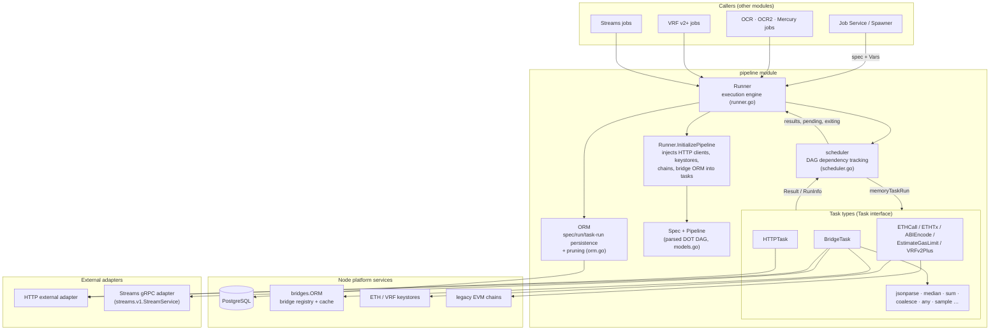
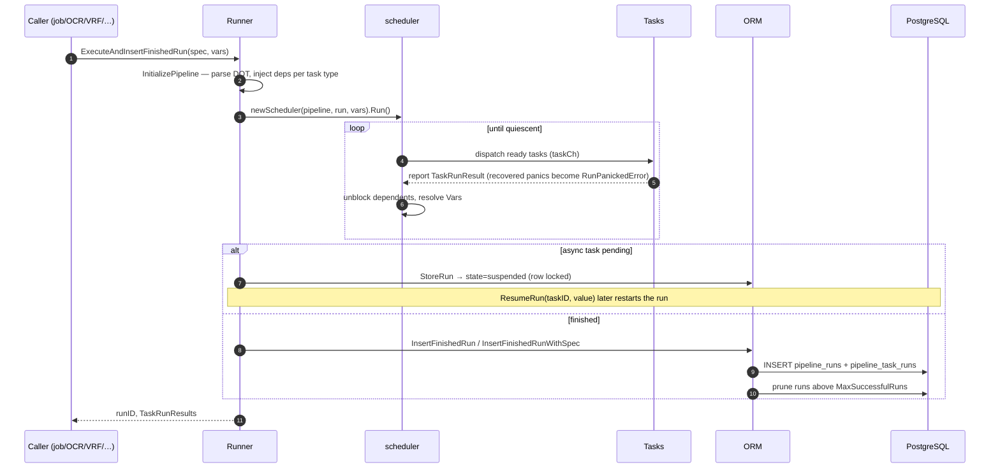
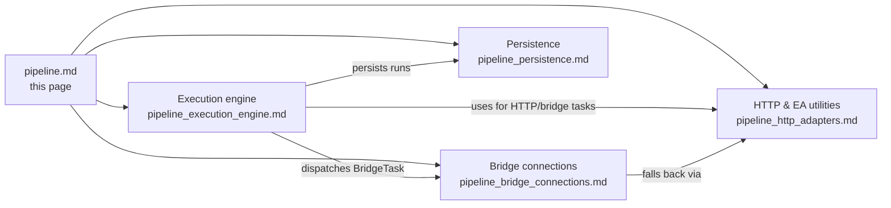

# Pipeline Module

> **Package:** `chainlink/core/services/pipeline` · **Parent:** [Oracle Engines & Data Pipelines](../Oracle_Engines___Data_Pipelines.md)

## 1. Purpose

The Pipeline module is the Chainlink node's **general-purpose execution engine for job pipelines**. A pipeline is a directed acyclic graph (DAG) of data-processing tasks declared in the DOT pipeline specification language (`DotDagSource`), for example:

```dot
ds [type=bridge name="eth-usd" requestData="{\"data\":{\"from\":\"ETH\",\"to\":\"USD\"}}"];
j [type=jsonparse path="data,result"];
ds -> j -> output
```

Nearly every classic Chainlink job type delegates its on-node data flow to this engine — the job-type constants in `common.go` enumerate them: `directrequest`, `fluxmonitor`, `offchainreporting`/`offchainreporting2`, `vrf`, `stream`, `webhook`, `cron`, `workflow`, `ccip`, `blockheaderfeeder`, `blockhashstore`, `bootstrap`, `gateway`, `ccvcommitteeverifier`, `ccvexecutor`, `cresettings`, `standardcapabilities`.

The module provides, end to end:

1. **Spec parsing & DAG model** — a textual DOT spec becomes a `Pipeline` (parsed DAG) attached to a persistent `Spec` row.
2. **Task framework** — a `Task` interface and ~40 concrete task types (`http`, `bridge`, `ethcall`, `ethtx`, `ethabidecode`, `jsonparse`, `median`, `sum`, `vrfv2plus`, …) that resolve parameters, run, and report `Result`s.
3. **Execution engine (`Runner`)** — concurrent, dependency-aware execution with per-task/per-run timeouts, retries, async suspension & resumption, panic recovery, and Prometheus instrumentation.
4. **Persistence (`ORM`)** — storing specs, runs, and task runs in PostgreSQL, with suspension/resume support and per-job run pruning.
5. **External-adapter connectivity** — the `BridgeTask` talks to external adapters over HTTP (with caching and required-path validation) or over a persistent gRPC observation stream via the `bridgeconn` connection manager.
6. **Shared HTTP & EA-parsing utilities** — a common request path (`makeHTTPRequest` + `chainlink-common/pkg/http`) and best-effort external-adapter status/error extraction (`eautils`).

## 2. Architecture Overview



### Core abstractions (`common.go`)

| Abstraction | Role |
|---|---|
| `Task` interface | Unit of work: `Type()`, `DotID()`, `Run(ctx, lggr, vars, inputs) (Result, RunInfo)`, timeout/retry/backoff metadata, DAG wiring (`Inputs`/`Outputs`, `TaskDependency{PropagateResult}`) |
| `Config` interface | Engine tuning knobs: `DefaultHTTPLimit`, `DefaultHTTPTimeout`, `MaxRunDuration`, `ReaperInterval`, `ReaperThreshold`, `VerboseLogging` |
| `BridgeConfig` interface | `BridgeResponseURL` (for async resume callbacks) and `BridgeCacheTTL` |
| `Result` / `FinalResult` | Per-task result (`Value` + `Error`); aggregated run result (`Values`, `AllErrors`, `FatalErrors`) |
| `TaskRunResult` / `TaskRunResults` | A task execution tied to a `TaskRun` row; supports output-index ordering and terminal-task selection |
| `RunInfo` | `{IsRetryable, IsPending}` — drives retry behaviour and async suspension |
| `TaskType` + `UnmarshalTaskFromMap` | Registry mapping spec strings (`"bridge"`, `"http"`, …) to task structs; legacy `vrf`/`vrfv2` are rejected with a migration error |

### Run / spec data model (`models.go`)

- **`Spec`** — persisted pipeline definition: `DotDagSource` (DOT graph), `MaxTaskDuration`, `GasLimit`, `ForwardingAllowed`, job linkage, and an in-memory `Pipeline` cache.
- **`Run`** — one execution of a spec: state (`running` → `suspended` → `completed`/`errored`), inputs/outputs, `AllErrors`/`FatalErrors`, `PipelineTaskRuns`, and the flags `Pending` (awaiting async data) and `FailSilently` (fail-early tasks leave no DB trace).
- **`TaskRun`** — persisted result of one task in one run (`output`, `error`, `dotId`, `index`).

### Execution flow



Key execution semantics:

- **Timeout layering** — the effective deadline is the earliest of: run context, pipeline `MaxRunDuration`, task `timeout`, and job `MaxTaskDuration`. A *discretionary overtime* window (default 100 ms, overridable via the `PIPELINE_OVERTIME`-style env setting read in `runner.go`) lets tasks finish reporting after cancellation.
- **Async tasks** — a task returning `RunInfo{IsPending: true}` suspends the run; `BridgeTask{async=true}` posts a `responseURL` resume endpoint and the run is later restarted by `ResumeRun` → `ORM.UpdateTaskRunResult`.
- **Fail-early** — a failed task marked `failEarly` aborts the run; `FailSilently` runs are deleted rather than persisted.
- **Error handling** — retries for retryable errors (e.g. HTTP 5xx), task-level `retries`/`minBackoff`/`maxBackoff`, panics converted to errors via `recovery.WrapRecoverHandle`.

## 3. Sub-modules

Detailed documentation lives in dedicated pages under [`pipeline/`](pipeline/):

| Sub-module | Source files | Contents | Documentation |
|---|---|---|---|
| **Execution engine** | `common.go`, `runner.go`, `task.sample.go` | `Runner` service lifecycle & execution flow, scheduler integration, `Task` interface & type registry, `Config`/`BridgeConfig` knobs, async resume, reaper, panic recovery, telemetry channel; experimental `SampleTask`/`Sample`/`AnyParam` | [pipeline_execution_engine.md](pipeline/pipeline_execution_engine.md) |
| **Bridge connections** | `bridgeconn/eaconn.go`, `bridgeconn/streamspb/streams_grpc.pb.go`, `task.bridge_test.go` | `BridgeConnManager` + `eaConn`: persistent gRPC observation streams (`streams.v1.StreamService`), 10s full-snapshot subscriptions, idle-timeout unsubscription, exponential-backoff reconnects, cache seeding & required-path fallback (integration tests) | [pipeline_bridge_connections.md](pipeline/pipeline_bridge_connections.md) |
| **Persistence** | `orm.go` | `ORM` interface & implementation: `pipeline_specs` / `pipeline_runs` / `pipeline_task_runs` CRUD, suspended-run storage & restart detection, transactional `ResumeRun` support, per-job pruning & batched reaper, `WithDataSource`/`Transact` composition | [pipeline_persistence.md](pipeline/pipeline_persistence.md) |
| **HTTP & EA utilities** | `common_http.go`, `eautils/eautils.go` | Shared `makeHTTPRequest` path (JSON body, size limits, timeout rules, `statusCodeGroup` metrics), `PossibleErrorResponses` extraction, `eautils` best-effort adapter status/provider-status/error parsing used by `BridgeTask` retry & cache logic | [pipeline_http_adapters.md](pipeline/pipeline_http_adapters.md) |



## 4. Relationship to Other Modules

- **Job orchestration** — the [Job Service](../Node_Platform_Services/job_service.md) (`services/job`) owns job specs and the `Spawner`, and drives pipeline runs for every pipeline-backed job type. The `StandardCapabilitiesConfig` there also configures pipeline runners used by the CRE engine ([Workflow & Capability Runtime](../Workflow___Capability_Runtime_(CRE_Engine).md)).
- **Oracle engines (siblings)** —
  - [OCR / OCR2](ocr.md) jobs execute their data source (typically a DOT pipeline) through this engine; `ocrcommon.DataSourceCacheService` caches pipeline results similarly to `bridgeconn`.
  - [VRF](vrf.md) — `TaskTypeVRFV2Plus` tasks use the VRF keystore provided by `Runner`.
  - [LLO](llo.md) — low-latency oracles consume pipeline/bridge data feeds.
  - [Streams](streams.md) — `stream` jobs wrap pipeline specs for streaming data.
- **Bridges / external adapters** — `BridgeTask` resolves bridge definitions via the [Bridges module](../Node_Application_Core___Interfaces/bridges.md) (`bridges.ORM`, cached by `Runner`), and persists last-known-good values in `bridge_last_value` for cache fallback.
- **Persistence layer** — the ORM builds on the [Database Persistence](../Node_Platform_Services/database_persistence.md) PostgreSQL layer (`pg.Batch` for batched deletes/reaper) and [sqlutil](../Shared_Foundation_Libraries___Domain_Types/sqlutil.md) transactions.
- **Keys & chains** — `ETHTx`/`ETHCall`/`EstimateGasLimit` tasks use the ETH keystore ([Keystore](../Node_Platform_Services/keystore.md)) and legacy EVM chain containers.
- **HTTP client** — `makeHTTPRequest` wraps [`chainlink-common/pkg/http`](../Shared_Foundation_Libraries___Domain_Types/http-client.md) (size-limited requests, structured logging).

## 5. Observability

Prometheus metrics emitted by the module:

| Metric | Type | Labels | Meaning |
|---|---|---|---|
| `pipeline_task_execution_time` | Gauge | job_id, job_name, task_id, task_type | Duration of each finished task |
| `pipeline_tasks_total_finished` | Counter | job_id, job_name, task_id, task_type, bridge_name, status | Completed vs errored task counts |
| `pipeline_run_errors` | Counter | job_id, job_name | Runs ending with fatal errors |
| `pipeline_run_total_time_to_completion` | Gauge | job_id, job_name | Wall-clock time of finished runs |
| `bridge_eaconn_observations_total` | Counter | bridgeName, assetKey | Accepted gRPC observations per bridge/asset |
| `bridge_eaconn_transmit_duration_seconds` | Histogram | bridgeName | Provider→node observation latency |
| `bridge_eaconn_transmit_skew_total` | Counter | bridgeName | Observations dropped due to adapter clock skew |

Task-level telemetry is delivered through a buffered channel installed on the context via `WithTelemetryCh` (e.g. `BridgeTelemetry` records request/response timings and cache hits).

## 6. Database Surface

| Table | Written by | Purpose |
|---|---|---|
| `pipeline_specs` | `CreateSpec`, `InsertFinishedRunWithSpec` | DOT source + `max_task_duration` |
| `pipeline_runs` | `InsertRun`/`StoreRun`/`InsertFinishedRun(s)`, `DeleteRunsOlderThan` | Run state, inputs/outputs, errors |
| `pipeline_task_runs` | `CreateRun`, `StoreRun`, `InsertFinishedRun(s)` | Per-task outputs/errors |
| `job_pipeline_specs` | `InsertFinishedRunWithSpec` | Job ↔ spec association |
| `bridge_last_value` | `BridgeTask` (via bridges ORM) | Last-known-good adapter values for cache fallback |

Pruning keeps `pipeline_runs` capped at `MaxSuccessfulRuns` per job (synchronous below 1000, async/sampled above), and the reaper periodically deletes runs finished before `ReaperThreshold` followed by `VACUUM ANALYZE pipeline_runs`.
