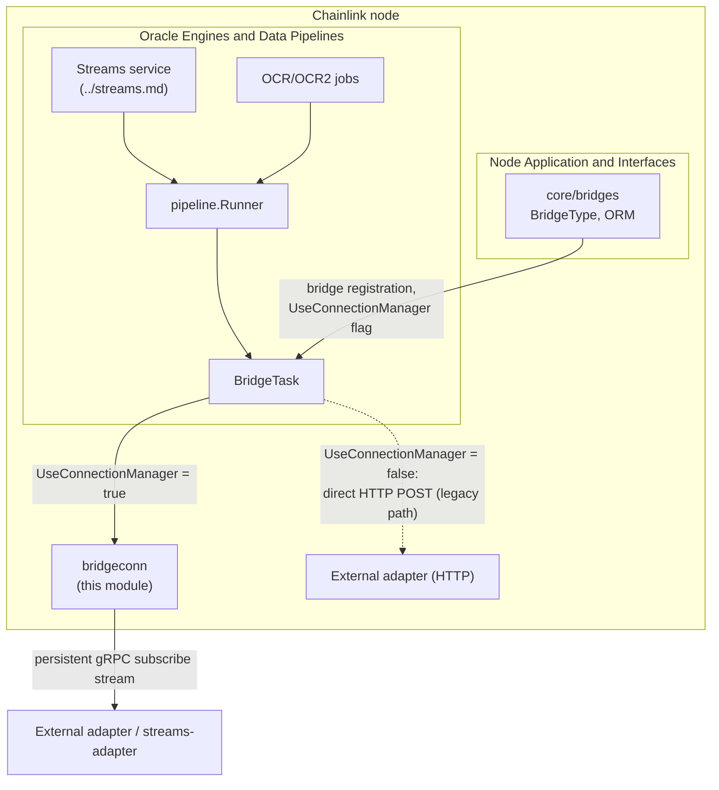
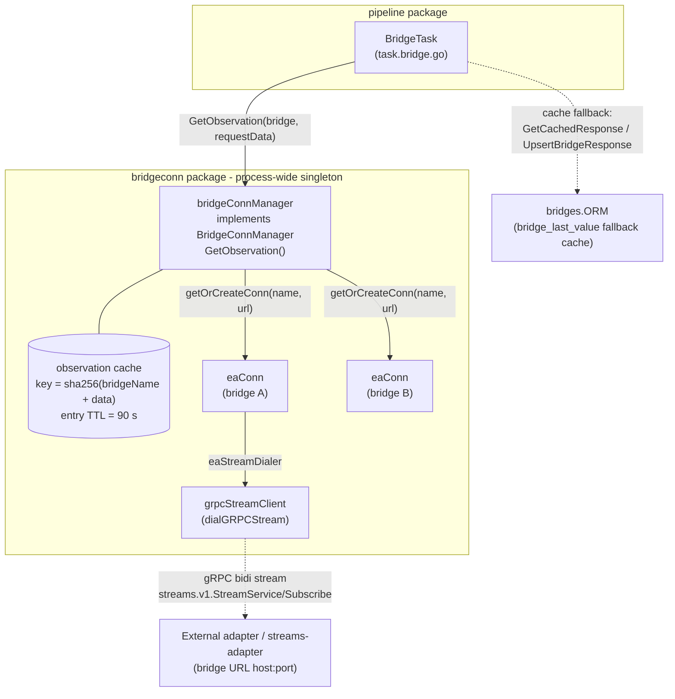
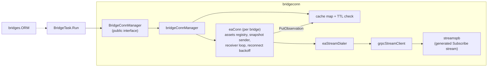
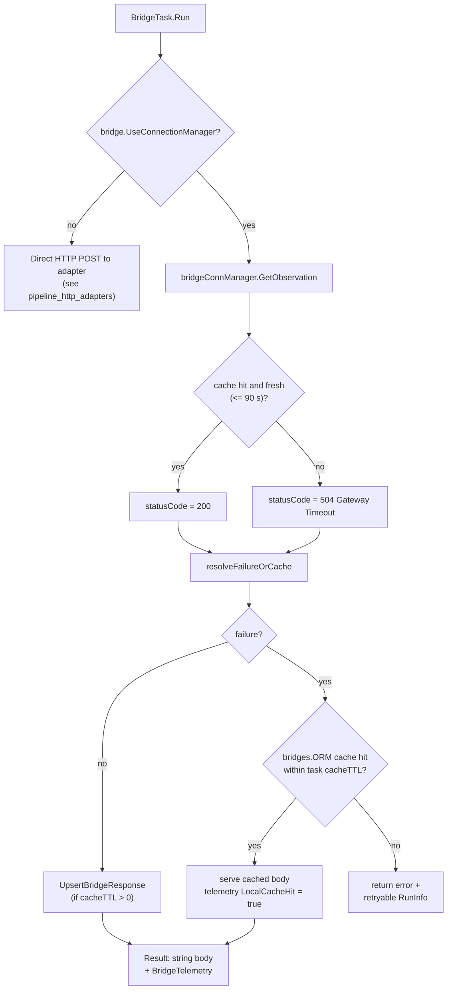
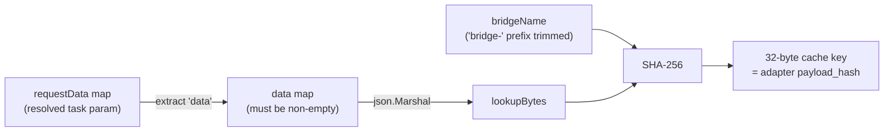
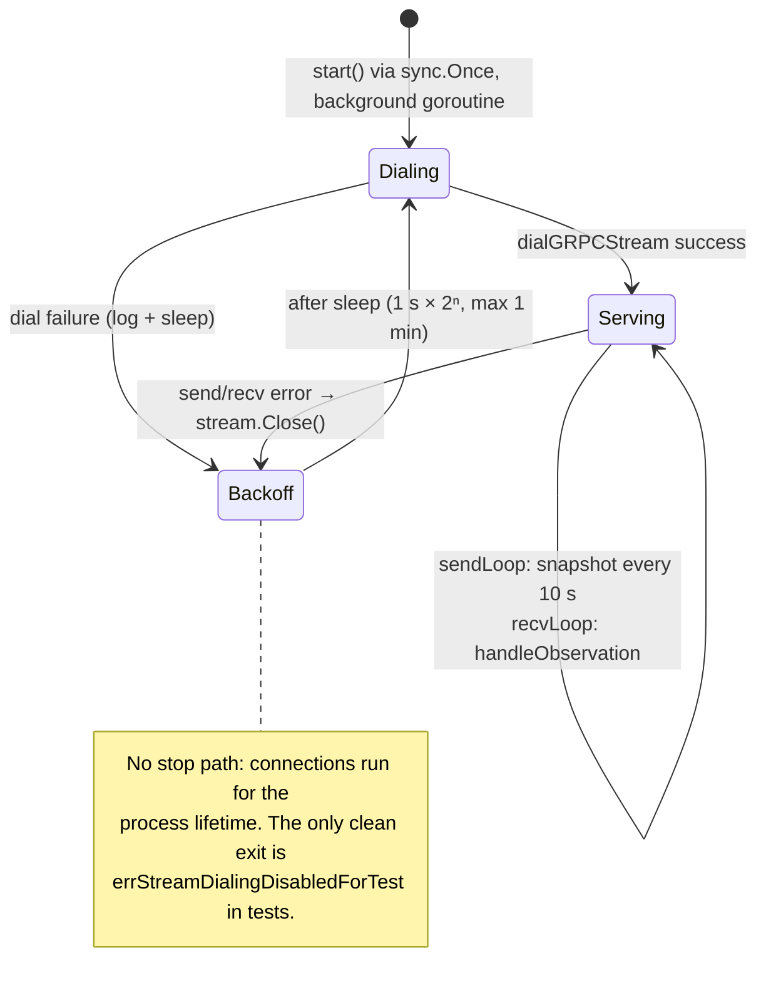

# Pipeline Bridge Connections (`bridgeconn`)

The **bridge connections** module — Go package `chainlink/core/services/pipeline/bridgeconn` — provides *push-based* delivery of external-adapter observations to the node's [pipeline engine](../pipeline.md). When a bridge is flagged `UseConnectionManager`, the pipeline's `BridgeTask` stops making synchronous HTTP POST requests to the adapter and instead reads observations from a process-wide cache that is continuously populated over a persistent, bidirectional gRPC stream (`streams.v1.StreamService/Subscribe`) maintained with each adapter.

The module consists of three cooperating layers:

| Layer | File | Responsibility |
|---|---|---|
| Manager facade | `bridge_conn_manager.go` | `BridgeConnManager` interface, process-wide singleton, observation cache, cache-key derivation |
| Connection owner | `eaconn.go` | One persistent gRPC stream per bridge: snapshot subscriptions, reconnection, observation intake, stream metrics |
| Transport | `grpc_stream_client.go`, `streamspb/` | `grpcStreamClient` adapter and the generated protobuf/gRPC contract for `streams.v1.StreamService` |

The consumer side (`BridgeTask.Run` in `../task.bridge.go`) and its test suite (`task.bridge_test.go`) are part of the [pipeline execution engine](pipeline_execution_engine.md); this page documents the integration points relevant to bridge connections.

> **Related modules:** bridge CRUD/persistence ([bridges](../../Node_Application_Core___Interfaces/bridges.md)) · HTTP adapter request/response helpers ([pipeline_http_adapters](pipeline_http_adapters.md)) · run/spec persistence ([pipeline_persistence](pipeline_persistence.md)) · Postgres layer ([database_persistence](../../Node_Platform_Services/database_persistence.md)) · Streams service that drives pipelines continuously ([streams](../streams.md))

---

## 1. Where this module fits



* Bridge definitions (name, URL, `UseConnectionManager`) live in `core/bridges` and are managed via the node's REST/GraphQL APIs — see [bridges](../../Node_Application_Core___Interfaces/bridges.md).
* Any job whose DOT DAG contains bridge tasks (OCR data sources, Streams jobs, direct-request pipelines) benefits from the shared observation cache, because `bridgeConnManager` is a process-wide singleton shared by *all* pipeline runs.

---

## 2. Architecture



Key design points:

* **Singleton, lazily initialized.** `NewBridgeConnManager(lggr)` returns the same `bridgeConnManager` on every call (guarded by `sync.Once`; the logger is only honored on first call and is immutable afterwards). There is no explicit start/stop lifecycle — connections live for the process lifetime.
* **Two registries under one manager:**
  * `cache map[[32]byte]cacheEntry` — cached observations keyed by payload hash, each entry stamped with `storedAt` and rejected after `observationTTL` (90 s).
  * `conns map[string]*eaConn` — one `eaConn` per bridge name, created and started on first use.
* **Intentionally configuration-free.** All operational timings are hardcoded constants; `EAConn` takes no configuration interface (see [§8](#8-configuration-and-operational-characteristics)).

---

## 3. Core components

### 3.1 `BridgeConnManager` — the consumer-facing facade

```go
type BridgeConnManager interface {
    GetObservation(bridge bridges.BridgeType, requestData map[string]any) ([]byte, error)
}
```

`GetObservation` is the only method the [pipeline execution engine](pipeline_execution_engine.md) sees. Its contract:

1. Trim an optional leading `bridge-` from the bridge name.
2. Extract the inner `"data"` object from the task's resolved request payload (`subscriptionData`); the payload must contain a non-empty `data` map — this is the only part sent as `Subscription.Data` and the only part the adapter hashes.
3. Derive the 32-byte cache key (see [§5.3](#53-cache-key-derivation)).
4. Build a `structpb.Struct` subscription payload and register it with the bridge's `eaConn` (`registerAsset`) — this *enrolls* the asset into the next snapshot; it never triggers an immediate send.
5. Look up the key in the cache:
   * **Miss** → wrapped `ErrBridgeObservationNotFound`.
   * **Older than 90 s** → wrapped `ErrBridgeObservationExpired`.
   * **Hit** → a defensive *copy* of the observation bytes.

Additional (unexported / test-facing) methods on the concrete type:

| Method | Visibility | Purpose |
|---|---|---|
| `PutObservation(key, observation)` | package + `eaConn` receiver loop | Stores observation bytes under the payload-hash key |
| `SeedObservation(bridge, requestData, observation)` | tests | Computes the cache key and seeds the cache directly |
| `getOrCreateConn(bridgeName, bridgeURL)` | internal | Lazily creates and starts the bridge's `eaConn` |
| `DisableEAConnDialingForTest()` | tests | Swaps the dialer for a no-op that fails immediately; mutates the shared singleton — test setup only |

Sentinel errors: `ErrBridgeObservationNotFound`, `ErrBridgeObservationExpired`. The dialer sentinel `errStreamDialingDisabledForTest` makes `eaConn.run` exit cleanly instead of retrying.

### 3.2 `eaConn` — one persistent stream per bridge

`eaConn` (`eaconn.go`) owns the connect/send/receive/reconnect loop for a single bridge:

* **Identity/transport** — `target` is the host:port of the bridge URL's authority; `useTLS` is true when the bridge URL scheme is `https`.
* **Asset registry** — `assets map[[32]byte]*eaAsset`, where `eaAsset` holds the immutable subscription payload and a `lastUsed` lease timestamp. `GetObservation` refreshes the lease on every call.
* **Snapshot semantics** — every `subscriptionInterval` (10 s) `sendLoop` sends a `SubscribeRequest` containing the *complete* set of active assets (`pruneAndSnapshot`). Assets idle for at least `assetIdleTimeout` (30 s) are dropped from the map; because each request replaces the full subscription set on the adapter, omission is an **indirect unsubscribe**.
* **Intake** — `recvLoop` passes each `SubscribeResponse` to `handleObservation`, which:
  1. discards responses whose `payload_hash` is not 32 bytes,
  2. discards observations for keys no longer registered to this connection,
  3. increments `bridge_eaconn_observations_total`,
  4. records the transmit-duration metric from the optional `timestamps.providerDataReceivedUnixMs` field (`observationTimestamps` — the only payload field it reads),
  5. hands the observation JSON to the manager's cache via `PutObservation`.
* **Resilience** — `run` dials, then runs `serve` (which races `sendLoop` and `recvLoop` and returns on the first failure), closes the stream, and retries with exponential backoff (1 s initial, ×2, capped at 1 min; reset to initial after a successful dial). The loop only exits if the dialer returns the test-disable sentinel.

The protobuf-independent seams — `eaStreamClient` (`Send`/`Recv`/`Close`) and `eaStreamDialer` — are implemented by `grpcStreamClient`/`dialGRPCStream` in production and by fakes in tests; `clockwork.Clock` is injected from the manager, enabling fake clocks in unit tests.

### 3.3 `grpcStreamClient` and the wire contract (`streamspb`)

`dialGRPCStream` opens a gRPC connection (TLS with system root CAs for `https` bridges, plaintext otherwise — no application tokens or client certificates) and starts the bidirectional `Subscribe` stream. `grpcStreamClient` adapts it to `eaStreamClient`; `Close()` blocks in-flight sends on a `services.WaitGroup`, then `CloseSend()`s and closes the underlying connection.

The generated code in `streamspb/` (from `streamspb/streams.proto`, `package streams.v1`) defines the contract:

| Message / RPC | Fields / Semantics |
|---|---|
| `StreamService.Subscribe` | single **bidirectional streaming** RPC; *each client request replaces the complete subscription set* |
| `SubscribeRequest` | `subscriptions: repeated Subscription` |
| `Subscription` | `data: google.protobuf.Struct` (the request's `data` object) |
| `SubscribeResponse` | `timestamp: string`, `observation_json: bytes`, `payload_hash: bytes` |

The node implements only the **client** side. `StreamServiceServer` / `UnimplementedStreamServiceServer` / `UnsafeStreamServiceServer` are the generated server interfaces consumed by the external *streams-adapter*; `UnsafeStreamServiceServer` simply opts out of gRPC's forward-compatibility embedding and is not used by the node.

### 3.4 `BridgeTask` integration (consumer side)

`BridgeTask` (`task.bridge.go`) reads `bridge.UseConnectionManager` — a persisted column on `bridges.BridgeType`, settable at bridge creation (see [bridges](../../Node_Application_Core___Interfaces/bridges.md)). When enabled, `Run`:

1. Calls `bridgeConnManager.GetObservation(bridge, lookupPayload)` and measures latency into `bridge_latency_seconds` / `bridge_latency_histogram_ms`.
2. Maps the outcome to a status code: `200 OK` on success, `504 Gateway Timeout` on cache miss/expiry.
3. Routes through the **same** `resolveFailureOrCache` path as the HTTP flow (see [§5.2](#52-bridgetask-lookup-and-fallback-paths)), so EA-error extraction and the durable `bridge_last_value` fallback behave identically in both modes.
4. Emits `BridgeTelemetry` (including `LocalCacheHit`) on the pipeline telemetry channel.
5. Persists fresh successful responses with `orm.UpsertBridgeResponse` (when `cacheTTL > 0`) so future failures can fall back to them.
6. Returns the observation JSON as the string task result.

### 3.5 Test support (`task.bridge_test.go`)

The bridge-task test suite documents the canonical external-adapter shapes used by the mock servers:

* **`adapterRequest`** — `{id, data, meta, responseURL}`: the request a `BridgeTask` POSTs in HTTP mode (the `data` sub-object is exactly what the connection manager subscribes with). Paired with `adapterResponse`, which embeds `eautils.AdapterStatus` (see [pipeline_http_adapters](pipeline_http_adapters.md)).
* **Connection-manager tests** use the manager's test hooks: `SeedObservation` to prime the cache and `DisableEAConnDialingForTest` so no real gRPC traffic is attempted against plain `httptest` servers. They assert: zero HTTP calls on cache hit, `LocalCacheHit=true` telemetry on DB-cache fallback, and correct behavior when the manager holds an observation only for the original request payload.
* **Behavioral coverage** includes stale-cache rejection (`bridge_last_value` age vs. `BridgeCacheTTL`), required-JSON-path validation with `CheckRequired`, async/pending responses, request-data variable interpolation, custom headers, and EA status-code handling.

---

## 4. Component interaction summary



* Manager → `eaConn`: lazy creation + asset registration.
* `eaConn` → manager: `PutObservation` on every accepted message.
* Task → manager: `GetObservation` per bridge-task execution; task → `bridges.ORM`: durable fallback cache.
* `eaConn` → transport: dial/send/recv through the `eaStreamDialer`/`eaStreamClient` seams.

---

## 5. Data flows

### 5.1 Subscription and observation delivery

```mermaid
sequenceDiagram
    autonumber
    participant T as BridgeTask (pipeline run)
    participant M as bridgeConnManager
    participant C as eaConn (per bridge)
    participant A as streams-adapter (gRPC)

    T->>M: GetObservation(bridge, requestData)
    M->>M: key = sha256(bridgeName + data)
    M->>C: registerAsset(key, payload)
    Note over C: asset joins the NEXT snapshot;<br/>no immediate send
    M->>M: cache lookup (TTL 90 s)
    alt fresh cache hit
        M-->>T: copy of observation_json
    else miss or expired
        M-->>T: ErrBridgeObservationNotFound / Expired
    end

    Note over C,A: every subscriptionInterval = 10 s
    C->>A: SubscribeRequest (full active-asset snapshot)
    A-->>C: SubscribeResponse {payload_hash, observation_json}
    C->>C: handleObservation: validate hash, check registration
    C->>M: PutObservation(key, observation_json)
    C->>C: observeTransmitDuration → Prometheus metrics
```

A task that misses on first execution will typically hit the cache on a later run once the adapter pushes the observation — the cache is shared across all runs and jobs in the process.

### 5.2 `BridgeTask` lookup and fallback paths



The DB-backed fallback (`bridge_last_value` table, `GetCachedResponse`/`UpsertBridgeResponse`) and the task-level bridge metrics are defined in `task.bridge.go` and covered in the parent [pipeline](../pipeline.md) documentation; the persistence layer beneath them is described in [pipeline_persistence](pipeline_persistence.md) and [database_persistence](../../Node_Platform_Services/database_persistence.md).

### 5.3 Cache-key derivation

The node-side key **must equal** the adapter-side `ObservationPayloadHash` (the adapter is configured with its `adapterName` equal to this bridge's name), which is why `payload_hash` on accepted observations can be used directly as a cache key:



---

## 6. Connection lifecycle and reliability



Reliability properties:

* **Crash-only lifecycle** — there is no runner-owned start/stop; the manager and its connections are process-lifetime singletons. Recovery from any stream failure is reconnection with capped exponential backoff.
* **Defensive intake** — malformed hashes and observations for pruned/unregistered assets are dropped (counted in debug logs/metrics, never stored).
* **Clean shutdown of a stream** — `grpcStreamClient.Close` blocks in-flight sends, half-closes, and closes the connection before the next dial.
* **Clock-skew tolerance** — observations whose `providerDataReceivedUnixMs` is in the future (negative transmit duration) are excluded from the latency histogram and counted separately, so unsynchronized hosts do not pollute latency data (see [§7](#7-observability)).

---

## 7. Observability

Stream-level metrics defined in `eaconn.go` (Prometheus, registered via `promauto`):

| Metric | Type | Labels | Meaning |
|---|---|---|---|
| `bridge_eaconn_observations_total` | Counter | `bridgeName`, `assetKey` (hex key) | Accepted gRPC observation messages per bridge and asset pair; derive a rate with PromQL `rate(...[1m])` |
| `bridge_eaconn_transmit_duration_seconds` | Histogram | `bridgeName` | Delay between the adapter receiving upstream provider data (`timestamps.providerDataReceivedUnixMs`) and this node handling the message; buckets 1 ms–500 ms |
| `bridge_eaconn_transmit_skew_total` | Counter | `bridgeName` | Observations excluded from the histogram because the computed duration was negative (adapter clock ahead). If this tracks `bridge_eaconn_observations_total` for a bridge, its clocks need synchronizing before latency data is meaningful |

Both metric branches are per-message hot paths (thousands of observations/second) and deliberately do not log — the counters carry the signal.

Task-level metrics (`bridge_latency_seconds`, `bridge_latency_histogram_ms`, `bridge_errors_total`, `bridge_cache_hits_total`, `bridge_cache_errors_total`) and the `BridgeTelemetry` envelope are produced by `BridgeTask` and documented with the [pipeline engine](../pipeline.md); node-wide telemetry plumbing lives in the [Telemetry & Observability Platform](../../Telemetry___Observability_Platform.md).

---

## 8. Configuration and operational characteristics

The manager has **no configuration section**; `EAConn` takes no configuration interface. All behavior constants live in `eaconn.go` / `bridge_conn_manager.go`:

| Constant | Value | Purpose |
|---|---|---|
| `subscriptionInterval` | 10 s | How often `eaConn` sends the full active-asset snapshot |
| `assetIdleTimeout` | 30 s | Assets unused for this long are pruned → indirect unsubscribe by omission |
| `reconnectBackoffInitial` | 1 s | First reconnect delay |
| `reconnectBackoffMultiplier` | 2.0 | Backoff growth factor |
| `reconnectBackoffMax` | 1 min | Reconnect delay cap (reset to initial after a successful dial) |
| `observationTTL` | 90 s | Maximum age of a served cached observation |

Operational requirements and caveats:

* **Opt-in per bridge.** The push mode activates only when `bridge_types.use_connection_manager` is true for the bridge; otherwise the classic synchronous HTTP path is used ([pipeline_http_adapters](pipeline_http_adapters.md)).
* **`data`-shaped requests.** `GetObservation` requires the resolved request payload to contain a non-empty `"data"` object; requests without one fail before any network I/O.
* **Key stability.** Because the cache key is `sha256(bridgeName ‖ marshaledData)`, changing a bridge's name changes all of its cache keys, and request-payload bytes must match what the adapter hashes (both sides marshal the `data` object the same way).
* **TLS via bridge URL scheme** — `https` bridges get system-root-C TLS; `http` bridges get plaintext gRPC. No mTLS or bearer tokens are used on this channel.
* **Test hygiene** — `DisableEAConnDialingForTest` mutates the process-wide singleton and must only be used in test setup; the dialer sentinel is also what allows `eaConn.run` goroutines to exit in tests.
* **Hot-path discipline** — observation handling and metric recording never log on the per-message path; misconfiguration shows up in the skew/observation counters instead.

---

## 9. Related documentation

* [Oracle Engines & Data Pipelines](../../Oracle_Engines___Data_Pipelines.md) — sibling oracle engines (OCR, VRF, LLO) and the Streams service.
* [pipeline](../pipeline.md) — the pipeline engine overview: DOT DAG specs, `Runner`, `Vars`, telemetry channels.
* [pipeline_execution_engine](pipeline_execution_engine.md) — `Runner`, `Config`, task model; where `BridgeTask.Run` is scheduled.
* [pipeline_http_adapters](pipeline_http_adapters.md) — EA request/response status handling (`eautils.AdapterStatus`, `PossibleErrorResponses`) shared by both bridge modes.
* [pipeline_persistence](pipeline_persistence.md) — pipeline ORM, spec/run persistence.
* [bridges](../../Node_Application_Core___Interfaces/bridges.md) — `BridgeType` model (including `UseConnectionManager`), bridge ORM and web/CLI management surfaces.
* [database_persistence](../../Node_Platform_Services/database_persistence.md) — Postgres access layer underpinning the durable `bridge_last_value` fallback cache.
