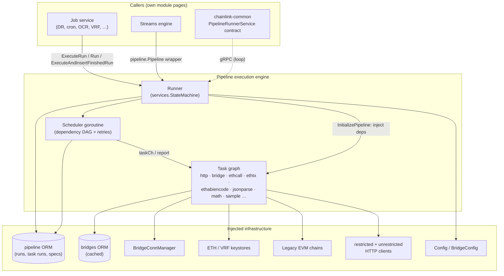
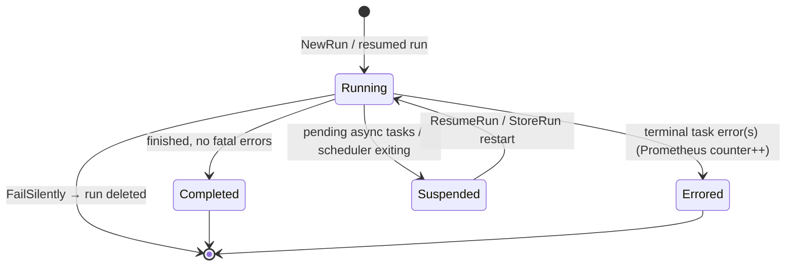
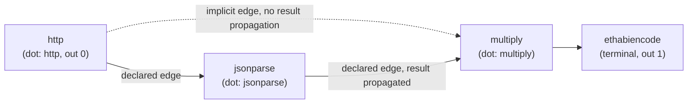
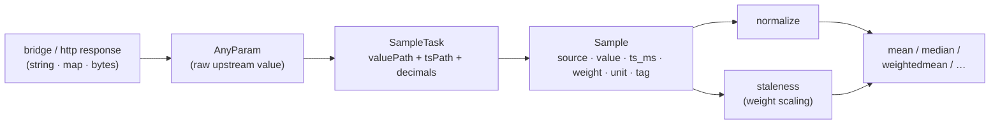
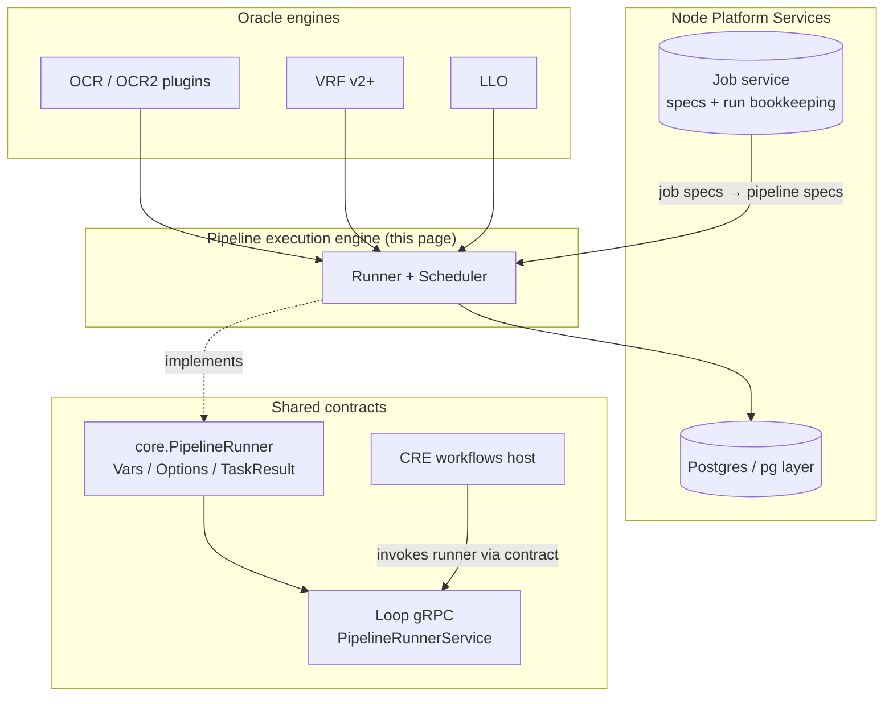

# Pipeline Execution Engine

> **Module:** `chainlink/core/services/pipeline` — the execution core of the pipeline subsystem.
> **Source files:** `common.go`, `runner.go`, `task.sample.go` (with `scheduler.go` and `orm.go` covered by sibling pages).

## 1. Introduction

The **pipeline execution engine** is the DAG-based data-transformation engine at the heart of every Chainlink job. Every job spec (`directrequest`, `cron`, `offchainreporting2`, `stream`, `workflow`, …) carries an *observation source* — a DOT-like text graph of tasks — that this engine parses, schedules, and executes whenever the job needs data fetched from external APIs, computed from raw inputs, encoded for a blockchain call, or delivered as an observation to a reporting plugin.

The engine is responsible for:

- **Spec interpretation** — turning the DOT source into a task graph (`UnmarshalTaskFromMap` + the `Pipeline` model), with typed task construction and per-task dependency injection.
- **Concurrent scheduling** — a dependency-counting scheduler dispatches every task the moment all of its inputs have resolved, with implicit-edge semantics and per-task retry accounting.
- **Execution semantics** — layered timeouts, panic recovery, overtime grace windows, cancellation propagation, and a well-defined error taxonomy (`Result` / `RunInfo` / `FinalResult`).
- **Suspension & resumption** — runs containing async tasks (e.g. `ethtx` awaiting a receipt) are persisted mid-flight and later resumed when the awaited data arrives, including recovery of runs interrupted by a node restart.
- **Persistence & housekeeping** — saving finished runs through the pipeline ORM and reaping stale runs.
- **Observability** — Prometheus metrics for task durations, run errors, and time-to-completion.

The engine lives in the main `github.com/smartcontractkit/chainlink/v2` Go module and consumes the shared foundation packages (`chainlink-common/pkg/logger`, `.../services`, `.../sqlutil`, `.../utils`) — see `chainlink/go.mod`. Its persistence layer, bridge connectivity, and HTTP/EA adapter handling are documented separately; this page links to those instead of duplicating them.

---

## 2. Component Map

| Component | File | Role |
|---|---|---|
| `Runner` (interface) / `runner` (impl.) | `runner.go` | Lifecycle-managed service that executes, persists, resumes, and reaps pipeline runs; owns the scheduler and per-task dependency injection. |
| `Config` (interface) | `common.go` | Engine tuning knobs supplied by node configuration: HTTP limits/timeouts, `MaxRunDuration`, reaper interval/threshold, verbose logging. |
| `BridgeConfig` (interface) | `common.go` | Bridge callback URL and cache TTL, handed to bridge tasks. |
| `Task` (interface) + `TaskDependency` | `common.go` | The unit of execution: typed, identified by a DotID, declares inputs/outputs, timeouts, retries, and stream IDs. |
| `Result`, `FinalResult`, `TaskRunResult`, `TaskRunResults`, `RunInfo` | `common.go` | Value/error plumbing: per-task results, aggregated final results, retryability/pendingness metadata. |
| `UnmarshalTaskFromMap` | `common.go` | Map → typed `Task` construction (mapstructure-based) for all supported task types. |
| Task-type registry & job-type constants | `common.go` | The `TaskType*` catalogue and the `*JobType` constants used for gas-limit selection. |
| `SampleTask`, `SampleParam`, `SampleSliceParam`, `AnyParam` | `task.sample.go` | Experimental "sample" data pipeline: converts raw upstream responses into labelled measurements for downstream aggregation. |
| `scheduler` / `newScheduler` | `scheduler.go` | Dependency-counting scheduler goroutine feeding runnable tasks to the runner. |
| `ORM` interface | `orm.go` | Run/spec persistence contract — details in [Pipeline Persistence](pipeline_persistence.md). |

---

## 3. Architecture



Key construction fact: `NewRunner` receives an `ORM`, a `bridges.ORM` (wrapped in a cache), the `Config`/`BridgeConfig`, legacy EVM chains, the ETH and VRF keystores, a logger, and **two** HTTP clients (a restricted client for `http` tasks and an unrestricted one for `bridge` tasks, since external adapters may run on operator-controlled hosts). At `Start()` the runner launches `scheduleUnfinishedRuns`, optionally the reaper loop, and starts the bridges cache if it is a `services.Service`; `Close()` mirrors this teardown. The engine is wired into the node from the application layer — see [Node Application Config](../../Node_Application_Core___Interfaces/node_application/node_application_config.md).

---

## 4. Domain Model

### 4.1 Task

The `Task` interface is the execution unit. Every concrete task embeds `BaseTask` and exposes:

- Identity: `Type()`, `ID()`, `DotID()` (dotted name used in DOT expressions such as `$(jsonparse.a)`), `Base()`, `GetDescendantTasks()`.
- Execution: `Run(ctx, lggr, vars Vars, inputs []Result) (Result, RunInfo)`.
- Graph topology: `Outputs()`, `Inputs() []TaskDependency`, `OutputIndex()` (explicit 0-based terminal ordering, unset = `-1`).
- Resilience: `TaskTimeout()`, `TaskRetries()`, `TaskMinBackoff()`, `TaskMaxBackoff()`.
- Streaming: `TaskStreamID() *uint32` (used by the [Streams engine](../streams.md)).

`TaskDependency` wraps an input task with `PropagateResult`: edges that were **implicit** (added by the scheduler for output-index ordering rather than declared in the spec) do **not** propagate results, because some tasks cannot handle input from an edge they did not declare.

### 4.2 Results

- `Result{Value any; Error error}` — one task outcome, with `OutputDB()`/`ErrorDB()` converters for persistence.
- `RunInfo{IsRetryable, IsPending}` — returned alongside a `Result`. Retryable meta marks non-deterministic failures (a later attempt may succeed — e.g. 5xx responses per `isRetryableHTTPError`); pending meta marks a task that awaits asynchronous completion.
- `TaskRunResult` — a task result enriched with a UUID, task pointer, attempt count, created/finished timestamps; `IsPending()` and `IsTerminal()` (no outputs) drive run-state accounting.
- `FinalResult{Values, AllErrors, FatalErrors}` — aggregated by `TaskRunResults.FinalResult()` (sorted by output index; only **terminal** tasks contribute values/fatal errors; panics if no terminal task exists). Helpers: `HasErrors`, `HasFatalErrors`, `CombinedError` (joins all errors), `SingularResult` (exactly one output + one fatal error).
- Canonical errors: `ErrWrongInputCardinality`, `ErrBadInput`, `ErrInputTaskErrored`, `ErrParameterEmpty`, `ErrIndexOutOfRange`, `ErrTooManyErrors`, `ErrTimeout`, `ErrTaskRunFailed`, `ErrCancelled`. `CheckInputs(inputs, minLen, maxLen, maxErrors)` enforces cardinality and tolerated-error budgets.

### 4.3 Run & Vars

`NewRun(spec, vars)` creates a `Run` in state `RunStatusRunning`, keyed to the spec's job (`JobID`/`PruningKey`), carrying serialized `Inputs`. During execution the runner fills `PipelineTaskRuns`, `Outputs`, `AllErrors`, `FatalErrors`, and the `Pending` / `FailSilently` flags. `Vars` carries the `map[string]any` scope that DOT expressions bind against; tasks resolve parameters via `ResolveParam` + `VarExpr(...)` / `Input(inputs, i)` (see the `SampleTask.Run` example in §8).

The node-agnostic counterpart of this model is defined in `chainlink-common/pkg/types/core/pipeline_runner.go` (`Vars`, `Options{MaxTaskDuration}`, `TaskResult`) — see [Types Core](../../Shared_Foundation_Libraries___Domain_Types/types-core.md).

---

## 5. Task Catalogue & Unmarshalling

`UnmarshalTaskFromMap(taskType, taskMap, id, dotID)` accepts a `map[string]any`/`map[string]string`, lowercases the type name, instantiates the concrete task struct, and decodes the map with `mapstructure` (weakly-typed input, `StringToTimeDuration` hook, string→`null.Uint32` hook). Explicit `index` keys must be ≥ 0; an *unset* `index` is normalized to `-1` so explicit indices can be 0-based.

| Category | Task types |
|---|---|
| Data fetching | `http`, `bridge` (see [HTTP Adapters](pipeline_http_adapters.md) and [Bridge Connections](pipeline_bridge_connections.md)) |
| Chain operations | `ethcall`, `ethtx`, `estimategaslimit`, `vrfv2plus` |
| Encoding / decoding | `ethabiencode`, `ethabiencode2`, `ethabidecode`, `ethabidecodelog`, `cborparse`, `hexdecode`, `hexencode`, `base64decode`, `base64encode` |
| Math & statistics | `sum`, `mean`, `median`, `min`, `max`, `mode`, `multiply`, `divide` |
| Control / plumbing | `conditional`, `coalesce`, `merge`, `any`, `lookup`, `length`, `jsonparse`, `lowercase`, `uppercase`, `lessthan` |
| Experimental | `sample`, `normalize`, `staleness`, `weightedmean`, `anchor` |
| Testing only | `panic`, `memo`, `fail` |
| Removed | `vrf` / `vrfv2` — unmarshalling fails with a migration error directing users to `vrfv2plus` |

Gas-limit resolution is centralized in `SelectGasLimit(gasEstimator, jobType, specGasLimit)`: the spec value wins, then a per-job-type limit (`*JobType` constants: `directrequest`, `fluxmonitor`, `offchainreporting(2)`, `vrf`, …), then the estimator default. `selectBlock` accepts only `""` (→ `"latest"`), `pending`, or `latest`.

---

## 6. Configuration

The engine is parameterized through two interfaces implemented by node configuration:

| `Config` method | Effect |
|---|---|
| `DefaultHTTPLimit()` | Default request-size limiter for HTTP-family tasks. |
| `DefaultHTTPTimeout()` | Default per-request timeout for HTTP tasks. |
| `MaxRunDuration()` | Pipeline-level run timeout applied in `run()`; `0` disables it. |
| `ReaperInterval()` / `ReaperThreshold()` | Housekeeping cadence and age cut-off for deleting old runs; `0` disables the reaper. |
| `VerboseLogging()` | Adds task results, run metadata, and error dumps to debug/trace logs. |

`BridgeConfig` supplies `BridgeResponseURL()` and `BridgeCacheTTL()` to bridge tasks. Two runtime escape hatches are worth knowing:

- The **overtime** window (default `100ms`, matching libocr's `ReportingPluginTimeoutWarningGracePeriod`) can be overridden through the `PIPELINE_OVERTIME` environment variable, read in the package `init()` via `core/config/env.PipelineOvertime`.
- `sqlutil.LogThresholds` warns at 80% and errors at 90% of a deadline, keeping slow-query logs meaningful for pipeline transactions.

---

## 7. Execution Lifecycle

### 7.1 Entry points

| Method | Semantics |
|---|---|
| `ExecuteRun(ctx, spec, vars)` | Pure in-memory execution; returns the `Run` and `TaskRunResults`. Errors if the run comes back *pending* (async tasks need the persistent path). |
| `Run(ctx, run, saveSuccessfulTaskRuns, fn)` | Blocking, persistence-aware execution. Runs with async tasks are pre-inserted, stored via `StoreRun` after each pass (which may signal `restart` for an instant resume), and only `InsertFinishedRun`-ed when no pre-insert is needed. The optional `fn` callback runs **inside the caller's transaction** on the run's data source. Returns `incomplete=true` when the run is suspended awaiting more data. `saveSuccessfulTaskRuns` is ignored for async runs. |
| `ExecuteAndInsertFinishedRun(ctx, spec, vars, saveSuccessfulTaskRuns)` | `ExecuteRun` + `InsertFinishedRun` in one call; persists the spec if it has no ID. Silent early exit (`FailSilently`) skips persistence. |
| `ResumeRun(ctx, taskID, value, err)` | Writes an async task's result via `ORM.UpdateTaskRunResult`; if that call reports the run is ready to restart, the runner is re-invoked in a goroutine. |
| `InsertFinishedRun(s)` | Persistence helpers with an optional `sqlutil.DataSource` override (for caller-managed transactions) via `ORM.WithDataSource`. |
| `InitializePipeline(spec)` | Parses/caches the DOT source and injects typed dependencies (below). |
| `OnRunFinished(fn)` | Registers a post-run hook (used by callers such as the streams engine). |

### 7.2 Dependency injection in `InitializePipeline`

Every task gets a fresh UUID, then type-specific wiring:

- `http` → engine `Config` + both HTTP clients.
- `bridge` → `Config`, `BridgeConfig`, the cached bridges `ORM`, spec ID, the **unrestricted** HTTP client, and the `BridgeConnManager`; required JSON paths are precomputed (details in [Bridge Connections](pipeline_bridge_connections.md)).
- `ethcall` / `ethtx` / `estimategaslimit` → legacy EVM chains, spec gas limit, job type; `ethtx` additionally gets the ETH keystore and `ForwardingAllowed`.
- `vrfv2plus` → the VRF keystore.

### 7.3 Sequence of a typical run

```mermaid
sequenceDiagram
    autonumber
    participant C as Caller (job / OCR / stream)
    participant R as Runner
    participant S as Scheduler (goroutine)
    participant T as Task (goroutine)
    participant DB as pipeline ORM

    C->>R: ExecuteRun(spec, vars) / Run(...)
    R->>R: InitializePipeline (parse DOT, inject deps)
    R->>S: newScheduler(pipeline, run, vars) → go Run()
    loop while tasks remain ready
        S-->>R: taskCh ← memoryTaskRun (deps == 0, not finished)
        R->>T: go recovery.WrapRecoverHandle(executeTaskRun)
        T->>T: Run(ctx, vars, inputs) → Result, RunInfo
        T-->>R: TaskRunResult
        R->>R: logTaskRunToPrometheus(result, spec)
        R->>S: report(result) (descendants scheduled, retries counted)
    end
    alt run has pending (async) tasks
        R->>DB: pre-insert run + StoreRun after each pass
        Note over R,C: Run returns incomplete=true; ResumeRun later restarts it
    else run finished
        R->>R: outputs/errors from terminal tasks, state = completed | errored
        R->>DB: InsertFinishedRun / InsertFinishedRunWithSpec
        R-->>C: runID + TaskRunResults
    end
    R--)C: runFinished(run) hook (if registered)
```

Timeout layering in `executeTaskRun` (deliberately stable code — see the in-source caution comment): the runner stop channel, then the task's own `TaskTimeout`, then `spec.MaxTaskDuration`, all nested inside the caller's context and the pipeline-level `MaxRunDuration`. `ExecuteRun` additionally shortens the parent deadline by ~10% (or the overtime value, whichever binds) so tasks can finish *after* the caller's cancellation via `context.WithoutCancel` — the `overtimeContext` helper.

### 7.4 Run state machine



Panic safety: a panicking task is recovered by `recovery.WrapRecoverHandle` and reported to the scheduler as a `RunPanickedError` result instead of crashing the process.

---

## 8. Scheduling Model

`scheduler.go` implements a dependency-counting scheduler:

- `dependencies map[int]uint` counts unresolved inputs per task; `taskCh` is buffered with the graph size so dispatch never blocks; `resultCh` is unbuffered.
- `newScheduler` seeds results from an in-progress `Run` (`reconstructResults`) so **resumed runs skip already-finished tasks**, then immediately dispatches every task whose dependencies are met.
- The scheduler tracks `pending` (async suspension) and `exiting` (error + `failEarly` → `run.FailSilently`), owns retry accounting via `attempts`, and honors each task's `TaskRetries`/`TaskMinBackoff`/`TaskMaxBackoff` with `RunInfo.IsRetryable` guiding retryability.
- After each `report`, dependents are decremented and dispatched as soon as they become ready; implicit edges (ordered by output index) don't forward values.



---

## 9. Experimental Sample Pipeline (`task.sample.go`)

The `sample` task family implements a typed measurement flow for data-stream aggregation:

- **`Sample`** bundles one measurement with its metadata: `Source` (grouping/weighting key), `Value` (decimal), `TsMs` (source clock, milliseconds), `Weight`, `Unit`, and a diagnostic `Tag`. Multiple response fields become multiple self-contained samples rather than parallel arrays that can drift out of alignment.
- **`SampleTask`** takes raw upstream output via **`AnyParam`** (accepts any value — string, map, bytes — without conversion), extracts `value` and `ts_ms` through configurable JSON paths (`ValuePath`, `TsPath`), optionally scales by `Decimals`, converts seconds → milliseconds when `TsUnit = "s"`, and emits a `Sample`. It fails when the input errors, a path is missing, or the value is not a valid number.
- **`SampleParam` / `SampleSliceParam`** are tolerant parsers accepting maps, JSON strings/bytes, nested slices, and single samples — flattening one level of nesting — with defaults of `weight = 1` and `tsUnit = "ms"`; strict integer validation guards timestamps across numeric types.



These tasks are marked experimental and may change; they are the plumbing that turns per-source observations into the aggregates consumed by higher-level oracle engines.

---

## 10. Persistence, Recovery & Housekeeping

Persistence details (spec/run tables, `CreateDataSource`, run storage semantics) live in [Pipeline Persistence](pipeline_persistence.md). Behaviors the engine itself guarantees:

- **Crash recovery** — on `Start()`, `scheduleUnfinishedRuns` streams `GetUnfinishedRuns` (bounded by `createdAt < now()` and an immediate reaper pass) and resumes each run in its own goroutine.
- **Reaper** — a sleeper task woken by a ticker every `ReaperInterval` deletes runs older than `ReaperThreshold` (`DeleteRunsOlderThan`), reporting failures to the service error buffer and `HealthReport`.
- **Health** — the runner is a `services.StateMachine`; its health report merges its own status with the wrapped bridges cache when that implements `HealthReporter`.

## 11. Observability

Prometheus metrics registered by `runner.go`:

| Metric | Type | Labels |
|---|---|---|
| `pipeline_task_execution_time` | Gauge | `job_id`, `job_name`, `task_id`, `task_type` |
| `pipeline_run_errors` | Counter | `job_id`, `job_name` |
| `pipeline_run_total_time_to_completion` | Gauge | `job_id`, `job_name` |
| `pipeline_tasks_total_finished` | Counter | `job_id`, `job_name`, `task_id`, `task_type`, `bridge_name`, `status` (`completed`/`error`) |

Runs may also emit task-specific telemetry through a channel attached via `WithTelemetryCh(ctx, ch)` / `GetTelemetryCh(ctx)` — non-buffered channels must not block tasks.

---

## 12. Integration with the Wider System



- **Job service** — jobs own specs and embed `pipeline.PipelineRun` for run bookkeeping/pruning; see [Job Service](../../Node_Platform_Services/job_service.md) and its [domain model](../../Node_Platform_Services/job_service/job_service_domain_model.md).
- **Streams** — `services/streams/pipeline.go` defines a `Pipeline` interface (`Run(ctx) (*pipeline.Run, pipeline.TaskRunResults, error)` plus `StreamIDs()`), wrapping this engine for streaming jobs; see [Streams](../streams.md).
- **OCR / VRF / LLO** — observation and computation sources for these engines are expressed as pipeline specs executed here; see [OCR](../ocr.md), [VRF](../vrf.md), [LLO](../llo.md).
- **Shared runner contract** — `chainlink-common/pkg/types/core/pipeline_runner.go` defines `Vars`, `Options{MaxTaskDuration}`, and `TaskResult`; this contract is served to plugin processes over Loop's gRPC `PipelineRunnerService` — see [Types Core](../../Shared_Foundation_Libraries___Domain_Types/types-core.md) and [Loop Plugin Core](../../Plugin_Process_Framework_(Loop)/loop-plugin-core.md). The CRE workflow host consumes it the same way — see [Workflows](../../Workflow___Capability_Runtime_(CRE_Engine)/workflows.md).
- **Database layer** — the ORM relies on the node's pg layer and transaction helpers; see [Database Persistence — pg Layer](../../Node_Platform_Services/database_persistence/database_persistence_pg_layer.md).

---

## 13. Reference Index

| Symbol | File | Notes |
|---|---|---|
| `Runner`, `runner`, `NewRunner`, `NewRun`, `RunPanickedError` | `chainlink/core/services/pipeline/runner.go` | Service lifecycle, execution, resume, reaper, metrics. |
| `Config`, `BridgeConfig`, `Task`, `TaskDependency`, `Result`, `FinalResult`, `TaskRunResult(s)`, `RunInfo`, `TaskType*`, `UnmarshalTaskFromMap`, `CheckInputs`, `SelectGasLimit`, `WithTelemetryCh` | `chainlink/core/services/pipeline/common.go` | Domain model + task registry. |
| `Sample`, `SampleParam`, `SampleSliceParam`, `SampleTask`, `AnyParam` | `chainlink/core/services/pipeline/task.sample.go` | Experimental sample pipeline. |
| `scheduler`, `newScheduler` | `chainlink/core/services/pipeline/scheduler.go` | DAG scheduling, retries, resumption. |
| `ORM` | `chainlink/core/services/pipeline/orm.go` | Run/spec persistence — see [Pipeline Persistence](pipeline_persistence.md). |

For adjacent subsystems of the `pipeline` package, see the parent overview [Oracle Engines & Data Pipelines — pipeline](../pipeline.md) and its pages on [persistence](pipeline_persistence.md), [bridge connections](pipeline_bridge_connections.md), and [HTTP adapters](pipeline_http_adapters.md).
