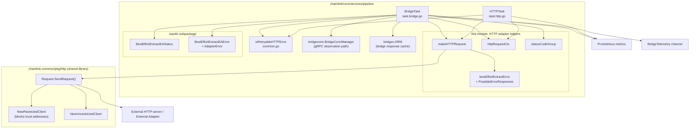
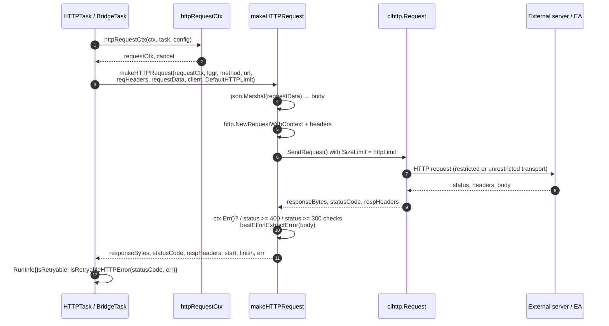
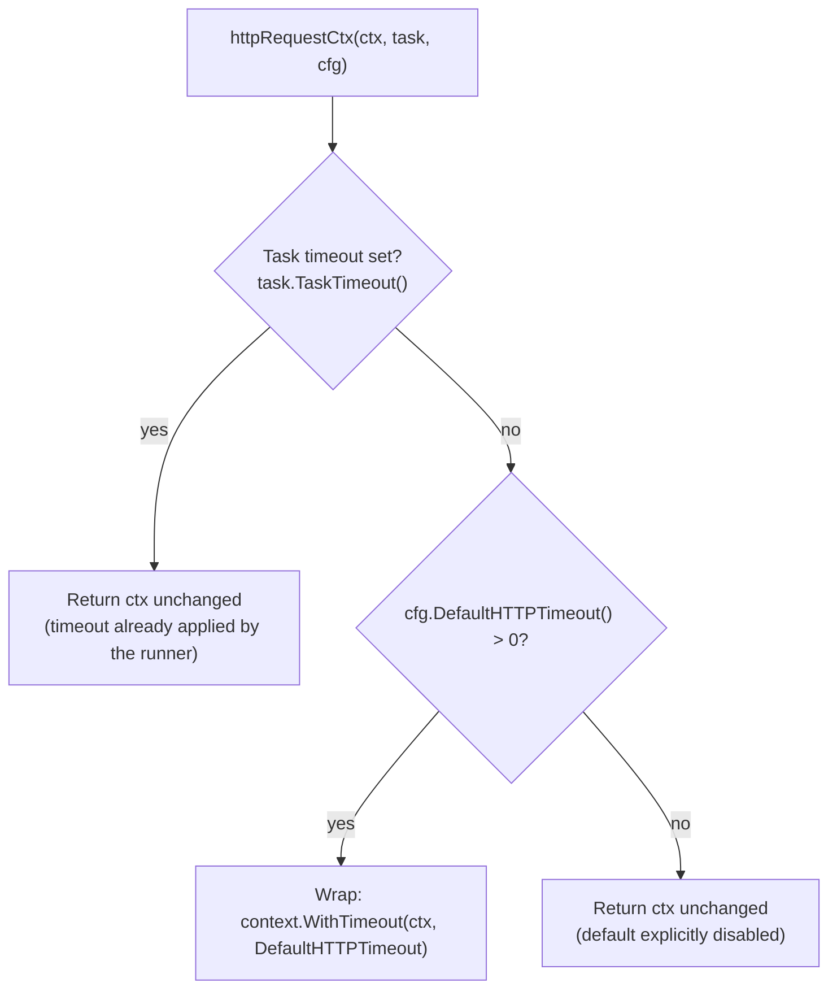
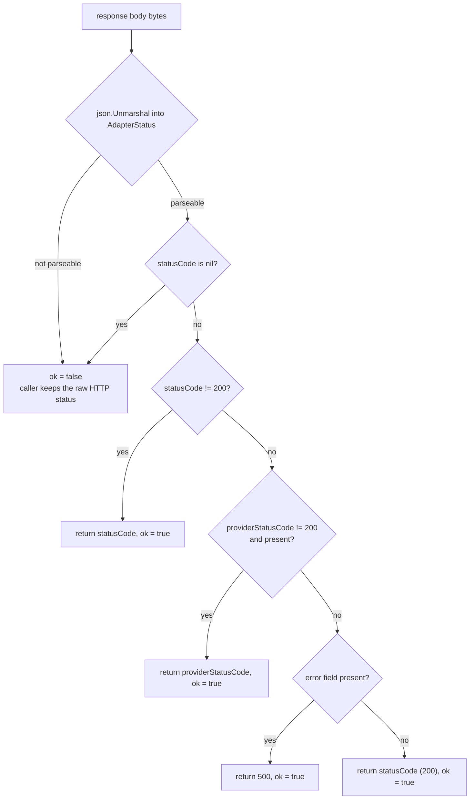
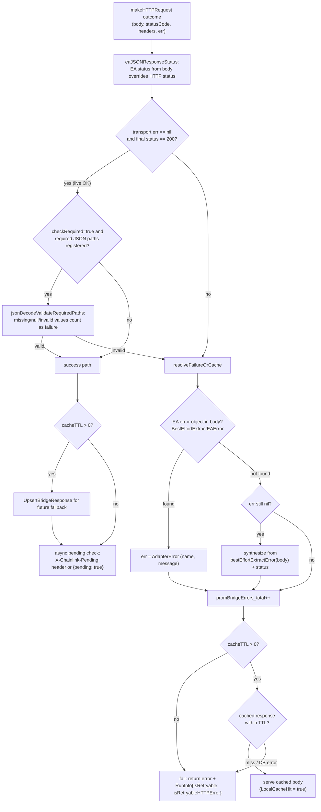

# Pipeline HTTP Adapters

The **pipeline_http_adapters** module is the shared HTTP transport layer for the pipeline execution engine. It contains the helper code that every outbound-networking pipeline task uses to talk to external systems: the `http` task that fetches data directly, and the `bridge` task that calls External Adapters (EAs). The module is deliberately small and dependency-light: it owns no goroutines, no state, and no scheduling — it just performs a single, well-bounded HTTP round trip and interprets the response.

It consists of two source files inside the pipeline service:

| File | Responsibility |
| --- | --- |
| `chainlink/core/services/pipeline/common_http.go` | Request construction, execution, timeout context, response size limiting, timing capture, status-code classification, and generic best-effort error extraction from JSON bodies. |
| `chainlink/core/services/pipeline/eautils/eautils.go` | Best-effort parsing of External Adapter JSON conventions — adapter status codes (`statusCode`/`providerStatusCode`) and structured adapter errors (`{error: {name, message}}`) — from arbitrary response bodies. |

For the surrounding machinery (spec parsing, the task DAG, scheduler, retries, and result persistence), see the [pipeline module](../pipeline.md) and the [pipeline execution engine](pipeline_execution_engine.md). For the gRPC-based alternative to direct HTTP bridge calls, see [pipeline bridge connections](pipeline_bridge_connections.md), and for run/spec storage see [pipeline persistence](pipeline_persistence.md).

---

## Architecture and component relationships

The helpers in this module sit between the network tasks and the shared HTTP client library in `chainlink-common/pkg/http` (documented in [http-client](../../Shared_Foundation_Libraries___Domain_Types/http-client.md)). Tasks resolve parameters, choose a client, then delegate the actual round trip to `makeHTTPRequest`. For bridge tasks, the `eautils` package refines the outcome using EA JSON conventions before the result is finalized.



### How the tasks get their clients

Clients are constructed by the application and injected into the pipeline `Runner` (`NewRunner(..., httpClient, unrestrictedHTTPClient)` in `chainlink/core/services/pipeline/runner.go`), then wired to each task during `InitializePipeline`:

- **`HTTPTask`** receives both clients. It uses the **restricted** client unless the task opts out via `allowUnrestrictedNetworkAccess="true"`. As a convenience, a hardcoded URL literal defaults to unrestricted, while variable-interpolated URLs (`$(...)`) default to restricted — operators must explicitly allow unrestricted access for interpolated URLs.
- **`BridgeTask`** always receives the **unrestricted** client, because bridge URLs come from the node's own database and external adapters frequently run on the same host (localhost), which the restricted client would block.

The restricted client blocks dialing local/loopback addresses (surfaced as `clhttp.ErrDisallowedIP`), and both transports disable HTTP compression to shut down a known class of decompression attacks. See [http-client](../../Shared_Foundation_Libraries___Domain_Types/http-client.md) for transport details.

---

## Core components

### `makeHTTPRequest` — the single round-trip helper

Defined in `chainlink/core/services/pipeline/common_http.go`:

```go
func makeHTTPRequest(
    ctx context.Context,
    lggr logger.Logger,
    method StringParam,
    url URLParam,
    reqHeaders []string,
    requestData MapParam,
    client *http.Client,
    httpLimit int64,
) (responseBytes []byte, statusCode int, respHeaders http.Header, start, finish time.Time, err error)
```

Behavior, in order:

1. **Body encoding** — if `requestData` is non-nil it is marshalled to JSON (`goccy/go-json`) and used as the request body; a marshalling failure aborts with `failed to encode request body as JSON`.
2. **Request construction** — `http.NewRequestWithContext` with the given method and URL; `Content-Type: application/json` is always set. Custom headers are passed as a **flat string slice of key/value pairs** (`reqHeaders[i]`, `reqHeaders[i+1]`). An odd-length slice panics inside this helper — both callers (`HTTPTask`, `BridgeTask`) pre-validate parity and return a task error instead, so the panic is a defensive backstop for direct users.
3. **Execution** — wraps the request in a `clhttp.Request` with `RequestConfig{SizeLimit: httpLimit}` and calls `SendRequest()`. The size limit is enforced by an `http.MaxBytesReader`, bounding memory consumption by untrusted response bodies. Tracing logs are emitted under the `HTTPRequest` logger name.
4. **Timing** — `start` is captured just before the request and `finish` just after, so callers can emit latency metrics without re-instrumenting.
5. **Context check** — if `ctx.Err() != nil` after the call (task timeout, run timeout, or shutdown won the race), the error is normalized to `http request timed out or interrupted`.
6. **Transport errors** — wrapped as `error making http request`.
7. **Status classification**:
   - `statusCode >= 400` → error: `got error from <url>: (status code <code>) <bestEffortExtractError(body)>`
   - `300 <= statusCode < 400` → error: `redirect error <url>: ...`. Go's client follows redirects automatically, so a 3xx reaching this point usually means the redirect chain was exhausted or invalid; either way it is treated as a failure.

The response body is returned as raw bytes; both tasks always stringify it into the task result (`Result{Value: string(responseBytes)}`).

### Request lifecycle



### `PossibleErrorResponses` and `bestEffortExtractError`

When a response signals failure (status >= 300), the raw body is often still JSON that explains why. `bestEffortExtractError` makes a **best-effort** attempt to surface that reason:

```go
type PossibleErrorResponses struct {
    Error        string `json:"error"`
    ErrorMessage string `json:"errorMessage"`
}
```

Extraction precedence: the `error` field, then the `errorMessage` field, then the raw body string. If the body is not valid JSON, an empty string is returned and the status code alone is reported. This covers the two most common error-body conventions without assuming any particular API shape.

### `httpRequestCtx` — timeout resolution

HTTP tasks must not outlive the deadline the scheduler already imposed, but they also need a sane default when a task spec omits `timeout`. `httpRequestCtx` resolves this:



Key semantics (from `BaseTask.TaskTimeout()` in `task.base.go` and the code comment in `common_http.go`):

- The **runner** (`runner.executeTaskRun`) layers deadlines: node shutdown → task `timeout` (`BaseTask.Timeout`, the `timeout` mapstructure key) → job-level `spec.MaxTaskDuration` → `MaxRunDuration`.
- If a task timeout is **present**, `httpRequestCtx` never adds a second layer — the tighter of the upstream deadlines governs.
- If the task timeout is **explicitly zero** (disabled), the node-level default is *not* re-applied — an explicit zero means "no HTTP default timeout".
- If no task timeout is set and `DefaultHTTPTimeout() > 0`, the node-level default is applied here.

### `statusCodeGroup` — metric cardinality control

```go
func statusCodeGroup(status int) string // "1xx".."5xx", "unknown"
```

`BridgeTask` uses this to label per-bridge latency metrics with a coarse status-class bucket instead of the raw status code, keeping Prometheus label cardinality bounded regardless of how many distinct status codes an EA emits.

---

### `eautils` — External Adapter JSON conventions

External adapters frequently wrap their payload in an EA envelope that carries status and error information *inside* a 200 response body. The `eautils` package (with unit tests in `eautils/eautils_test.go`) parses these conventions best-effort: malformed or non-EA bodies simply yield "not applicable", and the caller falls back to the plain HTTP status.

#### `BestEffortExtractEAStatus` and `AdapterStatus`

```go
type AdapterStatus struct {
    ErrorMessage       *string `json:"errorMessage"`
    Error              any     `json:"error"`
    StatusCode         *int    `json:"statusCode"`
    ProviderStatusCode *int    `json:"providerStatusCode"`
}
```

`BestEffortExtractEAStatus(responseBytes) (code int, ok bool)` applies the following decision chain:



Notes on the precedence:

- The adapter's own `statusCode` wins first; this is how an EA reports a failure inside an HTTP 200 envelope.
- `providerStatusCode` lets the adapter propagate the upstream provider's status; it is consulted only when the adapter status is 200.
- An `error` field with an otherwise-successful status is promoted to HTTP 500 so downstream failure handling (retryability, cache fallback, telemetry) sees a failure.
- `ok == false` means "this body is not an EA status envelope"; `BridgeTask.eaJSONResponseStatus` then keeps the transport status code.

#### `AdapterError` and `BestEffortExtractEAError`

```go
type adapterErrorResponse struct {
    Error *AdapterError `json:"error"`
}

type AdapterError struct {
    Name    string `json:"name"`
    Message string `json:"message"`
}
```

`AdapterError` implements the standard `error` interface (`"Name: Message"`), so an extracted adapter error can flow directly into pipeline results, `RunErrors`, and logs. `BestEffortExtractEAError(responseBytes) error` unmarshals the body and returns the embedded `*AdapterError` when present; for any other body shape it returns `nil` — it never fails, and a `nil` return means "no structured adapter error found" (the caller then synthesizes a generic error from `bestEffortExtractError`).

---

## Consumers

### `HTTPTask` (`task.http.go`)

The generic HTTP fetch task. Per run it:

1. Resolves parameters (`method`, defaulting to `GET`; `url` supporting variable interpolation; `requestData` supporting embedded JSON-with-var expressions; `headers` as a JSON array of flat key/value strings).
2. Selects the restricted or unrestricted client based on `allowUnrestrictedNetworkAccess` (defaulting to unrestricted only for hardcoded URL literals).
3. Calls `httpRequestCtx` + `makeHTTPRequest` with `config.DefaultHTTPLimit()`.
4. Special-cases `clhttp.ErrDisallowedIP` with an actionable message telling the operator how to enable unrestricted access for that task.
5. Emits `pipeline_task_http_fetch_time` (ms) and `pipeline_task_http_response_body_size` (bytes) gauges labeled by the task `dotID`, and returns the body as a string result.

### `BridgeTask` (`task.bridge.go`)

The External Adapter task. After resolving the bridge URL from `bridges.ORM` (see [bridges](../../Node_Application_Core___Interfaces/bridges.md)) it takes one of two paths:

- **Connection-manager path** (`UseConnectionManager`): the request is served by the gRPC bridge connection manager instead of direct HTTP — documented in [pipeline bridge connections](pipeline_bridge_connections.md). The outcome is then funneled through the same failure/cache handling below.
- **Direct HTTP path**: a `POST` via `makeHTTPRequest` on the **unrestricted** client, with the request data enriched with job-run `meta`, an optional upstream input (`includeInputAtKey`), and — for async adapters — a `responseURL` pointing at the node's resume endpoint.

The direct-HTTP outcome is refined through this pipeline:



Additional behaviors worth knowing:

- **Async adapters**: with `async="true"`, either an `X-Chainlink-Pending` response header or a `{"pending": true}` body suspends the run (`RunInfo{IsPending: true}`); the adapter later resumes it via the `responseURL` embedded in the request. This requires `BridgeResponseURL` to be configured (see [Configuration](#configuration)).
- **Bridge cache**: successful responses are upserted via `bridges.ORM.UpsertBridgeResponse`, and failures fall back to `GetCachedResponse` within the TTL (per-task `cacheTTL`, defaulting to `WebServer.BridgeCacheTTL`). Cache errors and hits are counted separately.
- **Telemetry**: a `BridgeTelemetry` record (request/finish timestamps, request/response payloads, status code, local cache hit, `streamID`, `specID`, `dotID`, response error) is pushed to the run's telemetry channel when one is attached; a full channel drops the record with a warning rather than blocking the task.

---

## Retryability semantics

Both tasks compute `RunInfo{IsRetryable: isRetryableHTTPError(statusCode, err)}` (defined in `chainlink/core/services/pipeline/common.go`):

| Condition | Retryable? | Rationale |
| --- | --- | --- |
| `400 <= statusCode < 500` | No | Client errors are unlikely to succeed when the identical request is retried. |
| `statusCode >= 500` | Yes | Remote/server errors may succeed on a later attempt. |
| Anything else with `err != nil` (timeouts, transport errors, redirect errors, 3xx) | Yes | Non-deterministic failures may resolve on retry. |

The scheduler consumes `RunInfo.IsRetryable` together with the task's `retries`/`minBackoff`/`maxBackoff` settings — see the [pipeline execution engine](pipeline_execution_engine.md).

---

## Observability

Metrics emitted by (or on behalf of) this module:

| Metric | Type | Labels | Emitter |
| --- | --- | --- | --- |
| `pipeline_task_http_fetch_time` | Gauge (ms) | `pipeline_task_spec_id` (dotID) | `HTTPTask`, `BridgeTask` |
| `pipeline_task_http_response_body_size` | Gauge (bytes) | `pipeline_task_spec_id` (dotID) | `HTTPTask`, `BridgeTask` |
| `bridge_latency_seconds` | Gauge | `name`, `status_code_group` | `BridgeTask` (both HTTP and connection-manager paths) |
| `bridge_latency_histogram_ms` | Histogram | `name`, `status_code_group` | `BridgeTask` |
| `bridge_errors_total` | Counter | `name` | `BridgeTask` |
| `bridge_cache_hits_total` / `bridge_cache_errors_total` | Counter | `name` | `BridgeTask` |

The `status_code_group` label comes from `statusCodeGroup` (`1xx`–`5xx`, `unknown`), which bounds per-bridge cardinality.

---

## Configuration

The helpers read two knobs from the pipeline `Config` interface (`chainlink/core/services/pipeline/common.go`), which is satisfied by the node's `[JobPipeline]` configuration (`chainlink/core/config/job_pipeline_config.go::JobPipeline`):

| Setting | TOML location | Default | Effect |
| --- | --- | --- | --- |
| `DefaultHTTPTimeout()` | `[JobPipeline.HTTPRequest] DefaultTimeout` | `15s` | Applied by `httpRequestCtx` when a task spec has no `timeout` (explicit `timeout = 0` disables it). |
| `DefaultHTTPLimit()` | `[JobPipeline.HTTPRequest] MaxSize` | `32768` bytes | Passed to `makeHTTPRequest` as the response-body size limit (`clhttp.RequestConfig.SizeLimit`). |
| `MaxRunDuration()` | `[JobPipeline] MaxRunDuration` | `10m` | Run-level deadline applied by the runner; bounds HTTP tasks indirectly. |
| `BridgeCacheTTL()` | `[WebServer] BridgeCacheTTL` | `0s` (disabled) | Default cache TTL for bridge tasks that don't set `cacheTTL`. |
| `BridgeResponseURL()` | `[WebServer] BridgeResponseURL` | — | Required for async external adapters; embedded as `responseURL` in bridge requests. |

Defaults are documented in the generated config reference (`chainlink/core/config/docs/core.toml`, `[JobPipeline.HTTPRequest]` and `[WebServer]` sections).

---

## Security considerations

- **SSRF mitigation**: variable-interpolated `http` task URLs use the restricted client by default, which blocks dialing local/loopback addresses (`clhttp.ErrDisallowedIP`) unless the task spec sets `allowUnrestrictedNetworkAccess="true"`. Bridge tasks are exempt by design because bridge URLs are node-operator-configured database records that commonly point at localhost EAs.
- **Response size limiting**: every response body is read through an `http.MaxBytesReader` bounded by `DefaultHTTPLimit`, preventing a malicious or buggy endpoint from exhausting node memory. (The `chainlink-common/pkg/http` package also offers a context-based `LimitedTransport` variant, described in [http-client](../../Shared_Foundation_Libraries___Domain_Types/http-client.md); the pipeline path uses the `RequestConfig.SizeLimit` mechanism.)
- **Compression disabled**: the shared transports disable HTTP compression, eliminating decompression-based attack classes at the transport level.

---

## Related documentation

- [Pipeline](../pipeline.md) — parent module: spec parsing, task types, and service wiring.
- [Pipeline execution engine](pipeline_execution_engine.md) — `Runner`, scheduler, task timeouts, retries, and result handling.
- [Pipeline bridge connections](pipeline_bridge_connections.md) — the gRPC-based `BridgeConnManager` alternative for bridge observations.
- [Pipeline persistence](pipeline_persistence.md) — run and spec storage.
- [Bridges](../../Node_Application_Core___Interfaces/bridges.md) — bridge registry, configuration, and the bridge response cache ORM.
- [http-client](../../Shared_Foundation_Libraries___Domain_Types/http-client.md) — the shared restricted/unrestricted HTTP client library.
- [Oracle Engines & Data Pipelines](../../Oracle_Engines___Data_Pipelines.md) — sibling oracle engines (OCR, VRF, LLO) that also feed pipelines.
