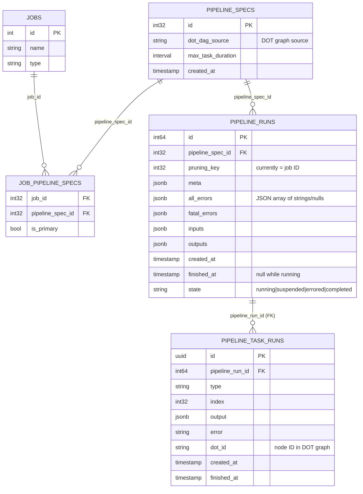
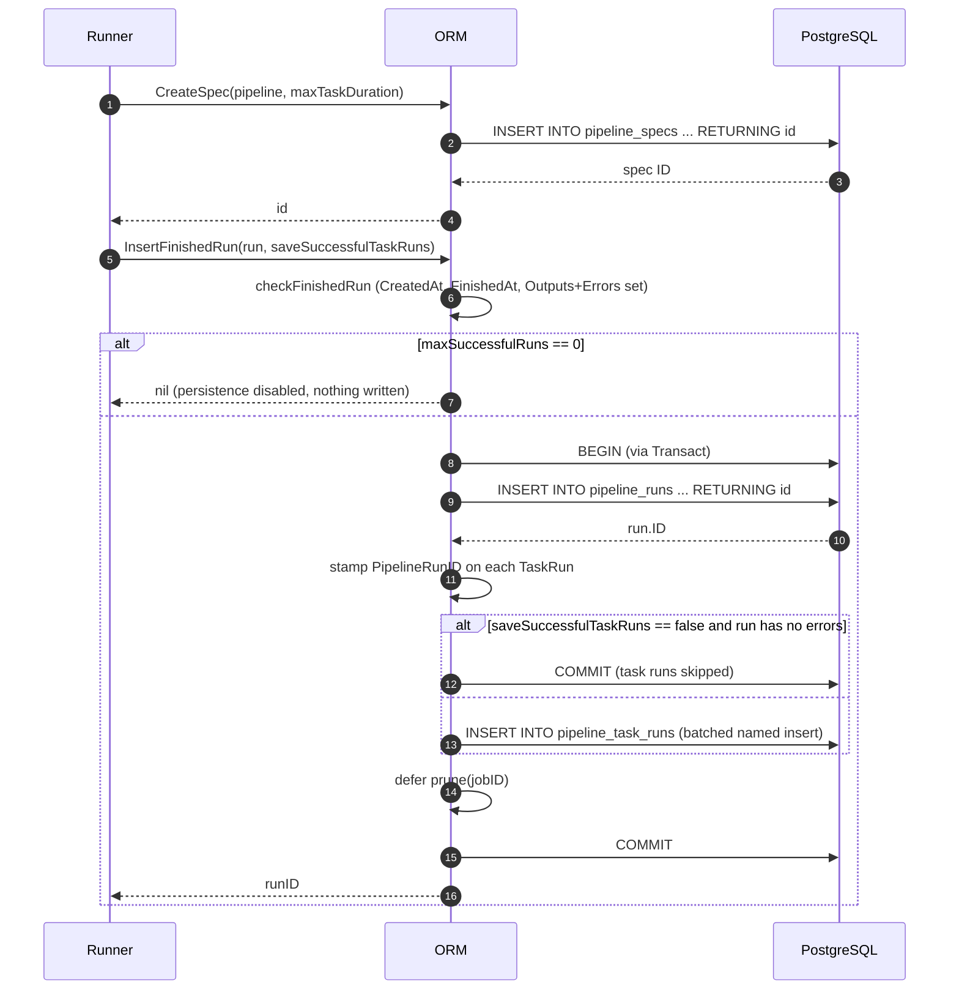
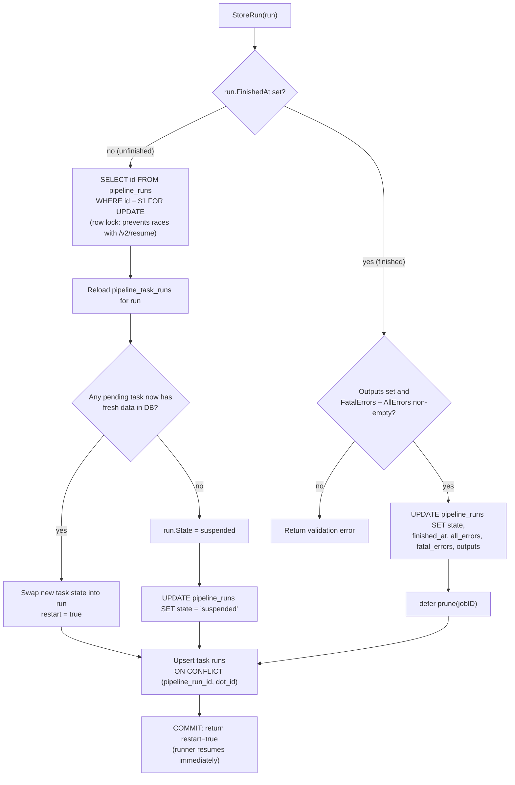
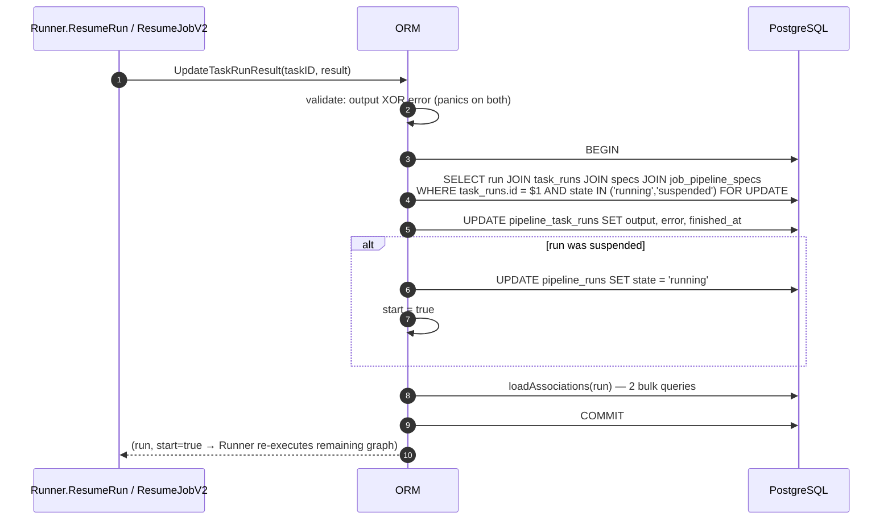
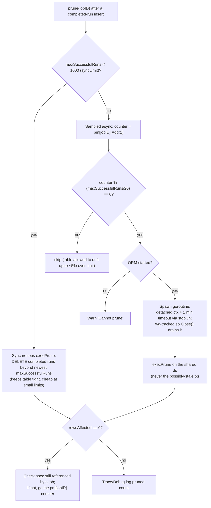

# Pipeline Persistence

> **Module:** `chainlink/core/services/pipeline` (persistence layer) — primary source: `chainlink/core/services/pipeline/orm.go`

## Introduction

The **pipeline persistence** module owns the durable storage of pipeline execution data for Chainlink node jobs (V2 jobs). While the execution side of the pipeline engine — DOT-graph parsing, task scheduling, and run orchestration — is documented in [Pipeline Execution Engine](pipeline_execution_engine.md), this module is responsible for everything that touches the PostgreSQL database:

- Persisting **pipeline specs** (the DOT source of a job's pipeline graph).
- Creating, updating, suspending and finishing **pipeline runs** and their **task runs**.
- Suspending partially-executed (async) runs and atomically resuming them when awaited results arrive.
- Retention: capping the number of stored completed runs per job (pruning) and batched deletion of aged runs (reaper support).

The module is deliberately *pure persistence*: it contains no task logic, no networking, and no scheduling. It is consumed almost exclusively by the pipeline [Runner](pipeline_execution_engine.md), which is wired into it at node startup and exposed to the rest of the node through `Application.PipelineORM()`.

### Quick facts

| Aspect | Value |
|---|---|
| Source file | `chainlink/core/services/pipeline/orm.go` |
| Core types | `CreateDataSource` (narrow query interface), `ORM` (service interface), `orm` (implementation) |
| Constructor | `NewORM(ds sqlutil.DataSource, lggr logger.Logger, jobPipelineMaxSuccessfulRuns uint64)` |
| Storage | PostgreSQL, via [`sqlutil.DataSource`](../../Shared_Foundation_Libraries___Domain_Types/sqlutil.md) |
| Tables | `pipeline_specs`, `pipeline_runs`, `pipeline_task_runs`, `job_pipeline_specs` (joins `jobs`) |
| Lifecycle | `services.Service` (Start/Stop once semantics) |
| Primary consumer | `pipeline.Runner` ([Pipeline Execution Engine](pipeline_execution_engine.md)) |
| Schema owner | Database migrations ([Database Persistence → Migrations](../../Node_Platform_Services/database_persistence/database_persistence_migrations.md)) |

---

## Architecture

The ORM sits between the execution engine and the shared database infrastructure. It is constructed once per node application with the shared data source and the `JobPipelineMaxSuccessfulRuns` retention setting, handed to the `Runner`, and re-exposed to other subsystems (web/GraphQL API, job spawner) through the application container.

```mermaid
flowchart TB
    subgraph Application["Node Application (chainlink/core/services/chainlink)"]
        APP["Application<br/>(PipelineORM() accessor)"]
    end

    subgraph Engine["Pipeline Execution Engine"]
        RUNNER["Runner<br/>(pipeline/runner.go)"]
        REAPER["runReaperWorker<br/>(SleeperTask, ReaperInterval/ReaperThreshold)"]
    end

    subgraph Persistence["This Module — pipeline persistence"]
        ORMIF["ORM interface"]
        ORMS["orm implementation"]
        CDS["CreateDataSource interface<br/>(narrow GetContext view)"]
    end

    subgraph Infra["Shared Persistence Infrastructure"]
        DS["sqlutil.DataSource / Transact<br/>(sqlutil module)"]
        PGBATCH["pg.Batch"]
        LOCKEDDB["pg.LockedDB (node DB handle)"]
        JOBSORM["job.ORM (jobs table owner)"]
    end

    subgraph DB[("PostgreSQL")]
        T1[("pipeline_specs")]
        T2[("pipeline_runs")]
        T3[("pipeline_task_runs")]
        T4[("job_pipeline_specs")]
        T5[("jobs")]
    end

    APP -- "constructs: NewORM(ds, lggr, maxSuccessfulRuns)" --> ORMS
    APP -- "ResumeJobV2(taskID, result)" --> RUNNER
    RUNNER -- "holds as 'orm' field" --> ORMIF
    ORMIF -. implemented by .-> ORMS
    ORMS --> CDS
    ORMS --> DS
    ORMS --> PGBATCH
    DS --> LOCKEDDB
    REAPER -- "DeleteRunsOlderThan" --> ORMS
    RUNNER -- "CreateSpec / CreateRun / StoreRun /<br/>UpdateTaskRunResult / InsertFinishedRun(s)" --> ORMS
    JOBSORM -. "owns jobs table;<br/>linked via job_pipeline_specs" .-> T5
    ORMS --> T1
    ORMS --> T2
    ORMS --> T3
    ORMS --> T4
    ORMS -- "loadAssociations JOIN (read-only)" --> T5
```

Key relationships:

- **Runner → ORM**: `NewRunner(orm, …)` receives the ORM and drives all run persistence through it (see [Runner interface in Pipeline Execution Engine](pipeline_execution_engine.md)). The runner's reaper `SleeperTask` periodically calls `DeleteRunsOlderThan` using the pipeline `Config`'s `ReaperInterval()` and `ReaperThreshold()`.
- **Application → ORM**: the node application constructs `pipeline.NewORM(...)` and publishes it via `Application.PipelineORM()`; the resume entry point `Application.ResumeJobV2(ctx, taskID, pipeline.Result)` funnels into `Runner.ResumeRun` → `ORM.UpdateTaskRunResult`.
- **Job service → ORM (indirect)**: the [Job Service](../../Node_Platform_Services/job_service/job_service_persistence.md) owns the `jobs` table; pipeline specs are linked to jobs through the `job_pipeline_specs` join table, which this module writes (non-primary rows in `InsertFinishedRunWithSpec`) and reads (in `loadAssociations`).
- **Database layer**: all access goes through [`sqlutil.DataSource`](../../Shared_Foundation_Libraries___Domain_Types/sqlutil.md), batch operations through [`pg.Batch`](../../Node_Platform_Services/database_persistence/database_persistence_pg_layer.md), and the physical connection/locking is managed by the [Database Persistence](../../Node_Platform_Services/database_persistence.md) stack.

---

## Core Components

### `CreateDataSource`

```go
type CreateDataSource interface {
    GetContext(ctx context.Context, dest any, query string, args ...any) error
}
```

A **narrowing interface** exposing only the single-row fetch primitive. It exists so that pipeline helpers that only need to *read* a value from the database can accept the minimal surface (satisfied by any `sqlutil.DataSource`, including transaction-wrapped ones) instead of the full `ORM`. It is a dependency-inversion seam, not a store of state — all real persistence lives behind `ORM`.

### `ORM` interface

The full persistence contract. It embeds `services.Service` (Start/Close/Name/HealthReport — see [Services library](../../Shared_Foundation_Libraries___Domain_Types/services.md)) and groups its methods by concern:

| Concern | Methods | Notes |
|---|---|---|
| Spec management | `CreateSpec(pipeline, maxTaskTimeout) (int32, error)` | Inserts a `pipeline_specs` row and returns its ID. |
| Run creation | `CreateRun`, `InsertRun` | `CreateRun` = run + task runs in one transaction; `InsertRun` is the raw run insert (`RETURNING *` rehydrates the model). |
| Finished-run ingestion | `InsertFinishedRun`, `InsertFinishedRunWithSpec`, `InsertFinishedRuns` | Bulk paths used by the runner after execution; see [Retention](#retention-pruning-and-the-reaper) and [flows below](#persistence-flows). |
| Live-run state | `StoreRun`, `UpdateTaskRunResult` | Suspend / resume / finish of partially-executed runs. |
| Deletion | `DeleteRun`, `DeleteRunsOlderThan` | Single-run cascade delete; batched age-based reaping. |
| Queries | `FindRun`, `GetAllRuns`, `GetUnfinishedRuns` | All eagerly load associations via `loadAssociations`. |
| Transaction scoping | `DataSource`, `WithDataSource`, `Transact` | Derive transactional or decorated copies of the ORM. |

### `orm` implementation

```go
type orm struct {
    services.StateMachine          // StartOnce/StopOnce lifecycle
    ds                sqlutil.DataSource
    lggr              logger.Logger // named "PipelineORM"
    maxSuccessfulRuns uint64        // per-job completed-run retention cap
    pm                sync.Map      // jobID => *atomic.Uint64 prune counters
    wg                sync.WaitGroup
    stopCh            services.StopChan
}
```

- **`services.StateMachine`** enforces exactly-once `Start`/`Close`; async pruning goroutines are only spawned `IfStarted` and are drained by `Close` via `wg.Wait()` after `stopCh` is closed.
- **`maxSuccessfulRuns`** comes from the node's `JobPipelineMaxSuccessfulRuns` setting. A value of `0` **disables run persistence entirely** — `InsertFinishedRun` short-circuits before any SQL is issued (an intentional optimization for jobs that need no run history).
- **`pm`** is a lazily-populated `sync.Map` of per-job prune counters used by the sampled pruning strategy (see [below](#per-job-pruning)).
- `WithDataSource` / `withDataSource` returns a lightweight copy sharing the logger and settings but bound to a different `sqlutil.DataSource` — the mechanism that makes `Transact` work.

---

## Data Model

The ORM writes to four tables it owns plus a read-only join to `jobs`. Column names below are taken from the SQL statements in `orm.go`; the DDL itself is owned by the migration framework ([Database Persistence → Migrations](../../Node_Platform_Services/database_persistence/database_persistence_migrations.md)).



Model mapping (from `chainlink/core/services/pipeline/models.go`):

- **`Spec`** ↔ `pipeline_specs` — the DOT graph source and per-task max duration.
- **`Run`** ↔ `pipeline_runs` — with typed columns `AllErrors`/`FatalErrors` (`RunErrors`, JSON arrays via `Scan`/`Value`), JSON-serializable `Meta`/`Inputs`/`Outputs`, and the `State` field.
- **`TaskRun`** ↔ `pipeline_task_runs` — identified by UUID, tied to a graph node by `DotID`. Upserts rely on the **unique constraint on `(pipeline_run_id, dot_id)`** (implied by the `ON CONFLICT (pipeline_run_id, dot_id)` clause in `StoreRun`).
- **`RunStatus`** — the `state` values persisted: `running`, `suspended`, `errored`, `completed` (plus in-memory `unknown`). A run's derived status is: fatal errors → `errored`; `FinishedAt` set → `completed`; otherwise `running`.

`PruningKey` on `Run` currently mirrors the owning **job ID** and is the key used for per-job retention.

---

## Persistence Flows

### 1. Fire-and-forget execution (spec + finished run)

Most job types execute synchronously to completion and only then persist. `Runner.ExecuteAndInsertFinishedRun` combines in-memory execution with `InsertFinishedRun`; if the spec has no ID yet, the runner first persists it via `CreateSpec`.



Semantics worth noting:

- `saveSuccessfulTaskRuns=false` (used by high-frequency jobs such as OCR, see [OCR module](../ocr.md)) persists the run header but **skips task-run rows unless the run errored**, dramatically reducing write volume for successful runs.
- `InsertFinishedRunWithSpec` additionally writes the spec and a **non-primary** `job_pipeline_specs` row (the job already has a primary spec at that point) — used when runs carry ad-hoc specs, e.g. from the OCR2 flow.
- `InsertFinishedRuns` is the batched variant: it inserts all run headers first (`RETURNING id` via named query), stitches the returned IDs into the task runs, then inserts the filtered task-run rows, and finally prunes for every distinct pruning key in the batch.

### 2. Suspending, resuming and finishing live runs

Runs containing async tasks (e.g. awaiting an on-chain event or an HTTP callback) are persisted mid-flight. `StoreRun` is the single transactional entry point for both suspending and finishing, and it is where concurrency safety is enforced.



The resume path is the mirror image. When an awaited value (or the external `/v2/resume` API via `Application.ResumeJobV2`) delivers a result for a pending task:



`UpdateTaskRunResult` deliberately joins through `job_pipeline_specs` so the returned run carries `JobID`/`JobName` for logging and telemetry, and it only touches runs in `running` or `suspended` state — completed/errored runs are immutable.

### 3. Read paths

`FindRun`, `GetAllRuns` and `GetUnfinishedRuns` all wrap their queries in a transaction and finish with `loadAssociations`, which hydrates `Run.PipelineSpec` (including job name/type via a `LEFT JOIN` to `jobs`) and `Run.PipelineTaskRuns` in **exactly two bulk queries** regardless of run count — avoiding N+1 queries on the API and startup paths:

- `GetUnfinishedRuns(state='running', created_at < now, callback)` is paginated via [`pg.Batch`](../../Node_Platform_Services/database_persistence/database_persistence_pg_layer.md) and is the hook the runner uses on startup to re-drive interrupted runs.
- `DeleteRun` performs a plain `DELETE` on `pipeline_runs` and relies on **foreign-key cascade** to wipe the associated `pipeline_task_runs` — used for `failEarly` runs that should leave no trace.

---

## Transaction Semantics

- **`Transact(ctx, fn)`** wraps `sqlutil.Transact` (see [sqlutil module](../../Shared_Foundation_Libraries___Domain_Types/sqlutil.md)): it builds a *transactional copy* of the ORM via `WithDataSource`, starts it, runs `fn`, and always closes the temporary ORM. Nested calls compose because every write path (`CreateRun`, `StoreRun`, `UpdateTaskRunResult`, `InsertFinishedRuns`, …) internally calls `o.transact`, which re-wraps the already-transactional data source.
- **`WithDataSource(ds)`** lets the runner execute task callbacks against the *same* transaction (e.g. so bridge/task side-effects can read uncommitted state), an override used by `Runner.Run(ctx, run, saveSuccessfulTaskRuns, fn)`.
- **Row locking**: unfinished-run suspension (`SELECT … FOR UPDATE` in `StoreRun`) and resume (`FOR UPDATE` in `UpdateTaskRunResult`) serialize concurrent writers on the same run, making the suspend/restart diff race-free.
- **Deferred pruning**: `prune` calls inside transactions run after the business mutation but within (or immediately after) commit, and never abort the enclosing operation on failure — pruning errors are logged, not propagated.

---

## Retention, Pruning and the Reaper

Retention operates on two timescales and two dimensions:

### Per-job pruning (`prune` / `execPrune`)

Keeps the number of **completed** runs per `pruning_key` (job) capped near `maxSuccessfulRuns`. The strategy is adaptive:



Notes:

- The async branch intentionally uses `context.WithoutCancel` so an in-flight prune is not killed by the caller's request context, while still respecting node shutdown through `stopCh`.
- Pruning targets only `state = 'completed'` runs — errored runs are left for the age-based reaper, preserving forensic data.

### Age-based reaping (`DeleteRunsOlderThan`)

Invoked by the runner's reaper task on the `Config.ReaperInterval()` cadence with `Config.ReaperThreshold()` (defined in `pipeline/common.go::Config` and fed from node configuration). It:

1. Deletes `pipeline_runs` older than `now - threshold` in **batches** (`pg.Batch` limit loop with an ordered CTE `DELETE … USING batched_pipeline_runs`), accumulating `rowsAffected`.
2. Issues `VACUUM ANALYZE pipeline_runs` afterwards to reclaim space and refresh statistics.
3. Treats vacuum failure as a **warning only** — the deletion itself already succeeded.

This pairs with the migration-owned DDL (see [Migrations](../../Node_Platform_Services/database_persistence/database_persistence_migrations.md)) and node-level database settings documented in [Database Persistence](../../Node_Platform_Services/database_persistence.md).

---

## Concurrency and Correctness Summary

| Hazard | Mitigation in this module |
|---|---|
| Concurrent suspend vs. external resume | `SELECT … FOR UPDATE` row lock in `StoreRun`; state-checked, locked re-select in `UpdateTaskRunResult` |
| Lost task results between in-memory execution and suspend | Diff of freshly-reloaded `pipeline_task_runs` → `restart=true` semantics instead of blind overwrite |
| Duplicate task-run rows on upsert | `ON CONFLICT (pipeline_run_id, dot_id) DO UPDATE` |
| Ambiguous result payloads | `UpdateTaskRunResult` panics if both output and error are valid |
| Unbounded run history | Per-job `prune` (count-based) + `DeleteRunsOlderThan` (age-based) + `maxSuccessfulRuns=0` hard off-switch |
| Goroutine leaks on shutdown | Async prunes are `wg`-tracked, `stopCh`-signalled, and drained in `Close` |
| Spec garbage buildup | `execPrune` removes orphaned specs' prune counters; `InsertFinishedRunWithSpec` keeps spec/job linkage explicit |

---

## Configuration

The ORM's behavior is controlled by two configuration surfaces:

| Setting | Feeds into | Effect |
|---|---|---|
| `JobPipelineMaxSuccessfulRuns` (node TOML) | `NewORM(..., maxSuccessfulRuns)` | Per-job completed-run cap; `0` disables run persistence. Announced at `Start` ("Pipeline runs will be pruned above per-job limit…" / "…saving is disabled"). |
| `pipeline.Config.ReaperInterval()` / `ReaperThreshold()` (`pipeline/common.go::Config`) | Runner's reaper `SleeperTask` | Cadence and age cutoff for `DeleteRunsOlderThan`. |

Schema changes for `pipeline_specs`, `pipeline_runs`, and `pipeline_task_runs` are versioned in the migration framework — see [Database Persistence → Migrations](../../Node_Platform_Services/database_persistence/database_persistence_migrations.md); connection pooling and advisory locking are described in [Database Persistence → PG layer](../../Node_Platform_Services/database_persistence/database_persistence_pg_layer.md).

---

## Where this fits in the system

- **Consumed by** [Pipeline Execution Engine](pipeline_execution_engine.md): the `Runner` persists specs, creates and stores runs, resumes suspended runs, and reaps old runs through this module.
- **Feeds** the OCR/OCR2 oracle families (finished-run ingestion with `saveSuccessfulTaskRuns=false`), VRF, and legacy job types executed as pipelines — see [OCR](../ocr.md), [VRF](../vrf.md) and the parent [Oracle Engines & Data Pipelines](../pipeline.md) overview.
- **Complements** the [Job Service persistence](../../Node_Platform_Services/job_service/job_service_persistence.md): the jobs table is the parent of `job_pipeline_specs`; pipeline run history is keyed by job ID via `PruningKey`.
- **Built on** the shared persistence stack: [`sqlutil`](../../Shared_Foundation_Libraries___Domain_Types/sqlutil.md) (data sources, transactions, intervals), [pg layer](../../Node_Platform_Services/database_persistence/database_persistence_pg_layer.md) (batching, locking), and the [Services lifecycle library](../../Shared_Foundation_Libraries___Domain_Types/services.md) (Start/Stop/HealthReport).
- **Exposed to** operators via the node's run/spec query endpoints, which surface `FindRun`/`GetAllRuns` results (the task-run state machine and task types themselves are covered in [Pipeline Execution Engine](pipeline_execution_engine.md) and [Pipeline Bridge Connections](pipeline_bridge_connections.md)).

---

## Source Map

| Symbol | Location |
|---|---|
| `CreateDataSource`, `ORM`, `orm`, `NewORM`, `Transact`, `StoreRun`, `UpdateTaskRunResult`, `InsertFinishedRun(s)`, `DeleteRunsOlderThan`, `prune`/`execPrune`, `loadAssociations` | `chainlink/core/services/pipeline/orm.go` |
| `Run`, `TaskRun`, `Spec`, `RunStatus`, `RunErrors`, `ResumeRequest` | `chainlink/core/services/pipeline/models.go` |
| `Runner`, `NewRunner` (ORM consumer, reaper wiring) | `chainlink/core/services/pipeline/runner.go` |
| `Config` (`ReaperInterval`, `ReaperThreshold`, …) | `chainlink/core/services/pipeline/common.go` |
| `Application.PipelineORM()`, `Application.ResumeJobV2` (wiring/accessor) | `chainlink/core/services/chainlink/application.go` |
| Generated test doubles (`mocks/orm.go`, `mocks/runner.go`) | `chainlink/core/services/pipeline/mocks/` |
