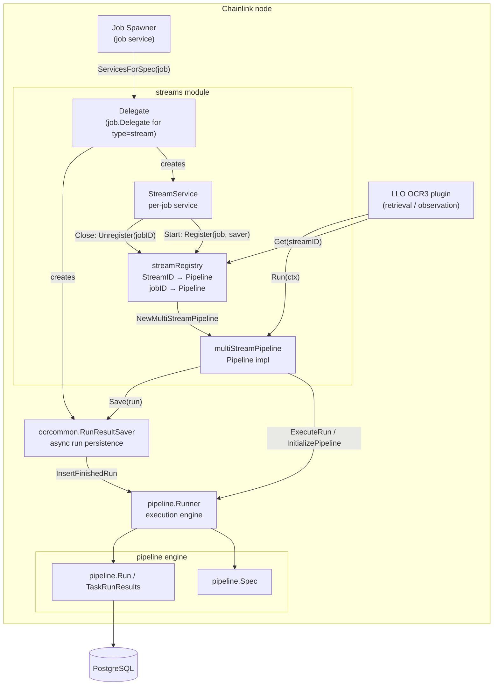
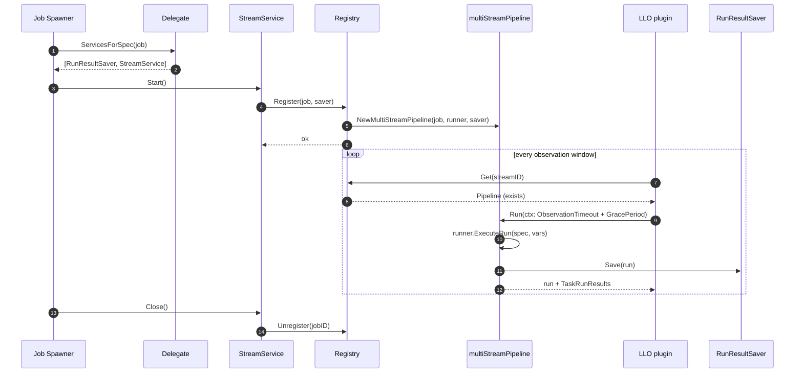

# Streams Module

> **Package:** `chainlink/core/services/streams` · **Parent:** [Oracle Engines & Data Pipelines](../Oracle_Engines___Data_Pipelines.md)

## 1. Purpose

The Streams module is the **job plumbing for LLO (Low-Latency Oracle / "Data Streams") feeds**. It turns declarative `stream` job specs into always-on, addressable data pipelines and exposes their results to the rest of the node:

1. **Job delegation** — implements the [`job.Delegate`](../Node_Platform_Services/job_service.md) contract for the `stream` job type so the node's job spawner can create, start, and stop stream jobs (`delegate.go`).
2. **Stream pipeline abstraction** — wraps a job's [`pipeline.Spec`](pipeline.md) in a `Pipeline` that executes on demand and persists run results (`pipeline.go`).
3. **Stream registry** — a thread-safe, in-memory index mapping `StreamID → Pipeline` so the LLO consensus/retrieval layer can look up the value-producing pipeline for any stream at observation time (`stream_registry.go`).

A **stream** is identified by a `StreamID` — a `uint32` aliased from [`llo.StreamID`](llo.md), chosen for chain-agnostic serializability. Stream IDs appear in two places in a job spec: a top-level `streamID` key (the job's *final output* stream) and per-task `streamID` tags inside the DOT pipeline (intermediate streams that other components may consume directly). Every stream job must define **at least one** stream ID.

```
type=stream job spec (TOML)
┌────────────────────────────────────────────────────────┐
│ streamID = 123          # final output stream          │
│                                                        │
│ succeed [type=bridge name="eth-usd" streamID=124];     │
│ succeed;                # intermediate stream 124      │
└────────────────────────────────────────────────────────┘
```

## 2. Architecture Overview



**Key relationships**

| Component | Relationship |
|---|---|
| `Delegate` | Implements `job.Delegate`; produces one `RunResultSaver` + one `StreamService` per `stream` job via `ServicesForSpec`. |
| `StreamService` | Lifecycle adapter: `Start()` registers the job in the `Registry`, `Close()` unregisters it. |
| `Registry` | Dual-index (`StreamID → Pipeline`, `jobID → Pipeline`) guarded by an `sync.RWMutex`; rejects duplicate registrations. |
| `multiStreamPipeline` | Owns the job's `pipeline.Spec`, validates stream-ID uniqueness, and executes runs through the shared [pipeline engine](pipeline.md) with job-specific vars. |
| `RunResultSaver` | Delegates persistence to [`ocrcommon.RunResultSaver`](ocr.md) (async queue, `MaxSuccessfulRuns` / `ResultWriteQueueDepth` config). |

## 3. Sub-modules

Detailed documentation for each sub-module, including component responsibilities and code-level behaviour:

| Sub-module | Source files | Documentation |
|---|---|---|
| Job delegation & lifecycle | `delegate.go` | [streams_delegate](streams/streams_delegate.md) |
| Stream pipeline abstraction | `pipeline.go` | [streams_pipeline](streams/streams_pipeline.md) |
| Stream registry | `stream_registry.go` | [streams_pipeline_registry](streams/streams_pipeline_registry.md) |

## 4. Core Functionality

### 4.1 Spec validation & job creation

`ValidatedStreamSpec(tomlString)` is the entry point for the CLI / job ORM when a stream job is created:

- Parses the TOML job spec into a `job.Job` with **`DisallowUnknownFields`** (strict parsing).
- Requires `type = "stream"` — any other job type is rejected.
- Collects stream IDs from the top-level `streamID` key and every task's `streamID` tag; a spec with **no** stream ID fails validation.

```go
// ValidatedStreamSpec contract
type=stream  +  (top-level streamID  OR  ≥1 task streamID tag)
```

### 4.2 Registration & lookup

`streamRegistry.Register(jb, rrs)`:

1. Asserts `jb.Type == job.Stream`.
2. Builds a `multiStreamPipeline` from the job (parses the DOT DAG if needed, initializes it against the runner).
3. Under write lock, rejects a job ID or stream ID that is already registered, then indexes the pipeline under **every** stream ID it exposes.

The [LLO plugin](llo.md) consumes the registry through the read-only `Getter` interface (`Get(streamID) (Pipeline, exists)`) while aggregating observations for a channel — a channel definition maps each `Stream` to an aggregator over that stream's observed values.

### 4.3 Execution & result persistence

`multiStreamPipeline.Run(ctx)`:

1. Executes the DAG via `runner.ExecuteRun(ctx, spec, vars)` with fresh `pipeline.Vars` exposing `jb.streamID`, `jb.databaseID`, `jb.externalJobID`, `jb.name`, and `pipelineSpec.id` to tasks.
2. The caller's context carries a timeout of **`ObservationTimeout + ObservationGracePeriod`** — on cancellation, the pipeline is expected to return any already-usable task values within the grace period (enforced by the [pipeline engine](pipeline.md), not this module).
3. Non-nil results are handed to the `RunResultSaver`, which asynchronously queues them for `InsertFinishedRun` (successful runs are dropped when `MaxSuccessfulRuns = 0`; runs are dropped without warning when the write queue is full).

## 5. Runtime Flow



## 6. Configuration

Stream job behaviour is configured at two levels:

| Level | Setting | Effect |
|---|---|---|
| Node config → `DelegateConfig` | `MaxSuccessfulRuns` | `0` skips persisting successful runs entirely (results still returned in-process). |
| Node config → `DelegateConfig` | `ResultWriteQueueDepth` | Depth of the async write queue in `RunResultSaver`; a full queue **drops** the run (logged as a warning). |
| Job spec (TOML) | `streamID = <uint32>` | Final output stream of the job. |
| Task parameters | `streamID=<uint32>` tag | Marks an intermediate task output as an independently consumable stream. |

The [node application config](../Node_Application_Core___Interfaces/node_application.md) supplies these values when constructing the delegate.

## 7. Testing

- `stream_test.go` — `MockTask` and `mockRunner` exercise `newMultiStreamPipeline`: empty/unparseable specs error, job-level + task-level stream IDs are collected (e.g. `124` task tag + `123` job key), successful runs return the runner's `Run`/`TaskRunResults` verbatim, and failures are wrapped as `Run failed: error executing run for spec ID …`.
- `delegate_test.go`, `stream_registry_test.go` — cover delegation wiring and registry register/get/unregister semantics.

## 8. Related Modules

- [Pipeline engine](pipeline.md) — executes the DAG declared in a stream job's `DotDagSource`; the `streams` module's `Runner` interface is a subset of the engine's `pipeline.Runner`.
- [LLO](llo.md) — the consumer side: channel definitions reference streams by ID and aggregate their observed values into reports; also defines the canonical `StreamID` type.
- [OCR / OCR2 common](ocr.md) — provides the `Runner` (`InsertFinishedRun`) and `RunResultSaver` used for async run persistence.
- [Job service](../Node_Platform_Services/job_service.md) — spawner and ORM that instantiate the delegate's services per job and persist jobs.
