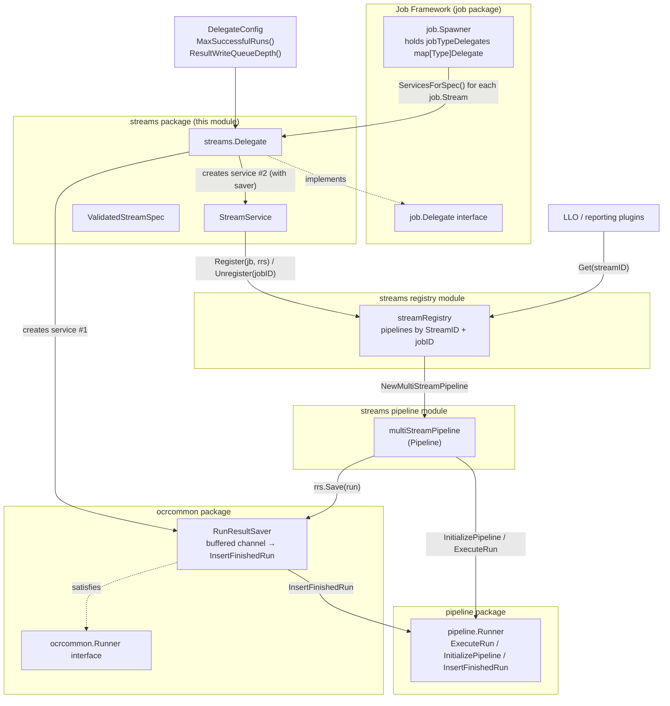
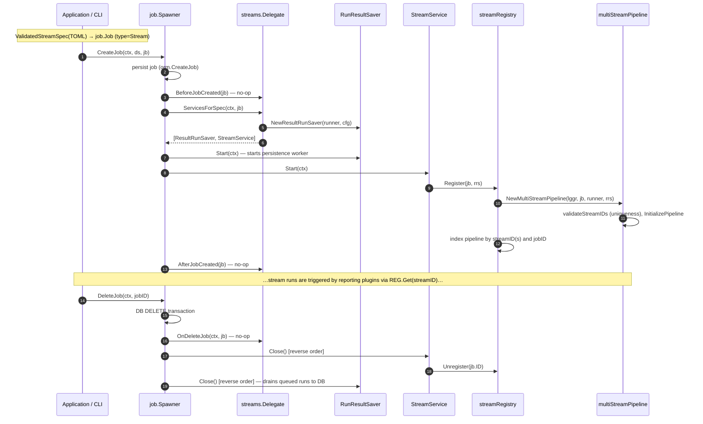

# Streams Delegate

## Overview

The **streams delegate** module (`chainlink/core/services/streams/delegate.go`) is the glue between the node's generic **Job Spawner** framework and the **Data Streams** subsystem. It implements the `job.Delegate` interface for the `job.Stream` job type, so that Stream job specs (TOML, DAG-based pipelines) can be created, started, and stopped through exactly the same lifecycle machinery used by every other V2 job type (Cron, OCR2, Webhook, Workflow, …).

Its responsibilities are deliberately small and focused:

1. **Declare the job type** it serves (`job.Stream`) so the spawner can route Stream specs to it.
2. **Assemble the per-job services** that the spawner will start/stop: a *run result saver* (asynchronous persistence of pipeline runs) and a *stream service* (registers the job's pipeline with the shared stream registry).
3. **Validate Stream job specs** (`ValidatedStreamSpec`) at creation time, enforcing TOML strictness and the presence of stream IDs.

The heavy lifting — building the DAG, executing runs, indexing pipelines by stream ID — is delegated to the sibling modules documented in the [streams overview](../streams.md): the [streams registry](streams_registry.md) and the [streams pipeline](streams_pipeline.md), which in turn sit on top of the shared [pipeline execution engine](../pipeline.md).

> **Where this fits:** Stream jobs are the data-source layer for low-latency oracle engines (notably LLO). `StreamID` is an alias of `llo.StreamID` from `chainlink-common/pkg/types/llo`, which is how reporting plugins later look up streams by ID — see [LLO](../llo.md).

---

## Core components

| Component | Kind | Purpose |
|---|---|---|
| `Delegate` | struct | `job.Delegate` implementation for `job.Stream`; produces the service set for each Stream job. |
| `DelegateConfig` | interface | Two knobs consumed from the node-wide job configuration: `MaxSuccessfulRuns() uint64` and `ResultWriteQueueDepth() uint64`. |
| `StreamService` | struct | A `job.ServiceCtx` started per Stream job; owns registration/unregistration in the stream registry. |
| `ResultRunSaver` (local interface) | interface | `Save(run *pipeline.Run)` — the write-only surface `StreamService` and pipelines use to persist runs. |
| `ValidatedStreamSpec` | function | Parses and validates a Stream job TOML spec into a `job.Job`. |

### `Delegate`

`Delegate` satisfies the `job.Delegate` interface (enforced at compile time via `var _ job.Delegate = (*Delegate)(nil)`) and is constructed with four dependencies:

```go
func NewDelegate(lggr logger.Logger, registry Registry, runner ocrcommon.Runner, cfg DelegateConfig) *Delegate
```

- `registry` — the shared [streams registry](streams_registry.md) (`Register` / `Unregister` / `Get`).
- `runner` — an `ocrcommon.Runner`, the persistence-facing slice of the [pipeline runner](../pipeline.md) used to insert finished runs into the database.
- `cfg` — the `DelegateConfig` knobs described [below](#configuration).

`JobType()` returns `job.Stream`, which is how the spawner's `jobTypeDelegates` map routes Stream specs to this delegate. All four deletion hooks (`BeforeJobCreated`, `AfterJobCreated`, `BeforeJobDeleted`, `OnDeleteJob`) are intentional no-ops: Stream jobs carry no external side effects that must be rolled back when a spec is deleted.

The heart of the delegate is `ServicesForSpec`:

```go
func (d *Delegate) ServicesForSpec(ctx context.Context, jb job.Job) (services []job.ServiceCtx, err error)
```

It builds, **in this order**:

1. `ocrcommon.NewResultRunSaver(d.runner, lggr, d.cfg.MaxSuccessfulRuns(), d.cfg.ResultWriteQueueDepth())` — the buffered run-persistence service.
2. `&StreamService{registry, jb, lggr, rrs}` — the registration service, which receives the saver.

Ordering matters. The [job spawner](../../Node_Platform_Services/job_service/job_service_lifecycle.md) starts returned services **in order** and stops them **in reverse order**, so the saver is fully running before the stream can register (and produce results), and it is drained and shut down *after* the stream has been unregistered and stopped producing. See the [lifecycle section](#lifecycle) for the full sequence.

### `StreamService`

A thin lifecycle wrapper around the registry:

- **`Start`** — guards against a missing `PipelineSpec` (a hard error; Stream jobs [require a pipeline spec](#spec-validation-rules)), then calls `registry.Register(s.jb, s.rrs)`. Registration builds the job's `multiStreamPipeline` via `NewMultiStreamPipeline`, validates stream-ID uniqueness, and indexes the pipeline both by job ID and by each of its stream IDs.
- **`Close`** — calls `s.registry.Unregister(s.jb.ID)`, which removes the pipeline from both indexes.

Because `Register` is the step that actually instantiates and initializes the DAG against the runner (including `runner.InitializePipeline`), a malformed pipeline surfaces as a job start error — recorded by the spawner and visible in the job's error field — rather than a silent runtime failure.

### `ValidatedStreamSpec`

```go
func ValidatedStreamSpec(tomlString string) (job.Job, error)
```

Used on the job-creation path (CLI / GraphQL / Job Spawner `CreateJob`) to turn TOML into a validated `job.Job` with a freshly generated `ExternalJobID` (UUID).

#### Spec validation rules

1. **Strict TOML** — decoded with `toml.DisallowUnknownFields()`; any unknown top-level key fails the job creation.
2. **Type check** — `jb.Type` must be `job.Stream`.
3. **At least one stream ID** — stream IDs are collected from:
   - the optional top-level `streamID` key (which represents the *final output* of the pipeline run), and
   - per-task `streamID` tags on DAG nodes (`t.TaskStreamID()`).

   A spec with neither fails with: *"no streamID found in spec"*.

Duplication and other semantic checks (e.g., duplicate stream IDs across tasks) are applied later, at registration time, inside `NewMultiStreamPipeline` → `validateStreamIDs` — see the [streams pipeline](streams_pipeline.md) documentation.

---

## Architecture

The delegate itself holds no pipeline state; it *wires together* the registry, the pipeline runner, and the job framework. The diagram below shows the components and how they relate (solid arrows = ownership/calls, dashed = interface implementation):



Cross-references for the boxes shown above:

- **job.Spawner / job.Delegate** — see the [job service](../../Node_Platform_Services/job_service.md) module and its [lifecycle](../../Node_Platform_Services/job_service/job_service_lifecycle.md) page.
- **streamRegistry** — see the [streams registry](streams_registry.md) module.
- **multiStreamPipeline** — see the [streams pipeline](streams_pipeline.md) module.
- **pipeline.Runner** — see the [pipeline execution engine](../pipeline.md) module; persistence details in [pipeline persistence](../pipeline/pipeline_persistence.md).
- **RunResultSaver / ocrcommon.Runner** — shared OCR plumbing documented in [ocrcommon shared](../ocr/ocrcommon_shared.md).

---

## Lifecycle

A Stream job passes through the following phases, driven entirely by the spawner's generic machinery:



Key guarantees that fall out of this design:

- **Atomic-ish teardown** — `OnDeleteJob` runs inside the spawner's DELETE transaction (no-op here), so a Stream job leaves no side effects requiring rollback.
- **No lost runs on shutdown** — because services stop in reverse order, the `StreamService` is closed first (no new results can be enqueued), then the `RunResultSaver` closes, draining any buffered runs to the database before exiting.
- **Failure isolation** — if `Start` fails (e.g., unparseable pipeline, duplicate stream ID), the spawner records the error against the job and the job is not active; no half-registered pipelines remain because registration is the last step and is mutex-protected and all-or-nothing in the registry.

---

## Runtime data flow

Once registered, a Stream job is *passive*: it does not self-trigger. Consumers (LLO / OCR2 reporting plugins) fetch a pipeline by stream ID and execute it per observation round. Results flow back through the run saver:

```mermaid
flowchart LR
    P["OCR2 / LLO plugin<br/>(observation round)"] -->|"Get(streamID)"| R["streamRegistry"]
    R -->|"Pipeline"| MSP["multiStreamPipeline.Run(ctx)"]
    MSP -->|"runner.ExecuteRun(spec, vars)"| PR["pipeline.Runner<br/>(DAG execution)"]
    PR --> OUT["pipeline.Run + TaskRunResults"]
    OUT -->|"rrs.Save(run) — non-blocking"| Q["RunResultSaver queue<br/>depth = ResultWriteQueueDepth"]
    Q -->|"worker goroutine:<br/>InsertFinishedRun"| DB[("Postgres:<br/>pipeline run tables")]
    Q -.->|"MaxSuccessfulRuns = 0:<br/>skip successful runs"| DB
```



Behavioural notes:

- **Non-blocking persistence** — `RunResultSaver.Save` performs a `select` with a `default` branch: if the write queue is full, the run is **dropped** with a warning rather than blocking the oracle's observation path. This makes `ResultWriteQueueDepth` a latency-vs-durability trade-off, not a correctness boundary.
- **Retention** — at most `MaxSuccessfulRuns` successful runs are retained (pruned by the persistence layer); setting it to `0` skips persisting successful runs entirely while still persisting failed runs (useful for debugging without write amplification).
- **Observation timeouts** — the context passed to `Pipeline.Run` carries the observation timeout + grace period; partial results are expected to be returned within the grace period (documented further in [streams pipeline](streams_pipeline.md)).

---

## Configuration

`DelegateConfig` is a two-method interface, satisfied by the node's job configuration at wiring time (the same values the [job spawner](../../Node_Platform_Services/job_service.md) uses for run persistence across job types):

| Knob | Type | Effect |
|---|---|---|
| `MaxSuccessfulRuns()` | `uint64` | Number of successful runs retained per job; `0` disables persisting successful runs. |
| `ResultWriteQueueDepth()` | `uint64` | Capacity of the run-write buffer; full queue ⇒ runs dropped (with a warning), never blocking execution. |

There is no streams-specific global configuration beyond these knobs and the Stream job TOML spec itself — see [spec validation rules](#spec-validation-rules).

---

## Threading & concurrency model

- `Delegate` is **stateless per job** and safe for concurrent use; all mutable state lives behind the registry's `sync.RWMutex` (see [streams registry](streams_registry.md)).
- A single `RunResultSaver` worker goroutine serializes DB writes for the job's runs; producers (pipeline executions) only enqueue.
- `StreamService.Start`/`Close` are called exactly once per job lifecycle by the spawner's `MultiStart`, matching the `services.ServiceCtx` conventions used node-wide.

---

## Related modules

- [Streams overview](../streams.md) — the Data Streams subsystem and how its three modules fit together.
- [Streams registry](streams_registry.md) — `Registry`/`Getter`, stream-ID indexing, duplicate protection.
- [Streams pipeline](streams_pipeline.md) — `multiStreamPipeline`, stream-ID extraction, vars, run execution.
- [Pipeline execution engine](../pipeline.md) — the DAG runner both the delegate and the registry depend on.
- [ocrcommon shared](../ocr/ocrcommon_shared.md) — `RunResultSaver` and run-persistence plumbing shared with OCR2.
- [LLO](../llo.md) — the consumer side that resolves pipelines by `llo.StreamID` (the type behind `StreamID`).
- [Job service](../../Node_Platform_Services/job_service.md) — the `Spawner`/`Delegate` contract and job lifecycle this module plugs into.
- [Node application core & interfaces](../../Node_Application_Core___Interfaces.md) — where the delegate is registered into the spawner's job-type delegate map when the node application starts.
