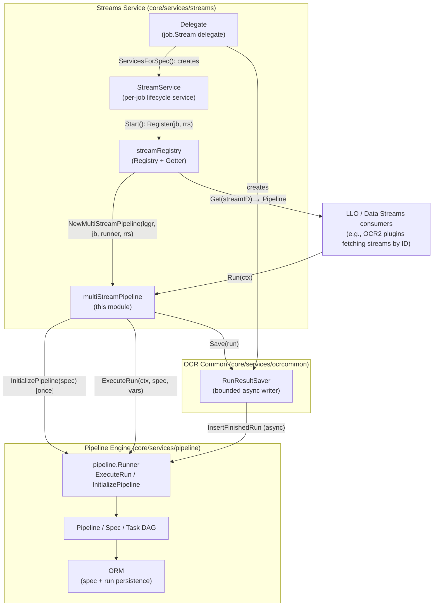
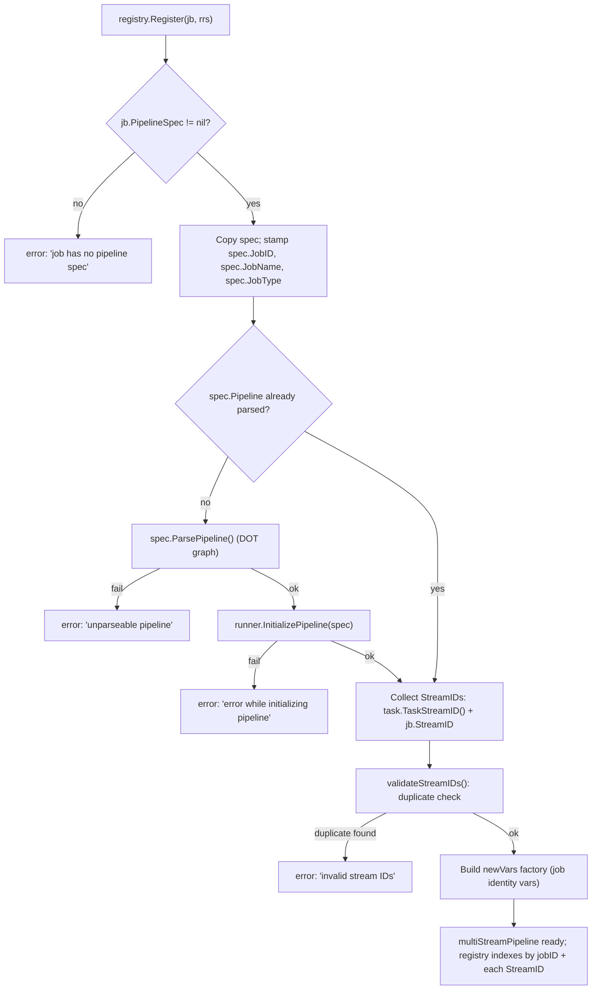
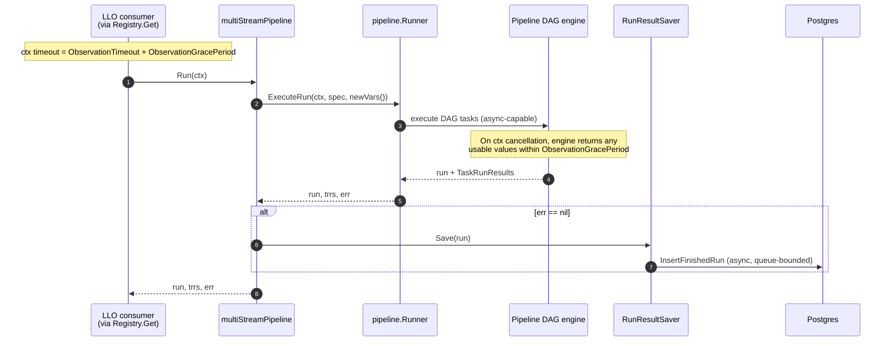
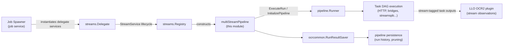

# Streams Pipeline

## Introduction

The **streams_pipeline** module (`chainlink/core/services/streams/pipeline.go`) defines the executable pipeline abstraction for **Data Streams (LLO) jobs**. It adapts a Stream job's TOML-defined pipeline specification into a self-contained, on-demand executable object (`Pipeline`) that can be:

1. **Registered** by stream ID in the streams [Registry](streams_registry.md),
2. **Executed** on demand through the shared [pipeline execution engine](../pipeline/pipeline_execution_engine.md), and
3. **Persisted** asynchronously via a result-run saver, so run history is available for monitoring and debugging.

The module is deliberately thin: it owns only the *streams-specific adaptation* (spec enrichment, stream ID collection/validation, and job-metadata variable seeding), while delegating all DAG interpretation, task execution, and result storage to the [pipeline engine](../pipeline.md) and its [persistence layer](../pipeline/pipeline_persistence.md).

---

## Module Responsibilities

| Responsibility | Description |
|---|---|
| **Spec adaptation** | Copies the job's `PipelineSpec`, stamps it with `JobID`, `JobName`, and `JobType` (used for logging and Prometheus labels), and lazily parses + initializes the DOT DAG. |
| **Stream ID management** | Collects `StreamID`s from pipeline task tags and the top-level job field, and enforces uniqueness. |
| **Execution** | Exposes `Run(ctx)` which executes the DAG in-memory via the pipeline engine's `ExecuteRun`. |
| **Result persistence** | Hands each finished run to a pluggable `RunResultSaver` for asynchronous database persistence. |
| **Variable seeding** | Provides a fresh `pipeline.Vars` per run containing job identity metadata accessible to tasks (e.g., `$(jb.streamID)`). |

---

## Core Components

### `Pipeline` (interface)

The public contract used by the [streams registry](streams_registry.md) and LLO consumers:

```go
type Pipeline interface {
    Run(ctx context.Context) (*pipeline.Run, pipeline.TaskRunResults, error)
    StreamIDs() []StreamID
}
```

- `Run` — executes one full pass of the DAG and returns the completed run, its task-run results, and any error. Results are enqueued for persistence before returning.
- `StreamIDs` — returns the list of stream IDs this pipeline serves (used by the registry for indexing).

### `multiStreamPipeline` (struct, sole implementation)

A **multi-stream** pipeline: a single job/spec can serve *multiple* stream IDs — one per stream-tagged task in the DAG, plus the job-level `StreamID` if set. This is the key nuance behind the name: rather than one pipeline per stream, one DAG can fan out several final outputs, each identified by its own stream ID.

Fields:

| Field | Purpose |
|---|---|
| `lggr` | Sugared, named logger (`MultiStreamPipeline`) annotated with `spec.ID`, `jobID`, `jobName`, and `jobType`. |
| `spec` | The enriched `pipeline.Spec` (job metadata + parsed DOT graph). |
| `runner` | Streams-local `Runner` abstraction over the pipeline engine. |
| `rrs` | Optional `RunResultSaver`; when `nil`, results are returned but not persisted. |
| `streamIDs` | Deduplicated-validated list of stream IDs served by this pipeline. |
| `newVars` | Factory producing a fresh `pipeline.Vars` per run. |

### `Runner` (interface, streams-local)

A minimal subset of the [pipeline engine's `Runner`](../pipeline/pipeline_execution_engine.md), declared locally in `pipeline.go` to decouple the streams package from the full engine interface:

```go
type Runner interface {
    ExecuteRun(ctx context.Context, spec pipeline.Spec, vars pipeline.Vars) (run *pipeline.Run, trrs pipeline.TaskRunResults, err error)
    InitializePipeline(spec pipeline.Spec) (*pipeline.Pipeline, error)
}
```

In production this is satisfied by the node's shared `pipeline.Runner` (the same runner used by [OCR common data sources](../ocr/ocrcommon_shared.md) and other job types), which implements `ExecuteRun` (in-memory execution) and `InitializePipeline` (one-time DAG/data-source hydration, e.g., resolving bridge configurations).

### `RunResultSaver` (interface)

```go
type RunResultSaver interface {
    Save(run *pipeline.Run)
}
```

Implemented in production by `ocrcommon.RunResultSaver`, which buffers finished runs in a bounded channel (`ResultWriteQueueDepth`) and asynchronously persists them via the engine's `InsertFinishedRun`, pruning to `MaxSuccessfulRuns`. See [OCR common shared components](../ocr/ocrcommon_shared.md) and [pipeline persistence](../pipeline/pipeline_persistence.md).

### `NewMultiStreamPipeline` / `newMultiStreamPipeline` (constructor)

Validates and assembles the pipeline. See [Construction Flow](#construction-flow) below.

### `validateStreamIDs` (helper)

Rejects duplicate stream IDs within a single pipeline. Duplicate IDs are ambiguous for the registry's `map[StreamID]Pipeline` index, so they are treated as a configuration error at construction time (in addition to the registry's cross-job uniqueness check).

---

## Architecture



**Data / dependency flow summary:**

- The [streams delegate](streams_delegate.md) is the `job.Delegate` for `job.Stream` jobs; per job it constructs a `RunResultSaver` and a `StreamService`.
- `StreamService.Start` registers the job (and its saver) with the [registry](streams_registry.md); `StreamService.Close` unregisters it.
- `Registry.Register` calls `NewMultiStreamPipeline` and indexes the resulting pipeline **once per stream ID** plus once by job ID.
- LLO components look up pipelines by stream ID (`Getter.Get`) and invoke `Run` during observation/report phases.
- Execution and persistence are entirely delegated to the [pipeline engine](../pipeline.md); the streams layer holds no execution state of its own beyond immutable spec/ID config.

---

## Construction Flow

`NewMultiStreamPipeline(lggr, jb, runner, rrs)` performs the following steps:



Key behaviors:

1. **Spec enrichment** — `JobID`, `JobName`, and `JobType` are stamped onto the spec so the engine can label logs and Prometheus metrics per job.
2. **Lazy parse + eager initialization** — if the spec has not yet been parsed, the DOT graph is parsed and immediately passed to `runner.InitializePipeline`. This one-time initialization compiles the DAG and hydrates task-level resources (e.g., bridge configs) so that per-run execution is cheap.
3. **Stream ID collection** — stream IDs come from two places:
   - Each pipeline task exposing a stream ID via `TaskStreamID()` (the `streamID` tag on tasks in the TOML spec), and
   - The optional job-level `streamID` field, which represents the *final output* of the run.
   
   Having at least one stream ID is enforced earlier by `ValidatedStreamSpec` in the [delegate](streams_delegate.md); uniqueness across both sources is enforced here.
4. **Variable factory** — `newVars` builds a fresh `pipeline.Vars` for every run (see [Seeded Variables](#seeded-variables)).

---

## Run Lifecycle



**Contract notes:**

- **Context semantics** — the caller is expected to pass a context with a timeout of `ObservationTimeout + ObservationGracePeriod`. On cancellation, the engine suspends gracefully and returns whatever usable values were produced within the grace period, rather than discarding the run entirely.
- **In-memory execution** — `ExecuteRun` does *not* persist anything itself; persistence happens exclusively through the `RunResultSaver` after a successful run. This keeps the hot path free of synchronous database writes.
- **Error propagation** — engine failures are wrapped as `"Run failed: %w"`; failures during execution of a specific spec are wrapped with the spec ID for traceability.
- **Optional persistence** — `rrs` may be `nil` (e.g., in tests); `Run` then simply returns results without saving.

---

## Seeded Variables

Each run starts with a fresh variable set derived from job identity, exposed to pipeline tasks via the usual `$(...)` syntax:

| Variable | Source | Purpose |
|---|---|---|
| `$(jb.streamID)` | `jb.StreamID` | The job-level stream ID (may be nil if only task-level tags are used). |
| `$(jb.databaseID)` | `jb.ID` | Numeric job ID in the node database. |
| `$(jb.externalJobID)` | `jb.ExternalJobID` | UUID identifying the job externally. |
| `$(jb.name)` | `jb.Name` | Human-readable job name. |
| `$(pipelineSpec.id)` | `spec.ID` | Database ID of the pipeline spec. |

Because `newVars` is a factory, every `Run` receives an isolated variable map — runs never share mutable variable state.

---

## Validation Rules

| Rule | Enforced by | Effect |
|---|---|---|
| Job must have a `PipelineSpec` | `newMultiStreamPipeline` | Construction error. |
| Pipeline spec must parse as a valid DOT graph | `spec.ParsePipeline` via constructor | Construction error. |
| DAG must initialize with the runner (data sources resolvable) | `runner.InitializePipeline` | Construction error. |
| No duplicate stream IDs within a job | `validateStreamIDs` | Construction error. |
| At least one stream ID present | `ValidatedStreamSpec` ([delegate](streams_delegate.md)) | Job creation rejected. |
| No cross-job stream ID collisions | [Registry](streams_registry.md) `Register` | Registration error. |

Validation is layered deliberately: cheap, spec-local checks fail fast at job creation; cross-job invariants (stream ID uniqueness across the node) are checked atomically at registration time under the registry's write lock.

---

## Concurrency Model

- `multiStreamPipeline` is **immutable after construction** (all fields are set once in the constructor), making it safe for concurrent `Run` invocations from multiple LLO consumers.
- All mutable state lives in collaborators:
  - The [registry's](streams_registry.md) maps are guarded by its `sync.RWMutex`.
  - The [pipeline engine](../pipeline/pipeline_execution_engine.md) internally manages per-run state and async task scheduling.
  - The `RunResultSaver` decouples `Run` returns from database latency via its bounded queue (capacity `ResultWriteQueueDepth`), applying backpressure or dropping per its `MaxSuccessfulRuns` pruning policy.

---

## Integration with the System

### Where this module fits

The streams_pipeline module is the execution adapter that connects **job management** to the **[pipeline engine](../pipeline.md)** specifically for Data Streams / LLO workloads:



### Related modules

- **Parent**: [Streams](../streams.md) — overview of the Data Streams service.
- **Siblings**: [Streams Registry](streams_registry.md) (stream ID → pipeline indexing and lookup) and [Streams Delegate](streams_delegate.md) (job lifecycle: spec validation, service wiring).
- **Execution engine**: [Pipeline](../pipeline.md) and the [Pipeline Execution Engine](../pipeline/pipeline_execution_engine.md) — `Runner`, `Spec`, `Vars`, and DOT task model used by `multiStreamPipeline`.
- **Persistence**: [Pipeline Persistence](../pipeline/pipeline_persistence.md) — where finished runs are stored and pruned.
- **Run saving**: [OCR Common Shared](../ocr/ocrcommon_shared.md) — the production `RunResultSaver` implementation.
- **Job model**: [Job Service](../../Node_Platform_Services/job_service.md) — the `job.Job` domain model and `job.Delegate`/`ServiceCtx` lifecycle contracts this module plugs into.
- **LLO context**: [LLO](../llo.md) — the Low Latency Oracle engine that consumes stream runs during report aggregation.
