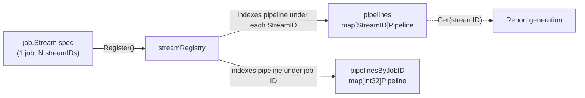
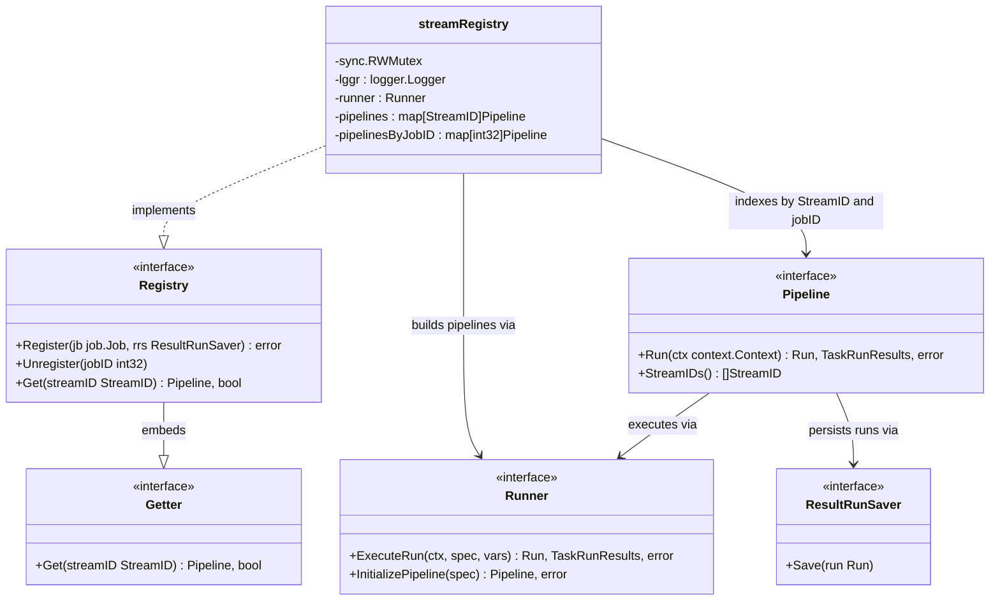
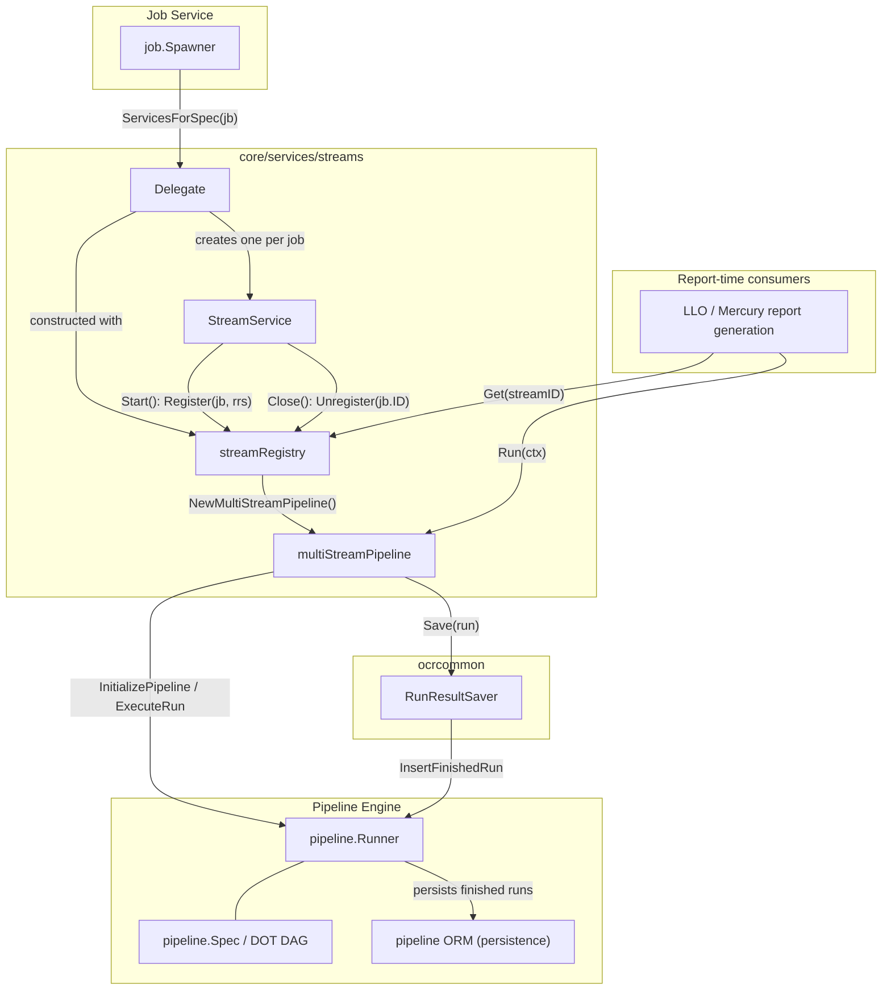
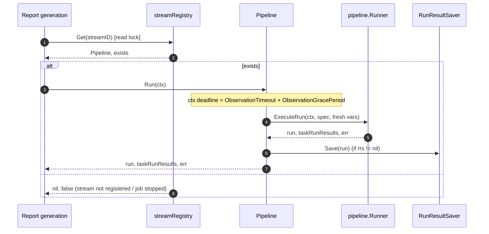
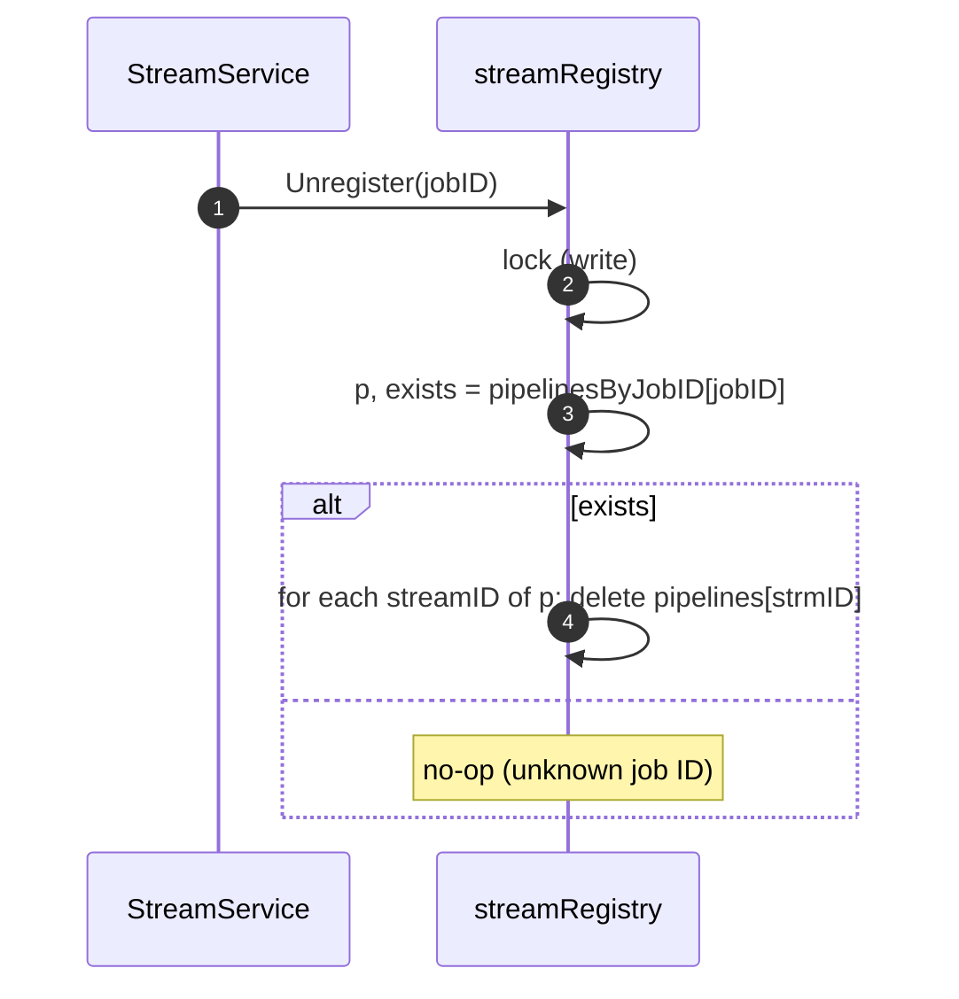

# Streams Pipeline Registry

> **Module:** `chainlink/core/services/streams/stream_registry.go`
> **Parent module:** [Streams](../streams.md) — part of [Oracle Engines & Data Pipelines](../../Oracle_Engines___Data_Pipelines.md)

---

## 1. Overview

The **Streams Pipeline Registry** is the in-memory lookup layer of the Data Streams (LLO/Mercury) subsystem. It maintains a thread-safe, bidirectional index that binds:

1. **Stream IDs → Pipelines** — so that report-generation code can resolve, at observation time, the pipeline responsible for producing data for a given `llo.StreamID`.
2. **Job IDs → Pipelines** — so that job lifecycle events (job deleted / stopped) can remove all of a job's stream mappings in a single call.

A single `job.Stream` job spec may serve **multiple** stream IDs: the optional top-level `streamID` key (the pipeline's final output) plus any number of per-task `streamID` tags inside the DOT DAG. The registry indexes the resulting `Pipeline` instance under *every* stream ID it serves, and once more under the owning job's database ID. The `StreamID` type is a direct alias of [`llo.StreamID`](../../Shared_Foundation_Libraries___Domain_Types/types-mercury-llo.md), so the index keys are the same numeric IDs used on-chain and by the reporting plugins.

The registry is deliberately **narrow and passive**: it holds no execution logic of its own. Pipelines are built once at registration time (via [`NewMultiStreamPipeline`](streams_pipeline.md)) and executed later by consumers through the `Getter` interface.



---

## 2. Where this module fits

| Layer | Role |
|---|---|
| [Job Service](../../Node_Platform_Services/job_service.md) | The `job.Spawner` invokes the streams [Delegate](streams_delegate.md) for every job of type `job.Stream` and starts the resulting services. |
| **This module (registry)** | Holds the active set of stream pipelines; one entry set per running stream job. |
| [Streams Pipeline](streams_pipeline.md) | The `multiStreamPipeline` objects stored in the registry; wraps the DOT DAG spec and executes it. |
| [Pipeline Engine](../pipeline.md) | The `pipeline.Runner` that parses, initializes, executes, and persists pipeline runs. |
| [OCR Common](../ocr/ocrcommon_shared.md) | Provides the `RunResultSaver` (`NewResultRunSaver`) that asynchronously persists successful runs. |

The write path (register/unregister) is driven entirely by job lifecycle events; the read path (`Get`) is exercised whenever report generation needs to execute the pipeline for a stream ID. This split keeps registration cost off the hot path and makes the read path a lock-protected map lookup.

---

## 3. Core components

### 3.1 `Registry` interface

```go
type Registry interface {
    Getter
    Register(jb job.Job, rrs ResultRunSaver) error
    Unregister(jobID int32)
}
```

The full management surface. Embedded `Getter` provides the read path. A second, read-only interface is extracted for consumers that only need lookups:

### 3.2 `Getter` interface

```go
type Getter interface {
    Get(streamID StreamID) (p Pipeline, exists bool)
}
```

Returns the pipeline registered for a stream ID and whether it exists. Keeping this as a separate, minimal interface allows downstream report-generation code (and tests, e.g. `MockTask` users in [Streams tests](../streams.md)) to depend on lookup behavior without coupling to registration internals.

### 3.3 `streamRegistry` (implementation)

| Field | Type | Purpose |
|---|---|---|
| `sync.RWMutex` | embedded | Guards both maps; `Get` takes the read lock, `Register`/`Unregister` the write lock. |
| `lggr` | `logger.Logger` | Package logger, named `"Registry"`. |
| `runner` | `Runner` | The (narrow) pipeline runner used to initialize specs at registration and execute runs at report time. |
| `pipelines` | `map[StreamID]Pipeline` | Primary index — keyed by **stream ID**. Multiple keys may point to the same `Pipeline`. |
| `pipelinesByJobID` | `map[int32]Pipeline` | Secondary index — keyed by **job DB ID**, used by `Unregister` to find all stream IDs of a job. |

Constructed via `NewRegistry(lggr, runner)`, which is injected into the streams `Delegate` (`NewDelegate(lggr, registry, runner, cfg)` — see [Streams Delegate](streams_delegate.md)).

### 3.4 `StreamID`

```go
type StreamID = llo.StreamID
```

A type alias (not a wrapper), kept for refactoring convenience. The registry's index keys are therefore identical to the stream IDs exchanged with the [LLO types](../../Shared_Foundation_Libraries___Domain_Types/types-mercury-llo.md).

---

## 4. Data model and indexing strategy



Key modeling decisions:

- **One pipeline, many stream IDs.** A job whose DAG contains `streamID=1`, `streamID=2`, `streamID=3` tags (and optionally a top-level `streamID`) results in **one** `Pipeline` object referenced by **four** `pipelines` map entries (three task IDs + one job-level ID). All references point to the same instance, so a lookup on any of the IDs executes the same DAG.
- **Job-level back-pointer.** `pipelinesByJobID` is the inverse index that makes `Unregister(jobID)` an O(N) deletion over the job's own stream IDs, without scanning the stream-ID map.
- **Structural interfaces.** `Runner` (the streams-local two-method subset of [`pipeline.Runner`](../pipeline/pipeline_execution_engine.md)) and `ResultRunSaver` (single `Save` method, satisfied by `ocrcommon.RunResultSaver`) are structural, so the registry depends on the smallest possible surface of the pipeline engine.

---

## 5. Architecture and component relationships



Interaction summary:

- **Wiring (startup):** the application constructs the `Runner` and the `Registry`, injects both into the streams `Delegate` (see [Streams Delegate](streams_delegate.md)), and registers the delegate with the [Job Service](../../Node_Platform_Services/job_service.md) for job type `job.Stream`.
- **Per-job lifecycle:** for each stream job, `Delegate.ServicesForSpec` produces a `ocrcommon.RunResultSaver` (result write queue of depth `ResultWriteQueueDepth`, keeping `MaxSuccessfulRuns` results) plus a `StreamService` bound to the shared registry.
- **Hot path:** report generation resolves a pipeline through `Get` and executes it; results are handed to the result saver, which persists them asynchronously through the runner (see [Pipeline persistence](../pipeline/pipeline_persistence.md)).

---

## 6. Lifecycle flows

### 6.1 Registration (`StreamService.Start` → `Registry.Register`)

```mermaid
sequenceDiagram
    autonumber
    participant JS as job.Spawner
    participant SS as StreamService
    participant R as streamRegistry
    participant MSP as NewMultiStreamPipeline
    participant PR as pipeline.Runner

    JS->>SS: Start(ctx)
    SS->>R: Register(jb, rrs)
    R->>R: jb.Type == job.Stream ? (else error)
    R->>MSP: build pipeline for jb
    MSP->>MSP: parse DOT DAG (if needed)
    MSP->>PR: InitializePipeline(spec)
    PR-->>MSP: ok / error
    MSP->>MSP: collect StreamIDs (task tags + jb.StreamID), validate uniqueness
    MSP-->>R: Pipeline, err
    alt err != nil
        R-->>SS: error "cannot register job with ID: %d; ..."
    else
        R->>R: lock (write)
        R->>R: job ID already registered? (else error)
        R->>R: any streamID already claimed? (else error)
        R->>R: pipelinesByJobID[jb.ID] = p
        R->>R: pipelines[strmID] = p (for each stream ID)
        R-->>SS: nil
    end
```

Behavioral details:

- **Type gate:** only `job.Stream` jobs are accepted; anything else is rejected with `cannot register job type %s; only Stream jobs are supported`.
- **Pipeline construction happens *before* the write lock is acquired.** Spec parsing and `runner.InitializePipeline` are relatively expensive; the lock is held only for the duplicate checks and map inserts, so concurrent `Get` calls are never blocked by pipeline construction.
- **Atomic duplicate checks.** Both the job-ID check and the per-stream-ID checks run inside the same write-lock critical section, so two concurrent `Register` calls claiming overlapping stream IDs are fully serialized — exactly one succeeds.
- **Registration contract (fields of `job.Job` used):** `jb.Type` (must be `Stream`), `jb.ID` (index key + logging), `jb.PipelineSpec` (the DAG), `jb.StreamID` (optional top-level output stream), `jb.Name`, `jb.ExternalJobID` (propagated into run vars). Spec-level validation (at least one stream ID present) happens earlier, in `ValidatedStreamSpec` — see [Streams Delegate](streams_delegate.md).

### 6.2 Report-time lookup and execution (`Getter`)



- `Get` acquires only the **read lock**, so lookups from multiple reporting goroutines proceed in parallel; they are blocked only while a registration/unregistration mutation is in flight.
- Each `Run` invocation builds **fresh pipeline vars** (spec ID, job stream ID, database ID, external job ID, name), so concurrent executions of the same pipeline do not share mutable state.
- A `(nil, false)` return is the normal signal that a stream job has been stopped or has not yet finished registering; callers must handle the missing-stream case gracefully.

### 6.3 Unregistration (`StreamService.Close` → `Registry.Unregister`)



- Unregistration is **idempotent**: unregistering an unknown job ID is a silent no-op, making `Close` safe to call even if `Start` failed mid-way.
- All stream IDs claimed by the job disappear atomically under the write lock — there is never a window where a partially-unregistered job answers `Get`.

---

## 7. Concurrency model

| Operation | Lock | Notes |
|---|---|---|
| `Get` | `RLock` | Concurrent readers; the intended hot path for report generation. |
| `Register` | `Lock` (duplicate checks + inserts) | Spec parsing / runner initialization occur **before** locking. |
| `Unregister` | `Lock` | Short critical section; only map deletions. |

The registry itself is the only synchronization boundary for the two maps. Thread safety of the returned `Pipeline` is delegated to the [pipeline engine](../pipeline/pipeline_execution_engine.md) (`ExecuteRun` is safe to invoke concurrently, each run receiving its own `Vars`).

---

## 8. Validation and error handling

`Register` performs validation in a fixed order and returns wrapped, job-ID-scoped errors:

| # | Condition | Error (format) |
|---|---|---|
| 1 | `jb.Type != job.Stream` | `cannot register job type %s; only Stream jobs are supported` |
| 2 | Pipeline construction fails — missing pipeline spec, unparseable DOT DAG, runner initialization error, or duplicate stream IDs *within the same job* (`validateStreamIDs`, see [Streams Pipeline](streams_pipeline.md)) | `cannot register job with ID: %d; <cause>` |
| 3 | Job ID already present in `pipelinesByJobID` | `cannot register job with ID: %d; it is already registered` |
| 4 | Any stream ID of the new job already claimed by another job (top-level or task-tagged) | `cannot register job with ID: %d; stream id %d is already registered` |

Notes:

- Errors from steps 1–2 occur **before** any state is mutated; the registry remains untouched.
- Errors from steps 3–4 occur inside the write-lock critical section but before any insertion, so a rejected registration leaves both maps unchanged.
- Stream-ID collision errors are intentionally identical whether the colliding ID comes from the job's top-level `streamID` or from a task `streamID` tag — from the registry's perspective both are entries of `p.StreamIDs()`.

---

## 9. Dependencies

| Dependency | Used for | Documented in |
|---|---|---|
| `chainlink-common/pkg/types/llo.StreamID` | Index key type (alias) | [types-mercury-llo](../../Shared_Foundation_Libraries___Domain_Types/types-mercury-llo.md) |
| `chainlink-common/pkg/logger` | Named `"Registry"` logger | [logger](../../Shared_Foundation_Libraries___Domain_Types/logger.md) |
| `core/services/job` (`job.Job`, `job.Stream`) | Registration input & type gate; delegate contract | [Job Service](../../Node_Platform_Services/job_service.md) |
| `core/services/streams/pipeline.go` (`Pipeline`, `NewMultiStreamPipeline`, `Runner`, `ResultRunSaver`) | Stored value type and construction | [Streams Pipeline](streams_pipeline.md) |
| `core/services/pipeline` (`Runner` methods, `Spec`) | Spec initialization & run execution | [Pipeline Engine](../pipeline.md) |
| `core/services/ocrcommon` (`NewResultRunSaver`) | Production `ResultRunSaver` implementation | [OCR Common shared](../ocr/ocrcommon_shared.md) |

The registry module itself has **no external configuration, build, or container dependencies** — it is a pure in-memory Go structure. All tunables (observation timeouts, result-write queue depth, max successful runs) live with the Delegate and the pipeline engine, not here.

---

## 10. Testing coverage

Behaviors exercised by `chainlink/core/services/streams/stream_registry_test.go` (see also the module-level notes in [Streams](../streams.md)):

- **`Get`** — hit for each registered stream ID; `(nil, false)` miss for unknown IDs.
- **`Register`**
  - A multi-stream job (3 task-tagged stream IDs) indexes **one** pipeline under **all** IDs; `StreamIDs()` and the wrapped `spec.ID` are preserved.
  - Re-registering the same job ID → `it is already registered`.
  - Duplicate stream IDs **within** one job → wrapped `invalid stream IDs: duplicate stream ID` error.
  - Unparseable DAG → wrapped `unparseable pipeline` error.
  - Stream-ID collision against an existing job, whether via top-level `streamID` or a task tag → `stream id %d is already registered`.
  - A non-colliding job registers successfully **without overwriting** any existing stream mapping.
- **`Unregister`**
  - Removes *all* stream-ID entries of the target job (job's own top-level + task-tagged IDs).
  - Unknown job ID → no-op, other jobs unaffected.

---

## 11. Maintenance notes and caveats

1. **`Unregister` does not delete the job-ID index entry.** The implementation looks up `pipelinesByJobID[jobID]` and deletes only the stream-ID entries; `pipelinesByJobID[jobID]` itself is left in place. Consequence: within one process lifetime, re-registering a job with the **same DB ID** (e.g., a service restart of an unchanged job) will be rejected with `it is already registered` even though its stream IDs are free. In practice the Job Spawner recreates jobs with new IDs and the registry is rebuilt on node restart, so this rarely surfaces — but anyone reusing job IDs or calling `Register`/`Unregister` manually should be aware of it. The tests only assert on the `pipelines` map, not `pipelinesByJobID`.
2. **Construction outside the lock is intentional but observable.** Because `Register` builds the pipeline before locking, a slow-to-parse spec delays only its own registration, not concurrent `Get` traffic. However, `Get` calls arriving *during* construction will correctly report `exists == false` — registration is only visible atomically after construction succeeds.
3. **`Get` returns shared instances.** Callers must not mutate the returned `Pipeline`; report-time concurrency safety comes from the pipeline engine, not from per-caller copies.
4. **`rrs` may be nil.** The registry forwards whatever saver it receives; `Pipeline.Run` tolerates a nil saver (`if s.rrs != nil`). Production wiring always supplies `ocrcommon.RunResultSaver` via the Delegate, but tests pass `nil`.

---

## 12. Related documentation

- [Streams module](../streams.md) — subsystem overview and sibling pages.
- [Streams Pipeline](streams_pipeline.md) — the `Pipeline` objects stored by this registry; stream-ID extraction and validation.
- [Streams Delegate](streams_delegate.md) — job-type wiring, `StreamService` lifecycle, `ResultRunSaver` definition, and TOML spec validation.
- [Streams Registry (interface view)](streams_registry.md) — sibling page covering the same `stream_registry.go` file from the interface-consumer perspective.
- [Pipeline Engine](../pipeline.md) — spec parsing, runner execution, and [persistence](../pipeline/pipeline_persistence.md) of run results.
- [OCR Engines](../ocr.md) — the reporting context in which stream pipelines execute; shared infrastructure in [OCR Common](../ocr/ocrcommon_shared.md).
- [Job Service](../../Node_Platform_Services/job_service.md) — spawner/delegate lifecycle that drives `Register`/`Unregister`.
- [LLO & Mercury domain types](../../Shared_Foundation_Libraries___Domain_Types/types-mercury-llo.md) — the `StreamID` definition.
