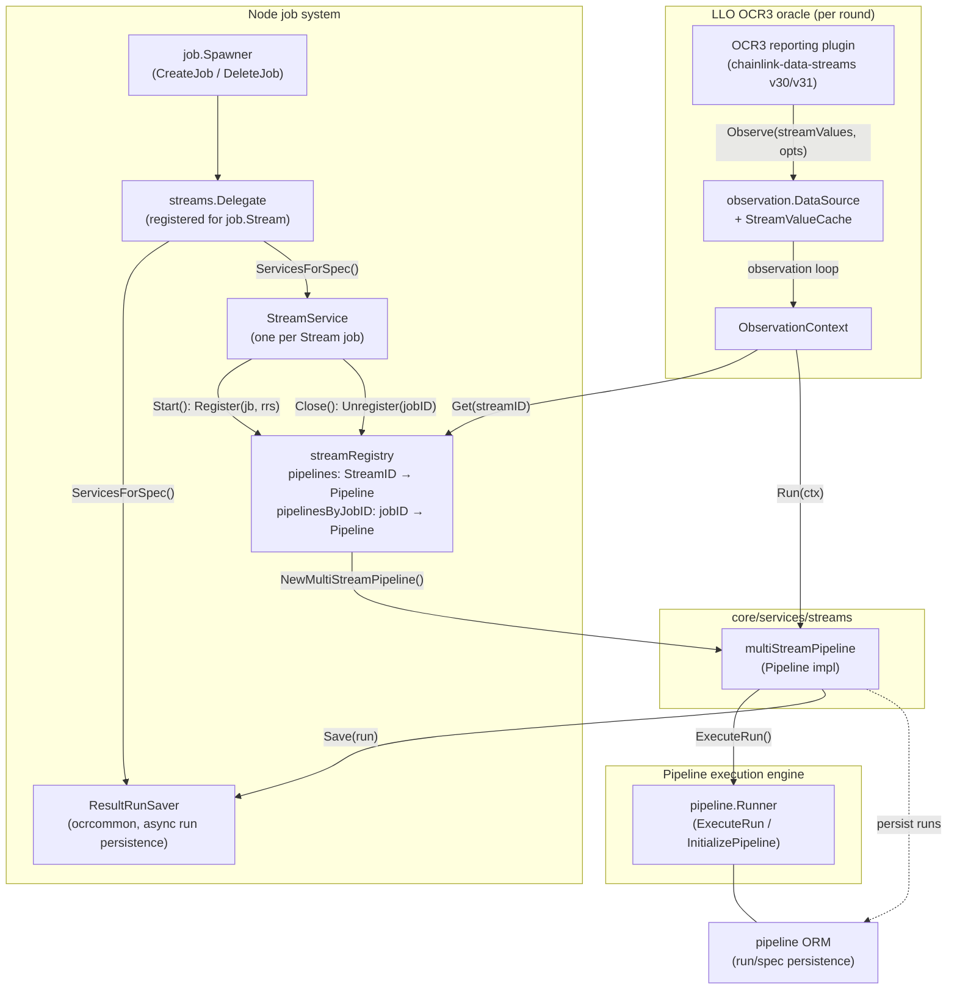

# Streams Registry

## Introduction

The **streams_registry** module implements the in-memory, thread-safe registry that maps LLO (Low-Latency Oracles) **Stream IDs** to their executable **Pipelines** inside the Chainlink node. It lives in `chainlink/core/services/streams/stream_registry.go` (Go module `github.com/smartcontractkit/chainlink/v2`, declared in `chainlink/go.mod`) and is the rendezvous point between two halves of the data-streams subsystem:

1. **Writers** — the [streams delegate](streams_delegate.md), which registers a pipeline when a `stream` job starts and unregisters it when the job stops.
2. **Readers** — the LLO OCR3 observation layer, which looks up the pipeline for every stream it must observe during a consensus round.

Because a single pipeline can serve **many** stream IDs (multi-stream pipelines), the registry is intentionally keyed twice — once by stream ID and once by job ID — to support efficient lookups on the hot read path and atomic registration/unregistration on the job lifecycle path.

For the broader context of the streams subsystem (spec validation, multi-stream pipelines, and the delegate that owns job lifecycle), see the parent page [Streams](../streams.md) and the group overview [Oracle Engines & Data Pipelines](../../Oracle_Engines___Data_Pipelines.md).

---

## Module Purpose and Core Functionality

The module exposes a single core component, the `Registry` interface, implemented by `streamRegistry`:

```go
// chainlink/core/services/streams/stream_registry.go
type Registry interface {
    Getter
    Register(jb job.Job, rrs ResultRunSaver) error
    Unregister(jobID int32)
}

type Getter interface {
    Get(streamID StreamID) (p Pipeline, exists bool)
}
```

### Responsibilities

| Responsibility | Method | Notes |
|---|---|---|
| Resolve a stream ID to a runnable pipeline | `Get(streamID)` | Read-locked, O(1) map lookup; safe for concurrent use on the LLO observation hot path |
| Attach a Stream job's pipeline to the registry | `Register(jb, rrs)` | Validates job type, constructs the [multi-stream pipeline](streams_pipeline.md), and claims all of its stream IDs atomically |
| Detach a Stream job's pipeline | `Unregister(jobID)` | Removes every stream-ID entry pointing at the job's pipeline |

### Key type aliases

```go
type StreamID = llo.StreamID   // = uint32, defined in chainlink-common/pkg/types/llo
```

`StreamID` is a plain `uint32` alias of [`llo.StreamID`](../../Shared_Foundation_Libraries___Domain_Types/types-mercury-llo/types-mercury-llo_llo.md) — chosen for cross-chain compatibility and JSON serializability (per the design notes in `chainlink-common/pkg/types/llo/types.go`). Stream ID `0` should be avoided to prevent confusion with uninitialized values. `Pipeline` and `Runner` are the interfaces defined in the same package (`pipeline.go`) and documented in [Streams Pipeline](streams_pipeline.md).

### Implementation internals

The concrete `streamRegistry` struct holds:

| Field | Type | Purpose |
|---|---|---|
| `sync.RWMutex` (embedded) | lock | Guards both maps; `Get` takes `RLock`, `Register`/`Unregister` take full `Lock` |
| `lggr` | `logger.Logger` | Named logger (`"Registry"`) for registration diagnostics |
| `runner` | `Runner` | The [pipeline execution engine](../pipeline/pipeline_execution_engine.md) used to parse and initialize specs at registration time |
| `pipelines` | `map[StreamID]Pipeline` | **Primary read index** — stream ID → pipeline |
| `pipelinesByJobID` | `map[int32]Pipeline` | **Ownership index** — job ID → pipeline (a job may own many stream IDs) |

Construction goes through the exported constructor:

```go
func NewRegistry(lggr logger.Logger, runner Runner) Registry
```

One registry is created per node process and shared by all Stream jobs.

---

## Architecture and Component Relationships

The diagram below shows the registry at the center of the streams subsystem. Writers enter from the job system (left); readers enter from the LLO OCR3 oracle (right).



Key relationships:

- **Registry → Pipeline**: the registry stores only interface values; the concrete pipeline is a `multiStreamPipeline` created by `NewMultiStreamPipeline` (see [Streams Pipeline](streams_pipeline.md)).
- **Registry → Runner**: registration eagerly parses the job's DAG and calls `runner.InitializePipeline(spec)` so that failures surface at job start, not mid-observation.
- **Registry → LLO observation layer**: `streams.Registry` structurally satisfies the narrow `observation.Registry` interface (`Get(streamID streams.StreamID) (streams.Pipeline, bool)`), so the LLO data source consumes the same instance without importing registration APIs.
- **Pipeline → ResultRunSaver**: successful runs are handed to the saver (non-blocking DB write queue, configured by `JobPipeline.MaxSuccessfulRuns` / `ResultWriteQueueDepth` node config) — see [Streams Delegate](streams_delegate.md).

---

## Registration and Deregistration Lifecycle

The node application wires everything together at startup in `chainlink/core/services/chainlink/application.go`:

```go
streamRegistry = streams.NewRegistry(globalLogger, pipelineRunner)
...
delegates := map[job.Type]job.Delegate{
    ...
    job.Stream: streams.NewDelegate(globalLogger, streamRegistry, pipelineRunner, cfg.JobPipeline()),
}
```

The sequence below traces one Stream job from creation to deletion:

```mermaid
sequenceDiagram
    participant API as Operator/API caller
    participant SP as job.Spawner
    participant DEL as streams.Delegate
    participant SS as StreamService
    participant REG as streamRegistry
    participant MSP as multiStreamPipeline
    participant RN as pipeline.Runner

    API->>SP: CreateJob(jb)
    SP->>DEL: ServicesForSpec(ctx, jb)
    DEL->>DEL: ocrcommon.NewResultRunSaver(runner, cfg)
    DEL-->>SP: [ResultRunSaver, StreamService]
    SP->>SS: Start(ctx)
    SS->>REG: Register(jb, rrs)
    REG->>REG: assert jb.Type == job.Stream
    REG->>MSP: NewMultiStreamPipeline(lggr, jb, runner, rrs)
    MSP->>RN: InitializePipeline(spec)
    RN-->>MSP: ok
    MSP->>MSP: collect streamID tags + jb.StreamID, validate uniqueness
    MSP-->>REG: Pipeline
    REG->>REG: Lock(); check jobID & streamID collisions; insert both maps
    REG-->>SS: ok
    Note over REG: pipeline is now observable by LLO

    API->>SP: DeleteJob(jobID)
    SP->>SS: Close()
    SS->>REG: Unregister(jobID)
    REG->>REG: Lock(); delete all streamID entries of the pipeline
```

### `Register` — step by step

1. **Job-type gate.** Only `job.Stream` jobs are accepted; anything else fails immediately with `"cannot register job type %s; only Stream jobs are supported"`.
2. **Pipeline construction.** `NewMultiStreamPipeline` copies the job's `pipeline.Spec`, stamps it with job ID/name/type, parses the DAG (if not already parsed), initializes it with the `Runner`, and collects the stream IDs declared by `streamID=` task tags plus the optional top-level `streamID` job key. Duplicate stream IDs **within** one spec are rejected (`validateStreamIDs`). Errors are wrapped as `"cannot register job with ID: %d; %w"`.
3. **Ownership check (write lock).** A pipeline already registered for `jb.ID` fails with `"cannot register job with ID: %d; it is already registered"`.
4. **Stream-ID collision check.** If **any** of the new pipeline's stream IDs is already mapped to a different pipeline, registration fails with `"cannot register job with ID: %d; stream id %d is already registered"`. No partial state is written.
5. **Commit.** The pipeline is stored under its job ID in `pipelinesByJobID` and under **every** stream ID it serves in `pipelines`.

### `Unregister` — step by step

Under the write lock, the pipeline is resolved via `pipelinesByJobID[jobID]`:

- Unknown job ID → silent no-op (idempotent).
- Known job ID → every entry in `pipelines` (stream-ID index) that points at the pipeline is deleted, making all of its streams unobservable atomically.

> **Implementation note.** `Unregister` removes only the stream-ID entries; the `pipelinesByJobID[jobID]` entry is left in place. In practice this is safe: job IDs come from an auto-incrementing database sequence (never reused within a process lifetime), and a node restart rebuilds the registry from scratch (the `Spawner` starts all persisted jobs at boot). It effectively acts as a tombstone preventing duplicate registration of the same job ID while the process runs.

---

## Observation Data Flow (LLO consumer)

During each LLO consensus round, the OCR3 reporting plugin requests values for a set of stream IDs. The registry lookup is the bridge between on-chain channel definitions (which reference stream IDs) and the node-local pipelines that produce values.

```mermaid
sequenceDiagram
    autonumber
    participant P as OCR3 plugin (Observe)
    participant DS as observation.DataSource
    participant LOOP as Observation loop
    participant OC as ObservationContext
    participant REG as streamRegistry (Get)
    participant MSP as multiStreamPipeline (Run)
    participant CACHE as StreamValueCache

    P->>DS: Observe(ctx, streamValues, opts)
    DS->>DS: setObservableStreams (Production stage only)
    DS->>LOOP: ensure running + wake
    DS->>CACHE: UpdateStreamValues (fill from cache)
    DS-->>P: nil (values filled in-place)

    LOOP->>OC: Observe(ctx, streamID, opts) [per refresh driver]
    OC->>REG: Get(streamID)
    alt stream registered
        REG-->>OC: (pipeline, true)
        OC->>MSP: Run(ctx) — once per pipeline, shared across its streams
        MSP-->>OC: run, taskRunResults
        OC->>OC: resolve StreamValues per streamID tag<br/>(fallback: terminal outputs)<br/>validate Quote invariant
        OC-->>LOOP: StreamValue
        LOOP->>CACHE: AddMany(values, TTL)
    else stream missing
        REG-->>OC: (nil, false)
        OC-->>LOOP: MissingStreamError<br/>→ promMissingStreamCount++
    end
```

Important behaviors at this boundary:

- **Read-path isolation.** `Get` takes only a read lock, so unregistered/registered writers never block concurrent round observations.
- **Missing streams are observable, not fatal.** A missing pipeline yields a `MissingStreamError` for that stream only; the corresponding `llo_datasource_stream_missing_count` Prometheus counter is incremented (`llo/observation/data_source.go`). Channels with `DisableNilStreamValues=false` can still produce reports with nil stream values.
- **One execution per pipeline per round.** `ObservationContext` deduplicates by pipeline identity, so a pipeline serving streams {1,2,3} runs once and all three stream lookups share the result — this is why the registry maps *many stream IDs to one pipeline pointer*.
- **Result persistence.** `Pipeline.Run` saves the run through the `ResultRunSaver` supplied at registration time, which is why `Register` requires it alongside the job.

---

## Error Handling Summary

| Condition | Error (verbatim) | Raised by |
|---|---|---|
| Non-Stream job type | `cannot register job type %s; only Stream jobs are supported` | `Register` |
| Job missing `PipelineSpec` | `job has no pipeline spec` (wrapped) | `newMultiStreamPipeline` |
| Unparseable DAG | `unparseable pipeline: …` (wrapped) | `newMultiStreamPipeline` |
| Runner initialization failure | `error while initializing pipeline: …` (wrapped) | `newMultiStreamPipeline` |
| Duplicate stream IDs within one spec | `invalid stream IDs: duplicate stream ID: %v` (wrapped) | `newMultiStreamPipeline` |
| Job already registered | `cannot register job with ID: %d; it is already registered` | `Register` |
| Stream ID already claimed by another job | `cannot register job with ID: %d; stream id %d is already registered` | `Register` |
| Stream ID looked up but not registered | `no pipeline for stream: %d` (`MissingStreamError`) | `ObservationContext.run` |

All `Register` failures occur before any map mutation, so a failed registration leaves the registry untouched (no partial claims).

---

## Concurrency Model

- A single embedded `sync.RWMutex` protects both maps as one unit, guaranteeing that the two indexes are always mutually consistent (a pipeline is never visible under a stream ID without being registered under its job ID, and vice versa).
- `Get` is `RLock`-only: arbitrarily many concurrent observations can read while at most one register/unregister is in flight.
- `Register` performs its uniqueness checks and writes **while holding the write lock**, making the check-then-insert atomic even if two jobs race to claim the same stream ID.
- Stream jobs are started concurrently by the `Spawner` at node boot (`startJobsConcurrently` in `chainlink/core/services/job/spawner.go`), so the write path must be and is race-free.

---

## Configuration and System Context

- **Node wiring.** The registry is a process-scoped singleton created in `NewApplication` and injected into the `job.Stream` delegate; see [Node Application Lifecycle](../../Node_Application_Core___Interfaces/node_application/node_application_lifecycle.md).
- **Run persistence knobs.** The `ResultRunSaver` passed to `Register` is configured from the node's `JobPipeline` section (`MaxSuccessfulRuns`, `ResultWriteQueueDepth`); see [Streams Delegate](streams_delegate.md) and [Node Application Config](../../Node_Application_Core___Interfaces/node_application/node_application_config.md).
- **Job persistence.** Stream jobs and their pipeline specs are stored in Postgres and restarted on boot by the `Spawner`; the registry itself is intentionally **not** persisted — it is rebuilt from the job database at startup. See [Job Service Persistence](../../Node_Platform_Services/job_service/job_service_persistence.md).
- **Observation telemetry.** Values produced via registry-resolved pipelines feed the LLO telemeter (EA/observation telemetry channels); see [LLO Telemetry](../llo/llo_telemetry.md) and signing/keyring context in [LLO Keyring](../llo/llo_keyring.md).
- **Related registry page.** The same component is also covered from the combined pipeline+registry perspective in [Streams Pipeline Registry](streams_pipeline_registry.md); stream ID sourcing and spec validation details are in [Streams Pipeline](streams_pipeline.md) and [Streams Delegate](streams_delegate.md).

---

## Testing

Unit tests live in `chainlink/core/services/streams/stream_registry_test.go` and exercise the implementation through the internal `newRegistry` constructor with a mock `Runner` and `mockPipeline`:

- **`Get`** — verifies lookups for present and absent stream IDs (`exists` flag semantics).
- **`Register`** — covers:
  - a multi-stream job (one pipeline, three stream IDs) being indexed under all IDs;
  - re-registration of an existing job ID (error);
  - duplicate stream IDs within one spec (error);
  - unparseable DAGs (error);
  - stream-ID collisions both via the top-level `streamID` job key and via DAG task tags (error, with no partial insertion);
  - a second, disjoint job registering successfully without disturbing the first job's mappings.
- **`Unregister`** — verifies that all stream IDs owned by a job are removed, and that unregistering an unknown job ID is a no-op.

Run with the standard node test target from `chainlink/GNUmakefile` (e.g. `make test`), scoped to the `core/services/streams` package.

---

## Summary

The streams registry is a small but critical synchronization point: it converts the node's durable, DB-backed Stream job definitions into a lock-protected, in-memory index that the low-latency LLO oracle can query per consensus round with O(1) lookups. Its strict "validate-then-commit" registration and atomic multi-key unregistration keep the observation path consistent even as jobs churn, while the read-locked `Get` keeps the hot path contention-free.
