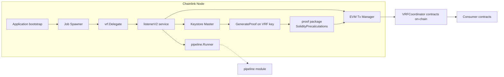
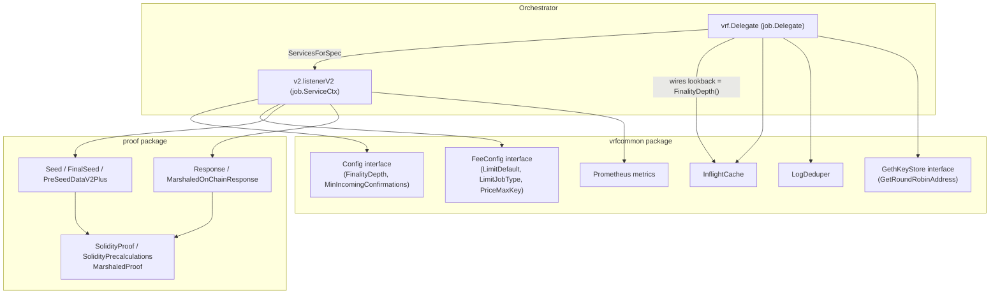
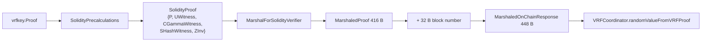
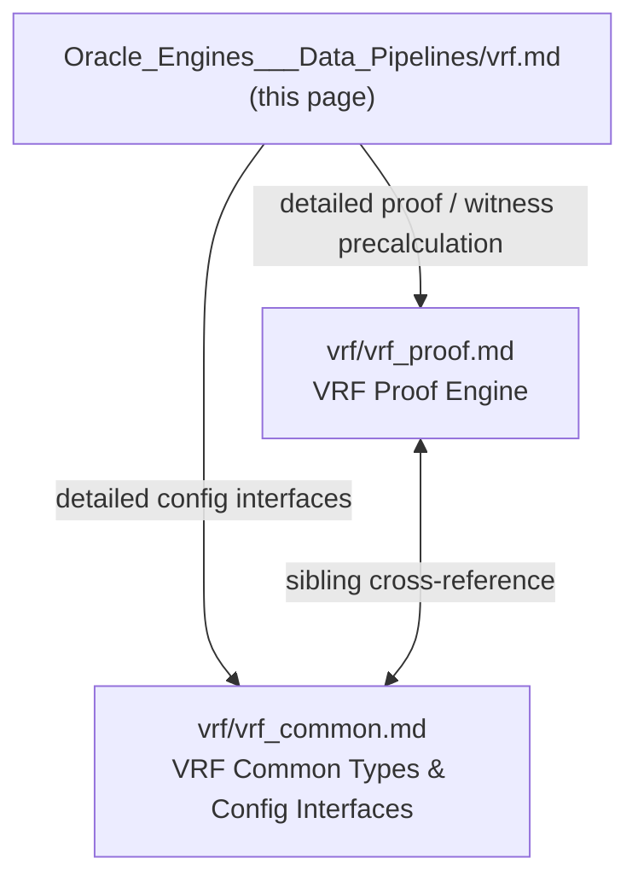

# VRF — Verifiable Random Function Oracle Engine

## 1. Purpose and Scope

The `vrf` module (`chainlink/core/services/vrf/...`) implements the **Verifiable Random Function (VRF)** oracle engine of the Chainlink node. A VRF produces random numbers that are:

- **Deterministic** — generated from a seed and the node's secret VRF key,
- **Verifiable** — each output is accompanied by a cryptographic proof that it was generated with the public key associated with the secret key, and
- **Unpredictable** — indistinguishable from uniform sampling over `{0, ..., 2**256-1}` for anyone who does not know the secret key (see `chainlink/core/services/vrf/doc.go`).

In practice the module runs a **VRF job** on the node that:

1. Watches for `RandomWordsRequested` events emitted by the on-chain `VRFCoordinator` contracts (V2 / V2 Plus / V2.5),
2. Mixes the request's `preSeed` with the hash of the containing block to compute the **final seed**,
3. Generates a secp256k1-based VRF **proof** via the node's VRF keystore,
4. **Precomputes** the witness values required by the on-chain Solidity verifier (`VRF.sol`) — `UWitness`, `CGammaWitness`, `SHashWitness`, and `ZInv`,
5. Submits the fulfillment transaction (single or batched) back to the coordinator through the EVM transaction manager, and
6. Reports request queue health via Prometheus metrics.

---

## 2. Position in the System

The VRF engine is one of the oracle engines inside the [Oracle Engines & Data Pipelines](../Oracle_Engines___Data_Pipelines.md) module, alongside:

- [OCR / OCR2](ocr.md) — decentralized data feed reporting,
- [LLO](llo.md) — low-latency oracle,
- [Pipeline](pipeline.md) — the DAG task execution engine that runs VRF fee-estimation pipelines,
- [Streams](streams.md) — streaming data pipelines.

VRF is orchestrated by the job lifecycle services from [Node Platform Services](../Node_Platform_Services.md) and wired into the node by the `Application` bootstrap described in [Node Application Core & Interfaces](../Node_Application_Core___Interfaces.md).



---

## 3. Architecture Overview

The module is organised into a small number of cooperating packages:

| Package | Responsibility |
|---|---|
| `vrf` (root: `delegate.go`, `doc.go`) | Implements the `job.Delegate` interface for `job.Type = VRF`. Validates job specs, resolves the EVM chain, wraps the `VRFCoordinatorV2.5` / batch coordinator contracts, and instantiates the V2+ listener with its dedupe primitives. |
| `vrf/proof` | Cryptography support: seed handling (`Seed`, `FinalSeed`), proof-response construction (`Response`, `MarshaledOnChainResponse`, `GenerateProofResponseV2Plus`) and the **precalculated Solidity verifier witnesses** (`SolidityProof`, `SolidityPrecalculations`, `MarshaledProof`). |
| `vrf/vrfcommon` | Shared interfaces and helpers: node/fee **config interfaces** (`Config`, `FeeConfig`, `GethKeyStore`), the `InflightCache` and `LogDeduper` reorg-protection primitives, Prometheus metrics, job-spec validation (`ValidatedVRFSpec`) and response-count utilities. |
| `vrf/v2` | The V2/V2Plus listener service: request queue (pairing heap), simulation through the pipeline runner, single and **batched** `fulfillRandomWords` fulfilment, exponential backoff and reorg tracking (`respCount`, `blockNumberToReqID`). |
| `vrf/extraargs` | ABI encode/decode of the `ExtraArgsV1` field (native-payment flag) attached to VRF V2+ requests. |
| `vrf/vrftesthelpers`, `vrf/mocks` | Test doubles and mocked config for integration testing. |

The two **core components** tracked by the wiki are the `SolidityProof` precalculation engine ([VRF Proof Engine](vrf/vrf_proof.md)) and the shared `Config` / `FeeConfig` / `GethKeyStore` interfaces ([VRF Common Types & Config Interfaces](vrf/vrf_common.md)); they are detailed in the sub-module pages below.



### 3.1 Job wiring (runtime context)

`vrf.Delegate.ServicesForSpec` (see `chainlink/core/services/vrf/delegate.go`) performs the following at job-creation time:

- Requires a `VRFSpec` **and** a `PipelineSpec` on the `job.Job` and parses the pipeline,
- Resolves the legacy EVM chain for `VRFSpec.EVMChainID` (VRF is not supported in LOOP-plugin mode),
- Instantiates `VRFCoordinatorV2_5` and, when `batchCoordinatorAddress` is configured, the `BatchVRFCoordinatorV2Plus` wrapper,
- For each `vrfv2plus` pipeline task, validates that every `fromAddress` exists in the ETH keystore, that key-specific max gas prices (`FeeConfig.PriceMaxKey`) are all equal and match `gasLanePrice`, and rejects unsupported options (VRF Owner, custom-revert pipelines),
- Fetches the `LINKNATIVEFEED` aggregator address from the coordinator with retries, and
- Constructs the `v2.New(...)` listener with an `InflightCache` and a `LogDeduper` whose **lookback is the chain's `FinalityDepth`** — the deduper lookback must be ≥ the log poller's lookback, otherwise already-delivered logs get re-delivered.

### 3.2 Reorg protection primitives

Two bounded caches in `vrfcommon` guard against replaying work after chain reorganisations:

- **`InflightCache`** (`inflight_cache.go`) — tracks logs whose fulfilments are in flight or already fulfilled, keyed by `(blockHash, blockNumber, logIndex)`; pruned every 1000 blocks beyond the lookback.
- **`LogDeduper`** (`log_dedupe.go`) — `ShouldDeliver(log)` filters duplicate fulfilment logs, pruned every 100 blocks.

Additionally, the listener keeps a `respCount` map plus a `blockNumberToReqID` pairing heap so that in-flight request accounting can be rolled back when a reorg un-confirms fulfilments.

---

## 4. VRF Request Lifecycle

```mermaid
sequenceDiagram
    autonumber
    participant C as Consumer contract
    participant CO as VRFCoordinator (on-chain)
    participant LP as Log Poller
    participant L as listenerV2
    participant P as proof package
    participant K as Keystore (VRF key)
    participant R as Pipeline Runner
    participant T as Tx Manager

    C->>CO: requestRandomWords(subId, keyHash, ...)
    CO->>LP: emits RandomWordsRequested log
    LP->>L: delivers log (after confirmations; deduped by InflightCache)
    L->>P: FinalSeed(preSeed, blockHash)
    L->>K: GenerateProof(keyID, finalSeed)
    K-->>L: vrfkey.Proof {pk, gamma, c, s, seed, output}
    L->>R: run vrfv2plus task (fee estimation / simulation)
    L->>P: SolidityPrecalculations(proof) → SolidityProof
    L->>P: GenerateProofResponseV2Plus → proof + request commitment
    L->>T: CreateTransaction(fulfillRandomWords[Batch])
    T->>CO: fulfilment transaction
    CO->>CO: verify proof using precomputed witnesses (VRF.sol)
    CO->>C: callback with randomWords
```

Batch fulfilment (V2 Plus): the listener accumulates simulated results into `batchFulfillment` groups that respect `batchGasLimit` (per-iteration cost `BatchFulfillmentIterationGasCost = 52_000`, scaled by `batchFulfillmentGasMultiplier`, default `1.15`), then enqueues one `fulfillRandomWords` transaction per batch inside a single DB transaction that also persists the finished pipeline runs.

---

## 5. On-chain Proof Encoding

The `SolidityProof` precalculations exist so the on-chain verifier (`VRF.sol`) can cheaply verify the linear combination `c*Γ + s*H(pk, seed)`. The flat wire format `MarshaledProof` is **416 bytes** (`ProofLength`):

| Offset | Size | Field |
|---|---|---|
| 0 | 64 | `PublicKey` (secp256k1 point) |
| 64 | 64 | `Gamma` |
| 128 | 32 | `C` (challenge) |
| 160 | 32 | `S` |
| 192 | 32 | `Seed` (pre-seed on the wire) |
| 224 | 32 | `uWitness` (20-byte address left-padded with 12 zero bytes) |
| 256 | 64 | `cGammaWitness` |
| 320 | 64 | `sHashWitness` |
| 384 | 32 | `zInv` |

For the legacy V1/V2 response, `Response.MarshalForVRFCoordinator` appends a 32-byte block number (replacing the final seed with the pre-seed so the coordinator can identify the request and recompute the final seed itself), yielding `MarshaledOnChainResponse` of `ProofLength + 32 = 448` bytes. For V2 Plus the same data is instead packed into `IVRFCoordinatorV2PlusInternalProof` and `IRequestCommitment` tuples. Full details: [VRF Proof Engine](vrf/vrf_proof.md).



---

## 6. Sub-modules

Detailed documentation for each sub-module is generated in the `vrf/` folder (exact file paths below):

- **[VRF Proof Engine](vrf/vrf_proof.md)** (`Oracle_Engines___Data_Pipelines/vrf/vrf_proof.md`) — `proof.SolidityProof`: the precomputed witnesses required by the Solidity verifier, the 416-byte wire encoding, and seed/request-response handling.
- **[VRF Common Types & Config Interfaces](vrf/vrf_common.md)** (`Oracle_Engines___Data_Pipelines/vrf/vrf_common.md`) — `vrfcommon.Config`, `FeeConfig`, `GethKeyStore`: the node-configuration surfaces consumed by the VRF listener and delegate.



---

## 7. Dependencies on Other Modules

| Dependency | Used for | Documentation |
|---|---|---|
| `chainlink-common/keystore/corekeys/vrfkey` | secp256k1 curve arithmetic, `Proof`, `HashToCurve`, `ProjectiveECAdd`, key `GenerateProof` | [Keystore](../Node_Platform_Services/keystore.md) |
| `core/services/keystore` (`keystore.Master`, `keystore.Eth`, `keystore.VRF`) | key lookup, `GenerateProof(id, seed)`, ETH signing-address validation | [Keystore](../Node_Platform_Services/keystore.md) |
| `core/services/job` | `job.Job`, `VRFSpec`, `job.Delegate`, `job.ServiceCtx`, spawning lifecycle | [Job Service](../Node_Platform_Services/job_service.md) |
| `core/services/pipeline` | `Runner`, `ORM`, `VRFTaskV2Plus` fee-estimation pipeline | [Pipeline](pipeline.md) |
| `chainlink-evm` (`legacyevm.Chain`, `logpoller`, `txmgr`, gethwrappers) | chain client, log delivery, transaction creation, coordinator contract bindings | — |
| `core/config` / EVM config | `FinalityDepth`, `MinIncomingConfirmations`, gas-estimator limits | [Core Config](../Node_Application_Core___Interfaces/core_config.md) |

---

## 8. Configuration, Metrics and Operations

**Configuration surfaces** (detailed in [VRF Common Types & Config Interfaces](vrf/vrf_common.md)):

- `Config.FinalityDepth()` — sets the lookback of the `InflightCache`/`LogDeduper` and the confirmations window for reorg safety.
- `Config.MinIncomingConfirmations()` — minimum confirmations before processing request logs.
- `FeeConfig.LimitDefault()` / `FeeConfig.LimitJobType()` — gas-limit budget for fulfilment transactions.
- `FeeConfig.PriceMaxKey(addr)` — per-signing-key max gas price; the delegate requires these to match `gasLanePrice` across all `fromAddresses`.
- `GethKeyStore.GetRoundRobinAddress(...)` — round-robin selection among multiple signing addresses.

**Job-spec validation** (`vrfcommon.ValidatedVRFSpec`): requires `publicKey` and `coordinatorAddress`, defaults `requestTimeout` to 24h, defaults `chunkSize` to 20 and `batchFulfillmentGasMultiplier` to 1.15, requires `batchCoordinatorAddress` when `batchFulfillmentEnabled = true`, and requires the pipeline to contain a `vrfv2`/`vrfv2plus` task with non-empty `fromAddresses`.

**Prometheus metrics** (`vrfcommon/metrics.go`): `vrf_request_queue_size`, `vrf_processed_request_count`, `vrf_dropped_request_count` (reasons `mailbox_size`, `age`), `vrf_duplicate_requests` (possible reorg indicator), `vrf_request_time_between_sims`, `vrf_request_time_until_initial_sim`.

**Deployment/testing**: a reference multi-node VRF (primary + backup + blockhash-store nodes + Postgres) docker-compose stack lives at `chainlink/core/scripts/common/vrf/docker/docker-compose.yml`; end-to-end VRF V2+ job specs are generated by the development environment tooling in [Dev, Test & Simulation Environments](../Dev,_Test___Simulation_Environments/devenv.md) (e.g. `chainlink/devenv/products/vrfv2plus/job_spec.go`).

---

## 9. Related Modules

- [OCR / OCR2](ocr.md) — sibling reporting engine sharing `ocrcommon` data-source caching patterns.
- [Pipeline](pipeline.md) — executes the `vrfv2plus` fee-estimation DAG for every request.
- [Streams](streams.md) and [LLO](llo.md) — other data pipelines in this module group.
- [Node Platform Services](../Node_Platform_Services.md) — job lifecycle, keystore and database persistence used by VRF.
