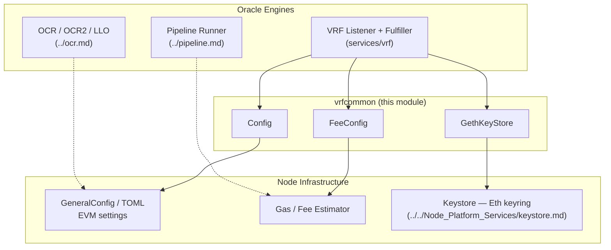
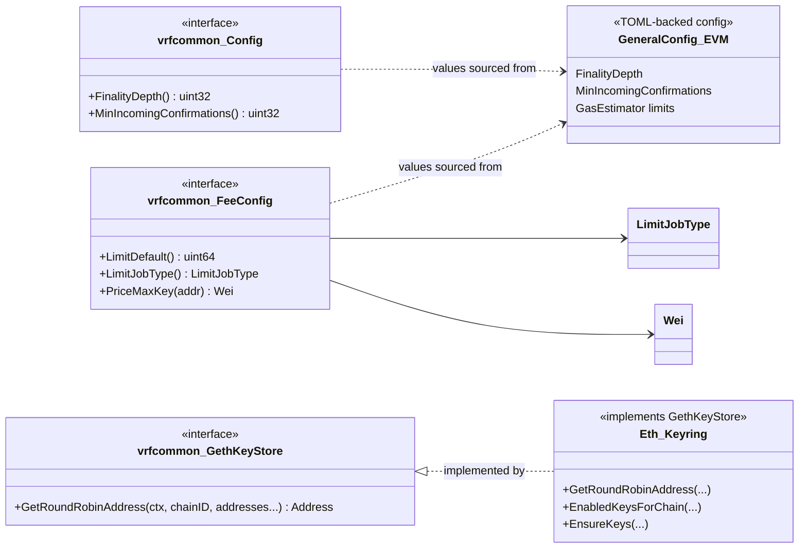
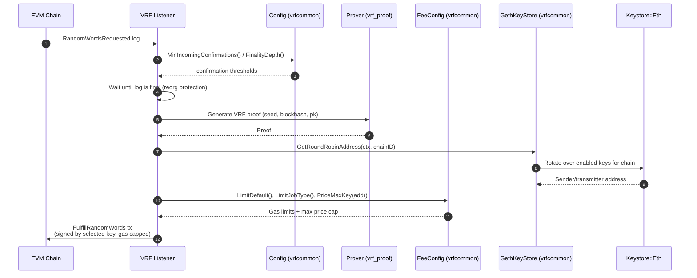
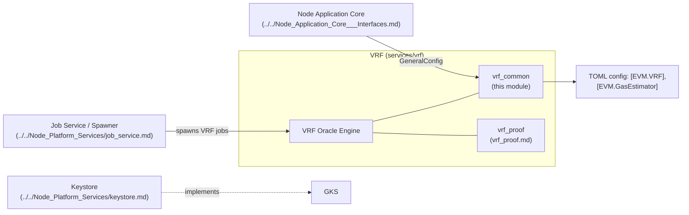

# vrf_common

> **Module path:** `chainlink/core/services/vrf/vrfcommon`
> **Domain:** Oracle Engines & Data Pipelines → [VRF](../vrf.md)

`vrfcommon` is the shared contract layer for the Verifiable Random Function (VRF) oracle engines. It defines the *narrow, consumer-facing interfaces* that every VRF job type (VRF v1, VRF v2, VRF v2 Plus) needs from the surrounding node: chain finality settings, fee/gas constraints, and transaction key selection. By coding VRF services against these three small interfaces instead of the full `GeneralConfig` or the complete keystore, the module keeps VRF logic decoupled from node infrastructure and trivially mockable in tests.

---

## 1. Purpose and Positioning

The Chainlink node hosts several oracle engines (OCR/OCR2, LLO, Pipeline, VRF — see [OCR](../ocr.md), [Pipeline](../pipeline.md)). Each engine needs a different slice of node capability:

| Engine need | Provided by vrfcommon via |
|---|---|
| "How many confirmations before I trust this log?" | `Config` |
| "How much gas may I spend, and at what max price?" | `FeeConfig` |
| "Which address signs and pays for the fulfillment tx?" | `GethKeyStore` |

The module is intentionally **pure contract code** — `types.go` contains no logic, only interface definitions. Implementations are supplied by:

- **[Keystore](../../Node_Platform_Services/keystore.md)** — the node's ETH keyring implements `GethKeyStore`.
- **Node EVM configuration** (`GeneralConfig` / TOML `[EVM]` / `[EVM.GasEstimator]` sections) — supplies values behind `Config` and `FeeConfig`.



---

## 2. Core Components

Source: [`chainlink/core/services/vrf/vrfcommon/types.go`](../vrf.md)

### 2.1 `Config`

```go
type Config interface {
    FinalityDepth() uint32
    MinIncomingConfirmations() uint32
}
```

Chain-finality settings consumed when processing `RandomWordsRequested` logs:

| Method | Meaning | Consumer behavior |
|---|---|---|
| `FinalityDepth()` | Number of blocks after which the chain is considered final (reorg-safe). | The listener waits until a request log is at least `FinalityDepth` blocks deep before generating a proof and fulfilling — protecting against reorg-driven double fulfillment. |
| `MinIncomingConfirmations()` | Minimum confirmations required for an incoming request before it is processed. | Job-level field of the same name (see the VRFV2Plus `JobSpec` in [devenv](../../Dev,_Test___Simulation_Environments/devenv.md)) mirrors this; the effective value guards premature handling of log events. |

### 2.2 `FeeConfig`

```go
type FeeConfig interface {
    LimitDefault() uint64
    LimitJobType() config.LimitJobType
    PriceMaxKey(addr common.Address) *assets.Wei
}
```

Gas-budgeting contract used when the VRF fulfiller submits the fulfillment transaction:

| Method | Meaning |
|---|---|
| `LimitDefault()` | Default gas limit (units) applied when no job-type override exists. |
| `LimitJobType()` | Per-job-type gas limit map (`config.LimitJobType`) — lets VRF fulfillments reserve enough gas for on-chain randomness verification without starving other job types. |
| `PriceMaxKey(addr)` | Maximum gas price (`*assets.Wei`) permitted for a given key address, capping the cost of the signing account's submissions. |

### 2.3 `GethKeyStore`

```go
type GethKeyStore interface {
    GetRoundRobinAddress(ctx context.Context, chainID *big.Int,
        addresses ...common.Address) (common.Address, error)
}
```

A deliberately minimal view of the node keystore: it returns the next **round-robin address** among enabled ETH keys for a chain, optionally constrained to a candidate address list. This spreads fulfillment fees and nonce pressure across all enabled accounts. The production implementation is the full `Eth` keyring interface in the [Keystore service](../../Node_Platform_Services/keystore.md) (`core/services/keystore/eth.go::Eth`), of which `GetRoundRobinAddress` is one method — a textbook application of interface segregation.

### 2.4 External dependencies

| Import | Purpose |
|---|---|
| `github.com/ethereum/go-ethereum/common` | `common.Address` for key selection |
| `github.com/smartcontractkit/chainlink-evm/pkg/assets` | `*assets.Wei` max gas-price representation |
| `github.com/smartcontractkit/chainlink-evm/pkg/config` | `config.LimitJobType` gas-limit map type |

---

## 3. Component Relationships



---

## 4. Runtime Flow — How the Interfaces Are Used

The sequence below shows a typical VRF request lifecycle (v1/v2/v2plus) and where each `vrfcommon` contract is exercised. Proof generation itself lives in the sibling module [vrf_proof](vrf_proof.md) (`SolidityProof` and the on-chain serialization), documented on the parent [VRF page](../vrf.md).



**Key takeaways from the flow:**

- `Config` gates *when* to act (finality), `GethKeyStore` decides *who* acts (key selection), and `FeeConfig` bounds *at what cost* (gas limits and price caps).
- All three are resolved per fulfillment attempt, so round-robin rotation naturally load-balances across the node's accounts.

---

## 5. Fit Within the Overall System



- **Upstream:** the [Job Service](../../Node_Platform_Services/job_service.md) spawner creates VRF job runs; job specs (e.g., `MinIncomingConfirmations`, `FromAddresses` in the devenv VRFV2Plus spec) provide per-job values that flow through the same contracts.
- **Downstream:** `vrf_proof` converts raw proofs into `SolidityProof` structs for on-chain verification; the [Pipeline engine](../pipeline.md) supplies the general task/gas machinery that VRF fulfillment submissions ultimately ride on.
- **Configuration:** values behind `Config`/`FeeConfig` originate in node TOML (see [Node Application config](../../Node_Application_Core___Interfaces/node_application/node_application_config.md)) — the same chain-level settings every engine shares.

---

## 6. Testing & Deployment Context

- **Local VRF cluster:** [`chainlink/core/scripts/common/vrf/docker/docker-compose.yml`](../../Dev,_Test___Simulation_Environments/operations_scripts.md) provisions a 5-node topology — VRF primary, VRF backup, BlockhashStore node, BHS backup, and BlockhashStore-Fulfiller — each started with layered TOML files (`base.toml`, `rpc-nodes.toml`, `vrf-primary.toml`, `bhs.toml`, `bhf.toml`). Those TOML files are exactly what populate the `Config` and `FeeConfig` interfaces at runtime, so changes to finality or gas behavior in this module must be validated against that configuration surface.
- **Unit testing:** because `vrfcommon` exposes only interfaces, VRF engine tests inject stub implementations of `Config`, `FeeConfig`, and `GethKeyStore` rather than booting a full keystore or `GeneralConfig` — the primary benefit of this module's design.
- **Dev environments:** the [devenv](../../Dev,_Test___Simulation_Environments/devenv.md) VRFV2Plus `JobSpec` exposes the job-level counterparts (`MinIncomingConfirmations`, `FromAddresses`) of the chain-level values surfaced here.

---

## 7. Extension Guidance

1. **Adding a setting:** extend the relevant interface (e.g., add a method to `Config`), then update the TOML-backed implementation in node config and the injected test stubs. Avoid widening `GethKeyStore` — key-access methods should be added to the full keystore interface instead and new narrow views minted as needed.
2. **New VRF version:** reuse these contracts; only the listener/fulfillment logic should change. If a new version needs, e.g., per-request gas price selection, prefer extending `FeeConfig` over leaking the full `GasEstimator` into VRF code.
3. **Non-EVM chains:** `GethKeyStore` is EVM-shaped (`common.Address`, `big.Int` chain IDs). Multi-chain VRF variants should define parallel contracts in their relay packages rather than generalizing this one, mirroring how other engines keep relay-specific types isolated.

---

## Related Documentation

- [VRF (parent module)](../vrf.md) — module overview including `SolidityProof`
- [vrf_proof](vrf_proof.md) — cryptographic proof generation and `SolidityProof` serialization
- [Keystore](../../Node_Platform_Services/keystore.md) — production `GetRoundRobinAddress` implementation
- [Job Service](../../Node_Platform_Services/job_service.md) — job spawning and specs
- [OCR](../ocr.md) · [Pipeline](../pipeline.md) — sibling oracle engines sharing the node's gas/config infrastructure
