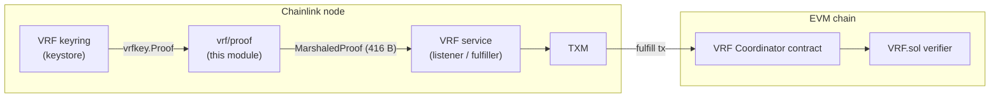
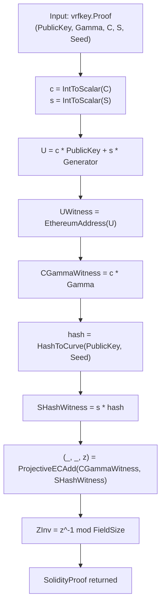
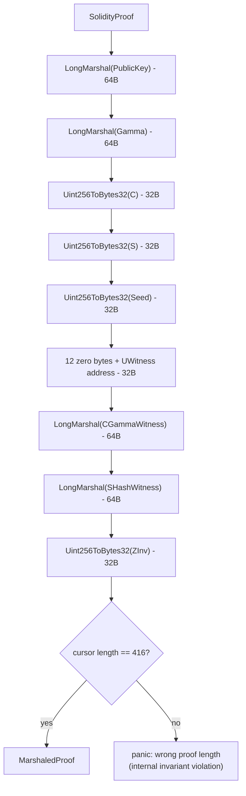
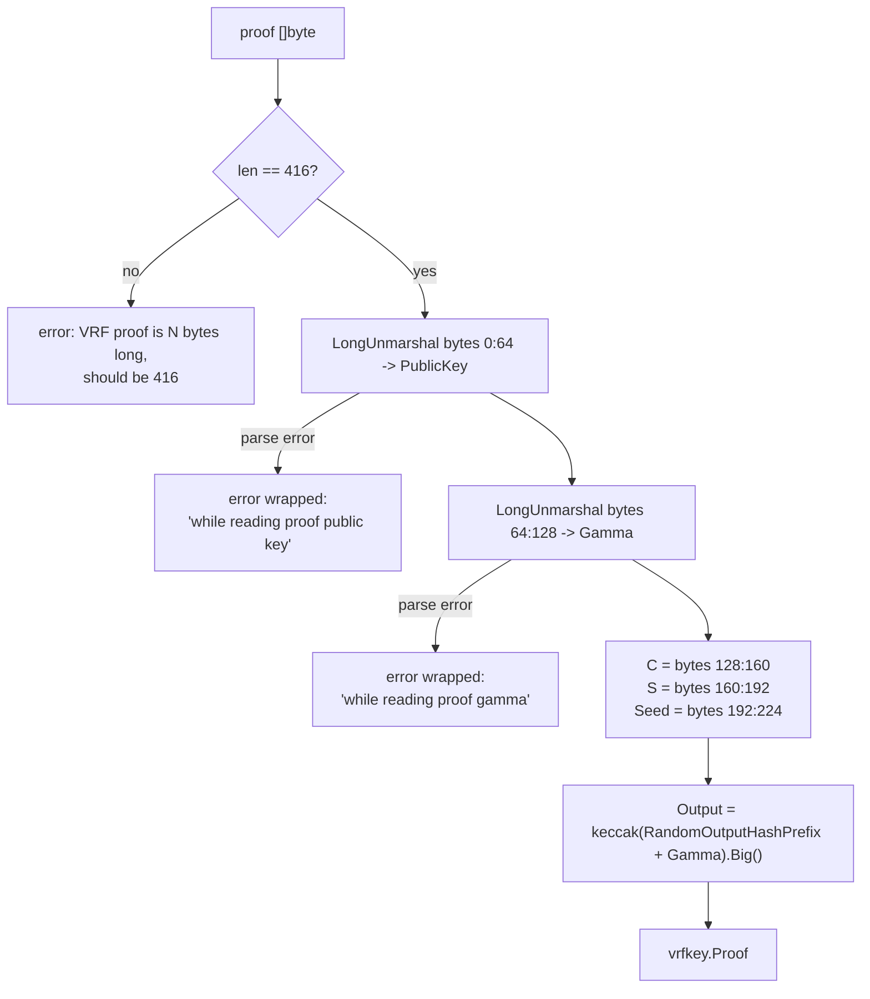
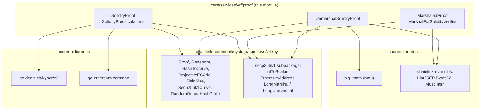
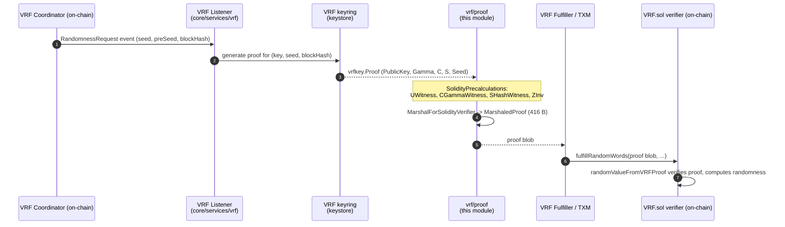

# VRF Proof Module (`core/services/vrf/proof`)

> **Module:** `Oracle_Engines___Data_Pipelines/vrf/vrf_proof`
> **Core component:** `chainlink/core/services/vrf/proof/solidity_proof.go::SolidityProof`
> **Parent:** [VRF](../vrf.md) · **Sibling:** [VRF Common (`vrfcommon`)](vrf_common.md)

## 1. Introduction

The `vrf_proof` module is the **on-chain serialization layer** of Chainlink's Verifiable Random Function (VRF) service. Once the VRF keyring produces a cryptographic proof (`vrfkey.Proof`), that proof cannot be submitted to Ethereum as-is: the on-chain verifier contract (`VRF.sol`, invoked through the VRF coordinator's `randomValueFromVRFProof`-style entrypoint) requires a precomputed, fixed-size binary blob containing auxiliary "witness" values.

This module provides exactly that bridge:

1. **Precalculation** — computes the curve witnesses (`UWitness`, `CGammaWitness`, `SHashWitness`) and the projective-coordinate inverse (`ZInv`) that the Solidity verifier needs to check a proof cheaply.
2. **Marshaling** — packs the proof plus witnesses into a 416-byte (`ProofLength`) blob in the exact field layout the verifier expects.
3. **Unmarshaling** — parses such a blob back into a `vrfkey.Proof`, re-deriving the random output value deterministically.

The module is deliberately dependency-light and side-effect free: it performs pure elliptic-curve arithmetic and byte encoding, making it trivially unit-testable and safe to run inside the node's hot path.

For the configuration types (`Config`, `FeeConfig`, `GethKeyStore`) that govern the VRF jobs which *consume* this package, see [VRF Common (`vrfcommon`)](vrf_common.md). For the key management that *produces* proofs, see the [Keystore](../../Node_Platform_Services/keystore.md) module.

---

## 2. Position in the System



- The **VRF keyring** (part of the [Keystore](../../Node_Platform_Services/keystore.md) module) performs the actual VRF proving: it derives `Gamma`, the challenge `C`, the scalar `S`, and the `Seed`, wrapped in a `vrfkey.Proof`.
- This module then converts that proof into the **on-chain wire format**.
- The **VRF service** (listener/fulfiller) submits the marshaled proof in a fulfillment transaction via the transaction manager.

The lifecycle, fee, and keystore configuration for these flows is documented in [vrf_common](vrf_common.md).

---

## 3. Core Component: `SolidityProof`

Defined in `chainlink/core/services/vrf/proof/solidity_proof.go`.

```go
type SolidityProof struct {
    P    *vrfkey.Proof  // The core proof
    UWitness                    common.Address // Address of P.C*P.PK+P.S*G
    CGammaWitness, SHashWitness kyber.Point    // P.C*P.Gamma, P.S*HashToCurve(P.Seed)
    ZInv                        *big.Int       // Inverse of Z coord from ProjectiveECAdd(CGammaWitness, SHashWitness)
}
```

| Field | Type | Meaning |
|---|---|---|
| `P` | `*vrfkey.Proof` | The core proof: proving `PublicKey`, `Gamma`, challenge `C`, scalar `S`, request `Seed` (and `Output`). |
| `UWitness` | `common.Address` | Ethereum address of the point `U = C·PK + S·G` — identifies the account recovered from the proof during on-chain verification. |
| `CGammaWitness` | `kyber.Point` | `C·Gamma` — lets the verifier check `C` without an extra scalar multiplication of `Gamma`. |
| `SHashWitness` | `kyber.Point` | `S·H`, where `H = HashToCurve(PK, Seed)` — ditto for the hash-to-curve point. |
| `ZInv` | `*big.Int` | Multiplicative inverse (mod the field size) of the `Z` coordinate of `ProjectiveECAdd(CGammaWitness, SHashWitness)`, allowing the verifier to complete projective additions with a single modular inversion. |

### Public API

| Symbol | Signature | Purpose |
|---|---|---|
| `SolidityPrecalculations` | `func(p *vrfkey.Proof) (*SolidityProof, error)` | Computes all witness values. Returns an error if `HashToCurve` fails. |
| `(*SolidityProof).MarshalForSolidityVerifier` | `func(p *SolidityProof) MarshaledProof` | Serializes to the fixed 416-byte blob (panics on internal length violation). |
| `MarshalForSolidityVerifier` | `func(p *vrfkey.Proof) (MarshaledProof, error)` | Convenience wrapper: precalculate + marshal in one call. |
| `UnmarshalSolidityProof` | `func(proof []byte) (vrfkey.Proof, error)` | Inverse operation: parses a 416-byte blob back into a `vrfkey.Proof`. |
| `ProofLength` | `const int = 416` | Length of the marshaled proof in bytes. |
| `MarshaledProof` | `type [ProofLength]byte` | Fixed-size byte-array wrapper with a `String()` rendering as `0x`-hex. |

---

## 4. Cryptographic Precalculations

`SolidityPrecalculations` performs the following steps over the secp256k1 curve (`vrfkey.Secp256k1Curve`):



**Why these values?** The on-chain verifier must confirm that:

1. The recovered point `U = C·PK + S·G` maps to the expected coordinator address (`UWitness`), and
2. `Gamma` and the hash-to-curve point `H` are consistent with the challenge `C` and scalar `S` — checked via the linear combination `C·Gamma + S·H`.

Because the verifier works in projective coordinates on-chain, the module precomputes `ZInv` so the contract can "affinize" the witness sum with a single `modexp`-style inversion instead of performing inversions inline. All group arithmetic is done off-chain with the [kyber](https://github.com/dedis/kyber) library via the `vrfkey` helpers (`Generator`, `HashToCurve`, `ProjectiveECAdd`, `FieldSize`).

---

## 5. On-Chain Proof Encoding

### 5.1 Wire layout (`ProofLength = 416` bytes)

| Offset | Size (bytes) | Field | Encoding |
|-------:|-------------:|---|---|
| 0 | 64 | `PublicKey` | `secp256k1.LongMarshal` (uncompressed curve point) |
| 64 | 64 | `Gamma` | `secp256k1.LongMarshal` (uncompressed curve point) |
| 128 | 32 | `C` | big-endian `uint256` (`utils.Uint256ToBytes32`) |
| 160 | 32 | `S` | big-endian `uint256` |
| 192 | 32 | `Seed` | big-endian `uint256` |
| 224 | 32 | `UWitness` | 12 zero bytes (left padding) + 20-byte address |
| 256 | 64 | `CGammaWitness` | `secp256k1.LongMarshal` |
| 320 | 64 | `SHashWitness` | `secp256k1.LongMarshal` |
| 384 | 32 | `ZInv` | big-endian `uint256` |

> **Note:** The proof's `Output` (the random value itself) is intentionally **not** serialized — "that can be efficiently calculated" on-chain, since it is a deterministic hash of `Gamma` (see §6).

### 5.2 Marshaling process



The method-internal length check is a **panic guard against programmer error**, not a runtime failure mode: the writes above are a fixed total of 416 bytes, so any mismatch indicates the layout constants or encoding helpers have drifted.

### 5.3 Gotcha: passing proofs to the geth simulator

The source carries an explicit NB: when passing a `MarshaledProof` to `randomValueFromVRFProof` through the **geth blockchain simulator** (used extensively in tests and the simulation environments), it must be passed **as a slice** (`proof[:]`). Passing the array as-is causes geth to ABI-encode it as hundreds of single bytes, each padded into its own 32-byte word, corrupting the call.

---

## 6. Proof Decoding (`UnmarshalSolidityProof`)

The inverse operation restores a `vrfkey.Proof` from its on-chain representation:



Key details:

- **Length validation first:** any blob that is not exactly `ProofLength` bytes is rejected with a descriptive error that includes both the observed and expected lengths plus a hex dump.
- **Deterministic output recovery:** the random output is recomputed as `utils.MustHash(string(vrfkey.RandomOutputHashPrefix) + string(rawGamma)).Big()` — i.e., keccak-256 over the domain-separated prefix concatenated with the raw `Gamma` bytes. This mirrors the on-chain calculation and keeps the output out of the wire format.
- **Wrapped errors:** point-parsing failures are wrapped with `pkg/errors.Wrapf` and clearly labeled with which field failed.

---

## 7. Dependencies



| Dependency | Role |
|---|---|
| `chainlink-common/keystore/corekeys/vrfkey` | Proof domain type and curve/hash primitives (`Proof`, `Generator`, `HashToCurve`, `ProjectiveECAdd`, `FieldSize`, `RandomOutputHashPrefix`). Owned by the [Keystore](../../Node_Platform_Services/keystore.md) module. |
| `.../vrfkey/secp256k1` | Scalar conversion (`IntToScalar`), address derivation (`EthereumAddress`), and long-form point (de)serialization (`LongMarshal`/`LongUnmarshal`). |
| `chainlink-common/pkg/utils/big_math` | Big-int allocation helper (`bm.I`) used when decoding `C`, `S`, `Seed`. |
| `chainlink-evm/pkg/utils` | Fixed-width integer encoding (`Uint256ToBytes32`) and keccak hashing (`MustHash`) for output recovery. |
| `go.dedis.ch/kyber/v3` | Generic curve-point interface (`kyber.Point`) used for witness types. |
| `go-ethereum/common` | `common.Address` type for `UWitness`. |

---

## 8. End-to-End Data Flow

How a proof travels from request to verified randomness:



Steps 3–5 are where this module operates: it is a **pure transformation stage** between the off-chain proof engine (keystore/keyring) and the on-chain verifier.

---

## 9. Operational Context, Testing & Simulation

The proof pipeline is exercised end-to-end by the node's simulation and test environments:

- The VRF docker simulation stack ([`chainlink/core/scripts/common/vrf/docker/docker-compose.yml`](../../Dev,_Test___Simulation_Environments/operations_scripts.md)) provisions five nodes against a shared Postgres instance: a `vrf-primary-node` and `vrf-backup-node` (running VRF jobs that generate and fulfill proofs through this module), a `bhs-node` / `bhs-backup-node` pair running BlockHashStore jobs, and a `bhf-node` (BlockhashStoreFulfilled). Nodes are launched from the `chainlink` image with TOML config mounted from `./toml-config` and per-node `CL_DATABASE_URL`s.
- Tooling that provisions VRF and VRFv2+ jobs programmatically (`VRFJobSpec`, `VRFV2PlusJobSpec`, `VRFV2PlusTxPipelineSpec`) is described in the [deployment environment](../../Dev,_Test___Simulation_Environments/deployment-environment.md) documentation.

In tests, `UnmarshalSolidityProof` and `MarshaledProof.String()` support round-trip assertions and log-friendly debugging of submitted proof blobs.

---

## 10. Invariants & Design Notes

1. **Fixed wire format.** The 416-byte layout is dictated by the Solidity verifier's ABI expectations. Any change requires a coordinated update with the on-chain contracts; the marshaling panic guard catches accidental drift at development time.
2. **Output excluded from the blob.** The random value is derivable from `Gamma` alone (`keccak(RandomOutputHashPrefix ∥ Gamma)`), so it is omitted from serialization and recomputed on decode — saving 32 bytes and eliminating a consistency-check burden on-chain.
3. **Single-inversion verification.** Precomputing `ZInv` off-chain shifts the expensive modular inversion out of the EVM, keeping on-chain verification to point arithmetic plus one inversion-friendly completion.
4. **No I/O, no state.** The package performs no logging, persistence, or network access; all functions are pure with respect to their inputs, which makes failures deterministic and easy to reproduce.
5. **Panic vs. error discipline.** `MarshalForSolidityVerifier` (method form) panics on a layout violation because that would indicate a code bug, while user-facing failures (bad input bytes, failed hash-to-curve) surface as returned `error`s.

---

## 11. Related Documentation

| Page | Relevance |
|---|---|
| [VRF (`vrf`)](../vrf.md) | Parent module: VRF service architecture and job types. |
| [VRF Common (`vrfcommon`)](vrf_common.md) | `Config`, `FeeConfig`, `GethKeyStore` — runtime configuration for VRF jobs that consume this package. |
| [Keystore](../../Node_Platform_Services/keystore.md) | VRF keyring and `vrfkey` core keys — where proofs originate. |
| [Oracle Engines & Data Pipelines](../../Oracle_Engines___Data_Pipelines.md) | Sibling oracle engines: OCR/OCR2, LLO, Pipeline, Streams. |
| [Dev/Test/Simulation — operations scripts](../../Dev,_Test___Simulation_Environments/operations_scripts.md) | VRF docker simulation stack that exercises proof fulfillment. |
| [Dev/Test/Simulation — deployment environment](../../Dev,_Test___Simulation_Environments/deployment-environment.md) | VRF job spec tooling (`VRFJobSpec`, `VRFV2PlusJobSpec`). |
