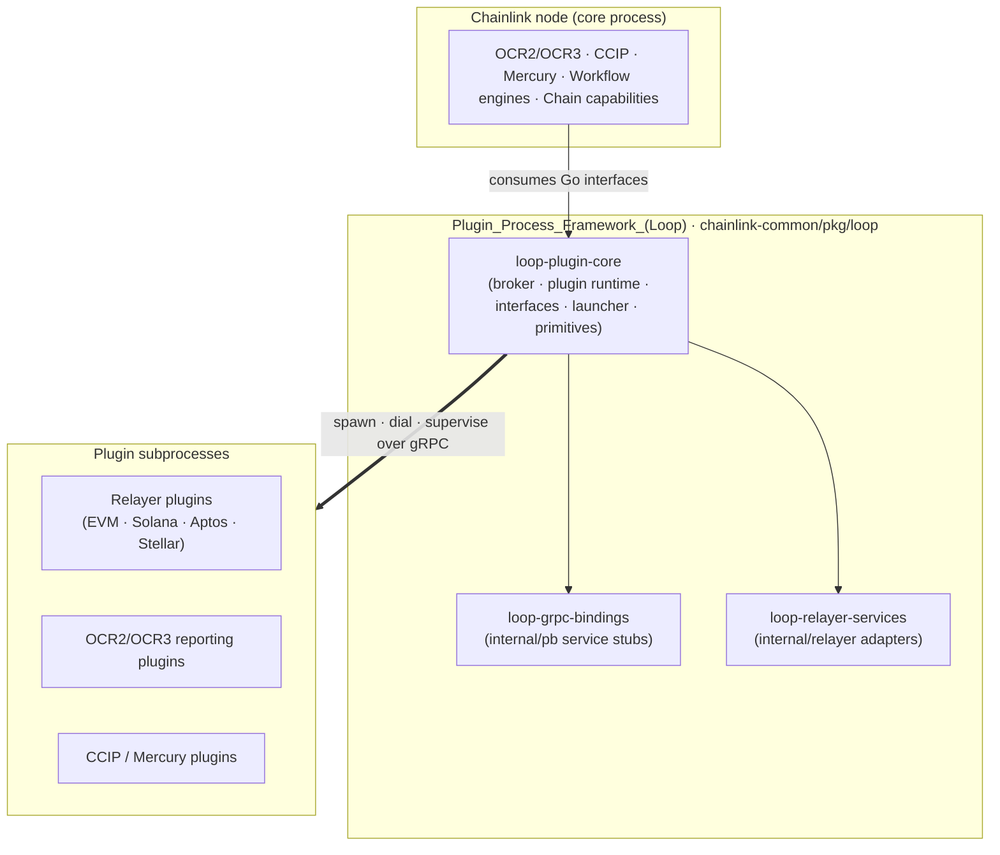
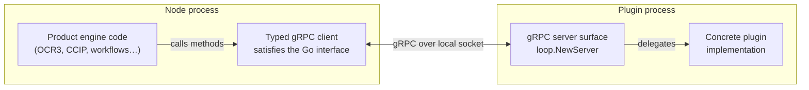
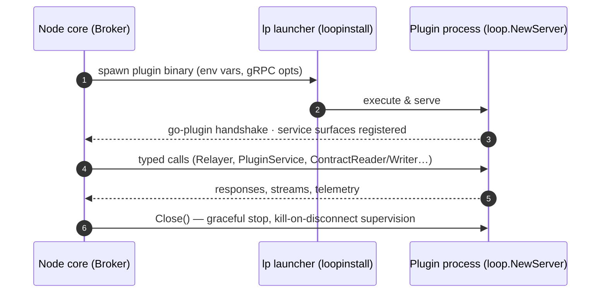

# Plugin Process Framework (Loop)

**Module path:** `chainlink-common/pkg/loop`

## Purpose

The Loop framework is the **process-isolation backbone** of the Chainlink node. Instead of linking product code directly into the core binary, it runs plugin code — OCR2/OCR3 reporting plugins, CCIP plugins, Mercury services, and chain-specific Relayers (EVM, Solana, Aptos, Stellar) — as **separate operating-system processes ("loops")**, communicating over gRPC.

Its key design goals are:

- **Fault isolation** — a crashing or hanging plugin cannot take the node down; the broker supervises subprocesses (kill-on-disconnect) and restarts them with backoff.
- **Uniform contract** — consumers program against plain Go interfaces (`Relayer`, `RelayerSet`, `PluginService`, `Oracleish`, …); the framework transparently provides gRPC-backed client implementations on the node side and gRPC servers that wrap concrete implementations on the plugin side.
- **Decoupling & extensibility** — chain-specific binaries carry their own dependencies and are launched via a small launcher process, so new plugin types and chains plug in without growing the core node.

An in-process variant (`NewProcessBroker`) instantiates "loops" inside the node itself, which is used for testing and configurations where isolation is disabled.

## Architecture

The client/server duality that makes isolation transparent:

Lifecycle of a plugin process:

## Core components

| Component | Path | Role |
|---|---|---|
| [loop-plugin-core](<Plugin_Process_Framework_(Loop)/loop-plugin-core.md>) | `chainlink-common/pkg/loop` | The heart of the framework: the **Broker** (launch, dial and supervise plugin processes; in-process variant), the **plugin runtime** (`NewServer`/`NewClient` plumbing), the **service-surface registrations** negotiable between broker and plugin, the shared **interfaces** (`Relayer`, `RelayerSet`, `PluginService`, `Oracleish`), the **loopinstall** bootstrap of the `lp` launcher, and runtime **query primitives** (env-var propagation, gRPC options, Prometheus logging config, safe-run helpers). |
| [loop-grpc-bindings](<Plugin_Process_Framework_(Loop)/loop-grpc-bindings.md>) | `chainlink-common/pkg/loop/internal/pb` | Protobuf definitions plus generated code and client/server adapters for every plugin surface: **contract-io** (ContractReader/ContractWriter), **relayer-oracle** (Relayer & Oracle), **ocr-reporting** (OCR2/OCR3 reporting plugins), **ccip**, and **mercury**. |
| [loop-relayer-services](<Plugin_Process_Framework_(Loop)/loop-relayer-services.md>) | `chainlink-common/pkg/loop/internal/relayer` | Domain adapters for the relayer surface: the gRPC-backed **Relayer** implementation consumed by the node, the **RelayerSet** for multi-chain plugin access (e.g. CCIP, multi-chain OCR3), and **PluginProviders** that hand bound sub-services (chain readers/writers, etc.) to plugin code. |

## Relation to the rest of the system

- **Oracle engines & pipelines** (`chainlink/core/services/ocr`, `llo`, `mercury`) and **CCIP** (`chainlink/core/capabilities/ccip`) obtain their reporting plugins through Loop clients.
- **Chain capabilities** under `capabilities/chain_capabilities/*` ship Relayer plugins that this framework executes as subprocesses.
- The framework builds on the shared foundation libraries (`chainlink-common/pkg/types`, `values`, `logger`, `services`) for domain types and common runtime utilities.