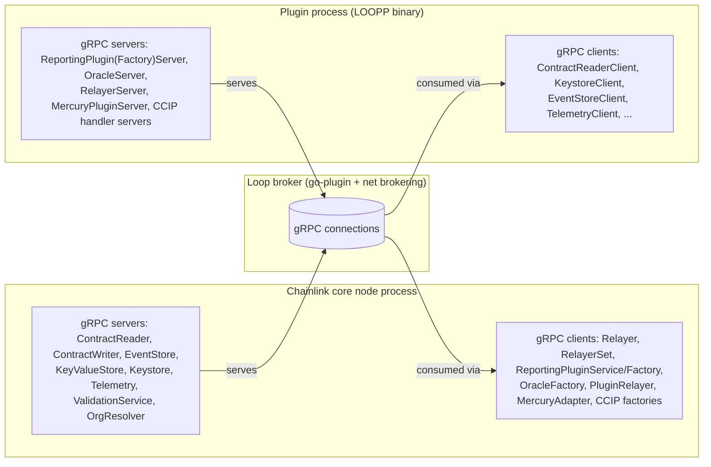
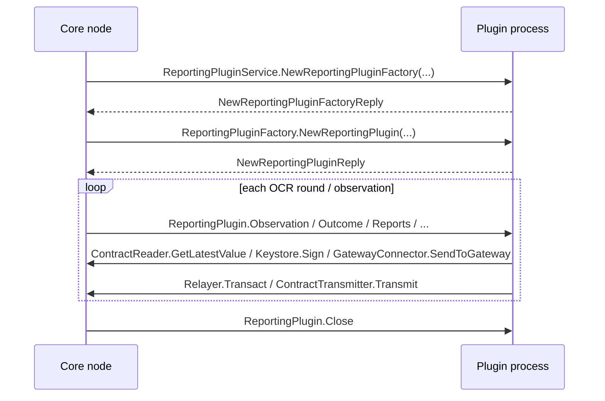
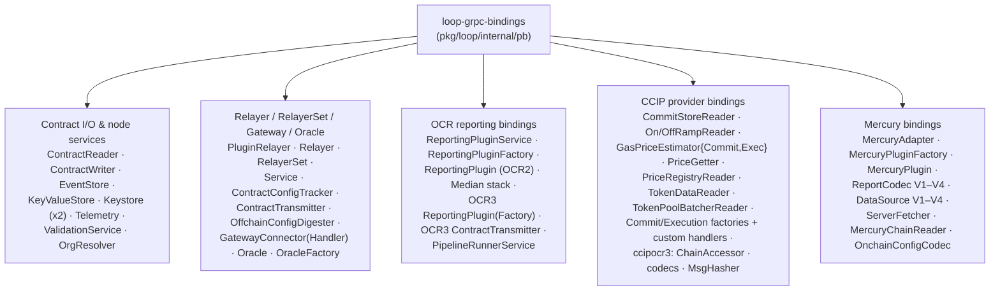
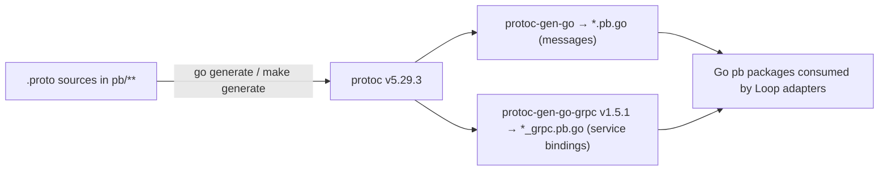

# loop-grpc-bindings

## 1. Overview

`loop-grpc-bindings` is the **wire-contract layer of the Loop plugin process framework (LOOPP)**. It lives in `chainlink-common/pkg/loop/internal/pb` and contains every `.proto` definition plus its generated Go code that defines what can be said between the **Chainlink core node process** and **out-of-process plugin binaries (LOOPPs)** over the gRPC connections managed by the Loop broker.

In the Loop architecture (see [Plugin_Process_Framework_(Loop)](../Plugin_Process_Framework_(Loop).md)), products such as OCR/median feeds, Mercury, CCIP and CRE capabilities run as separate OS processes. Because Go plugins cannot share memory across processes, *every* interface a plugin implements or consumes must be projected onto the network as a protobuf `service`. This module is that projection: for each Go interface in `chainlink-common/pkg/types` (e.g. `ContractReader`, `Relayer`, `ReportingPluginFactory`, `ccip.ChainAccessor`) it defines:

- a `.proto` file declaring a gRPC `service` whose RPCs mirror the interface methods (Go `interface` → proto `service`, Go `struct` → proto `message`),
- generated `*_grpc.pb.go` code providing, per service:
  - `<Service>Client` interface + `New<Service>Client(grpc.ClientConnInterface)` constructor (the side that *consumes* the interface),
  - `<Service>Server` interface + `Register<Service>Server(grpc.ServiceRegistrar, srv)` (the side that *implements* the interface),
  - `Unimplemented<Service>Server` (embedded **by value** for forward compatibility) and `Unsafe<Service>Server` (opt-out of forward compatibility),
  - a `<Service>_ServiceDesc` descriptor,
  - generated per-method unary handlers that support gRPC interceptors.

All generated code is pinned to `protoc-gen-go-grpc v1.5.1` / `protoc v5.29.3` and requires `grpc.SupportPackageIsVersion9` (gRPC-Go ≥ 1.64); every RPC is invoked with `grpc.StaticMethod()` semantics.

> **Internal boundary.** Everything under `pkg/loop/internal/pb` is `internal` to `chainlink-common`: plugins consume the stable wrappers in [loop-plugin-core](loop-plugin-core.md), never these packages directly. The hand-written client/server **adapters** that translate between Go interfaces and these gRPC bindings live in `pkg/loop/internal/{core,relayer,reportingplugin,goplugin}` and are documented as part of [loop-plugin-core](loop-plugin-core.md) and [loop-relayer-services](loop-relayer-services.md).

## 2. Architecture

### 2.1 Process-boundary view

The Loop broker (hashicorp go-plugin + Loop `net` brokering) lets **both sides serve and consume services**. Node-provided infrastructure services are served by the core node; plugin-provided factories/plugins are served by the plugin binary:



A typical OCR-style plugin session therefore exercises both directions (see [loop-grpc-bindings_ocr-reporting](loop-grpc-bindings/loop-grpc-bindings_loop-grpc-bindings_ocr-reporting.md)):



### 2.2 Service taxonomy

The roughly 40 generated services fall into five cohesive groups, each documented as a sub-module:



### 2.3 Code generation and build integration

Generated code is produced by `go generate` driven by `//go:generate protoc ...` directives committed next to the package(s), orchestrated by the module Makefile:

- `chainlink-common/Makefile` — targets `install-protoc` (installs `protoc`, `protoc-gen-go`, `protoc-gen-go-grpc` from `.tool-versions`), `cre-protoc` (builds the `protoc-gen-cre` plugin) and `generate` (runs mockery + protoc codegen).
- `chainlink-common/pkg/loop/internal/pb/generate.go` — top-level directives for `relayer.proto`, `reporting.proto`, `median.proto`, `contract_reader.proto`, `contract_writer.proto` (via the `generate_with_values` helper), `median_datasource.proto`, `keystore.proto`, `reporting_plugin_service.proto`, `telemetry.proto`, `pipeline_runner.proto`, `keyvalue_store.proto`, `validate_config.proto`, `orgresolver.proto` and `event_store.proto`.
- Sub-packages (`ccip/`, `ccipocr3/`, `keystore/`, `oracle/`, `oraclefactory/`, `gatewayconnector/`, `mercury/`, `mercury/v1..v4/`, `ocr3/`, `relayerset/`) each carry their own `generate.go`.



Notes on the proto layout:

- Shared wire types come from sibling packages: `internal/codec/codec.proto` (the `codec` module — `VersionedBytes`, codec versioning), `loop/chain-common/query.proto` (the query DSL used by `ContractReader.QueryKey(s)`), and `chains/{evm,solana,aptos,stellar,ton}/*.proto` (documented in [chain-grpc-protos](../Shared_Foundation_Libraries___Domain_Types/chain-grpc-protos.md)).
- `contract_writer.proto` reuses the EVM `GetTransactionStatus` types, so the gRPC binding imports `chainlink-common/pkg/chains/evm`.
- `pb/mercury/README.md` records that the awkward `vN/datasource_vN.proto` naming exists only because proto requires *globally unique* file names.
- Hand-written helpers alongside the generated code: `big.go` (`*BigInt` ↔ `*big.Int` conversion used across request/reply messages) and `utils.go` (`ReportTimestamp` conversions with strict `ConfigDigest`/`Round` bounds checking).
- **Compatibility discipline:** proto changes must follow the protobuf *do's and don'ts* (field numbers are immutable; only additive changes). The generated `Unimplemented...Server` embedded-by-value pattern is the forward-compatibility mechanism — see the maintenance guide in `chainlink-common/pkg/loop/internal/README.md`.

## 3. Sub-module documentation

| Sub-module | Scope | Documentation |
|---|---|---|
| **Contract I/O & node services** | Services the **core node serves** to plugins: on-chain reads/writes, trigger event persistence, KV state, signing/decryption, telemetry egress, config validation, org resolution | [loop-grpc-bindings_contract-io.md](loop-grpc-bindings/loop-grpc-bindings_contract-io.md) |
| **Relayer, RelayerSet, Gateway & Oracle** | Services the **plugin side implements** for chain access: relayer/relayer-set lifecycle, head/config tracking, transmission, gateway messaging, oracle instances | [loop-grpc-bindings_relayer-oracle.md](loop-grpc-bindings/loop-grpc-bindings_relayer-oracle.md) |
| **OCR reporting bindings** | OCR2 (`ReportingPlugin*`), the Median plugin stack, OCR3 (`ocr3.ReportingPlugin*`, `ocr3.ContractTransmitter`) and `PipelineRunnerService` | [loop-grpc-bindings_ocr-reporting.md](loop-grpc-bindings/loop-grpc-bindings_loop-grpc-bindings_ocr-reporting.md) |
| **CCIP provider bindings** | `pb/ccip` (commit/execution readers, gas price estimators, factories & custom handlers) and `pb/ccipocr3` (chain accessors, codecs, message hasher) | [loop-grpc-bindings_ccip.md](loop-grpc-bindings/loop-grpc-bindings_ccip.md) |
| **Mercury bindings** | `pb/mercury` adapter/plugin factories plus versioned V1–V4 data sources and report codecs | [loop-grpc-bindings_mercury.md](loop-grpc-bindings/loop-grpc-bindings_mercury.md) |

## 4. How this module fits into the system

```mermaid
flowchart TB
    subgraph Node2["Core node (chainlink)"]
        REL["Relayer &amp; RelayerSet servers\n(loop-relayer-services)"]
        CORES["core services\n(ContractReader, Keystore, EventStore, ...)"]
    end
    subgraph Framework["Loop framework"]
        BR["Broker / goplugin wrappers\n(loop-plugin-core)"]
        BIND["loop-grpc-bindings\n(this module)"]
    end
    subgraph Products["Product plugin binaries"]
        MED["Median / OCR2/OCR3 plugins"]
        MER["Mercury plugins"]
        CCIP["CCIP plugins\n(commit / execution)"]
        CAP["CRE capability plugins"]
    end
    BR ---|wraps connections for| BIND
    BIND ---|defines the wire contract of| CORES
    BIND ---|defines the wire contract of| REL
    MED &amp; MER &amp; CCIP &amp; CAP ---|speak| BIND
```

- **[loop-plugin-core](loop-plugin-core.md)** — the runtime (broker, goplugin wrappers, `LoopRelayer` bootstrapping, query primitives) that dials the connections and instantiates the client/server adapters for these bindings. The bindings themselves are intentionally dumb: pure interface projection.
- **[loop-relayer-services](loop-relayer-services.md)** — the relayer-side abstractions (`Relayer`, per-chain servers for EVM/Solana/Aptos/Stellar/TON, plugin providers) whose gRPC surfaces are declared by `relayer.proto` and `relayerset/`.
- **[chain-grpc-protos](../Shared_Foundation_Libraries___Domain_Types/chain-grpc-protos.md)** — the per-chain message protos (`evm.proto`, `solana.proto`, `aptos.proto`, `stellar.proto`, `ton.proto`) imported by these bindings.
- **Product engines** — [Oracle_Engines___Data_Pipelines](../Oracle_Engines___Data_Pipelines.md) (OCR/Mercury), [CCIP_Cross-Chain_Protocol](../CCIP_Cross-Chain_Protocol.md) and [Workflow___Capability_Runtime_(CRE_Engine)](../../Workflow___Capability_Runtime_(CRE_Engine).md) all execute as LOOPPs and communicate exclusively through the service definitions in this module.

## 5. Conventions and maintenance guidance

1. **Never hand-edit `*.pb.go` / `*_grpc.pb.go`.** Edit the `.proto`, then run `make generate` in `chainlink-common/` (see `chainlink-common/pkg/loop/internal/README.md` § Protobuf best practices).
2. **Direction of control.** Factory services (`ReportingPluginFactory`, `OracleFactory`, `PluginRelayer`, `MercuryAdapter`, `Execution/CommitFactoryGenerator`, `MercuryPluginFactory`) return *service IDs* in their replies; the consumer then instantiates a client for the returned sub-service. Closing is symmetric: most long-lived services expose a `Close` RPC taking `google.protobuf.Empty`.
3. **Forward compatibility** is provided by `Unimplemented<Service>Server` embedded by value; `Register...Server` even panics at registration time if a nil pointer was embedded. Prefer the standard server interface over `Unsafe...Server`, which opts out of compile-time safety when the proto gains methods.
4. **Errors** cross the process boundary as gRPC status errors; bounds/type validation helpers (`ErrConfigDigestLen`, `ErrUint8Bounds` in `utils.go`) preserve precise failure causes for OCR types.
5. **Testing** of the full serialization path uses the multi-process scaffolding in `pkg/loop/internal/test` (`grpc_scaffold.go`) rather than mocks, per the Loop development guide.
