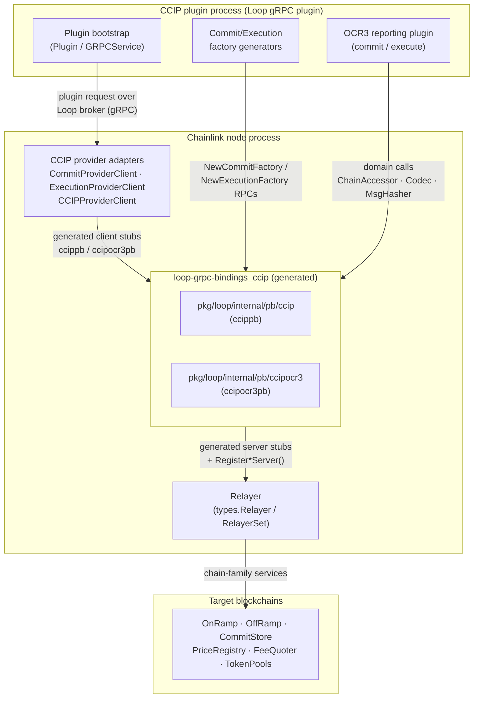
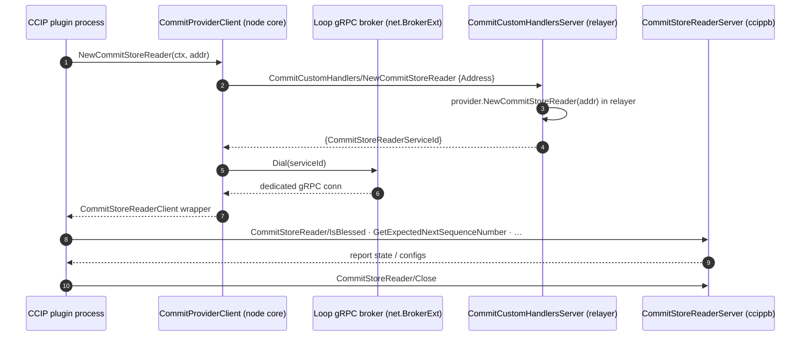
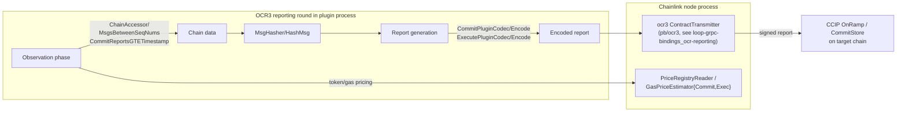
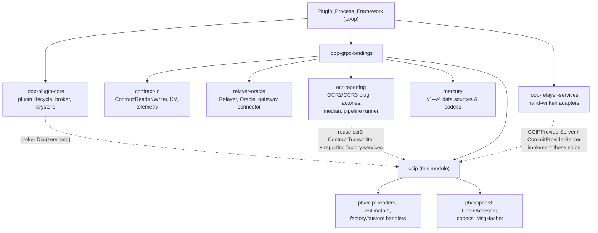

# loop-grpc-bindings_ccip

## Introduction

`loop-grpc-bindings_ccip` is the CCIP (Cross-Chain Interoperability Protocol) portion of the Loop gRPC binding surface. It contains the **generated protobuf/gRPC code** that allows CCIP reporting plugins — which run as separate OS processes under the [Loop plugin framework](../loop-plugin-core.md) — to consume chain data and codec services hosted by the Chainlink node.

The module lives in two generated packages:

| Package | Generation era | Wrapped domain layer |
|---|---|---|
| `chainlink-common/pkg/loop/internal/pb/ccip` (`ccippb`) | Legacy CCIP (v1.5-style readers/writers) | `chainlink-common/pkg/types/ccip` interfaces (see [types-ccip](../../CCIP_Cross-Chain_Protocol/types-ccip.md)) |
| `chainlink-common/pkg/loop/internal/pb/ccipocr3` (`ccipocr3pb`) | CCIP OCR3 / CCIP v2 plugin | `chainlink-common/pkg/types/ccipocr3` interfaces (see [types-ccip](../../CCIP_Cross-Chain_Protocol/types-ccip.md)) |

Every generated file follows the same shape: a `*Client` interface (used by the node core to call out to a relayer service), a `*Server` interface (implemented by hand-written adapters inside the plugin/relayer), `Unimplemented*Server` / `Unsafe*Server` embedding markers for forward compatibility, per-method handler dispatchers, and a `grpc.ServiceDesc` for registration. **All services are unary** (`Streams: []grpc.StreamDesc{}`) and all client calls are issued with `grpc.StaticMethod()`.

> This page documents the generated bindings only. The hand-written client/server adapters that implement these interfaces on top of a real relayer are covered in [loop-relayer-services](../loop-relayer-services.md). For an overview of all binding groups see [loop-grpc-bindings](../loop-grpc-bindings.md); the sibling groups are [contract-io](loop-grpc-bindings_contract-io.md), [relayer-oracle](loop-grpc-bindings_relayer-oracle.md), [ocr-reporting](loop-grpc-bindings_ocr-reporting.md), and [mercury](loop-grpc-bindings_mercury.md).

---

## Architecture

The bindings form the *wire contract* between three participants:

1. **Chainlink node core (client side)** — the relayer creates gRPC *clients* from these bindings (`NewCommitStoreReaderClient`, `NewOffRampReaderClient`, …) so that a CCIP plugin executing in a child process can call back into the node for chain reads and codec work.
2. **CCIP plugin process (server side)** — during plugin bootstrap, the node's relayer implementation registers the corresponding gRPC *servers* backed by real domain objects (contract readers, gas estimators, codecs). Registration happens in `RegisterCommitProviderServices` / `RegisterExecutionProviderServices` (legacy `ccip`) and `RegisterProviderServices` (OCR3 `ccipocr3`).
3. **Target blockchain** — the domain objects behind the servers ultimately read/write the CCIP on-ramp, off-ramp, commit store, price registry, fee quoter, and token pool contracts via the chain-family relayers described in [loop-relayer-services](../loop-relayer-services.md) and [CCIP chain codecs](../../CCIP_Cross-Chain_Protocol/ccip/ccip_chain_codecs.md).

The direction of the gRPC calls is notable: although the *node* launches the *plugin*, the data services flow the other way. The plugin process acts as the gRPC **client** of the readers/codecs, while the node process hosts the gRPC **servers** that proxy to its relayer. The plugin *implements* the `ocr3_reporting` plugin interfaces (see [loop-grpc-bindings_ocr-reporting](loop-grpc-bindings_ocr-reporting.md)), which the node calls in the opposite direction over the same connection.

---

## Component map

### `pb/ccip` — legacy CCIP services (package `ccippb`)

These services adapt the `chainlink-common/pkg/types/ccip` contract-reader interfaces (see [types-ccip → ramp contracts](../../CCIP_Cross-Chain_Protocol/types-ccip/types-ccip_ramp_contracts.md)). All end with a `Close` RPC to release broker resources.

| gRPC service (full name `loop.internal.pb.ccip.<Service>`) | Core component | Wrapped interface | Methods | Purpose |
|---|---|---|---|---|
| `CommitStoreReader` | `UnsafeCommitStoreReaderServer` | `types/ccip.CommitStoreReader` | 15 | Blessing / commit-report state on the destination chain: `IsBlessed`, `IsDown`, `IsDestChainHealthy`, `GetAcceptedCommitReportsGteTimestamp`, `DecodeCommitReport`/`EncodeCommitReport`, `VerifyExecutionReport`, static/offchain config, sequence numbers, and the nested `GetCommitGasPriceEstimator`. |
| `OffRampReader` | `UnsafeOffRampReaderServer` | `types/ccip.OffRampReader` | 16 | Destination-chain execution state: `GetExecutionState(Changes)`, `CurrentRateLimiterState`, `GetSourceToDestTokensMapping`, `ListSenderNonces`, encode/decode execution reports, router address, token metadata, on/offchain config. |
| `OnRampReader` | `UnsafeOnRampReaderServer` | `types.OnRampReader` | 8 | Source-chain message ingestion: `GetSendRequestsBetweenSeqNums`, `GetDynamicConfig`, `IsSourceChainHealthy`, `IsSourceCursed`, router and source price-registry addresses. |
| `GasPriceEstimatorExec` | `UnsafeGasPriceEstimatorExecServer` | `types/ccip.GasPriceEstimatorExec` | 4 | Execution-side gas economics: `GetGasPrice`, `DenoteInUSD`, `EstimateMsgCostUSD`, `Median`. |
| `GasPriceEstimatorCommit` | `UnsafeGasPriceEstimatorCommitServer` | `types/ccip.GasPriceEstimatorCommit` | 4 | Commit-side gas economics: `GetGasPrice`, `DenoteInUSD`, `Median`, `Deviates`. |
| `PriceGetter` | `UnsafePriceGetterServer` | `types/ccip.PriceGetter` | 3 | Legacy token price feed: `TokenPricesUSD`, `FilterConfiguredTokens`. |
| `PriceRegistryReader` | `UnsafePriceRegistryReaderServer` | `types/ccip.PriceRegistryReader` | 8 | Price registry reads: token/gas price updates created after a timestamp, fee tokens, token decimals, registry address. |
| `TokenDataReader` | `UnsafeTokenDataReaderServer` | `types/ccip.TokenDataReader` | 2 | `ReadTokenData` (e.g., CCTP message payloads) for a token address. |
| `TokenPoolBatcherReader` | `UnsafeTokenPoolBatcherReaderServer` | `types/ccip.TokenPoolBatcherReader` | 2 | `GetInboundTokenPoolRateLimits` for batched token pool reads. |

### `pb/ccip/factories` — provider factories and custom handlers

`factories_grpc.pb.go` defines the *resource-lifecycle* services. They let a plugin request that the node construct a new reader (which the relayer binds to a specific contract address) and receive a broker **service ID** that resolves to a dedicated gRPC connection.

| gRPC service | Core component | Methods | Purpose |
|---|---|---|---|
| `CommitFactoryGenerator` | `UnsafeCommitFactoryGeneratorServer` | 1 (`NewCommitFactory`) | Constructs the commit plugin factory inside the node on behalf of the plugin bootstrap. |
| `ExecutionFactoryGenerator` | `UnsafeExecutionFactoryGeneratorServer` | 1 (`NewExecutionFactory`) | gRPC adapter for the CCIP execution reporting plugin factory (`ccipexec.NewExecutionReportingPluginFactory`). |
| `CommitCustomHandlers` | `UnsafeCommitCustomHandlersServer` | 7 (`NewCommitStoreReader`, `NewOffRampReader`, `NewOnRampReader`, `NewPriceGetter`, `NewPriceRegistryReader`, `SourceNativeToken`, `Close`) | Custom resource-generation requests for `types.CCIPCommitProvider`. |
| `ExecutionCustomHandlers` | `UnsafeExecutionCustomHandlersServer` | 9 (`GetTransactionStatus`, `NewCommitStoreReader`, `NewOffRampReader`, `NewOnRampReader`, `NewPriceRegistryReader`, `NewTokenDataReader`, `NewTokenPoolBatchedReader`, `SourceNativeToken`, `Close`) | Custom resource-generation requests for `types.CCIPExecProvider`. |

These handlers are the gRPC mirror of the domain interfaces [`CCIPCommitProvider`](../../Shared_Foundation_Libraries___Domain_Types/types-core.md) and `CCIPExecProvider` — the provider interfaces that CCIP job specs are validated against (see [CCIP job validation](../../CCIP_Cross-Chain_Protocol/ccip/ccip_job_validation.md)).

### `pb/ccipocr3` — CCIP OCR3 plugin services (package `ccipocr3pb`)

These services adapt the consolidated `chainlink-common/pkg/types/ccipocr3` plugin types used by the OCR3-era CCIP plugins (see [types-ccip → OCR3 plugin types](../../CCIP_Cross-Chain_Protocol/types-ccip/types-ccip_ocr3_plugin_types.md)).

| gRPC service (full name `loop.internal.pb.ccipocr3.<Service>`) | Core component | Wrapped interface | Methods | Purpose |
|---|---|---|---|---|
| `ChainAccessor` | `UnsafeChainAccessorServer` | `ccipocr3.ChainAccessor` | 18 | The single chain-access facade for OCR3 plugins, grouped by role: **AllAccessors** (`GetContractAddress`, `GetAllConfigsLegacy`, `GetChainFeeComponents`, `Sync`), **DestinationAccessor** (`CommitReportsGTETimestamp`, `ExecutedMessages`, `NextSeqNum`, `Nonces`, `GetChainFeePriceUpdate`, `GetLatestPriceSeqNr`), **SourceAccessor** (`MsgsBetweenSeqNums`, `LatestMessageTo`, `GetExpectedNextSequenceNumber`, `GetTokenPriceUSD`, `GetFeeQuoterDestChainConfig`), **USDCMessageReader** (`MessagesByTokenID`), **PriceReader** (`GetFeedPricesUSD`, `GetFeeQuoterTokenUpdates`). |
| `ChainSpecificAddressCodec` | `UnsafeChainSpecificAddressCodecServer` | `ccipocr3.ChainSpecificAddressCodec` | 4 | Chain-family address conversion: bytes↔string, `OracleIDAsAddressBytes`, `TransmitterBytesToString`. |
| `CommitPluginCodec` | `UnsafeCommitPluginCodecServer` | `ccipocr3.CommitPluginCodec` | 2 | Encode/decode commit-plugin reports for the destination chain family (e.g., ABI encoding on EVM). |
| `ExecutePluginCodec` | `UnsafeExecutePluginCodecServer` | `ccipocr3.ExecutePluginCodec` | 2 | Encode/decode execute-plugin reports (`ExecutePluginReport`). |
| `TokenDataEncoder` | `UnsafeTokenDataEncoderServer` | `ccipocr3.TokenDataEncoder` | 1 | `EncodeUSDC` — builds offchain token data (CCTP) attached to messages. |
| `SourceChainExtraDataCodec` | `UnsafeSourceChainExtraDataCodecServer` | `ccipocr3.SourceChainExtraDataCodec` | 2 | `DecodeExtraArgsToMap`, `DecodeDestExecDataToMap` for source-chain-specific fields. |
| `ExtraDataCodecBundle` | `UnsafeExtraDataCodecBundleServer` | bundle of extra-data codecs | 2 | Chain-selector-dispatched decoding: `DecodeExtraArgs`, `DecodeTokenAmountDestExecData`. |
| `MsgHasher` | `UnsafeMsgHasherServer` | `ccipocr3.MessageHasher` | 1 | `HashMsg` — chain-family message hashing (e.g., keccak256 + ABI on EVM) used for OCR3 signature binding. |

The chain-family *implementations* behind the codec and hasher servers (EVM, Solana, Sui, Aptos, noop) live in the CCIP module itself — see [ccip_chain_codecs](../../CCIP_Cross-Chain_Protocol/ccip/ccip_chain_codecs.md) and [ccip_chain_rw_providers](../../CCIP_Cross-Chain_Protocol/ccip/ccip_chain_rw_providers.md).

---

## Reader factory lifecycle

The distinctive mechanic of this module is how per-contract readers are created lazily across the process boundary. A factory RPC does not return data — it returns a **service ID** into the shared Loop gRPC broker, which the client then dials to obtain a connection to a freshly spawned child service (implemented with one of the reader bindings above).

Key implementation notes (from `ext/ccip/commit_provider.go`):

- The response field names vary per factory (`CommitStoreReaderServiceId`, `OfframpReaderServiceId`, `OnrampReaderServiceId`, `PriceGetterServiceId`), and each is dialed through the **shared broker** so resources spawned by an embedded relayer can be proxied (see the `BCF-3061` notes in the source).
- `GetTransactionStatus` (execution side) is a plain data RPC — it queries transaction state rather than spawning a service.
- Every spawned reader carries its own `Close` RPC so the plugin can release broker slots deterministically.

---

## Data flow: from plugin round to chain

Legend of the roles the bindings play in a round:

1. **Observation** — the plugin pulls source messages via `ChainAccessor` (`pb/ccipocr3`) or `OnRampReader` (`pb/ccip`), and commit state via `CommitReportsGTETimestamp` / `GetAcceptedCommitReportsGteTimestamp`.
2. **Pricing** — fee math uses `GasPriceEstimatorExec/Commit`, `PriceGetter`, `PriceRegistryReader`, and `ChainAccessor/GetFeeQuoter*` endpoints.
3. **Encoding & hashing** — report bytes are produced by `CommitPluginCodec`, `ExecutePluginCodec`, `TokenDataEncoder`, and bound to a signature domain by `MsgHasher`.
4. **Transmission** — the encoded, signed report leaves via the OCR3 `ContractTransmitter` binding (shared with the general OCR reporting group, see [loop-grpc-bindings_ocr-reporting](loop-grpc-bindings_ocr-reporting.md)).

---

## Code generation and build integration

All files are generated — never edit them by hand:

- **Generators**: `protoc-gen-go-grpc v1.5.1`, `protoc v5.29.3`; output requires **gRPC-Go ≥ v1.64** (`const _ = grpc.SupportPackageIsVersion9`).
- **Source directives**: `chainlink-common/pkg/loop/internal/pb/ccip/generate.go` carries one `//go:generate protoc …` line per proto (`commitstore.proto`, `gaspriceestimator.proto`, `models.proto`, `offramp.proto`, `onramp.proto`, `pricegetter.proto`, `priceregistry.proto`, `tokendata.proto`, `tokenpool.proto`, `factories.proto`). The `ccipocr3` protos (`chainaccessor.proto`, `codec.proto`, `msghasher.proto`, `reportcodec.proto`) follow the same pattern.
- **Make target**: `make generate` in [`chainlink-common/Makefile`](../../Build,_CI___Release_Infrastructure/build-and-repo-tooling.md) (file `chainlink-common/Makefile`) runs `mockery`, `install-protoc` (versions pinned in `.tool-versions`), then `go generate ./...`, which regenerates every `*.pb.go` in this module.
- **Wire compatibility**: service names are namespaced `loop.internal.pb.ccip.<Service>` and `loop.internal.pb.ccipocr3.<Service>`; since all RPCs are unary, adding methods requires regenerating both sides of a deployed node+plugin pair, so plugin binaries and node versions must be kept compatible (the Loop framework's `Unimplemented*Server` embedding turns missing methods into runtime `codes.Unimplemented` errors instead of crashes).

### Forward-compatibility markers

Each generated service exposes two optional embedding interfaces:

| Marker | Behavior |
|---|---|
| `Unimplemented<service>Server` | Recommended: new methods added to the interface get default `Unimplemented` responses, so older servers keep compiling. |
| `Unsafe<service>Server` | Opt-out: any interface change breaks compilation. The module tree tracks the `Unsafe*Server` symbols because they are the canonical, most-strict server surfaces; concrete adapters embed them to fail fast at build time. |

---

## Development workflow

The module is consumed via a strict five-step contract (documented in `chainlink-common/pkg/loop/internal/relayer/pluginprovider/ext/ccip/README.md`):

1. **Update the Go interface** in `chainlink-common/pkg/types` / `pkg/types/ccip` (or `ccipocr3`).
2. **Mirror it as protobuf** under `pkg/loop/internal/pb/ccip` (interface ↔ `service`, struct ↔ `message`) and regenerate with `make generate`.
3. **Implement the adapter pair** (`<Interface>GRPCClient` / `<Interface>GRPCServer`) in `pkg/loop/internal/relayer/pluginprovider/ext/ccip` (or `ext/ccipocr3`) — covered in [loop-relayer-services](../loop-relayer-services.md).
4. **Guard with round-trip tests**: the client side fails to compile on interface drift, but the *server* side silently returns runtime `Unimplemented` — the per-RPC roundtrip tests in `ext/ccip/test` and `ext/ccipocr3/test` exist specifically to catch this.
5. **Release cross-module**: dependent repos (e.g., the CCIP plugin repo) consume `chainlink-common` by version; co-development uses a `go workspace` (see [Build/CI release tooling](../../Build,_CI___Release_Infrastructure/build-and-repo-tooling.md) for module release scripts).

---

## Relationship to the rest of the Loop framework

- **Consumers of the domain interfaces**: the CCIP oracle implementations in [CCIP → common interfaces](../../CCIP_Cross-Chain_Protocol/ccip/ccip_common_interfaces.md) and the OCR transmitters in [CCIP → OCR transmitters](../../CCIP_Cross-Chain_Protocol/ccip/ccip_ocr_transmitters.md) are what the server adapters delegate to.
- **Provider contract**: the commit/execution custom-handler services mirror [`CCIPCommitProvider` / `CCIPExecProvider` / `CCIPFactoryGenerator`](../../Shared_Foundation_Libraries___Domain_Types/types-core.md) from the shared type library.
- **Sibling services**: relayers for each chain family (EVM, Aptos, Solana, Stellar, TON) built on the same broker/resource pattern are documented in [loop-relayer-services](../loop-relayer-services.md).
