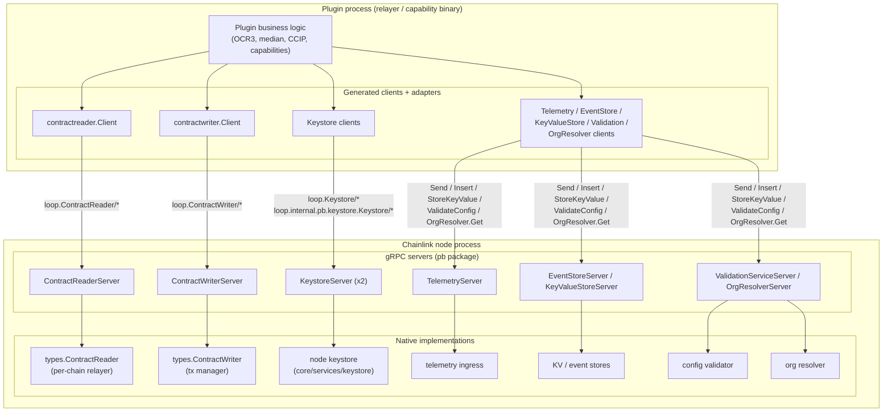
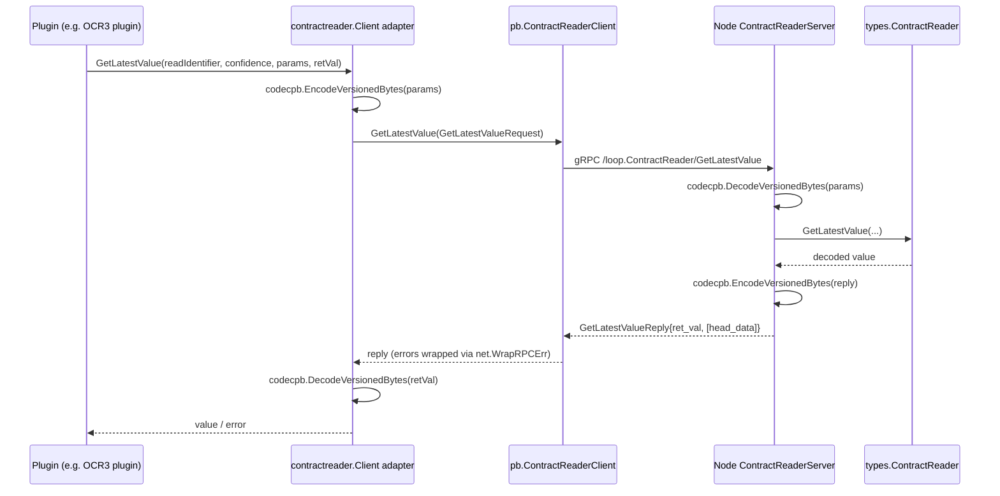
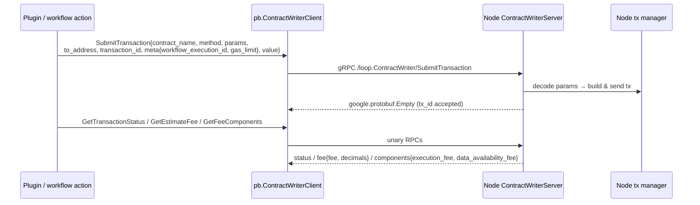
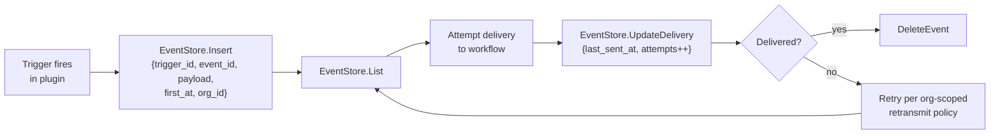
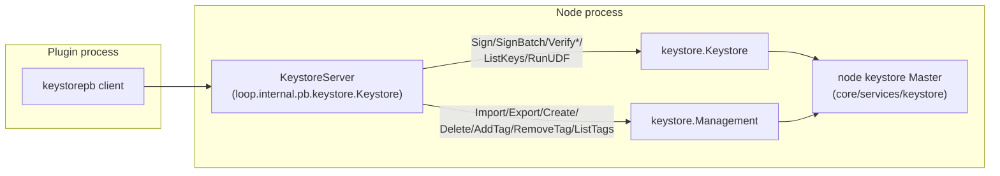
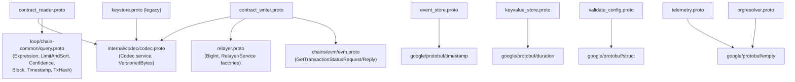

# loop-grpc-bindings: Contract I/O Bindings

The **contract-io** module defines the protobuf schemas and generated gRPC bindings for the *contract input/output surface* of the [Loop plugin framework](../loop-grpc-bindings.md). It is the part of `chainlink-common/pkg/loop/internal/pb` that plugins use to **read on-chain state, submit transactions, persist trigger events, store key/value data, sign and verify with keys, emit telemetry, validate configs, and resolve organizations** — all by making gRPC calls back into the Chainlink node process.

The module contains the hand-written `.proto` service definitions and their `protoc`-generated counterparts (`*_grpc.pb.go`). It deliberately contains **no business logic**: every service here is a wire-level mirror of a Go interface in [types-core](../../Shared_Foundation_Libraries___Domain_Types/types-core.md), and the translation between the two happens in the adapter layer documented in [loop-relayer-services](../loop-relayer-services.md) and [loop-plugin-core](../loop-plugin-core.md).

> Parent page: [loop-grpc-bindings](../loop-grpc-bindings.md) · Framework overview: [Plugin_Process_Framework_(Loop)](../../Plugin_Process_Framework_(Loop).md)

---

## 1. Service catalog

| gRPC service (full method prefix) | Proto source | Purpose | Mirrors Go interface |
|---|---|---|---|
| `loop.ContractReader` | `chainlink-common/pkg/loop/internal/pb/contract_reader.proto` | Read latest / batched / queried values from contracts | `types.ContractReader` |
| `loop.ContractWriter` | `chainlink-common/pkg/loop/internal/pb/contract_writer.proto` | Submit transactions, query status and fee estimates | `types.ContractWriter` |
| `loop.EventStore` | `chainlink-common/pkg/loop/internal/pb/event_store.proto` | Durable pending-event queue for trigger retransmission | plugin-side trigger event store |
| `loop.KeyValueStore` | `chainlink-common/pkg/loop/internal/pb/keyvalue_store.proto` | Generic key/value storage with TTL pruning | — |
| `loop.Keystore` *(legacy)* | `chainlink-common/pkg/loop/internal/pb/keystore.proto` | Account-based sign/decrypt for classic plugins | `loop.Keystore` |
| `loop.internal.pb.keystore.Keystore` *(current)* | `chainlink-common/pkg/loop/internal/pb/keystore/keystore.proto` | Full key lifecycle: sign, verify, import/export, tags, UDF | `types/keystore.Keystore` + `types/keystore.Management` |
| `loop.Telemetry` | `chainlink-common/pkg/loop/internal/pb/telemetry.proto` | Ship telemetry payloads to the node's ingress | `core.TelemetryClient` |
| `loop.ValidationService` | `chainlink-common/pkg/loop/internal/pb/validate_config.proto` | Validate relay/plugin configuration | `core.ValidationService` |
| `loop.OrgResolver` | `chainlink-common/pkg/loop/internal/pb/orgresolver.proto` | Map a workflow owner to a CRE organization id | `services/orgresolver.OrgResolver` |

All services are **unary RPCs only** (no streaming). All service definitions live in the `loop` protobuf package (except the current keystore, in `loop.internal.pb.keystore`), and all generated files were produced with `protoc-gen-go-grpc v1.5.1` / `protoc v5.29.3`, requiring **gRPC-Go ≥ v1.64.0** (`grpc.SupportPackageIsVersion9`).

---

## 2. Position in the Loop framework

The Loop framework runs plugins (reporting plugins, chain capabilities, standard capabilities) in **separate OS processes**, communicating with the node over gRPC via a hashed-pipe broker. The contract-io services are the *inbound* half of that communication: when a plugin needs node capabilities, it calls these services. The *outbound* half (node → plugin calls into reporting plugins, oracles, pipeline runners) is covered by the sibling modules [loop-grpc-bindings_ocr-reporting](loop-grpc-bindings_ocr-reporting.md), [loop-grpc-bindings_relayer-oracle](loop-grpc-bindings_relayer-oracle.md) and [loop-grpc-bindings_ccip](loop-grpc-bindings_ccip.md).



The node hands plugin processes pre-built client bundles. Factories on the `loop.Relayer` service (see `chainlink-common/pkg/loop/internal/pb/relayer.proto`) — `NewContractReader`, `NewContractWriter`, `NewPluginProvider` — return **service IDs** that the plugin resolves into the gRPC clients described here. The full provider wiring is documented in [loop-relayer-services](../loop-relayer-services.md); the plugin/broker runtime that registers the servers is documented in [loop-plugin-core](../loop-plugin-core.md).

---

## 3. ContractReader

`chainlink-common/pkg/loop/internal/pb/contract_reader.proto` (+ `contract_reader_grpc.pb.go`) mirrors `types.ContractReader` — the read path used by reporting plugins to observe chain state.

### RPCs

| RPC | Request → Reply | Semantics |
|---|---|---|
| `GetLatestValue` | `GetLatestValueRequest` → `GetLatestValueReply` | Latest decoded value for a read identifier at a given confidence level |
| `GetLatestValueWithHeadData` | `GetLatestValueRequest` → `GetLatestValueWithHeadDataReply` | Same, plus the `Head` (height/hash/timestamp) the value was read at |
| `BatchGetLatestValues` | `BatchGetLatestValuesRequest` → `BatchGetLatestValuesReply` | Multiple contracts × multiple reads in one round trip |
| `QueryKey` | `QueryKeyRequest` → `QueryKeyReply` | Filtered, paginated query over a key (e.g. EVM log events) |
| `QueryKeys` | `QueryKeysRequest` → `QueryKeysReply` | Multi-key variant returning `SequenceWithKey` results |
| `Bind` / `Unbind` | `BindRequest`/`UnbindRequest` → `google.protobuf.Empty` | (Un)register `BoundContract`s for subsequent reads |

### Key wire types

- **`BoundContract`** `{address, name}` — gRPC adapter for `types.BoundContract`.
- **`codec.VersionedBytes`** `{version, data}` — all params and return values cross the wire as *versioned* serialized bytes (from [codec](../../Shared_Foundation_Libraries___Domain_Types/codec.md)). The version field lets client and server negotiate encoding; the Go `*values.Value` type bypasses decoding via the `as_value_type` flag on read requests.
- **`loop.chain.common.*`** — `Confidence` (`Unconfirmed`/`Finalized`/`Safe`), the `Expression` filter DSL (primitives, comparators, boolean trees) and `LimitAndSort` (cursor-based `Limit`, `SortBy`), defined in `chainlink-common/pkg/loop/chain-common/query.proto` (see [loop-plugin-core query primitives](../loop-plugin-core/loop-plugin-core_query_primitives.md)).
- **Batching** — `ContractBatch` groups `BatchRead`s (each with `read_name`, `params`, `return_val`) per contract; results come back as `ContractBatchResult` with per-read `BatchReadResult` carrying an **error string per read**, so one failing read does not fail the batch.
- **Sequences** — `Sequence` `{sequence_cursor, head, data, tx_hash}` and `SequenceWithKey` (adds `key`) mirror `types.Sequence` for event-style data.



The adapter implementation (`chainlink-common/pkg/loop/internal/relayer/pluginprovider/contractreader/contract_reader.go`) is a reference for the pattern used across the module: implement the `types.*` interface, delegate to the generated `pb.*Client`, convert Go values through the codec, and wrap transport errors with `net.WrapRPCErr` so plugin code sees actionable messages. `QueryKeys` surfaces results as a Go `iter.Seq2[string, types.Sequence]` on top of the single unary reply.

---

## 4. ContractWriter

`chainlink-common/pkg/loop/internal/pb/contract_writer.proto` (+ `contract_writer_grpc.pb.go`) is the write path used by workflow actions and plugin transmitters.

| RPC | Request → Reply | Semantics |
|---|---|---|
| `SubmitTransaction` | `SubmitTransactionRequest` → `google.protobuf.Empty` | Enqueue a contract call: `contract_name`, `method`, versioned `params`, `to_address`, `transaction_id`, `value` (`BigInt`), `TransactionMeta` |
| `GetTransactionStatus` | `loop.evm.GetTransactionStatusRequest` → `loop.evm.GetTransactionStatusReply` | Per-transaction status (types from the shared EVM proto, see [chain-grpc-protos](../../Shared_Foundation_Libraries___Domain_Types/chain-grpc-protos.md)) |
| `GetFeeComponents` | `google.protobuf.Empty` → `GetFeeComponentsReply` | `execution_fee` + `data_availability_fee` (`types.ChainFeeComponents`, e.g. L2→L1 posting cost) |
| `GetEstimateFee` | `GetEstimateFeeRequest` → `GetEstimateFeeReply` | Estimated fee with `decimals` for display/normalization |

Notable wire types:

- **`TransactionMeta`** `{workflow_execution_id, gas_limit (BigInt)}` — mirrors `types.TxMeta`; `workflow_execution_id` attributes the spend to a Keystone/CRE workflow, and `gas_limit` optionally overrides the node's default (implementations that don't support it return `ErrSettingTransactionGasLimitNotSupported`).
- **`BigInt`** — arbitrary-precision integers are defined once in `chainlink-common/pkg/loop/internal/pb/relayer.proto` as `{negative, value bytes}`, with Go helpers `NewBigIntFromInt` / `(*BigInt).Int()` in `chainlink-common/pkg/loop/internal/pb/big.go`.



---

## 5. EventStore

`chainlink-common/pkg/loop/internal/pb/event_store.proto` (+ `event_store_grpc.pb.go`) gives plugin-side triggers a **durable pending-event queue** hosted by the node, so trigger deliveries survive plugin restarts and can be retried. It complements the node-side trigger event store described in [core_capabilities_runtime_trigger_event_store](../../../Workflow___Capability_Runtime_(CRE_Engine)/core_capabilities_runtime/core_capabilities_runtime_trigger_event_store.md).

| RPC | Purpose |
|---|---|
| `Insert(InsertEventRequest)` | Persist a `PendingEventProto` |
| `UpdateDelivery(UpdateDeliveryRequest)` | Record delivery progress (`last_sent_at`, `attempts`) |
| `List(google.protobuf.Empty)` | Fetch all pending events |
| `DeleteEvent(DeleteEventRequest)` | Remove a single delivered event |
| `DeleteEventsForTrigger(DeleteEventsForTriggerRequest)` | Remove all events for a trigger (e.g. trigger deregistered) |

`PendingEventProto` carries `trigger_id`, `event_id`, `payload`, `first_at`, `last_sent_at`, `attempts`, and `org_id` — the CRE organization id of the workflow that registered the trigger, used for the **org-scoped retransmit policy** (resolution of `owner → organization_id` is exactly what the `OrgResolver` service below provides).



---

## 6. KeyValueStore

`chainlink-common/pkg/loop/internal/pb/keyvalue_store.proto` (+ `keyvalue_store_grpc.pb.go`) is a minimal, plugin-scoped persistence primitive:

| RPC | Request → Reply | Notes |
|---|---|---|
| `StoreKeyValue` | `{key, value bytes}` → `Empty` | Upsert |
| `GetValueForKey` | `{key}` → `{value}` | Lookup |
| `PruneExpiredEntries` | `{max_age (Duration)}` → `{num_pruned}` | TTL-based cleanup; returns the number of removed entries |

---

## 7. Keystore (two generations)

The module carries **two distinct keystore services**; they are not interchangeable.

### 7.1 Legacy: `loop.Keystore`

`chainlink-common/pkg/loop/internal/pb/keystore.proto` (+ `keystore_grpc.pb.go`, package `pb`) — a minimal, *account-centric* surface used by classic Loop plugins:

- `Accounts(Empty) → AccountsReply` — list account addresses (`string`).
- `Sign(SignRequest{account, data}) → SignReply{signedData}`.
- `Decrypt(DecryptRequest{account, data}) → DecryptReply{decryptedData}`.

This is the surface exposed to older plugins through `GRPCPluginKeystore` in [loop-plugin-core](../loop-plugin-core.md), which wraps it in a go-plugin service (`keystorepb.GRPCService` server-side, `keystorepb.Client` client-side).

### 7.2 Current: `loop.internal.pb.keystore.Keystore`

`chainlink-common/pkg/loop/internal/pb/keystore/keystore.proto` (+ `keystore/keystore_grpc.pb.go`, generated Go package `keystorepb`) — a *key-ID-centric* API (`bytes keyID`) that mirrors the modern keystore interfaces in [types-core](../../Shared_Foundation_Libraries___Domain_Types/types-core.md):

| Group | RPCs |
|---|---|
| Signing / verification | `Sign`, `SignBatch`, `Verify`, `VerifyBatch` |
| Key enumeration | `ListKeys(tags) → keyIDs` |
| Key lifecycle | `ImportKey(keyType, data, tags)`, `ExportKey(keyID)`, `CreateKey(keyType, tags)`, `DeleteKey(keyID)` |
| Tag management | `AddTag`, `RemoveTag`, `ListTags` |
| Extensibility | `RunUDF(name, keyID, data)` — user-defined functions, kept off the core interface for forward compatibility |

These 13 RPCs map 1:1 onto `types/keystore.Keystore` (sign/verify/list/run-UDF) and `types/keystore.Management` (import/export/create/delete/tags). The node side is backed by the [keystore service](../../Node_Platform_Services/keystore.md); the serialization format for exported keys is covered by the keystore runtime module.



---

## 8. Telemetry, ValidationService, OrgResolver

Three small single-purpose services complete the contract-io surface:

| Service | RPC | Wire payload | Backed by |
|---|---|---|---|
| `loop.Telemetry` | `Send(TelemetryMessage) → Empty` | `TelemetryMessage{RelayID{network, chainId}, contractID, telemetryType, payload}` | Node telemetry ingress ([telemetry_ingress](../../Telemetry___Observability_Platform/telemetry_ingress.md)) |
| `loop.ValidationService` | `ValidateConfig(ValidateConfigRequest) → ValidateConfigResponse` | `google.protobuf.Struct` config | `core.ValidationService` — plugins defer chain-spec validation to the node |
| `loop.OrgResolver` | `Get(GetOrganizationRequest{owner}) → GetOrganizationResponse{organization_id}` | Owner address → CRE org id | `chainlink-common/pkg/services/orgresolver` (with its gRPC-status-aware caching wrapper) |

`Telemetry` and `ValidationService` mirror `core.TelemetryClient` / `core.ValidationService` from [types-core](../../Shared_Foundation_Libraries___Domain_Types/types-core.md); they exist so plugin processes never talk to external telemetry or chain-validation endpoints directly — everything funnels through the node.

---

## 9. Shared wire-type dependencies



- **[codec](../../Shared_Foundation_Libraries___Domain_Types/codec.md)** (`chainlink-common/pkg/internal/codec/codec.proto`) — `VersionedBytes{version, data}` is the universal envelope for serialized params/results; the `Codec` service in the same proto exposes encode/decode/max-size operations to plugins that need codec access themselves.
- **query DSL** (`chainlink-common/pkg/loop/chain-common/query.proto`) — chain-agnostic filtering/pagination primitives consumed by `ContractReader.QueryKey(s)`; documented in [loop-plugin-core query primitives](../loop-plugin-core/loop-plugin-core_query_primitives.md).
- **`relayer.proto`** — besides `BigInt`, it defines the `Relayer` factory service that hands out contract reader/writer instances, and the OCR2 support services (`OffchainConfigDigester`, `ContractConfigTracker`, `ContractTransmitter`, `Service`); see [loop-grpc-bindings_relayer-oracle](loop-grpc-bindings_relayer-oracle.md).
- **`chains/evm/evm.proto`** — EVM-specific request/reply types shared with the chain gRPC protos ([chain-grpc-protos](../../Shared_Foundation_Libraries___Domain_Types/chain-grpc-protos.md)).

---

## 10. Generated-code conventions

Every `*_grpc.pb.go` in this module follows the same protoc-gen-go-grpc v1.5.1 template:

- A `<Service>Client` interface + `New<Service>Client(conn)` constructor, with one unary `Invoke` per RPC and full-method constants (`/loop.<Service>/<Method>`).
- A `<Service>Server` interface, plus **`Unimplemented<Service>Server`** which must be embedded *by value* for forward compatibility (new methods added to the proto keep older servers compiling, returning `codes.Unimplemented` at runtime).
- **`Unsafe<Service>Server`** — opt-out of forward compatibility; using it causes compile errors when the service gains methods. It exists only for strict-compatibility embedders; prefer the `Unimplemented` variant.
- `Register<Service>Server(registrar, srv)` which sanity-checks the by-value embedding and registers the `grpc.ServiceDesc` (e.g. `loop.ContractReader`, `loop.internal.pb.keystore.Keystore`).

Handlers are plain unary (`grpc.UnaryServerInterceptor`-aware) with **no streaming**, which keeps the broker protocol simple and works uniformly in-process (`ProviderServer` in [loop-plugin-core](../loop-plugin-core.md)) and cross-process (go-plugin over hashed pipes).

---

## 11. Regeneration and tooling

The bindings are generated code — edit the `.proto`, never the `*_grpc.pb.go`.

1. **Per-package codegen**: `chainlink-common/pkg/loop/internal/pb/generate.go` holds the `//go:generate` directives. Most protos are built with:
   ```
   protoc --proto_path=../../../ --go_out=../../../ --go_opt=paths=source_relative \
          --go-grpc_out=../../../ --go-grpc_opt=paths=source_relative loop/internal/pb/<file>.proto
   ```
   Notably, `contract_writer.proto` is generated through a **custom generator** (`go run ./generate_with_values contract_writer.proto`) that enriches the output with `values`-package conversions.
2. **Toolchain install**: `make -C chainlink-common install-protoc` reads pinned versions from `.tool-versions` (protoc `5.29.3`, `protoc-gen-go-grpc`), downloads the protoc release binary via `chainlink-common/script/install-protoc.sh`, and installs `protoc-gen-go` / `protoc-gen-go-grpc` from the module graph.
3. **Full generation**: `make -C chainlink-common generate` chains `mockery → install-protoc → gomods → cre-protoc → modgraph` (see `chainlink-common/Makefile`).

Because all consumers (node core in `chainlink/`, capabilities, relayers) import these generated types from the `chainlink-common` module, regenerated bindings must be committed atomically with any `.proto` change, and the gRPC-Go ≥ v1.64.0 requirement must hold across all consuming modules.

---

## 12. Related documentation

- [loop-grpc-bindings](../loop-grpc-bindings.md) — sibling binding groups: relayer/oracle, OCR reporting, CCIP, Mercury.
- [loop-plugin-core](../loop-plugin-core.md) — plugin/broker runtime, in-process serving, install tooling.
- [loop-relayer-services](../loop-relayer-services.md) — client/server adapters (e.g. `contractreader.Client`) that bridge these bindings to `types.*` interfaces.
- [types-core](../../Shared_Foundation_Libraries___Domain_Types/types-core.md) — the Go interfaces mirrored by the services in this module.
- [codec](../../Shared_Foundation_Libraries___Domain_Types/codec.md) — encoding system behind `VersionedBytes`.
- [keystore](../../Node_Platform_Services/keystore.md) — node-side keystore backing both Keystore services.
- [capabilities_pb](../../../Workflow___Capability_Runtime_(CRE_Engine)/capabilities/capabilities_pb.md) — the capability-runtime gRPC contracts, which use the same codec and query primitives.
