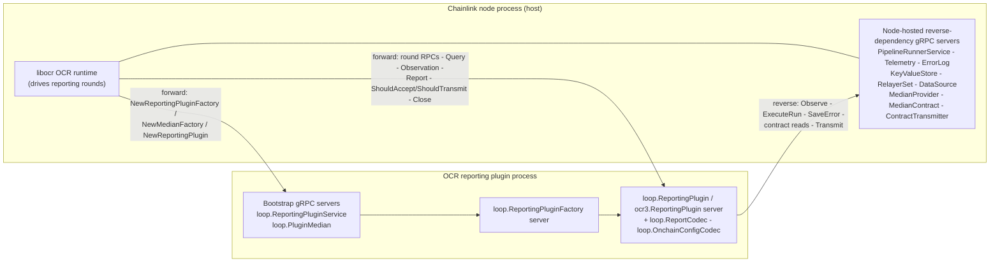
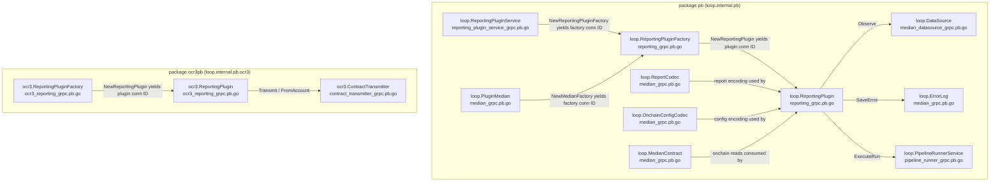
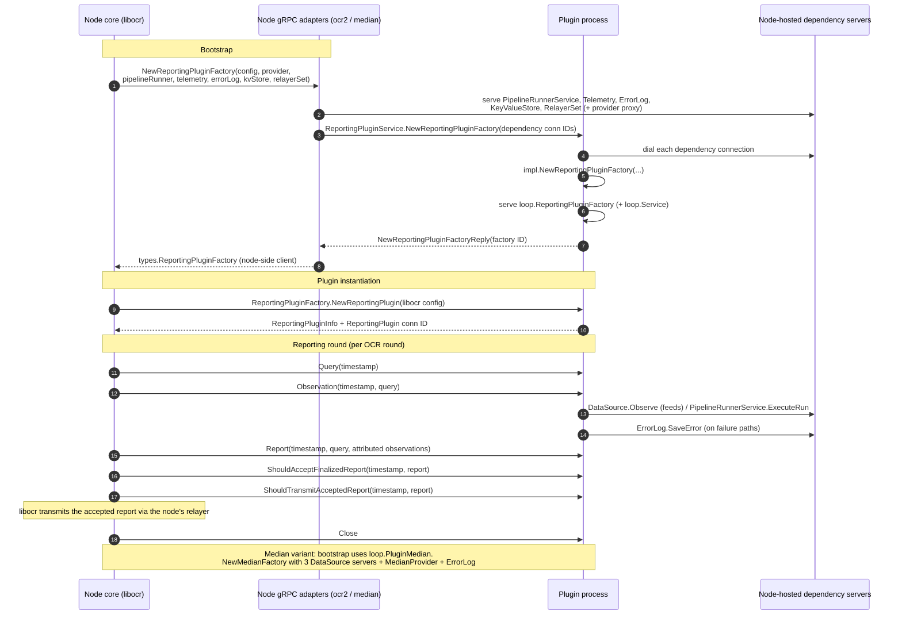
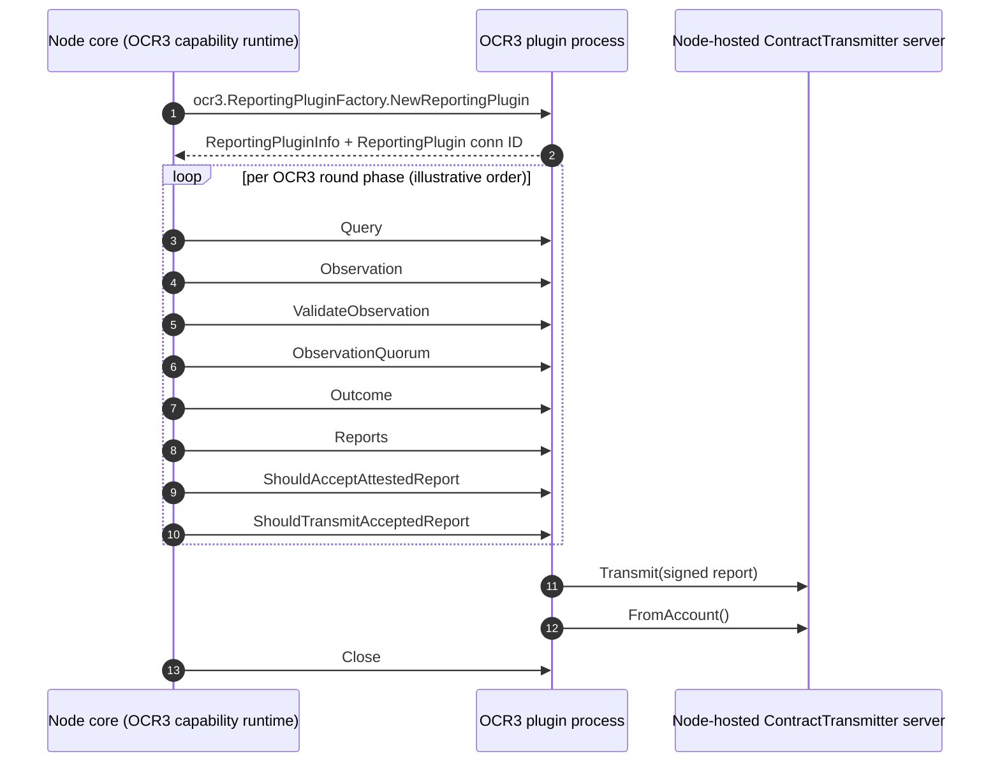

# OCR Reporting gRPC Bindings (`loop-grpc-bindings_loop-grpc-bindings_ocr-reporting`)

## Introduction

This module is the **wire-contract layer for offchain reporting (OCR) plugins** inside the [Loop plugin-process framework](../loop-grpc-bindings.md). It consists entirely of **generated gRPC binding code** (`protoc-gen-go-grpc` output, `*_grpc.pb.go` files) that defines the client/server API surface used when a Chainlink node core executes an OCR/OCR3 reporting plugin as a **separate operating-system process**.

Every OCR reporting plugin — whether a [median data feeds plugin](../../Oracle_Engines___Data_Pipelines/ocr.md), a custom OCR2 plugin, or an OCR3 plugin — interacts with the node exclusively through the RPC services declared here:

- **Node → plugin (forward calls):** bootstrap RPCs (`NewReportingPluginFactory`, `NewMedianFactory`, `NewReportingPlugin`) and the per-round reporting RPCs (`Query`, `Observation`, `Report`, …).
- **Plugin → node (reverse calls):** dependency services the node hosts for the plugin — data source observations, pipeline execution, error logging, on-chain contract reads, and report transmission.

The module contains **no hand-written logic**. It defines the protocol; the behavioral adapters that implement/consume these interfaces live in sibling modules ([loop-plugin-core](../loop-plugin-core.md) and [loop-relayer-services](../loop-relayer-services.md)) and in the node core.

### Module at a glance

| Aspect | Value |
|---|---|
| Location | `chainlink-common/pkg/loop/internal/pb/` (package `pb`) and `chainlink-common/pkg/loop/internal/pb/ocr3/` (package `ocr3pb`) |
| Content | 7 generated `*_grpc.pb.go` files covering 13 gRPC services |
| Generator | `protoc-gen-go-grpc v1.5.1`, `protoc v5.29.3` |
| gRPC compatibility | `grpc.SupportPackageIsVersion9` (requires gRPC-Go ≥ v1.64.0) |
| Wire namespaces | `loop.*` (OCR2/median/pipeline) and `loop.internal.pb.ocr3.*` (OCR3) |
| Depends on | [types-core](../../Shared_Foundation_Libraries___Domain_Types/types-core.md) domain interfaces, libocr types, [loop-plugin-core](../loop-plugin-core.md) runtime |

---

## Generated-code anatomy

All files in this module follow the identical `protoc-gen-go-grpc` template (the shared codegen pipeline is described in [Code generation and build integration](#code-generation-and-build-integration)). For each protobuf service `Xxx`, the generated file provides:

| Artifact | Role |
|---|---|
| `XxxClient` interface | The RPC surface a consumer dials. Wraps a `grpc.ClientConnInterface`; each method marshals a request message and invokes the full method name (e.g. `/loop.ReportingPlugin/Query`). |
| `NewXxxClient(cc)` constructor | Binds the client interface to a connection. |
| `XxxServer` interface | The RPC surface a provider implements. |
| `UnimplementedXxxServer` struct | **Must be embedded by value** in server implementations for forward compatibility; unimplemented methods return `codes.Unimplemented`. |
| `UnsafeXxxServer` interface | Opt-out of forward compatibility (adding methods then breaks compilation of embedders). Use is explicitly discouraged. |
| `RegisterXxxServer(s, srv)` | Registers the implementation with a `grpc.ServiceRegistrar`; performs an initialization-time panic check that `UnimplementedXxxServer` was embedded **by value**, not by pointer. |
| `_Xxx_<Method>_Handler` funcs | Per-method unary handlers with interceptor support. |
| `Xxx_ServiceDesc` | The `grpc.ServiceDesc` consumed by `grpc.RegisterService`; carries the service name and the source `.proto` file in `Metadata`. |

Two packages are involved:

- **`pb`** (`chainlink-common/pkg/loop/internal/pb`) — OCR2/generic services: `loop.ReportingPluginService`, `loop.ReportingPluginFactory`, `loop.ReportingPlugin`, `loop.PluginMedian`, `loop.ErrorLog`, `loop.ReportCodec`, `loop.MedianContract`, `loop.OnchainConfigCodec`, `loop.DataSource`, `loop.PipelineRunnerService`. Source protos: `reporting_plugin_service.proto`, `reporting.proto`, `median.proto`, `median_datasource.proto`, `pipeline_runner.proto`.
- **`ocr3pb`** (`chainlink-common/pkg/loop/internal/pb/ocr3`) — OCR3 services: `loop.internal.pb.ocr3.ReportingPluginFactory`, `loop.internal.pb.ocr3.ReportingPlugin`, `loop.internal.pb.ocr3.ContractTransmitter`. Source protos: `ocr3_reporting.proto`, `contract_transmitter.proto`.

> Note: `reporting_grpc.pb.go` also ships `UnimplementedReportingPluginFactoryServer` / `UnimplementedReportingPluginServer` (in addition to the `Unsafe…` variants), because the OCR2 reporting surface is versioned for forward compatibility like every other service here.

---

## Architecture

### Process topology and call directions

The Loop framework runs reporting plugins as isolated processes communicating over gRPC (via the hashicorp-go-plugin broker described in [loop-plugin-core](../loop-plugin-core.md)). This module supplies the *protocol* for both call directions; the diagram below shows which side serves and which side calls each service group.

### Direction-of-call matrix

| gRPC service (wire name) | Served by | Consumed by | Purpose |
|---|---|---|---|
| `loop.ReportingPluginService` | plugin binary | node core | Generic OCR2 plugin bootstrap: create a `ReportingPluginFactory` or a `ValidationService` |
| `loop.PluginMedian` | plugin binary | node core | Median-specific bootstrap: create a median `ReportingPluginFactory` |
| `loop.ReportingPluginFactory` | plugin process | node core | Instantiate one reporting plugin per OCR config |
| `loop.ReportingPlugin` | plugin process | node core | OCR2 round lifecycle |
| `loop.ReportCodec` | plugin process | node/plugin peers | gRPC adapter of libocr `median.ReportCodec` (`BuildReport`, `MedianFromReport`, `MaxReportLength`) |
| `loop.OnchainConfigCodec` | plugin process | node/plugin peers | Encode/decode chain-specific onchain config |
| `loop.DataSource` | node core | plugin | Feed observations for median data sources (price feeds, gas price, juels-per-fee-coin) |
| `loop.ErrorLog` | node core | plugin | Persist plugin error logs into the node's error log store |
| `loop.MedianContract` | node core | plugin | On-chain reads: `LatestTransmissionDetails`, `LatestRoundRequested` |
| `loop.PipelineRunnerService` | node core | plugin | Execute a [pipeline run](../../Oracle_Engines___Data_Pipelines/pipeline/pipeline_execution_engine.md) |
| `ocr3.ReportingPluginFactory` | plugin process | node core | OCR3 factory bootstrap |
| `ocr3.ReportingPlugin` | plugin process | node core | OCR3 round lifecycle (extended protocol) |
| `ocr3.ContractTransmitter` | node core | plugin | Transmit signed OCR3 reports on-chain; resolve transmitter account |

---

## Service catalog

### 1. `loop.ReportingPluginService` — generic OCR2 bootstrap
**File:** `reporting_plugin_service_grpc.pb.go` · **Component:** `UnsafeReportingPluginServiceServer`

The top-level entry point of any OCR2 reporting plugin binary. It mirrors the Go interface `core.ReportingPluginServer[T types.PluginProvider]` in [types-core](../../Shared_Foundation_Libraries___Domain_Types/types-core.md):

| RPC | Request → Reply | Semantics |
|---|---|---|
| `NewReportingPluginFactory` | `NewReportingPluginFactoryRequest` → `NewReportingPluginFactoryReply` | Creates a reporting plugin factory. The request carries a `ReportingPluginServiceConfig` (`ProviderType`, `Command`, `PluginName`, `TelemetryType`, `PluginConfig`) plus **connection IDs** for node-hosted dependencies: `ProviderID`, `ErrorLogID`, `PipelineRunnerID`, `TelemetryID`, `KeyValueStoreID`, `RelayerSetID`. The reply carries the connection ID of a freshly served `loop.ReportingPluginFactory`. |
| `NewValidationService` | `ValidationServiceRequest` → `ValidationServiceResponse` | Creates a `ValidationService` for job/OCR config validation (see `core.ValidationService.ValidateConfig`), returning its connection ID. |

### 2. `loop.PluginMedian` — median bootstrap
**File:** `median_grpc.pb.go` · **Component:** `UnsafePluginMedianServer`

A single RPC, `NewMedianFactory`, specialized for median data-feeds plugins. The node client (`loop/internal/reportingplugin/median.PluginMedianClient`) hosts **three** `loop.DataSource` servers (primary data source, juels-per-fee-coin, gas-price subunits), a `MedianProvider` server, and an `ErrorLog` server, then passes their connection IDs in `NewMedianFactoryRequest` along with `ContractID` and a JSON-serialized `DeviationFuncDefinition`. The plugin dials those dependencies, builds its libocr median factory, and serves back a `loop.ReportingPluginFactory` connection ID (returned in `NewMedianFactoryReply.ReportingPluginFactoryID`).

### 3. `loop.ReportingPluginFactory` / `loop.ReportingPlugin` — OCR2 round protocol
**File:** `reporting_grpc.pb.go` · **Components:** `UnsafeReportingPluginFactoryServer`, `UnsafeReportingPluginServer`, `UnimplementedReportingPluginFactoryServer`, `UnimplementedReportingPluginServer`

These two services are the gRPC mirror of libocr's `ReportingPluginFactory` and `ReportingPlugin` (the factory additionally extends `core.ReportingPluginFactory` from [types-core](../../Shared_Foundation_Libraries___Domain_Types/types-core.md)):

- `ReportingPluginFactory.NewReportingPlugin` — input: a full `ReportingPluginConfig` (32-byte `ConfigDigest`, `OracleID`, `N`, `F`, onchain/offchain config, estimated round interval and per-phase max durations); output: `ReportingPluginInfo` (name, unique-reports flag, query/observation/report length limits) plus the connection ID of a new `loop.ReportingPlugin` server.
- `ReportingPlugin` round RPCs:

| RPC | Purpose |
|---|---|
| `Query` | Produce the round query (`ReportTimestamp` in → `Query` out) |
| `Observation` | Produce this oracle's observation (`ReportTimestamp`, `Query` in → `Observation` out) |
| `Report` | Build a candidate report from attributed observations (→ `ShouldReport`, `Report`) |
| `ShouldAcceptFinalizedReport` | Consensus gate: accept a finalized report |
| `ShouldTransmitAcceptedReport` | Consensus gate: transmit an accepted report |
| `Close` | Release plugin resources (`emptypb.Empty` in/out) |

The RPC messages carry libocr primitives directly (`ReportTimestamp`, `Query`, `Observation`, `Report`, `AttributedObservation` with an `Observer` oracle ID validated against `uint8` bounds by the adapters).

### 4. Median companion services (in `median_grpc.pb.go` / `median_datasource_grpc.pb.go`)

These services factor the libocr *median plugin dependencies* into standalone RPC surfaces so that plugin logic (codecs) and node capabilities (chain access, storage) can live on opposite sides of the process boundary:

- **`loop.ReportCodec`** (`UnsafeReportCodecServer`) — `BuildReport`, `MedianFromReport`, `MaxReportLength`; documented in the generated code as "gRPC adapter of libocr `median.ReportCodec`". Encodes plugin-specific report formats.
- **`loop.OnchainConfigCodec`** (`UnsafeOnchainConfigCodecServer`) — `Encode`/`Decode` of chain-specific onchain configuration payloads.
- **`loop.MedianContract`** (`UnsafeMedianContractServer`) — `LatestTransmissionDetails`, `LatestRoundRequested`; hosted by the node because it wraps on-chain aggregator reads the plugin process cannot perform itself.
- **`loop.DataSource`** (`median_datasource_grpc.pb.go`, `UnsafeDataSourceServer`) — single `Observe` RPC returning a data-source observation; the node wraps each median data source (`median.DataSource`) in one server instance.
- **`loop.ErrorLog`** (`UnsafeErrorLogServer`) — `SaveError`; lets the plugin persist error-log entries (`core.ErrorLog`) into the node's error store.

### 5. OCR3 services (`ocr3pb` package)

**Files:** `ocr3/ocr3_reporting_grpc.pb.go`, `ocr3/contract_transmitter_grpc.pb.go` · **Components:** `UnsafeReportingPluginFactoryServer`, `UnsafeReportingPluginServer`, `UnsafeContractTransmitterServer` (in `ocr3pb`)

The OCR3 protocol is a distinct wire namespace (`loop.internal.pb.ocr3.*`) with an **extended round lifecycle** compared to OCR2:

| RPC (on `ocr3.ReportingPlugin`) | OCR2 analogue / role |
|---|---|
| `Query` | Same role as OCR2 |
| `Observation` | Same role as OCR2 |
| `ValidateObservation` | **OCR3-only:** reject invalid observations from other oracles |
| `ObservationQuorum` | **OCR3-only:** quorum check over observations |
| `Outcome` | **OCR3-only:** compute round outcome from previous outcome + observations |
| `Reports` | Replaces OCR2 `Report`: generate report(s) from an outcome |
| `ShouldAcceptAttestedReport` | Accept gate for attested reports (replaces `ShouldAcceptFinalizedReport`) |
| `ShouldTransmitAcceptedReport` | Same role as OCR2 |
| `Close` | Same role as OCR2 |

`ocr3.ReportingPluginFactory.NewReportingPlugin` mirrors the OCR2 factory RPC with the OCR3 request/reply messages. **`ocr3.ContractTransmitter`** (`Transmit`, `FromAccount`) is the OCR3 counterpart of the transmission capability: the OCR3 reporting plugin invokes it to push an attested, signed report on-chain via the node's chain writer/keystore, and to resolve the transmitter's on-chain account identity.

### 6. `loop.PipelineRunnerService`
**File:** `pipeline_runner_grpc.pb.go` · **Component:** `UnsafePipelineRunnerServiceServer`

A single RPC, `ExecuteRun` (`RunRequest` → `RunResponse`). It exposes the node's [pipeline execution engine](../../Oracle_Engines___Data_Pipelines/pipeline/pipeline_execution_engine.md) (`core.PipelineRunnerService`, configured via `core.Options{MaxTaskDuration}`) to the plugin process, so a reporting plugin can evaluate arbitrary pipeline specs — for example fetching auxiliary data — inside the round lifecycle.

---

## Data flow

### Instantiation / component graph

Solid arrows are RPC calls; the labeled instantiations show how bootstrap RPCs *return connection IDs* that are later dialed.

### OCR2 reporting plugin: bootstrap and round lifecycle

Verified wiring (node-side clients in `loop/internal/core/services/reportingplugin/ocr2`, median variant in `loop/internal/reportingplugin/median`):

The median bootstrap flow differs only in step 3–4: the node serves three `loop.DataSource` servers (primary feed, `JuelsPerFeeCoinDataSource`, `GasPriceSubunitsDataSource`), a `MedianProvider` (or a gRPC proxy when the provider is itself remote), and `ErrorLog`; the plugin-side `pluginMedianServer` dials each, fails **closed** (closing already-dialed resources) on any dial error, then serves the resulting `ReportingPluginFactory`.

### OCR3 reporting round

> The diagram illustrates the RPC surface of `ocr3.ReportingPlugin`; libocr drives the exact phase ordering at runtime.

---

## Resource and connection lifecycle patterns

Although this module is generated code, the protocol it encodes implies the connection management discipline its consumers must follow (implemented by adapters in [loop-plugin-core](../loop-plugin-core.md) and [loop-relayer-services](../loop-relayer-services.md)):

1. **Dependency injection by connection ID.** Bootstrap RPCs never pass service objects; they pass *numeric connection IDs* of services the caller is hosting on its gRPC server. The callee dials each ID through the plugin broker. For OCR2 this covers `Provider`, `PipelineRunner`, `Telemetry`, `ErrorLog`, `KeyValueStore`, and `RelayerSet`; for median it covers `DataSource` ×3, `MedianProvider`, and `ErrorLog`.
2. **Fail-closed teardown.** Adapters dial dependencies in order and, on the first failure, close all previously dialed resources before returning an error (`net.ErrConnDial`). Generated handlers never do this themselves — it is a contract the server adapters must honor.
3. **Nested serving.** Every successful bootstrap returns the connection ID of a newly served factory/plugin, itself registered alongside a `loop.Service` lifecycle server (via `goplugin.ServiceServer`) so the node can manage the remote object's `Start`/`Close` health.
4. **Forward compatibility.** Implementations embed `UnimplementedXxxServer` **by value**; `RegisterXxxServer` panics at registration time if it was embedded by pointer (which would nil-deref at runtime). `UnsafeXxxServer` exists only for opting out and is discouraged.
5. **Unary-only transport.** All services in this module are unary (`Streams: []grpc.StreamDesc{}`), with `grpc.StaticMethod` call options on clients; long-running work (pipeline runs, contract reads) happens *within* a unary call under the caller's context deadline (`Options.MaxTaskDuration` for pipeline runs).

---

## Code generation and build integration

These files are regenerated, never hand-edited (`// Code generated by protoc-gen-go-grpc. DO NOT EDIT.` header). The toolchain is pinned and driven by the `chainlink-common` build (see `chainlink-common/Makefile`):

- `make install-protoc` installs `protoc` (version pinned in `.tool-versions`), `protoc-gen-go`, and `protoc-gen-go-grpc` (`chainlink-common/Makefile`, targets `install-protoc` / `cre-protoc`).
- `make generate` runs the full pipeline: mockery + protoc installation, `gomods` code generation, `cre-protoc`, and module graphing (`chainlink-common/Makefile`, target `generate`).

Because the generated `Server` interfaces are the *contract* for every plugin binary, adding an RPC to any proto in this module is a **cross-repo breaking change**: all node-side client adapters, plugin-side server adapters, and out-of-tree plugin implementations must be regenerated in lockstep (that is what the `Unimplemented*` embedding pattern is designed to soften).

---

## Relationship to other modules

| Module | Relationship |
|---|---|
| [loop-grpc-bindings (parent)](../loop-grpc-bindings.md) | This module is the OCR-reporting slice of the shared Loop protobuf surface. |
| [loop-grpc-bindings_contract-io](loop-grpc-bindings_contract-io.md) | Sibling bindings for `ContractReader`/`ContractWriter`/`Keystore`/`KeyValueStore`/`EventStore`/`Telemetry` — several of these (keystore, key-value store, telemetry) are dependencies handed to reporting plugins at bootstrap. |
| [loop-grpc-bindings_relayer-oracle](loop-grpc-bindings_relayer-oracle.md) | Sibling bindings for relayers/oracles; the `RelayerSet` and `MedianProvider` dependencies referenced by bootstrap RPCs are served by adapters built on those bindings. |
| [loop-grpc-bindings_ccip](loop-grpc-bindings_ccip.md) | Sibling bindings for CCIP readers/codec bundles (also OCR3-plugin based, but for cross-chain messaging). |
| [loop-grpc-bindings_mercury](loop-grpc-bindings_mercury.md) | Sibling bindings for Mercury report codecs and data sources — the Mercury v1–v4 `DataSource`/`ReportCodec` services are the evolution of the median `DataSource`/`ReportCodec` patterns in this module. |
| [loop-plugin-core](../loop-plugin-core.md) | Hosts the plugin runtime (`goplugin`, broker, `GRPCService` surfaces) and the hand-written client/server adapters that implement the server interfaces generated here (`ocr2.NewReportingPluginFactoryServer`, `pipeline.NewRunnerServer`, etc.). |
| [loop-relayer-services](../loop-relayer-services.md) | Provider/relayer adapters (`PluginProviderServer`, relayer sets) exposed to plugins as reverse-dependency servers. |
| [types-core](../../Shared_Foundation_Libraries___Domain_Types/types-core.md) | The Go domain interfaces these wire services mirror: `ReportingPluginServer`, `ReportingPluginServiceConfig`, `PipelineRunnerService`, `ValidationService`, `ErrorLog`, `RelayerSet`, `TelemetryClient`, `ReportingPluginFactory`. |
| [OCR engine](../../Oracle_Engines___Data_Pipelines/ocr.md) | Node-side OCR/OCR2/OCR3 configuration and libocr integration — the consumer of the factories defined here. |
| [Pipeline execution engine](../../Oracle_Engines___Data_Pipelines/pipeline/pipeline_execution_engine.md) | Backing implementation of `loop.PipelineRunnerService.ExecuteRun`. |

---

## Maintenance notes

- **Do not edit** any `*_grpc.pb.go` file in this module by hand; change the `.proto` source and regenerate via `make -C chainlink-common generate`.
- **Version skew risk:** the generated code asserts gRPC-Go ≥ v1.64 (`SupportPackageIsVersion9`). Node and plugin binaries communicate over these bindings, so a plugin built against an older binding generation may fail registration against a newer node — release node and plugin artifacts together where the proto surface changed.
- **`uint8` oracle IDs:** the wire format widens `Observer` to `uint32`; the OCR2 adapters re-validate against `uint8` bounds (`pb.ErrUint8Bounds`) — preserve this when touching adapters.
- **Config digest length:** `NewReportingPlugin` adapters enforce a 32-byte `ConfigDigest` (`pb.ErrConfigDigestLen`).
- **Median `DeviationFuncDefinition`** travels as JSON bytes inside `NewMedianFactoryRequest`; marshal/unmarshal errors are surfaced as bootstrap failures, not round failures.

---

## Source references

| File | Generated services |
|---|---|
| `chainlink-common/pkg/loop/internal/pb/reporting_plugin_service_grpc.pb.go` | `loop.ReportingPluginService` (`UnsafeReportingPluginServiceServer`) |
| `chainlink-common/pkg/loop/internal/pb/reporting_grpc.pb.go` | `loop.ReportingPluginFactory`, `loop.ReportingPlugin` (`Unsafe…`/`Unimplemented…` servers) |
| `chainlink-common/pkg/loop/internal/pb/median_grpc.pb.go` | `loop.PluginMedian`, `loop.ErrorLog`, `loop.ReportCodec`, `loop.MedianContract`, `loop.OnchainConfigCodec` |
| `chainlink-common/pkg/loop/internal/pb/median_datasource_grpc.pb.go` | `loop.DataSource` (`UnsafeDataSourceServer`) |
| `chainlink-common/pkg/loop/internal/pb/ocr3/ocr3_reporting_grpc.pb.go` | `loop.internal.pb.ocr3.ReportingPluginFactory`, `loop.internal.pb.ocr3.ReportingPlugin` |
| `chainlink-common/pkg/loop/internal/pb/ocr3/contract_transmitter_grpc.pb.go` | `loop.internal.pb.ocr3.ContractTransmitter` (`UnsafeContractTransmitterServer`) |
| `chainlink-common/pkg/loop/internal/pb/pipeline_runner_grpc.pb.go` | `loop.PipelineRunnerService` (`UnsafePipelineRunnerServiceServer`) |
| `chainlink-common/Makefile` | protoc toolchain pinning and regeneration targets (`install-protoc`, `cre-protoc`, `generate`) |
