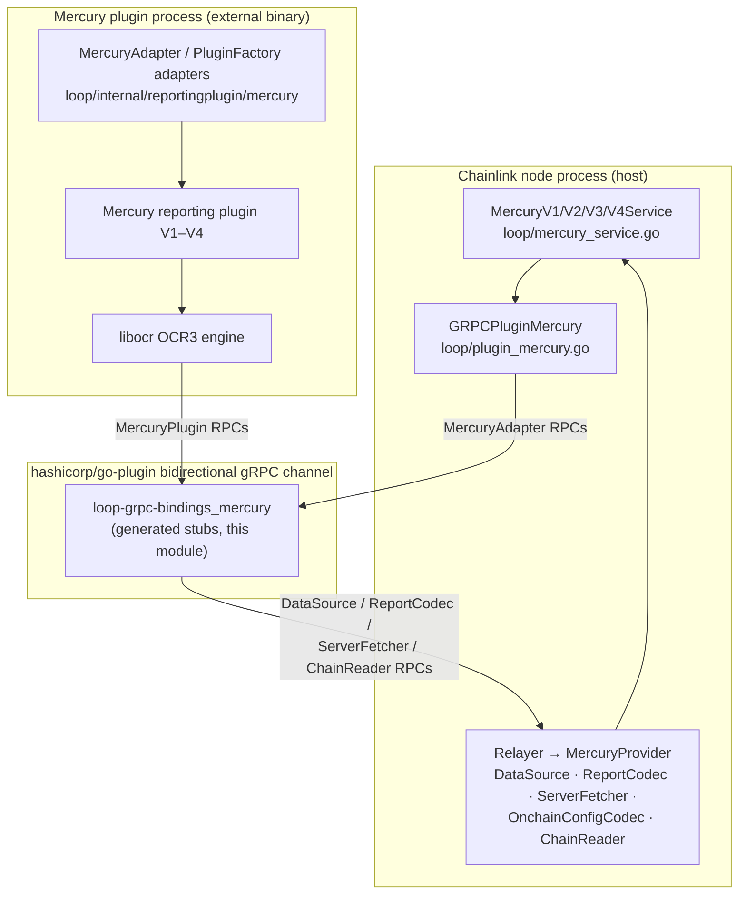
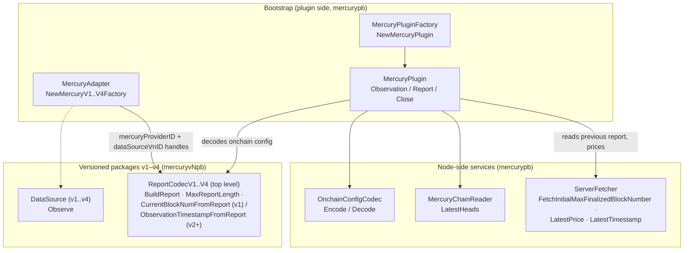
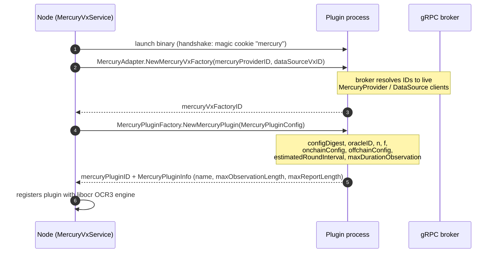
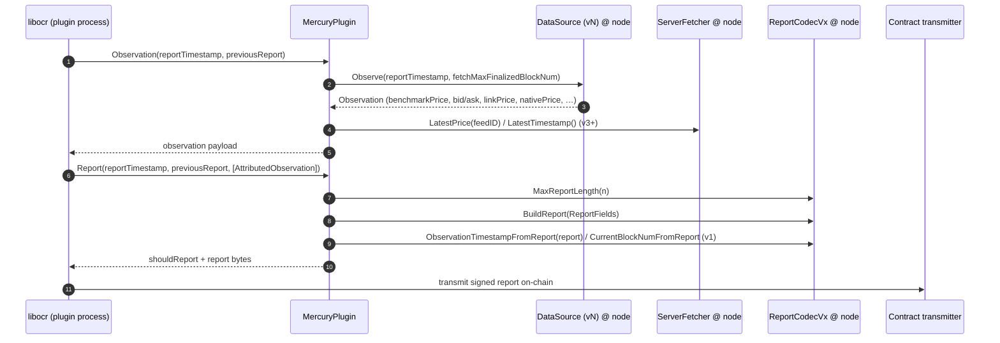
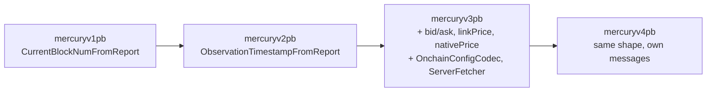

# loop-grpc-bindings_mercury

> **Module location:** `chainlink-common/pkg/loop/internal/pb/mercury/` (Go packages `mercurypb`, `mercuryv1pb`, `mercuryv2pb`, `mercuryv3pb`, `mercuryv4pb`)
> **Parent module:** [loop-grpc-bindings](../loop-grpc-bindings.md) · [Plugin Process Framework (Loop)](<../../Plugin_Process_Framework_(Loop).md>)

## Introduction

`loop-grpc-bindings_mercury` contains the **generated gRPC protocol bindings** for the **Mercury** family of OCR3 reporting plugins. Mercury is Chainlink's low-latency, off-chain price-reporting protocol; its reporting plugin exists in several wire-protocol revisions (**V1–V4**), implemented in the `chainlink-data-streams` ecosystem.

Under the [Loop plugin-process framework](../loop-plugin-core.md), Mercury plugins do not run inside the Chainlink node process. Instead, the node launches the plugin as a **separate OS process** (via `hashicorp/go-plugin`) and communicates with it over a bidirectional gRPC channel. This module defines the **wire contract** for that channel:

- **protobuf message types** — wire-serializable representations of the Go domain types (`Observation`, `Head`, `OnchainConfig`, `MercuryPluginConfig`, `AttributedObservation`, …)
- **gRPC client/server stubs** — one service per Go interface of the Mercury plugin surface (`DataSource`, `ReportCodec`, `OnchainConfigCodec`, `ServerFetcher`, `ChainReader`, `MercuryPluginFactory`, `MercuryPlugin`, and the `MercuryAdapter` bootstrap service)

All files in this module are **generated code** (`// Code generated by protoc-gen-go-grpc. DO NOT EDIT.`) from `.proto` sources kept alongside them. The handwritten Go adapters that bind these stubs to the domain interfaces live in [loop-plugin-core](../loop-plugin-core.md) and [loop-relayer-services](../loop-relayer-services.md) — this module is only the generated transport layer.

## Architecture

### Position in the Loop framework



Two directions share one connection:

| Direction | Served by | Services |
|---|---|---|
| Node → Plugin | plugin binary (via `MercuryAdapter` client in `loop/plugin_mercury.go`) | `MercuryAdapter`, `MercuryPluginFactory`, `MercuryPlugin` |
| Plugin → Node | node relayer (registered by `mercury.RegisterProviderServices` in `loop/internal/relayer/pluginprovider/ext/mercury/mercury.go`) | `DataSource` (per version), `ReportCodecV1–V4`, `OnchainConfigCodec`, `ServerFetcher`, `MercuryChainReader` |

### File and package layout

```
pkg/loop/internal/pb/mercury/
├── mercury_loop.proto / mercury_loop_grpc.pb.go     # MercuryAdapter, OnchainConfigCodec, ReportCodecV1–V4,
│                                                    # ServerFetcher, MercuryChainReader   (pkg mercurypb)
├── mercury_plugin.proto / mercury_plugin_grpc.pb.go # MercuryPluginFactory, MercuryPlugin  (pkg mercurypb)
├── generate.go                                      # //go:generate protoc directives
├── README.md                                        # filename-uniqueness workaround note
├── v1/  datasource_v1.proto|_grpc.pb.go,  reportcodec_v1.proto|_grpc.pb.go   (pkg mercuryv1pb)
├── v2/  datasource_v2.proto|_grpc.pb.go,  reportcodec_v2.proto|_grpc.pb.go   (pkg mercuryv2pb)
├── v3/  datasource_v3.proto|_grpc.pb.go,  reportcodec_v3.proto|_grpc.pb.go   (pkg mercuryv3pb)
└── v4/  datasource_v4.proto|_grpc.pb.go,  reportcodec_v4.proto|_grpc.pb.go   (pkg mercuryv4pb)
```

Naming quirk: version sub-directories use suffixed filenames (`datasource_v1.proto`, not `datasource.proto`) because protobuf requires **globally unique filenames** — see `chainlink-common/pkg/loop/internal/pb/mercury/README.md`. The top-level package is deliberately separate from the median plugin package to avoid collisions with shared type names (`OnchainConfig`, `BuildReport`).

## gRPC service surface

### Bootstrap & lifecycle services (`mercurypb`)

| Service | Methods | Purpose |
|---|---|---|
| `MercuryAdapter` | `NewMercuryV1Factory`, `NewMercuryV2Factory`, `NewMercuryV3Factory`, `NewMercuryV4Factory` | Entry point called by the node at plugin startup. Returns a brokered factory handle for the requested protocol version. |
| `MercuryPluginFactory` | `NewMercuryPlugin` | Creates one reporting-plugin instance for an OCR round series. Returns `mercuryPluginID` + `MercuryPluginInfo` (name, observation/report size limits). |
| `MercuryPlugin` | `Observation`, `Report`, `Close` | The libocr `MercuryPlugin` contract: produce an observation payload, decide/assemble a report from attributed observations, and release resources. |
| `OnchainConfigCodec` | `Encode`, `Decode` | gRPC adapter for `pkg/types/mercury/v3.OnchainConfigCodec`; message `OnchainConfig { BigInt min, BigInt max }`. |
| `ServerFetcher` | `FetchInitialMaxFinalizedBlockNumber`, `LatestPrice`, `LatestTimestamp` | gRPC adapter for `pkg/types/mercury/v3.ServerFetcher` (feed-ID keyed price lookups). |
| `MercuryChainReader` | `LatestHeads` | gRPC adapter for `pkg/types/mercury.ChainReader`; returns `repeated Head { number, hash, timestamp }`. |

### Versioned reporting services (`mercuryvNpb`)

Each version defines its own `DataSource` and `ReportCodec` messages; the *top-level* `ReportCodecV1–V4` services re-expose them with version-specific payloads:

| Version | `DataSource` | `ReportCodec` methods | Notes |
|---|---|---|---|
| V1 | `Observe` | `BuildReport`, `MaxReportLength`, **`CurrentBlockNumFromReport`** | Legacy extraction API (block number instead of timestamp) |
| V2 | `Observe` | `BuildReport`, `MaxReportLength`, `ObservationTimestampFromReport` | Timestamp extraction replaces block-number extraction |
| V3 | `Observe` (adds `bid`, `ask`, `maxFinalizedTimestamp`, `linkPrice`, `nativePrice` to `Observation`) | same as V2 | Adds `OnchainConfigCodec` + `ServerFetcher`; top-level services are documented as thin wrappers around the v3 implementation to satisfy the `MercuryProvider` API |
| V4 | `Observe` | same shape as V3 | Own generated message types (no protobuf aliasing) |

All RPCs in this module are **unary** (no streaming), and every service follows the same generated layout: `XClient`/`XServer` interfaces, `UnimplementedXServer` (forward compatibility), `UnsafeXServer` (opt-out), method-name constants, interceptor-aware handlers, and a `grpc.ServiceDesc`.

### Component relationship map



## Key flows

### 1. Plugin bootstrap and factory creation

At job start, the node wraps the relayer's `MercuryProvider` and version-specific `DataSource`, launches the plugin binary, and negotiates a factory over the broker. Request messages carry **brokered object IDs** (`mercuryProviderID`, `dataSourceVnID`) rather than data — the actual objects are exchanged through the Loop [net broker](../loop-plugin-core.md); replies return a `mercuryVnFactoryID` handle used for subsequent brokering.



### 2. OCR round: observation → report

During each round, libocr invokes the plugin, which calls back into node-side services using the generated stubs:



The `ReportCodec` calls validate size limits and extract freshness data from reports before transmission; `OnchainConfigCodec.Encode/Decode` round-trips the `min`/`max` BigInt configuration between the plugin and the node's on-chain config handling.

## Versioning strategy



- **No protobuf aliasing** — every version duplicates its message set, so V4 payloads are independent of V3 even when shapes match.
- **Top-level shim services** — `ReportCodecV1–V4` in `mercurypb` exist so a single `MercuryProvider`-shaped surface can be exposed; the proto comment notes they are thin wrappers around the v3 implementation.
- **Graceful degradation** — `loop/internal/relayer/pluginprovider/ext/mercury/mercury.go` provides `RegisterProviderServices` (all versions) plus `RegisterProviderServicesV1/V2/V3/V4`, which register the chosen version and embed `UnimplementedReportCodecVxServer{}` for the rest, yielding clean gRPC `Unimplemented` errors for unsupported versions.
- **Forward compatibility** — service additions only require new `Unimplemented*Server` methods; embedding `Unsafe*Server` opts out of this and forces compile-time breaks on interface changes (discouraged by the generated docs).

## Generated-code conventions

Every service in this module (toolchain: `protoc v5.29.3`, `protoc-gen-go-grpc v1.5.1`, gRPC-Go ≥ v1.64 / `SupportPackageIsVersion9`) contains:

- `XClient` interface + `NewXClient(cc)` wrapper around `grpc.ClientConnInterface`
- `XServer` interface requiring embedded `UnimplementedXServer`
- `UnimplementedXServer` — **must be embedded by value**; `RegisterXServer` panics at registration time if embedded as a nil pointer, converting a runtime hazard into an init-time failure
- `UnsafeXServer` — forward-compatibility opt-out (not recommended)
- `X_ServiceDesc` service descriptor and `/_FullMethodName` constants, e.g. `/loop.internal.pb.mercury.MercuryAdapter/NewMercuryV1Factory`
- Unary handlers honoring `grpc.UnaryServerInterceptor`

## Regeneration & build tooling

Sources are regenerated via `//go:generate` directives in each `generate.go` (`protoc --go_out --go-grpc_out`, `paths=source_relative`). In CI/dev this is driven by the `chainlink-common/Makefile`:

- `make install-protoc` — installs `protoc`, `protoc-gen-go`, and `protoc-gen-go-grpc` pinned by `.tool-versions` (`chainlink-common/Makefile`, target `install-protoc`)
- `make generate` — runs code generation across the module, including these protos (target `generate`, depends on `install-protoc`)

When editing Mercury wire behavior, change the `.proto` files and regenerate — never edit `*_grpc.pb.go` directly.

## Dependencies

| Depends on | Relationship |
|---|---|
| [types-mercury-llo](../../Shared_Foundation_Libraries___Domain_Types/types-mercury-llo.md) | The Go interfaces these services adapt: `MercuryProvider`, per-version `DataSource`/`ReportCodec`, `OnchainConfigCodec`, `ServerFetcher`, `ChainReader`, `Head` |
| [loop-plugin-core](../loop-plugin-core.md) | `goplugin`/`PluginService` machinery that launches the plugin process and wraps these stubs (`GRPCPluginMercury`, `MercuryVxService`) |
| [loop-relayer-services](../loop-relayer-services.md) | Handwritten client/server adapters (`ext/mercury/**`) that implement the domain interfaces on top of these stubs and register node-side services |
| [LLO](../../Oracle_Engines___Data_Pipelines/llo.md) | Mercury is a predecessor/related low-latency reporting path; shares report/transmission concepts |
| [OCR engines](../../Oracle_Engines___Data_Pipelines/ocr.md) | libocr OCR2/OCR3 plugin contracts (`MercuryPlugin`, `MercuryPluginFactory`, `MercuryPluginConfig`) mirrored by the plugin services |
| [CCIP gRPC bindings](loop-grpc-bindings_ccip.md) | Sibling binding set following the identical generated-code pattern |

## See also

- Parent: [loop-grpc-bindings](../loop-grpc-bindings.md) — overview of all binding families
- Sibling pages: [loop-grpc-bindings_contract-io](loop-grpc-bindings_contract-io.md), [loop-grpc-bindings_relayer-oracle](loop-grpc-bindings_relayer-oracle.md), [loop-grpc-bindings_ocr-reporting](loop-grpc-bindings_ocr-reporting.md), [loop-grpc-bindings_ccip](loop-grpc-bindings_ccip.md)
- Framework root: [Plugin_Process_Framework_(Loop)](<../../Plugin_Process_Framework_(Loop).md>)
