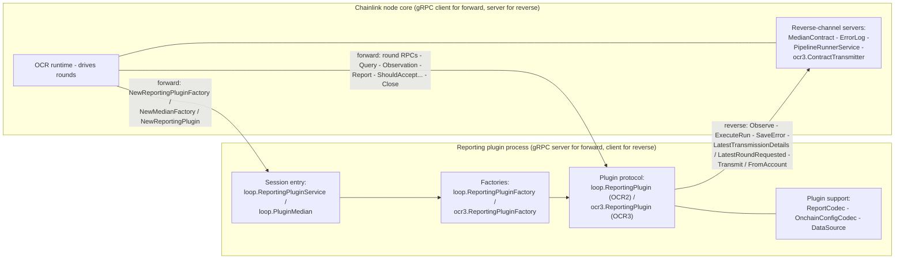
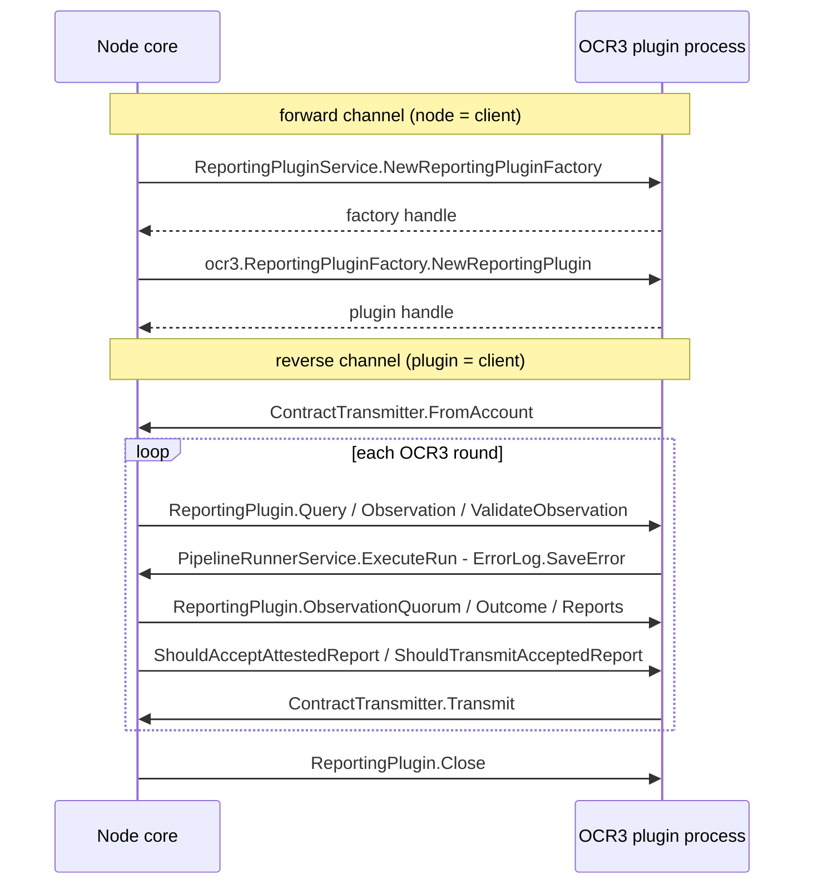
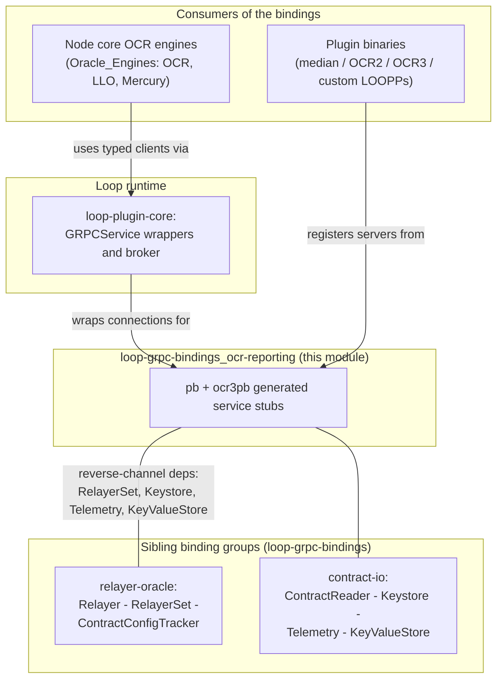

# loop-grpc-bindings_ocr-reporting

## 1. Purpose and scope

`loop-grpc-bindings_ocr-reporting` is the sub-module of [loop-grpc-bindings](../loop-grpc-bindings.md) that defines the **gRPC wire contract for Offchain Reporting (OCR) plugins** — the protocol spoken between the Chainlink node core and reporting-plugin binaries running as separate operating-system processes (see [Plugin_Process_Framework_(Loop)](../../Plugin_Process_Framework_(Loop).md)).

It covers every service a reporting-plugin session needs:

- **OCR2 protocol** — the session entry point (`loop.ReportingPluginService`), the plugin factory (`loop.ReportingPluginFactory`) and the per-round plugin RPCs (`loop.ReportingPlugin`).
- **Legacy Median plugin stack** — the `loop.PluginMedian` entry point plus its supporting surfaces: `loop.ReportCodec`, `loop.OnchainConfigCodec`, `loop.DataSource`, and the node-provided `loop.MedianContract` and `loop.ErrorLog` services.
- **OCR3 protocol** — `loop.internal.pb.ocr3.ReportingPluginFactory`, `loop.internal.pb.ocr3.ReportingPlugin` (with validation/quorum/outcome reporting phases) and the node-provided `loop.internal.pb.ocr3.ContractTransmitter`.
- **Pipeline execution** — the node-provided `loop.PipelineRunnerService`, which plugins call back to run pipeline specs on the node.

The module consists of **7 generated `*_grpc.pb.go` files** under `chainlink-common/pkg/loop/internal/pb/` (packages `pb` and `ocr3pb`) declaring **13 gRPC services**. It contains **no hand-written logic**: it is the pure interface-projection layer, generated by `protoc-gen-go-grpc v1.5.1` / `protoc v5.29.3` and pinned to `grpc.SupportPackageIsVersion9` (gRPC-Go ≥ 1.64).

> **Related pages.** The parent page [loop-grpc-bindings](../loop-grpc-bindings.md) documents the common generated-code anatomy, service taxonomy and code-generation pipeline shared by *all* binding groups, and links to a legacy alias of this page ([loop-grpc-bindings_loop-grpc-bindings_ocr-reporting.md](loop-grpc-bindings_loop-grpc-bindings_ocr-reporting.md)) covering the same components. This page is the canonical OCR-reporting reference; the semantic Go interfaces behind these bindings are documented in [types-core](../../Shared_Foundation_Libraries___Domain_Types/types-core.md).

## 2. Files and services

| Generated file | Package | gRPC services (wire name) | Source proto |
|---|---|---|---|
| `reporting_plugin_service_grpc.pb.go` | `pb` | `loop.ReportingPluginService` | `reporting_plugin_service.proto` |
| `reporting_grpc.pb.go` | `pb` | `loop.ReportingPluginFactory`, `loop.ReportingPlugin` | `loop/internal/pb/reporting.proto` |
| `median_grpc.pb.go` | `pb` | `loop.PluginMedian`, `loop.ErrorLog`, `loop.ReportCodec`, `loop.MedianContract`, `loop.OnchainConfigCodec` | `loop/internal/pb/median.proto` |
| `median_datasource_grpc.pb.go` | `pb` | `loop.DataSource` | `loop/internal/pb/median_datasource.proto` |
| `ocr3/ocr3_reporting_grpc.pb.go` | `ocr3pb` | `loop.internal.pb.ocr3.ReportingPluginFactory`, `loop.internal.pb.ocr3.ReportingPlugin` | `ocr3_reporting.proto` |
| `ocr3/contract_transmitter_grpc.pb.go` | `ocr3pb` | `loop.internal.pb.ocr3.ContractTransmitter` | `contract_transmitter.proto` |
| `pipeline_runner_grpc.pb.go` | `pb` | `loop.PipelineRunnerService` | `pipeline_runner.proto` |

## 3. Architecture

### 3.1 Two communication channels

Reporting plugins are launched and supervised by the Loop broker (see [loop-plugin-core](../loop-plugin-core.md)) over the gRPC connections shown in the parent page's process-topology diagram. Within a session, this module's services split along **direction of call**:

Key points:

- **Forward channel (node → plugin):** session bootstrap and the plugin's reporting behavior. The node is the *client*; the plugin binary registers `ReportingPluginServiceServer`, `PluginMedianServer`, `ReportingPluginFactoryServer`, `ReportingPluginServer`, `ocr3pb.ReportingPluginFactoryServer`, `ocr3pb.ReportingPluginServer`, `ReportCodecServer`, `OnchainConfigCodecServer` and `DataSourceServer`.
- **Reverse channel (plugin → node):** infrastructure the plugin needs but must not own (chain access, transmission, persistence, logging). The node serves `MedianContractServer`, `ErrorLogServer`, `PipelineRunnerServiceServer` and `ocr3pb.ContractTransmitterServer`; the plugin consumes them via the generated clients.
- The node-side semantic interface `ReportingPluginServer` (`chainlink-common/pkg/types/core/reporting_plugin_service.go`, documented in [types-core_plugin-services](../../Shared_Foundation_Libraries___Domain_Types/types-core/types-core_plugin-services.md)) makes the reverse-channel wiring explicit: `NewReportingPluginFactory` receives `pipelineRunner`, `telemetry`, `errorLog`, `keyValueStore` and `relayerSet` — exactly the node-hosted services handed to the plugin process.

### 3.2 Call-direction matrix

| Service (wire name) | Served by | Consumed by | Purpose |
|---|---|---|---|
| `loop.ReportingPluginService` | plugin | node | Session bootstrap: create a reporting-plugin factory and a validation service |
| `loop.ReportingPluginFactory` | plugin | node | Instantiate one reporting plugin (OCR2) for a config/provider |
| `loop.ReportingPlugin` | plugin | node | OCR2 round lifecycle: `Query`, `Observation`, `Report`, `ShouldAcceptFinalizedReport`, `ShouldTransmitAcceptedReport`, `Close` |
| `loop.PluginMedian` | plugin | node | Legacy median-plugin entry point: `NewMedianFactory` |
| `loop.DataSource` | plugin | node | Plugin's data feed: `Observe` returns the observed value |
| `loop.ReportCodec` | plugin | node | Median report encoding: `BuildReport`, `MedianFromReport`, `MaxReportLength` |
| `loop.OnchainConfigCodec` | plugin | node | `Encode` / `Decode` of the median on-chain configuration |
| `loop.MedianContract` | node | plugin | Reverse: contract introspection — `LatestTransmissionDetails`, `LatestRoundRequested` |
| `loop.ErrorLog` | node | plugin | Reverse: `SaveError` persistence of plugin error logs |
| `loop.PipelineRunnerService` | node | plugin | Reverse: `ExecuteRun` executes a pipeline spec on the node |
| `loop.internal.pb.ocr3.ReportingPluginFactory` | plugin | node | OCR3 plugin creation (`NewReportingPlugin`) |
| `loop.internal.pb.ocr3.ReportingPlugin` | plugin | node | OCR3 round lifecycle incl. `ValidateObservation`, `ObservationQuorum`, `Outcome`, `Reports`, `ShouldAcceptAttestedReport` |
| `loop.internal.pb.ocr3.ContractTransmitter` | node | plugin | Reverse: on-chain report transmission — `Transmit`, `FromAccount` |

### 3.3 Typical OCR3 session flow

### 3.4 OCR2 vs OCR3 protocol shape

| Aspect | OCR2 (`loop.*`) | OCR3 (`loop.internal.pb.ocr3.*`) |
|---|---|---|
| Entry points | `ReportingPluginService` and/or `PluginMedian` | `ocr3.ReportingPluginFactory` (via `ReportingPluginService`) |
| Plugin RPCs | `Query`, `Observation`, `Report`, `ShouldAcceptFinalizedReport`, `ShouldTransmitAcceptedReport`, `Close` | `Query`, `Observation`, `ValidateObservation`, `ObservationQuorum`, `Outcome`, `Reports`, `ShouldAcceptAttestedReport`, `ShouldTransmitAcceptedReport`, `Close` |
| Transmission | Node handles it via relayer services ([loop-grpc-bindings_relayer-oracle](loop-grpc-bindings_relayer-oracle.md)) | Dedicated `ocr3.ContractTransmitter` binding served by the node |
| Median support services | `ReportCodec`, `OnchainConfigCodec`, `DataSource`, `MedianContract`, `ErrorLog` | Not applicable (OCR3 uses its own report types) |

## 4. Sub-modules

Detail documentation is split by protocol family. All sub-module pages live in the [`loop-grpc-bindings_ocr-reporting/`](loop-grpc-bindings_ocr-reporting/) folder next to this file:

| Sub-module | Scope | Documentation |
|---|---|---|
| **Plugin lifecycle (OCR2)** | Session bootstrap (`loop.ReportingPluginService`) plus the OCR2 factory/plugin protocol in `reporting_grpc.pb.go`, including the forward-compatibility (`Unimplemented…`) and `Unsafe…` server variants | [loop-grpc-bindings_ocr-reporting_plugin-lifecycle.md](loop-grpc-bindings_ocr-reporting/loop-grpc-bindings_ocr-reporting_plugin-lifecycle.md) |
| **Median plugin bindings** | The legacy median stack: `PluginMedian`, `ErrorLog`, `ReportCodec`, `MedianContract`, `OnchainConfigCodec` (`median_grpc.pb.go`) and `DataSource` (`median_datasource_grpc.pb.go`) | [loop-grpc-bindings_ocr-reporting_median-bindings.md](loop-grpc-bindings_ocr-reporting/loop-grpc-bindings_ocr-reporting_median-bindings.md) |
| **OCR3 bindings** | `ocr3_reporting_grpc.pb.go` (factory + extended plugin protocol) and `contract_transmitter_grpc.pb.go` (node-hosted transmission) | [loop-grpc-bindings_ocr-reporting_ocr3-bindings.md](loop-grpc-bindings_ocr-reporting/loop-grpc-bindings_ocr-reporting_ocr3-bindings.md) |
| **Pipeline runner binding** | `loop.PipelineRunnerService` — the reverse-channel `ExecuteRun` RPC letting plugins run pipeline specs on the node | [loop-grpc-bindings_ocr-reporting_pipeline-runner.md](loop-grpc-bindings_ocr-reporting/loop-grpc-bindings_ocr-reporting_pipeline-runner.md) |

## 5. How this module fits into the system

- **Node side.** The node's OCR engines obtain reporting plugins through the Loop `GRPCService` wrappers in [loop-plugin-core](../loop-plugin-core.md) (`chainlink-common/pkg/loop/reportingplugins/grpc.go` and `reportingplugins/ocr3/grpc.go`), which hold the `ReportingPluginServiceClient` for the OCR2 and OCR3 bindings and expose `NewReportingPluginFactory` to the node's job engine (see [Oracle_Engines___Data_Pipelines](../../Oracle_Engines___Data_Pipelines.md) → [ocr](../../Oracle_Engines___Data_Pipelines/ocr.md)).
- **Plugin side.** A plugin binary registers `pb`/`ocr3pb` servers via the `Register…Server` functions (typically through the `loop.NewServer` plumbing of loop-plugin-core) and consumes node-hosted services through the generated clients — including the relayer/transmission surfaces documented in [loop-grpc-bindings_relayer-oracle](loop-grpc-bindings_relayer-oracle.md) and the contract-I/O surfaces in [loop-grpc-bindings_contract-io](loop-grpc-bindings_contract-io.md).
- **Domain types.** The request/reply messages mirror the Go interfaces in [types-core](../../Shared_Foundation_Libraries___Domain_Types/types-core.md) (`ReportingPluginFactory`, `PipelineRunnerService`, `ErrorLog`, `Keystore`, `RelayerSet`); conversions for OCR-specific values (config digests, report timestamps) are handled by the Loop adapters, not by these bindings.

## 6. Code generation and maintenance

These files are pure `protoc-gen-go-grpc` output and **must never be hand-edited**. Regeneration is driven by the `chainlink-common` module build:

- `chainlink-common/Makefile` — target `install-protoc` installs `protoc`, `protoc-gen-go` and `protoc-gen-go-grpc` at the versions pinned in `.tool-versions`; target `generate` runs the full codegen pipeline (including building the `cre-protoc` helper plugin).
- Each service's source `.proto` lives next to the generated code (see the paths in the table in §2); the module-wide codegen layout and best practices are described in the parent page's [code-generation section](../loop-grpc-bindings.md).

Conventions that apply to every service here (embedded-by-value `Unimplemented…Server` for forward compatibility, registration-time nil-embedding panic checks in `Register…Server`, discouraged `Unsafe…Server` opt-outs, errors crossing the boundary as gRPC status errors) are documented once in the parent page's [conventions section](../loop-grpc-bindings.md) and are not repeated per sub-module.
