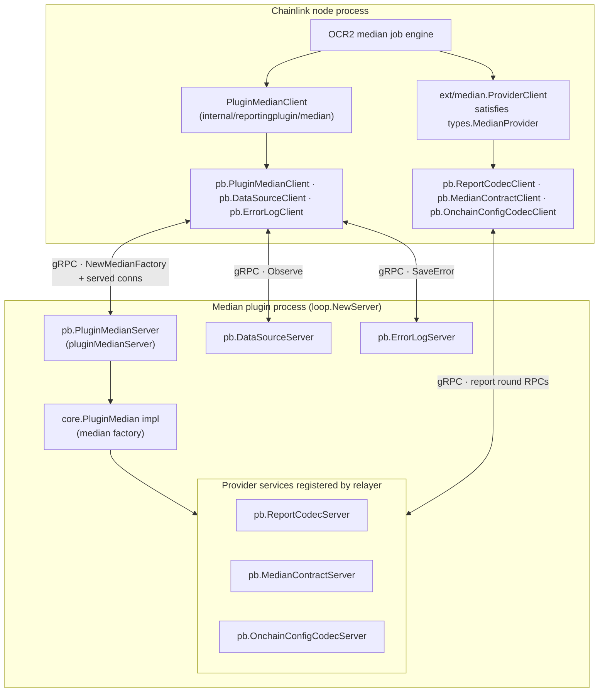
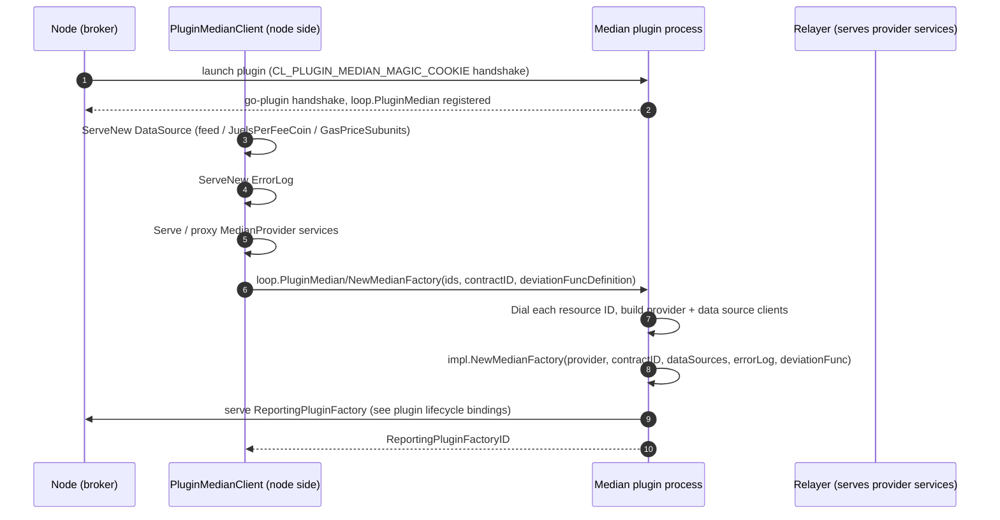
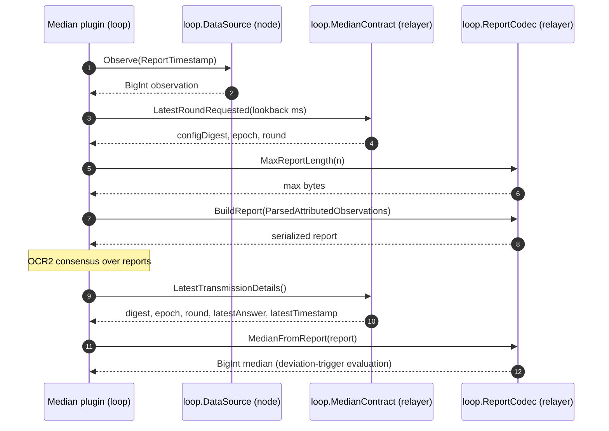
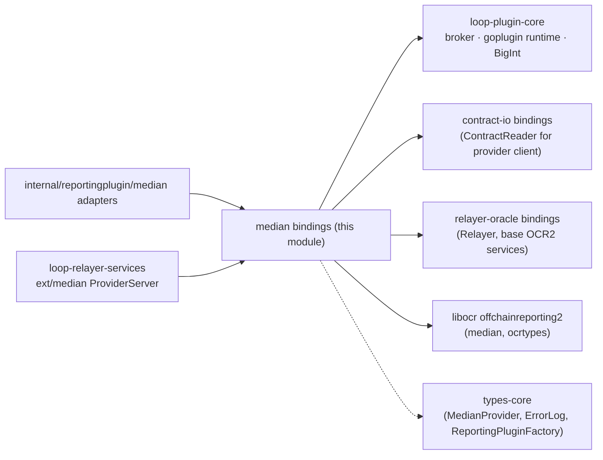

# Loop gRPC Bindings — OCR Reporting: Median Bindings

**Module scope:** `chainlink-common/pkg/loop/internal/pb/median.proto` → `median_grpc.pb.go` and `chainlink-common/pkg/loop/internal/pb/median_datasource.proto` → `median_datasource_grpc.pb.go`

## Purpose

This module contains the **generated gRPC bindings for the OCR2 median reporting plugin family** — the data-streams / Keystone "median" feed. It is one of the plugin-specific binding sets that make up [loop-grpc-bindings](../../loop-grpc-bindings.md) within the [Plugin Process Framework (Loop)](../../../Plugin_Process_Framework_(Loop).md).

The `chainlink-common/pkg/loop/internal/pb/median.proto` schema defines six gRPC services that mirror, one-to-one, the Go interfaces of `github.com/smartcontractkit/libocr/offchainreporting2/reportingplugin/median` plus a few node-side core services:

| gRPC service (`loop.*`) | Go interface it adapts | Methods |
|---|---|---|
| `PluginMedian` | `core.PluginMedian` (node-side factory service) | `NewMedianFactory` |
| `ErrorLog` | `core.ErrorLog` | `SaveError` |
| `ReportCodec` | `median.ReportCodec` (libocr) | `BuildReport`, `MedianFromReport`, `MaxReportLength` |
| `MedianContract` | `median.MedianContract` (libocr) | `LatestTransmissionDetails`, `LatestRoundRequested` |
| `OnchainConfigCodec` | `median.OnchainConfigCodec` (libocr) | `Encode`, `Decode` |

`median_datasource.proto` adds a seventh service:

| gRPC service (`loop.*`) | Go interface it adapts | Methods |
|---|---|---|
| `DataSource` | `median.DataSource` (libocr) | `Observe` |

Together these bindings let a **median reporting plugin run in its own process (a "loop")** while transparently using:

- the node's data sources (price pipelines) via `DataSource`,
- the on-chain aggregator contract via `MedianContract`,
- the node's error log via `ErrorLog`, and
- the chain-specific `MedianProvider` (transmitter, contract reader, codec) via the provider connection.

For the *lifecycle* services shared by all OCR2/OCR3 plugins (`ReportingPluginFactory`, `ReportingPluginService`, pipeline runner, etc.), see [ocr-reporting plugin lifecycle](loop-grpc-bindings_ocr-reporting_plugin-lifecycle.md); the OCR3 equivalents are covered in [ocr3-bindings](loop-grpc-bindings_ocr-reporting_ocr3-bindings.md).

## Architecture

The generated code in this module provides the **wire layer only** (protobuf messages + client/server stubs). The behavioural adapters that use it live in the neighbouring [loop-relayer-services](../../loop-relayer-services.md) and `internal/reportingplugin/median` packages:

Key relationships:

- **`ReportCodec`, `MedianContract`, `OnchainConfigCodec`** are *provider-direction* services: the **relayer** (EVM relayer plugin or embedded relayer) serves them via `median.RegisterProviderServices`, and the plugin consumes them through `pb.*Client` wrappers (`ext/median/median.go`).
- **`DataSource` and `ErrorLog`** are *node-direction* services: the **node** serves them from within `PluginMedianClient.NewMedianFactory` (`ServeNew`) so that the plugin can call back into node-owned resources.
- **`PluginMedian`** is the bootstrap RPC: it carries resource *IDs* (not implementations) so the plugin can dial each dependency connection in the broker.

## Component reference

### `median_grpc.pb.go` (source: `loop/internal/pb/median.proto`)

Generated with `protoc-gen-go-grpc v1.5.1` / `protoc v5.29.3` (gRPC-Go ≥ v1.64, `grpc.SupportPackageIsVersion9`). Each service follows the standard generated pattern:

- a `*Client` interface + `New*Client(grpc.ClientConnInterface)` constructor,
- a `*Server` interface whose implementations embed `Unimplemented*Server` (by value) for forward compatibility, and
- an `Unsafe*Server` interface (e.g. `UnsafePluginMedianServer`, `UnsafeReportCodecServer`, `UnsafeMedianContractServer`, `UnsafeOnchainConfigCodecServer`, `UnsafeErrorLogServer`) that opts out of forward compatibility — embedding it means newly added RPCs become compile errors instead of returning `codes.Unimplemented`.

| Component | Service | Notes |
|---|---|---|
| `UnsafePluginMedianServer` | `loop.PluginMedian` | Single RPC `NewMedianFactory` (`/loop.PluginMedian/NewMedianFactory`). The server-side adapter `pluginMedianServer` wraps `core.PluginMedian`. |
| `UnsafeReportCodecServer` | `loop.ReportCodec` | Documented in-source as the "gRPC adapter of `libocr/.../median.ReportCodec`". |
| `UnsafeMedianContractServer` | `loop.MedianContract` | Read-only view of the on-chain aggregator (latest transmission / requested round). |
| `UnsafeOnchainConfigCodecServer` | `loop.OnchainConfigCodec` | Encode/decode of the median `OnchainConfig{min, max}`. |
| `UnsafeErrorLogServer` | `loop.ErrorLog` | Fire-and-forget `SaveError(message) → google.protobuf.Empty`, used by plugins to surface errors to node job telemetry. |

### `median_datasource_grpc.pb.go` (source: `loop/internal/pb/median_datasource.proto`)

| Component | Service | Notes |
|---|---|---|
| `UnsafeDataSourceServer` | `loop.DataSource` | Single RPC `Observe(ObserveRequest{ReportTimestamp}) → ObserveReply{BigInt value}`. Wraps `libocr median.DataSource` so the plugin samples node-side price pipelines (feed value, juels-per-fee-coin, gas price subunits). |

## Wire data types

Defined in the two protos (messages in `median.pb.go` / `median_datasource.pb.go`):

- **`ParsedAttributedObservation`** — mirrors `median.ParsedAttributedObservation`: `timestamp` (uint32), `value`, `julesPerFeeCoin`, `gasPriceSubunits` (arbitrary-precision `BigInt`), `observer` (uint32; validated to fit `uint8`/`commontypes.OracleID` on both ends).
- **`BuildReportRequest/Reply`** — `repeated ParsedAttributedObservation` → serialized report `bytes` (a `libocr.Report`).
- **`MedianFromReportRequest/Reply`** — report bytes → median `BigInt`.
- **`MaxReportLengthRequest/Reply`** — `int64 n` (number of observers) → `int64 max` byte budget.
- **`LatestTransmissionDetailsReply`** — 32-byte `configDigest`, `epoch` (uint32), `round` (uint8, range-validated), `latestAnswer` (`BigInt`), `latestTimestamp` (`google.protobuf.Timestamp`).
- **`LatestRoundRequestedRequest/Reply`** — `lookback` in **milliseconds** → digest/epoch/round.
- **`OnchainConfig`** — `{BigInt min, BigInt max}`; `Encode`/`Decode` convert to/from the canonical on-chain encoding.
- **`ObserveRequest/Reply`** — `ReportTimestamp` (converted by `pb.ReportTimestampToPb` / `pb.ReportTimestampFromPb`) → `BigInt` observation value.
- **`NewMedianFactoryRequest`** — carries `medianProviderID`, `contractID`, `dataSourceID`, `juelsPerFeeCoinDataSourceID`, `errorLogID`, `gasPriceSubunitsDataSourceID` and an optional `deviationFuncDefinition` (serialized JSON).

`BigInt` is the loop framework's wire representation for `*math/big.Int` (created via `pb.NewBigIntFromInt`, read back with `.Int()`), used throughout to keep arbitrary-precision price values exact across processes.

## How the bindings are wired

### Node side — plugin client (legacy median plugin)

`chainlink-common/pkg/loop/plugin_median.go` defines the hashicorp go-plugin surface `GRPCPluginMedian` with the dedicated handshake `CL_PLUGIN_MEDIAN_MAGIC_COOKIE` (`PluginMedianHandshakeConfig`). Its client half, `PluginMedianClient` (`internal/reportingplugin/median/median.go`), implements `core.PluginMedian.NewMedianFactory`:

1. **Serve** three `loop.DataSource` servers (feed value, `JuelsPerFeeCoin`, `GasPriceSubunits`) wrapping the node's `median.DataSource` pipelines,
2. **Serve** `loop.ErrorLog` wrapping the node's `core.ErrorLog`,
3. **Provide the `MedianProvider`**: if the provider is already a gRPC connection, it is served through a `grpc-proxy` passthrough; otherwise `medianprovider.RegisterProviderServices` re-exposes it (`ReportCodec`, `MedianContract`, `OnchainConfigCodec` + the OCR2 base services),
4. **Call** `pb.PluginMedianClient.NewMedianFactory` with the resource IDs and the JSON `deviationFuncDefinition`,
5. **Return** a `ReportingPluginFactoryClient` bound to the connection the plugin serves back.

### Node side — provider client

`ext/median.ProviderClient` (`internal/relayer/pluginprovider/ext/median/median.go`) satisfies `types.MedianProvider` (see [types-core providers](../../../Shared_Foundation_Libraries___Domain_Types/types-core/types-core_providers.md)) by composing `pb.ReportCodecClient`, `pb.MedianContractClient`, `pb.OnchainConfigCodecClient`, the [contract-io](../loop-grpc-bindings_contract-io.md) ContractReader/Codec clients, and the base OCR2 `PluginProviderClient`. `RmUnimplemented` probes the ContractReader and Codec and nils them out when the relayer does not implement them (legacy relayer compatibility).

### Plugin side — servers

- `pluginMedianServer` (`pb.UnimplementedPluginMedianServer`) dials each served dependency by ID (`m.Dial(request.DataSourceID)`, …), rehydrates the `deviationFuncDefinition` JSON, invokes the plugin's `core.PluginMedian.NewMedianFactory`, and serves the resulting factory back to the node — registering every dependency connection as a broker `net.Resource` so they are closed together.
- `dataSourceServer`, `reportCodecServer`, `medianContractServer`, `onchainConfigCodecServer` and the errorlog server adapt the plugin/relayer implementations to the `pb.*Server` interfaces.

### Modern unified path

The dedicated `PluginMedian` handshake is legacy. New-style plugins use the generic plugin-service surface (`reportingplugins.GRPCService[T]`), where `MedianProviderServer = median.ProviderServer` (`reportingplugins/grpc.go`) makes `ConnToProvider` return a `types.MedianProvider` to the plugin. The `PluginMedian` RPC then disappears — the provider arrives via the relayer set instead. Both paths share the same `pb` bindings from this module.

## Data flow: plugin start-up handshake

## Data flow: one report round

## Dependencies

## Relation to the rest of the system

- **Parent**: [loop-grpc-bindings](../../loop-grpc-bindings.md) — sibling binding sets: [contract-io](../loop-grpc-bindings_contract-io.md) (reader/writer/keystore/event store), [relayer-oracle](../loop-grpc-bindings_relayer-oracle.md) (Relayer, oracle factory, gateway connector), [ccip](../loop-grpc-bindings_ccip.md), [mercury](../loop-grpc-bindings_mercury.md) (the v1–v4 report-codec analogue of this module's `ReportCodec`).
- **Grandparent**: [Plugin Process Framework (Loop)](../../../Plugin_Process_Framework_(Loop).md) — broker, launcher and process supervision. The broker/runtime machinery these stubs rely on (client dialling, `net.Resources` bookkeeping, the shared `BigInt` codec) is documented in [loop-plugin-core](../../loop-plugin-core.md).
- **Consuming adapters**: [loop-relayer-services](../../loop-relayer-services.md) (`ext/median` provider servers/clients) and `chainlink-common/pkg/loop/internal/reportingplugin/median` (plugin-side factory client/server). The pipeline the plugin hands reports to is bound in [pipeline-runner](loop-grpc-bindings_ocr-reporting_pipeline-runner.md).
- **Domain types**: `chainlink-common/pkg/types/provider_median.go` (`MedianProvider`) — see [types-core providers](../../../Shared_Foundation_Libraries___Domain_Types/types-core/types-core_providers.md).
- **Node configuration**: the median plugin's relay/job config (`gasPriceSubunitsSource`, `juelsPerFeeCoinSource`, `deviationFunc` pipelines in `chainlink/core/services/ocr2/plugins/median/config/config.go`) is what the `DataSource` services ultimately execute; see the [OCR engines module](../../../Oracle_Engines___Data_Pipelines/ocr/ocr2_delegate.md) for how the node drives these jobs.
- **Testing**: round-trip harnesses live in `chainlink-common/pkg/loop/internal/relayer/pluginprovider/ext/median/test` and `chainlink-common/pkg/loop/internal/reportingplugin/test`, plus `chainlink-common/pkg/loop/median_service_test.go` / `plugin_median_test.go`.

## Maintenance notes

- Both `.grpc.pb.go` files are **generated** — edit `median.proto` / `median_datasource.proto` and regenerate (see [build-and-repo-tooling](../../../Build,_CI___Release_Infrastructure/build-and-repo-tooling/build-and-repo-tooling_code-generation.md) for the `chainlink-common` protoc toolchain).
- All generated `Unsafe*Server` interfaces exist to opt out of gRPC's forward-compatibility shims; the loop adapters deliberately embed `Unimplemented*Server` by value instead.
- Narrow integer types on the Go side (`uint8` observer/round) are widened to `uint32` on the wire and validated on both ends; keep those checks in sync when regenerating.
