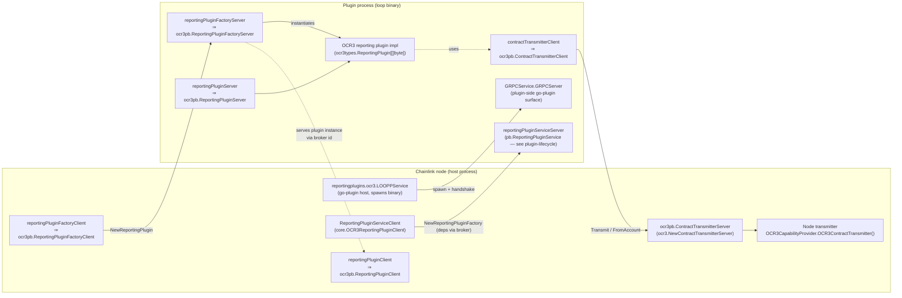
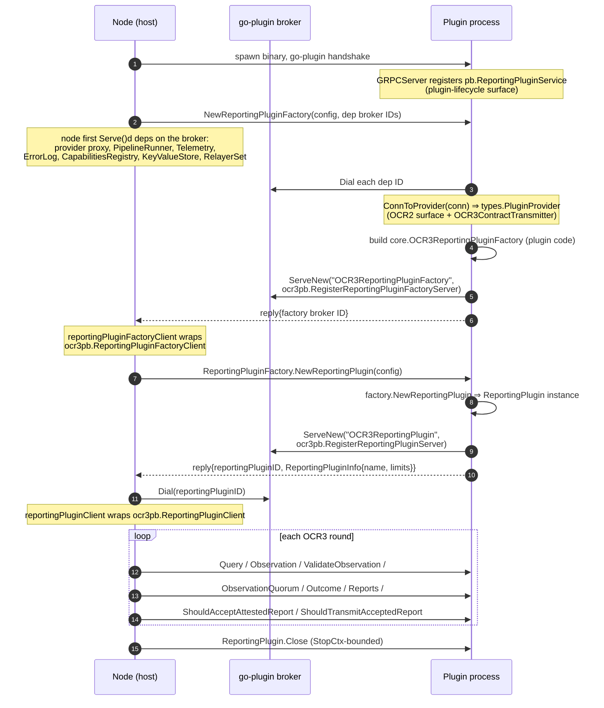
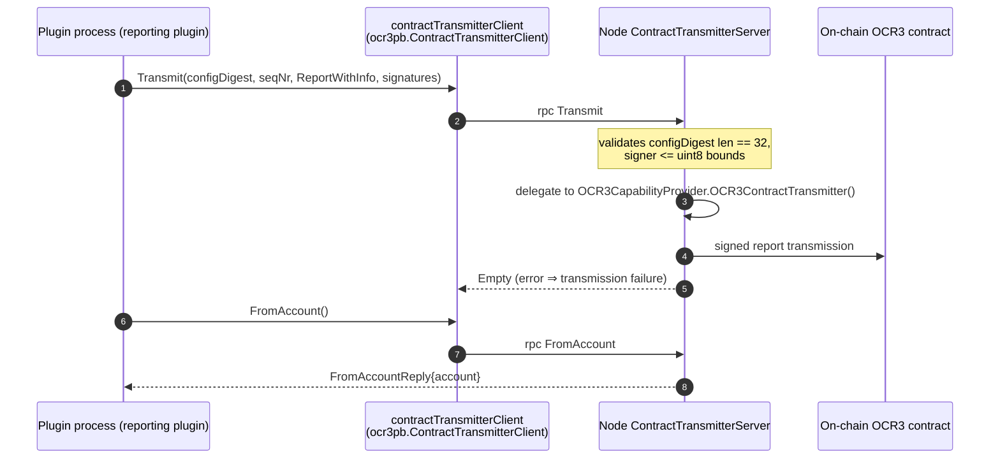

# loop-grpc-bindings: OCR3 Bindings

**Module path:** `chainlink-common/pkg/loop/internal/pb/ocr3` (Go package `ocr3pb`)

## Purpose

This module is the **wire-format layer for OCR3 (Off-Chain Reporting v3) plugin surfaces** in the [Loop plugin process framework](<../../../Plugin_Process_Framework_(Loop).md>). It contains the `protoc`-generated gRPC bindings (service stubs, message types, and registration helpers) for three services defined in `ocr3_reporting.proto` and `contract_transmitter.proto`:

| gRPC service (full name) | Proto file | Direction | Purpose |
|---|---|---|---|
| `loop.internal.pb.ocr3.ReportingPluginFactory` | `ocr3_reporting.proto` | Node → plugin | Instantiates a concrete reporting plugin inside the plugin process |
| `loop.internal.pb.ocr3.ReportingPlugin` | `ocr3_reporting.proto` | Node → plugin | Drives the OCR3 reporting rounds (query, observe, outcome, reports, transmit gating) |
| `loop.internal.pb.ocr3.ContractTransmitter` | `contract_transmitter.proto` | Plugin → node | Lets the reporting plugin hand signed reports to the node's on-chain transmitter |

These bindings are the contract that allows a libocr `ocr3types.ReportingPlugin[[]byte]` / `ReportingPluginFactory[[]byte]` implementation compiled into a **separate plugin binary** to be driven by the Chainlink node — with crash isolation, restart supervision, and version skew tolerance — exactly as described in [loop-grpc-bindings](../../loop-grpc-bindings.md).

This page documents the two files in scope:

- `chainlink-common/pkg/loop/internal/pb/ocr3/ocr3_reporting_grpc.pb.go` — `ReportingPluginFactory` and `ReportingPlugin` service bindings (core components: `UnsafeReportingPluginFactoryServer`, `UnsafeReportingPluginServer`).
- `chainlink-common/pkg/loop/internal/pb/ocr3/contract_transmitter_grpc.pb.go` — `ContractTransmitter` service bindings (core component: `UnsafeContractTransmitterServer`).

> The sibling module [plugin-lifecycle](loop-grpc-bindings_ocr-reporting_plugin-lifecycle.md) documents the higher-level `ReportingPluginService` negotiation that bootstraps these surfaces; [median-bindings](loop-grpc-bindings_ocr-reporting_median-bindings.md) covers the OCR2 median equivalents, and [pipeline-runner](loop-grpc-bindings_ocr-reporting_pipeline-runner.md) covers the `PipelineRunnerService` dependency consumed by OCR3 plugins.

## Architecture

The three services implement a **dual-direction bridge** between the node process and the plugin process:

- **Node → plugin (reporting):** the node drives the OCR3 round lifecycle against plugin implementations served over broker connections.
- **Plugin → node (transmission):** the plugin calls back into the node to transmit reports on-chain, because signing keys and chain connections live in the node (see `types.OCR3CapabilityProvider` in [types-core](../../../Shared_Foundation_Libraries___Domain_Types/types-core.md)).

The generated files themselves are thin: each file provides typed **client** interfaces, **server** interfaces, `Unimplemented*` forward-compatibility bases, `Unsafe*` opt-out interfaces, per-method unary handlers, interceptors-ready registration functions, and `grpc.ServiceDesc` descriptors. All behavioral adaptation (type conversion, bounds validation, broker dialing) lives in the wrappers of [loop-relayer-services](../../loop-relayer-services.md) and `internal/core/services/reportingplugin/ocr3`.

## Generated components

### `ocr3_reporting_grpc.pb.go`

| Component | Kind | Role |
|---|---|---|
| `ReportingPluginFactoryClient` / `reportingPluginFactoryClient` | client API + impl | Single RPC `NewReportingPlugin`; created via `NewReportingPluginFactoryClient(cc)` with the `grpc.StaticMethod()` call option |
| `ReportingPluginFactoryServer` | server interface | Implemented by `reportingPluginFactoryServer` in `internal/core/services/reportingplugin/ocr3`, which wraps a node-supplied `ocr3types.ReportingPluginFactory[[]byte]` |
| `UnimplementedReportingPluginFactoryServer` | forward-compat base | Returns `codes.Unimplemented`; must be embedded **by value** (embedded-by-pointer nil panics are caught at registration time via the `testEmbeddedByValue` guard) |
| `UnsafeReportingPluginFactoryServer` *(core component)* | opt-out interface | Opts **out** of forward compatibility: adding methods to the server interface becomes a compile error instead of falling through to `Unimplemented` |
| `ReportingPluginClient` / `reportingPluginClient` | client API + impl | The 9 lifecycle RPCs (Query … Close) |
| `ReportingPluginServer` / `UnimplementedReportingPluginServer` / `UnsafeReportingPluginServer` *(core component)* | server API trio | Serves a plugin instance back to the node over a broker connection |
| `RegisterReportingPluginFactoryServer`, `RegisterReportingPluginServer` | registration | Guard + `grpc.ServiceRegistrar` registration; used by `ocr3.RegisterReportingPluginServer(s, …)` wrappers |
| `_ReportingPluginFactory_*_Handler`, `_ReportingPlugin_*_Handler` | handlers | Unary handler glue, interceptor-aware |
| `ReportingPluginFactory_ServiceDesc`, `ReportingPlugin_ServiceDesc` | descriptors | Service names `loop.internal.pb.ocr3.ReportingPluginFactory` / `…ReportingPlugin`; metadata `ocr3_reporting.proto`; **no streaming methods** |

### `contract_transmitter_grpc.pb.go`

| Component | Kind | Role |
|---|---|---|
| `ContractTransmitterClient` / `contractTransmitterClient` | client API + impl | `Transmit(TransmitRequest) → Empty` and `FromAccount(Empty) → FromAccountReply` |
| `ContractTransmitterServer` | server interface | Implemented by `contractTransmitterServer` in `internal/relayer/pluginprovider/ocr3/contract_transmitter.go`, delegating to the node's `ocr3types.ContractTransmitter[[]byte]` |
| `UnimplementedContractTransmitterServer` / `UnsafeContractTransmitterServer` *(core component)* | compat bases | Same by-value / unsafe embedding semantics as above |
| `RegisterContractTransmitterServer` | registration | Called by `ocr3capability.RegisterProviderServices` on the node side |
| `ContractTransmitter_ServiceDesc` | descriptor | Service name `loop.internal.pb.ocr3.ContractTransmitter`; metadata `contract_transmitter.proto`; unary only |

## Service contracts

### `ReportingPluginFactory` — one RPC

| RPC | Request → Reply | Semantics |
|---|---|---|
| `NewReportingPlugin` | `NewReportingPluginRequest{ReportingPluginConfig}` → `NewReportingPluginReply{reportingPluginID, ReportingPluginInfo}` | Builds a reporting plugin from the OCR3 config digest, oracle committee (N, F), on-chain/off-chain configs and round-timing limits. The **`reportingPluginID` is a go-plugin broker ID**: the plugin process serves the new `ReportingPlugin` instance under that ID, and the node dials it (`ServiceClient.Dial`) to obtain a typed client. |

### `ReportingPlugin` — the libocr round lifecycle over RPC

| RPC | Maps to `ocr3types.ReportingPlugin[[]byte]` | Reply |
|---|---|---|
| `Query` | `Query(OutcomeContext)` | `QueryReply{query}` |
| `Observation` | `Observation(OutcomeContext, query)` | `ObservationReply{observation}` |
| `ValidateObservation` | `ValidateObservation(OutcomeContext, query, AttributedObservation)` | `google.protobuf.Empty` (error = rejection) |
| `ObservationQuorum` | `ObservationQuorum(OutcomeContext, query, []AttributedObservation)` | `ObservationQuorumReply{quorumReached}` |
| `Outcome` | `Outcome(OutcomeContext, query, []AttributedObservation)` | `OutcomeReply{outcome}` |
| `Reports` | `Reports(seqNr, outcome)` | `ReportsReply{repeated ReportPlus}` |
| `ShouldAcceptAttestedReport` | `ShouldAcceptAttestedReport(seqNr, ReportWithInfo)` | `ShouldAcceptAttestedReportReply{shouldAccept}` |
| `ShouldTransmitAcceptedReport` | `ShouldTransmitAcceptedReport(seqNr, ReportWithInfo)` | `ShouldTransmitAcceptedReportReply{shouldTransmit}` |
| `Close` | `Close()` | `google.protobuf.Empty` |

### `ContractTransmitter` — the on-chain exit point

| RPC | Maps to `ocr3types.ContractTransmitter[[]byte]` | Notes |
|---|---|---|
| `Transmit` | `Transmit(configDigest, seqNr, ReportWithInfo, []AttributedOnchainSignature)` | `Signature{signature, signer}` encodes the signer as `uint32` because proto3 has no `uint8` |
| `FromAccount` | `FromAccount()` | Returns the transmitter's on-chain account (`FromAccountReply{account}`) |

## Wire format and type mapping

Payloads are deliberately **plugin-agnostic**: `query`, `observation`, `outcome`, `report`, `info`, `onchainConfig`, and `offchainConfig` are all raw `bytes`, so the same bindings serve any OCR3 reporting plugin regardless of report encoding. Semantic types are re-assembled in the Go wrappers:

| Go type (libocr / chainlink-common) | Proto message / field | Wrapper-enforced invariant |
|---|---|---|
| `libocr.ConfigDigest` (`[32]byte`) | `ReportingPluginConfig.configDigest`, `TransmitRequest.configDigest` | Length must be exactly 32, else `pb.ErrConfigDigestLen` |
| `ocr3types.OutcomeContext` | `OutcomeContext{seqNr, previousOutcome, epoch, round}` | `epoch`/`round` deprecated upstream but still serialized (`//nolint:all`) for wire compatibility |
| `libocr.AttributedObservation` | `AttributedObservation{observation, observer}` | `observer` is `uint8` on-chain → validated `<= math.MaxUint8` via `pb.ErrUint8Bounds` before truncating to `uint32` on the wire |
| `libocr.AttributedOnchainSignature` | `Signature{signature, signer}` | Same `uint8` bound check on `signer` |
| `ocr3types.ReportWithInfo[[]byte]` | `ReportWithInfo{report, info}` | — |
| `ocr3types.ReportPlus[[]byte]` | `ReportPlus{ReportWithInfo, TransmissionScheduleOverride}` | `TransmissionSchedule{transmitters (OracleIDs), transmissionDelays}` |
| `ocr3types.ReportingPluginInfo` / `ReportingPluginLimits` | `ReportingPluginInfo` / `ReportingPluginLimits` | Limits are `uint64` on the wire, `int` in Go |
| `time.Duration` (round interval, per-phase max durations) | `int64` fields (`estimatedRoundInterval`, `maxDuration*`) | Nanosecond-precision int64 |
| `libocr.Account` (string) | `FromAccountReply.account` | — |

All three services are **unary-only** (empty `Streams` in every `ServiceDesc`), and client stubs attach `grpc.StaticMethod()` to skip method-name resolution overhead for these hot-path round calls.

## Process flows

### Flow 1 — Factory and plugin instantiation (node → plugin)

### Flow 2 — Report transmission (plugin → node)

The server side of this flow is registered when the node serves its provider to the plugin: `ocr3capability.RegisterProviderServices(s, provider)` calls `ocr3pb.RegisterContractTransmitterServer(s, ocr3.NewContractTransmitterServer(provider.OCR3ContractTransmitter()))`, while the client side (`ocr3.NewContractTransmitterClient`) is composed into `ocr3capability.ProviderClient` alongside the OCR2 surface to satisfy `types.OCR3CapabilityProvider`. The full provider adapter chain is described in [loop-relayer-services / plugin providers](../../loop-relayer-services/loop-relayer-services_plugin_providers.md).

## Code generation and build integration

These files are **generated artifacts** — never edit them by hand:

- `generate.go` in the same directory carries the `//go:generate` directives: `protoc --go_out=. --go-grpc_out=. --go-grpc_opt=paths=source_relative …` for `ocr3_reporting.proto` and `contract_transmitter.proto`.
- Toolchain installation is driven by `chainlink-common/Makefile`: the `generate` target depends on `install-protoc`, which installs `protoc`, `protoc-gen-go`, and a pinned `protoc-gen-go-grpc` (version sourced from `.tool-versions`), plus `cre-protoc` for the CRE template generator.
- Generated headers pin the toolchain: `protoc-gen-go-grpc v1.5.1`, `protoc v5.29.3`, with the `grpc.SupportPackageIsVersion9` compile-time assertion requiring **gRPC-Go ≥ v1.64.0**.
- `option go_package = "…/pkg/loop/internal/pb/ocr3;ocr3pb"` keeps the package name short for the many internal importers.

Because both node and plugin binaries depend on these bindings, the proto files act as the **compatibility contract** between node and plugin releases; the `Unimplemented*`/`Unsafe*` embedding rules documented above are how that contract is versioned safely.

## Relationship to the rest of the system

- **Parent surfaces:** this module is one of four children of [ocr-reporting bindings](../loop-grpc-bindings_ocr-reporting.md), next to [plugin-lifecycle](loop-grpc-bindings_ocr-reporting_plugin-lifecycle.md) (service negotiation, validation), [median-bindings](loop-grpc-bindings_ocr-reporting_median-bindings.md) (OCR2 median) and [pipeline-runner](loop-grpc-bindings_ocr-reporting_pipeline-runner.md).
- **Framework core:** broker dialing (`Dial`/`ServeNew`), the go-plugin handshake, and kill-on-disconnect supervision come from [loop-plugin-core](../../loop-plugin-core.md) (see also its [plugin runtime](../../loop-plugin-core/loop-plugin-core_plugin_runtime.md) page).
- **Go interfaces bridged:** `OCR3ReportingPluginClient` / `OCR3ReportingPluginServer[T]` / `OCR3ReportingPluginFactory` in `chainlink-common/pkg/types/core` (documented in [types-core / plugin-services](../../../Shared_Foundation_Libraries___Domain_Types/types-core/types-core_plugin-services.md)) and `OCR3CapabilityProvider` / `ReportingPluginFactory` in [types-core](../../../Shared_Foundation_Libraries___Domain_Types/types-core.md).
- **Consumers:** OCR3-based products obtain plugins through these bindings — the median/data-streams lineage is covered in [Oracle Engines & Data Pipelines / OCR](../../../Oracle_Engines___Data_Pipelines/ocr.md), the CRE consensus OCR3 reporting plugin in [Workflow & Capability Runtime / consensus capability](<../../../../Workflow___Capability_Runtime_(CRE_Engine)/consensus_capability.md>), and multi-chain OCR3 setups rely on the RelayerSet dependency documented in [loop-relayer-services](../../loop-relayer-services.md) and [CCIP](../../../CCIP_Cross-Chain_Protocol/ccip.md).

## Operational notes

- **Forward compatibility:** production servers should embed `Unimplemented*` by value; `Unsafe*` interfaces (the listed core components) exist for tightly-coupled internal builds where compile-time breakage on upgrades is preferred over runtime `Unimplemented` errors.
- **Registration safety:** `Register*Server` functions panic early (at registration) if an `Unimplemented*` server was embedded **by pointer** and left nil — preventing nil-pointer panics on the first unimplemented RPC.
- **Resource lifecycle:** every broker-served plugin instance is registered with a `net.Resource{Closer: rp, …}` so a plugin crash or node-side `CloseAll` tears down the matching gRPC connection; `Close` RPCs are bounded by the broker's stop context.
- **Validation at the boundary:** malformed wire data (wrong digest length, out-of-range signer/observer IDs) is rejected in the Go wrappers before reaching libocr, keeping plugin and node implementations free of defensive decoding.
