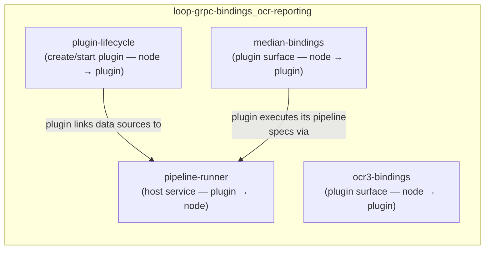
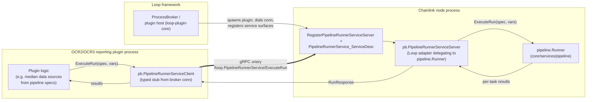
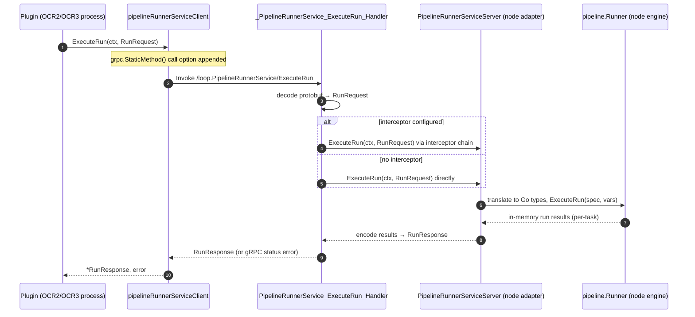

# OCR-Reporting · Pipeline Runner gRPC Bindings

**Module path:** `chainlink-common/pkg/loop/internal/pb` (file: `pipeline_runner_grpc.pb.go`, source proto: `pipeline_runner.proto`)

## Purpose

This module contains the **generated gRPC bindings for the `loop.PipelineRunnerService`** — the wire contract that lets a Loop plugin subprocess execute pipeline specs on the Chainlink node's pipeline engine.

In the [Loop plugin framework](../../Plugin_Process_Framework_(Loop).md), reporting plugins (OCR2/OCR3) run as isolated OS processes. Such plugins frequently describe their inputs as *pipeline specs* (for example, the OCR2 [median plugin](loop-grpc-bindings_ocr-reporting_median-bindings.md) takes `gasPriceSubunitsSource` and `juelsPerFeeCoinSource` pipeline definitions in its job config). The node owns the real pipeline execution engine — the `pipeline.Runner` in `chainlink/core/services/pipeline` (see [Pipeline execution engine](../../../Oracle_Engines___Data_Pipelines/pipeline.md)) — while the plugin process has no database or chain access of its own.

This binding closes that gap with a single **node-ward (inverted) RPC**: instead of the node pushing work into the plugin, the *plugin calls back into the node* to run a pipeline in-memory and get its results. The generated file provides:

- A **client stub** (`PipelineRunnerServiceClient`) the plugin side dials through its broker connection.
- A **server surface** (`PipelineRunnerServiceServer`) that a Loop adapter on the node side implements by delegating to the real `pipeline.Runner`.

The service exposes exactly one unary RPC:

| RPC | Full method name | Signature |
|---|---|---|
| `ExecuteRun` | `/loop.PipelineRunnerService/ExecuteRun` | `ExecuteRun(ctx, *RunRequest) (*RunResponse, error)` |

There are **no streaming methods** (`Streams: []grpc.StreamDesc{}`) — the surface is deliberately minimal: one blocking "run this spec, return the results" call. Persistence of runs is *not* part of this contract; the node-side engine's in-memory `ExecuteRun` semantics ("executes a new run in-memory according to a spec and returns the results") are what get exposed, keeping plugin-triggered executions decoupled from run-bookkeeping.

## Position in the architecture

This page is a leaf of the [loop-grpc-bindings](../../loop-grpc-bindings.md) module, which holds the protobuf definitions and generated stubs for every plugin surface. Its parent, [loop-grpc-bindings_ocr-reporting](../loop-grpc-bindings_ocr-reporting.md), groups all OCR-reporting-related bindings:

- [plugin-lifecycle](loop-grpc-bindings_ocr-reporting_plugin-lifecycle.md) — factory/plugin lifecycle RPCs (`reporting_grpc.pb.go`, `reporting_plugin_service_grpc.pb.go`): how a plugin is *created and started*.
- [median-bindings](loop-grpc-bindings_ocr-reporting_median-bindings.md) and [ocr3-bindings](loop-grpc-bindings_ocr-reporting_ocr3-bindings.md) — the plugin's *own* service surfaces (report codecs, contracts, transmitters).
- **pipeline-runner** (this page) — a *host-side service the plugin consumes*, direction-reversed relative to its siblings.

## Component reference

All names below live in package `pb` (`chainlink-common/pkg/loop/internal/pb`).

| Component | Kind | Role |
|---|---|---|
| `PipelineRunnerServiceClient` | interface | Client API: `ExecuteRun(ctx, *RunRequest, opts...) (*RunResponse, error)`. |
| `pipelineRunnerServiceClient` | struct | Concrete client wrapping any `grpc.ClientConnInterface`; created by `NewPipelineRunnerServiceClient(cc)`. Adds `grpc.StaticMethod()` to every call (a perf optimization for methods whose name is resolved statically). |
| `PipelineRunnerServiceServer` | interface | Server API: `ExecuteRun(context.Context, *RunRequest) (*RunResponse, error)`; implementations must embed `UnimplementedPipelineRunnerServiceServer`. |
| `UnimplementedPipelineRunnerServiceServer` | struct | Forward-compatibility default: returns gRPC error `codes.Unimplemented` for `ExecuteRun`. Must be embedded **by value** — registration panics at init time if embedded by pointer (`testEmbeddedByValue` guard), preventing nil-dereference panics on unimplemented methods. |
| `UnsafePipelineRunnerServiceServer` | interface | Opt-out of forward compatibility (the module's listed core component). Embedding it instead of `Unimplemented...` makes the compiler fail when new methods are added to the service — safe only for implementations that regenerate on every proto change. Its use is explicitly discouraged. |
| `RegisterPipelineRunnerServiceServer` | func | Registers a server on a `grpc.ServiceRegistrar` (this is what the Loop broker/plugin host calls when wiring service surfaces). |
| `_PipelineRunnerService_ExecuteRun_Handler` | func | Generated unary handler: decodes the `RunRequest`, dispatches to `PipelineRunnerServiceServer.ExecuteRun`, and honors an optional `grpc.UnaryServerInterceptor`. |
| `PipelineRunnerService_ServiceDesc` | var | `grpc.ServiceDesc` for `loop.PipelineRunnerService` (metadata `pipeline_runner.proto`; one method, no streams). |

**Version constraints:** generated by `protoc-gen-go-grpc v1.5.1` / `protoc v5.29.3` and requires gRPC-Go v1.64.0 or later (`grpc.SupportPackageIsVersion9`).

### Forward-compatibility model

gRPC services evolve by adding methods. This file implements the standard two-tier strategy:

1. **Safe path (default):** embed `UnimplementedPipelineRunnerServiceServer` by value. New methods get a working "unimplemented" fallback; older binaries keep serving at runtime.
2. **Unsafe path:** embed `UnsafePipelineRunnerServiceServer`. You trade runtime resilience for a compile-time guarantee that no method goes unimplemented silently — any regeneration that adds methods breaks the build until the implementation catches up.

## Architecture

Key points:

- **Direction of dependency is inverted** compared to sibling bindings: the *node* implements this server (wrapping its own `pipeline.Runner`), and the *plugin* holds the client. This is how plugins gain read/execute access to node resources without the node linking plugin code.
- The **broker** (see [loop-plugin-core](../../loop-plugin-core.md)) owns the process lifecycle and the `grpc.ClientConnInterface`; the generated stub is agnostic to whether the connection is a real socket or the in-process broker variant.
- The node-side adapter (an implementation of `PipelineRunnerServiceServer` provided by the `chainlink-common/pkg/loop` package, not this generated file) translates between protobuf messages and the Go domain types below.

## Data flow: an `ExecuteRun` round trip

Failure semantics are conventional gRPC: any error becomes a `status` error on the wire; the plugin side observes a non-nil `error` from `ExecuteRun`. Because the RPC is unary and blocking, long-running specs are bounded by the caller's context (matching the node engine's context-driven cancellation).

## Domain type mapping

The wire messages `RunRequest` / `RunResponse` (defined in the companion generated `pipeline_runner.pb.go`) carry the canonical Go pipeline types documented in [types-core · plugin services](../../../Shared_Foundation_Libraries___Domain_Types/types-core/types-core_plugin-services.md):

| Go type (`chainlink-common/pkg/types/core/pipeline_runner.go`) | Meaning |
|---|---|
| `Vars{Vars map[string]any}` | Input variables for the run. |
| `Options{MaxTaskDuration time.Duration}` | Execution options (per-task timeout budget). |
| `TaskResult{ID, Type, Index, TaskValue}` | Result of one task in the pipeline DAG. |

The generated gRPC file is message-agnostic — the protobuf ↔ Go-domain translation lives in the Loop wrapper around it, keeping this file a pure wire contract. Broader pipeline-run persistence (`PipelineRun` records) is handled by the node's job service, not this service; see [job service domain model](../../../Node_Platform_Services/job_service/job_service_domain_model.md).

## Consumers

- **OCR2 median plugin** — its config declares pipeline specs (`gasPriceSubunitsSource`, `juelsPerFeeCoinSource`); at observation time the plugin executes them through this service so that data-source fetching, HTTP calls, and caching all happen inside the node.
- **Standard capability plugins** — receive a pipeline-runner client alongside their other broker-provided services when they need spec-driven computation.
- **Node side** — `chainlink/core/services/pipeline`'s `Runner` (see [Pipeline execution engine](../../../Oracle_Engines___Data_Pipelines/pipeline.md)) is the concrete implementation wrapped by the server adapter; the plugin-facing surface set (`PluginProvider`, `MedianProvider`) is documented in [types-core](../../../Shared_Foundation_Libraries___Domain_Types/types-core/types-core_plugin-services.md).

## Regeneration and tooling

This is generated code — never edit by hand. It is produced from `pipeline_runner.proto` by the protoc toolchain managed in `chainlink-common`:

- `chainlink-common/Makefile` target `install-protoc` installs `protoc-gen-go` and `protoc-gen-go-grpc` at versions pinned in `.tool-versions` (matching the `v1.5.1` / `v5.29.3` headers above).
- The `generate` target runs the full code-generation pass, after which regenerated `*_grpc.pb.go` files must be committed together with their `.proto` sources.

## Related documentation

- Parent: [loop-grpc-bindings](../../loop-grpc-bindings.md) · [loop-grpc-bindings_ocr-reporting](../loop-grpc-bindings_ocr-reporting.md)
- Siblings: [plugin-lifecycle](loop-grpc-bindings_ocr-reporting_plugin-lifecycle.md) · [median-bindings](loop-grpc-bindings_ocr-reporting_median-bindings.md) · [ocr3-bindings](loop-grpc-bindings_ocr-reporting_ocr3-bindings.md)
- Framework context: [Plugin Process Framework (Loop)](../../Plugin_Process_Framework_(Loop).md) · [loop-plugin-core](../../loop-plugin-core.md)
- Node-side engine: [Pipeline execution engine](../../../Oracle_Engines___Data_Pipelines/pipeline.md)
- Domain types: [types-core · plugin services](../../../Shared_Foundation_Libraries___Domain_Types/types-core/types-core_plugin-services.md)
