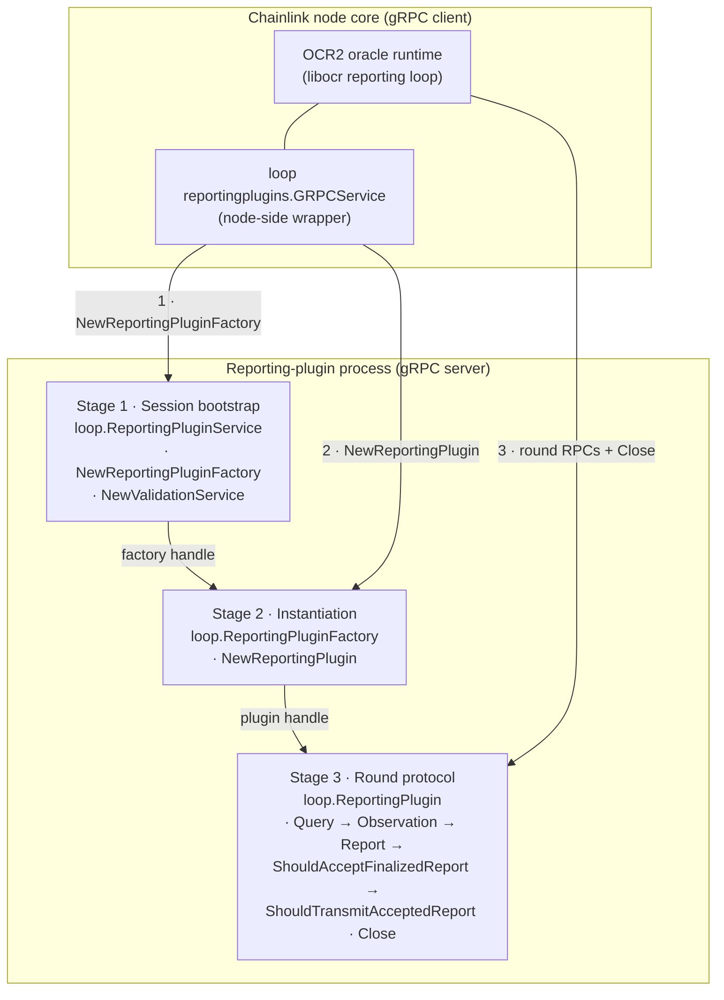
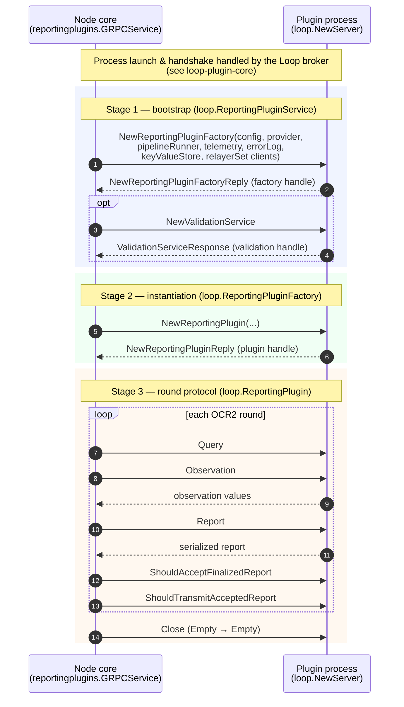
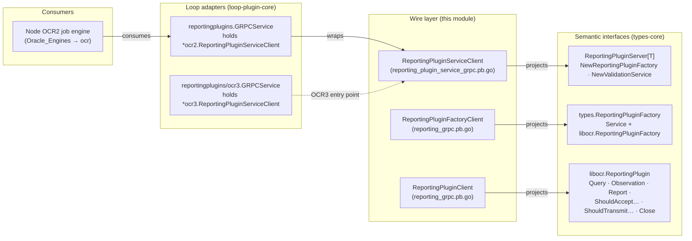

# loop-grpc-bindings_ocr-reporting_plugin-lifecycle

**Module path:** `chainlink-common/pkg/loop/internal/pb` (files `reporting_plugin_service_grpc.pb.go`, `reporting_grpc.pb.go`)

## 1. Purpose and scope

This sub-module of [loop-grpc-bindings_ocr-reporting](../loop-grpc-bindings_ocr-reporting.md) defines the **gRPC wire contract for the OCR2 reporting-plugin lifecycle**: the full protocol by which the Chainlink node core bootstraps a reporting-plugin session, instantiates a plugin through its factory, drives it through the Offchain Reporting round protocol, and shuts it down again.

It is the purest expression of the Loop process-isolation model for OCR2 plugins — three services in two generated files:

| Generated file | gRPC service (wire name) | Lifecycle role |
|---|---|---|
| `reporting_plugin_service_grpc.pb.go` | `loop.ReportingPluginService` | **Session bootstrap** — the node's first contact with a plugin binary; creates the plugin factory and a config-validation service |
| `reporting_grpc.pb.go` | `loop.ReportingPluginFactory` | **Plugin instantiation** — turns configuration + node-provided dependencies into one running plugin instance |
| `reporting_grpc.pb.go` | `loop.ReportingPlugin` | **Round protocol & teardown** — `Query`, `Observation`, `Report`, acceptance/transmission decisions, and `Close` |

Like everything in the bindings layer, this module contains **no hand-written logic**. Both files are `protoc-gen-go-grpc v1.5.1` / `protoc v5.29.3` output pinned to `grpc.SupportPackageIsVersion9` (gRPC-Go ≥ 1.64), generated from `reporting_plugin_service.proto` and `loop/internal/pb/reporting.proto`. The semantic Go interfaces they project are documented in [types-core](../../../Shared_Foundation_Libraries___Domain_Types/types-core.md) — specifically [types-core_plugin-services](../../../Shared_Foundation_Libraries___Domain_Types/types-core/types-core_plugin-services.md).

> **Scope note.** This page covers the *generic OCR2* lifecycle (`loop.*` services). The OCR3 lifecycle (extended round protocol with validation/quorum/outcome phases) is covered in [loop-grpc-bindings_ocr-reporting_ocr3-bindings](loop-grpc-bindings_ocr-reporting_ocr3-bindings.md), the legacy Median stack in [loop-grpc-bindings_ocr-reporting_median-bindings](loop-grpc-bindings_ocr-reporting_median-bindings.md), and the node-side `PipelineRunnerService` callback in [loop-grpc-bindings_ocr-reporting_pipeline-runner](loop-grpc-bindings_ocr-reporting_pipeline-runner.md).

## 2. Service inventory

Every RPC is a plain unary call (`Streams: []grpc.StreamDesc{}` in both service descriptors), invoked with `grpc.StaticMethod()` semantics, and each per-method handler supports gRPC interceptors.

### `loop.ReportingPluginService` — session bootstrap

| RPC (full method name) | Request → Reply | Semantic operation |
|---|---|---|
| `/loop.ReportingPluginService/NewReportingPluginFactory` | `NewReportingPluginFactoryRequest` → `NewReportingPluginFactoryReply` | Obtain the plugin's `ReportingPluginFactory`, passing node-hosted dependency clients |
| `/loop.ReportingPluginService/NewValidationService` | `ValidationServiceRequest` → `ValidationServiceResponse` | Obtain a `ValidationService` for off-chain/on-chain config validation |

### `loop.ReportingPluginFactory` — plugin instantiation

| RPC (full method name) | Request → Reply | Semantic operation |
|---|---|---|
| `/loop.ReportingPluginFactory/NewReportingPlugin` | `NewReportingPluginRequest` → `NewReportingPluginReply` | Create one reporting-plugin instance for a concrete configuration/provider pair |

### `loop.ReportingPlugin` — OCR2 round protocol

| RPC (full method name) | Request → Reply | Semantic operation |
|---|---|---|
| `/loop.ReportingPlugin/Query` | `QueryRequest` → `QueryReply` | Round query phase — advance/plugin epoch |
| `/loop.ReportingPlugin/Observation` | `ObservationRequest` → `ObservationReply` | Produce this node's observation for the round |
| `/loop.ReportingPlugin/Report` | `ReportRequest` → `ReportReply` | Build the report from observed values |
| `/loop.ReportingPlugin/ShouldAcceptFinalizedReport` | `ShouldAcceptFinalizedReportRequest` → `ShouldAcceptFinalizedReportReply` | Consensus gate: accept the finalized report? |
| `/loop.ReportingPlugin/ShouldTransmitAcceptedReport` | `ShouldTransmitAcceptedReportRequest` → `ShouldTransmitAcceptedReportReply` | Consensus gate: transmit the accepted report? |
| `/loop.ReportingPlugin/Close` | `emptypb.Empty` → `emptypb.Empty` | Release plugin resources (symmetric teardown) |

## 3. Architecture

### 3.1 Three-stage lifecycle layering

The two files implement a **funnel**: one service per session, one factory per provider/configuration, one plugin per OCR2 oracle instance. Each layer returns a *service handle* that the node resolves into a typed client for the next layer (the factory-services pattern described in the parent [loop-grpc-bindings](../../loop-grpc-bindings.md) conventions).



Key structural points:

- **All three services are served by the plugin process** on the forward channel — the node is always the gRPC client here. The node-hosted services the plugin needs in return (pipeline runner, telemetry, error log, key-value store, relayer set) are *not* separate services in this module; they are handed to the plugin as **clients embedded in the `NewReportingPluginFactoryRequest`** (see §4.2 and [loop-grpc-bindings_contract-io](../loop-grpc-bindings_contract-io.md)).
- **Layered handles.** The reply to `NewReportingPluginFactory` identifies the factory sub-service; the reply to `NewReportingPlugin` identifies the plugin sub-service. Closing is symmetric: `loop.ReportingPlugin` exposes `Close` taking `google.protobuf.Empty`, matching the teardown convention for long-lived services.
- **One file, two protocol layers.** `reporting_grpc.pb.go` deliberately co-locates the factory and the round protocol because they share the OCR2 message vocabulary (`QueryRequest`, `ObservationRequest`, `ReportRequest`, …); the bootstrap service lives in its own file because it is shared by the OCR2 and OCR3 protocols (the OCR3 bindings in [ocr3-bindings](loop-grpc-bindings_ocr-reporting_ocr3-bindings.md) reuse the same `loop.ReportingPluginService` entry point).

### 3.2 Generated-code anatomy (per service)

Both files instantiate the standard `protoc-gen-go-grpc` template documented in the parent page's [generated-code overview](../../loop-grpc-bindings.md). The core components of this module are exactly these building blocks:

| Component | Provided by | Role |
|---|---|---|
| `ReportingPluginServiceClient` + `NewReportingPluginServiceClient` | `reporting_plugin_service_grpc.pb.go` | Typed client the node consumes |
| `ReportingPluginServiceServer` + `RegisterReportingPluginServiceServer` | `reporting_plugin_service_grpc.pb.go` | Interface + registration the plugin implements |
| `UnimplementedReportingPluginServiceServer` | `reporting_plugin_service_grpc.pb.go` | Forward-compatibility default (embedded **by value**); returns `codes.Unimplemented` for new RPCs |
| `UnsafeReportingPluginServiceServer` | `reporting_plugin_service_grpc.pb.go` | Opt-out of forward compatibility (discouraged) |
| `ReportingPluginFactoryClient` / `ReportingPluginFactoryServer` / `UnimplementedReportingPluginFactoryServer` / `UnsafeReportingPluginFactoryServer` | `reporting_grpc.pb.go` | Same quartet for the factory service |
| `ReportingPluginClient` / `ReportingPluginServer` / `UnimplementedReportingPluginServer` / `UnsafeReportingPluginServer` | `reporting_grpc.pb.go` | Same quartet for the round-protocol service |
| `<Service>_ServiceDesc` + `_…_Handler` functions | both files | gRPC service descriptors and interceptor-aware method handlers |

Registration hardening is present in all three `Register…Server` functions: each checks the `testEmbeddedByValue()` marker and panics at registration time if an `Unimplemented…Server` was embedded by *pointer* (a nil-pointer embedding would panic later at request time on an unimplemented method).

## 4. Lifecycle flow

### 4.1 End-to-end session sequence



### 4.2 What crosses the boundary at bootstrap

The semantic node-side interface behind the `NewReportingPluginFactory` RPC is `ReportingPluginServer[T]` from `chainlink-common/pkg/types/core/reporting_plugin_service.go` (see [types-core_plugin-services](../../../Shared_Foundation_Libraries___Domain_Types/types-core/types-core_plugin-services.md)):

```go
NewReportingPluginFactory(ctx context.Context,
    config ReportingPluginServiceConfig, provider T,
    pipelineRunner PipelineRunnerService, telemetry TelemetryClient,
    errorLog ErrorLog, keyValueStore KeyValueStore, relayerSet RelayerSet,
) (types.ReportingPluginFactory, error)
```

The `NewReportingPluginFactoryRequest` therefore carries both the **plugin identity/configuration** (mirroring `ReportingPluginServiceConfig`: provider type, command, plugin name, telemetry type, plugin config JSON) and **reverse-channel clients** for the node-hosted services the plugin will call back into during rounds. The round RPCs of `loop.ReportingPlugin` then project the `libocr.ReportingPlugin` interface that `types.ReportingPluginFactory` composes (see [types-core_providers](../../../Shared_Foundation_Libraries___Domain_Types/types-core/types-core_providers.md)).

## 5. Mapping to semantic Go interfaces and runtime wrappers



| Wire artifact | Consumed by (node side) | Implemented by (plugin side) |
|---|---|---|
| `ReportingPluginServiceClient` | `loop/reportingplugins.GRPCService` (`pluginClient *ocr2.ReportingPluginServiceClient`), `loop/reportingplugins/ocr3.GRPCService` (`*ocr3.ReportingPluginServiceClient`) | Registration via the `loop.NewServer` plumbing of [loop-plugin-core](../../loop-plugin-core.md); the aggregate `Plugin` runtime manages the registered `services.Service` set |
| `ReportingPluginFactoryClient` | The adapter's `NewReportingPluginFactory` implementation | The plugin's concrete factory, projected onto `ReportingPluginFactoryServer` |
| `ReportingPluginClient` | libocr's reporting loop, driven by the OCR2 job engine (see [Oracle_Engines___Data_Pipelines/ocr](../../../Oracle_Engines___Data_Pipelines/ocr.md)) | The plugin's concrete reporting plugin, projected onto `ReportingPluginServer` |

The wrappers live in `chainlink-common/pkg/loop/reportingplugins/grpc.go` (OCR2) and `chainlink-common/pkg/loop/reportingplugins/ocr3/grpc.go` (OCR3) — both are documented as part of [loop-plugin-core](../../loop-plugin-core.md). Note that even the OCR3 wrapper bootstraps through this module's `loop.ReportingPluginService` before switching to the `loop.internal.pb.ocr3.*` services — which is why the bootstrap service is shared between both protocol pages.

## 6. Forward compatibility: `Unimplemented…` vs `Unsafe…`

This module's five listed server-side components are the compatibility surface of the OCR2 protocol:

- **`UnimplementedReportingPluginServiceServer`, `UnimplementedReportingPluginFactoryServer`, `UnimplementedReportingPluginServer`** — structs providing default `codes.Unimplemented` implementations for every RPC. Server implementations embed them **by value** to stay source-compatible when the protos gain new methods (the protocol-versioning discipline of the protobuf do's-and-don'ts referenced in the parent page).
- **`UnsafeReportingPluginServiceServer`, `UnsafeReportingPluginFactoryServer`, `UnsafeReportingPluginServer`** — interfaces that opt out of forward compatibility (no embedded defaults). Embedding them means any future RPC addition is a compile error on the implementer's side; their use is discouraged and preserved only for generated-code compatibility.

The behavioral contract — embedded-by-value requirement, registration-time nil-embedding panic checks, gRPC-status error propagation, and interceptor support in every generated handler — is shared with all Loop bindings and documented once in the parent page's [conventions and maintenance guidance](../../loop-grpc-bindings.md). It is not repeated per-service here.

## 7. Code generation and maintenance

Both files are pure generated output and **must never be hand-edited**. Regeneration is driven by the `chainlink-common` module build (`chainlink-common/Makefile`):

- `install-protoc` — installs `protoc` plus `protoc-gen-go` / `protoc-gen-go-grpc`, with versions resolved from `.tool-versions` (matching the `protoc v5.29.3` / `protoc-gen-go-grpc v1.5.1` pins in the file headers).
- `cre-protoc` — builds the custom `protoc-gen-cre` plugin used by the wider codegen pipeline.
- `generate` — runs the full mockery + protoc codegen across the module (including the `//go:generate` directives for `reporting_plugin_service.proto` and `loop/internal/pb/reporting.proto` in `pkg/loop/internal/pb/generate.go`).

Editing procedure: modify the `.proto` source (field numbers are immutable; only additive changes are allowed), then run `make generate` in `chainlink-common/`. The full codegen pipeline, shared wire types (`internal/codec`, `chain-common/query`), and test scaffolding (`pkg/loop/internal/test/grpc_scaffold.go`) are described in the parent page's [code-generation section](../../loop-grpc-bindings.md).

## 8. Related documentation

- [loop-grpc-bindings_ocr-reporting](../loop-grpc-bindings_ocr-reporting.md) — parent page: service taxonomy, call-direction matrix, OCR2 vs OCR3 comparison
- [loop-grpc-bindings](../../loop-grpc-bindings.md) — generated-code anatomy, service naming conventions, codegen pipeline
- [loop-plugin-core](../../loop-plugin-core.md) — broker, `loop.NewServer`/`NewClient` runtime, and the `reportingplugins.GRPCService` wrappers that consume this module
- [loop-grpc-bindings_ocr-reporting_ocr3-bindings](loop-grpc-bindings_ocr-reporting_ocr3-bindings.md) — the OCR3 factory/plugin/transmitter services that bootstrap through this module
- [loop-grpc-bindings_ocr-reporting_median-bindings](loop-grpc-bindings_ocr-reporting_median-bindings.md) — legacy Median stack (`PluginMedian`, `ReportCodec`, `DataSource`, …)
- [loop-grpc-bindings_ocr-reporting_pipeline-runner](loop-grpc-bindings_ocr-reporting_pipeline-runner.md) — `PipelineRunnerService`, one of the reverse-channel dependencies passed at bootstrap
- [types-core_plugin-services](../../../Shared_Foundation_Libraries___Domain_Types/types-core/types-core_plugin-services.md) — semantic `ReportingPluginServer[T]`, `PipelineRunnerService`, `ErrorLog`, `ValidationService` interfaces
- [Plugin_Process_Framework_(Loop)](../../../Plugin_Process_Framework_(Loop).md) — the overall process-isolation framework
