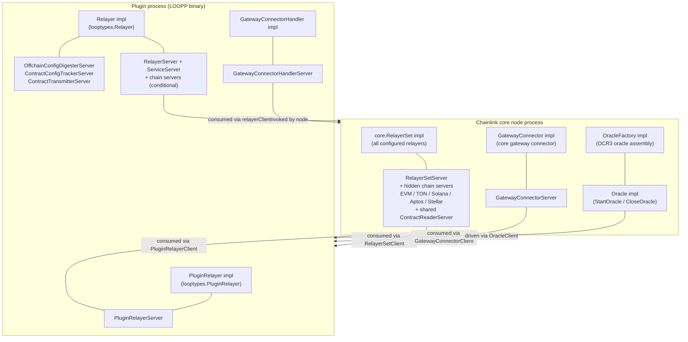
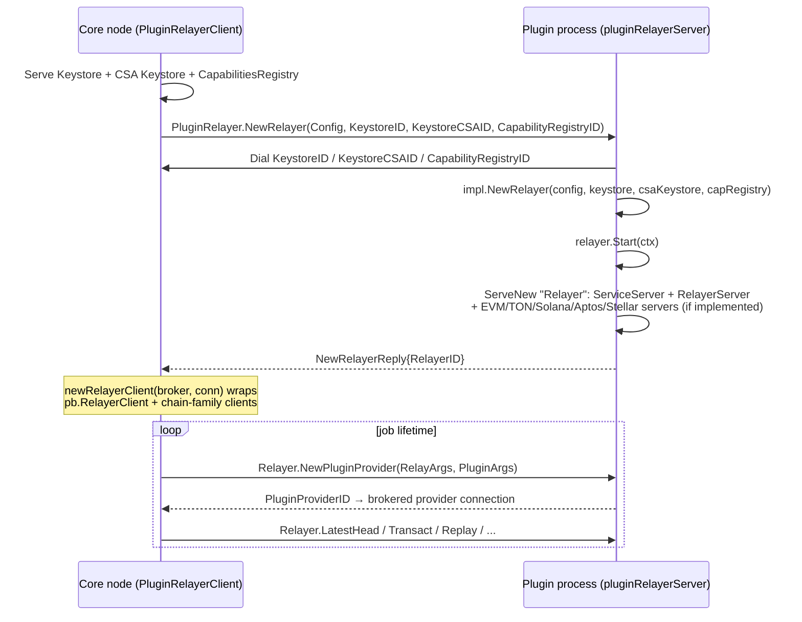
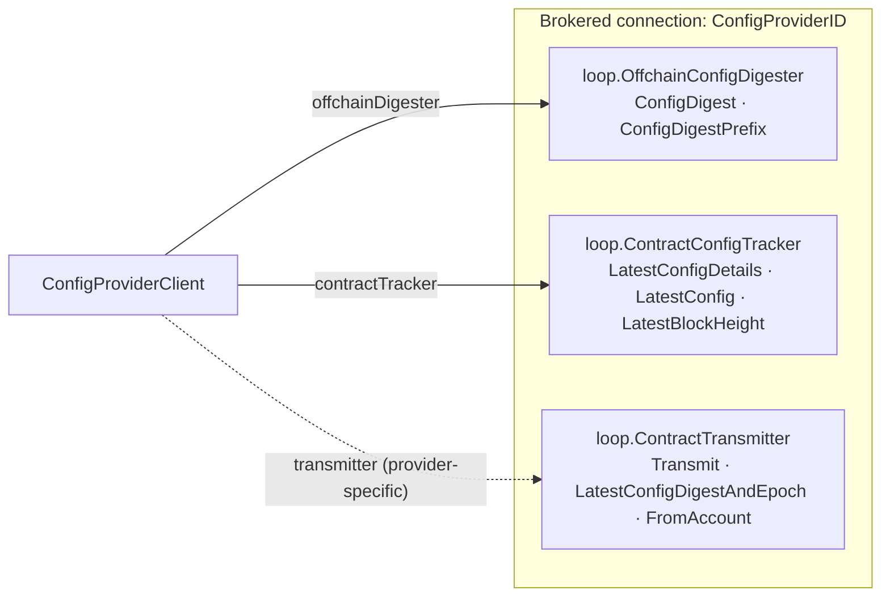
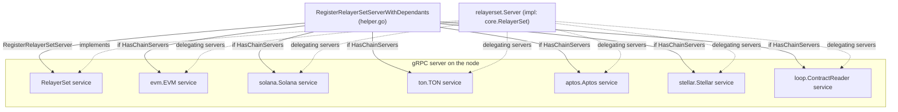
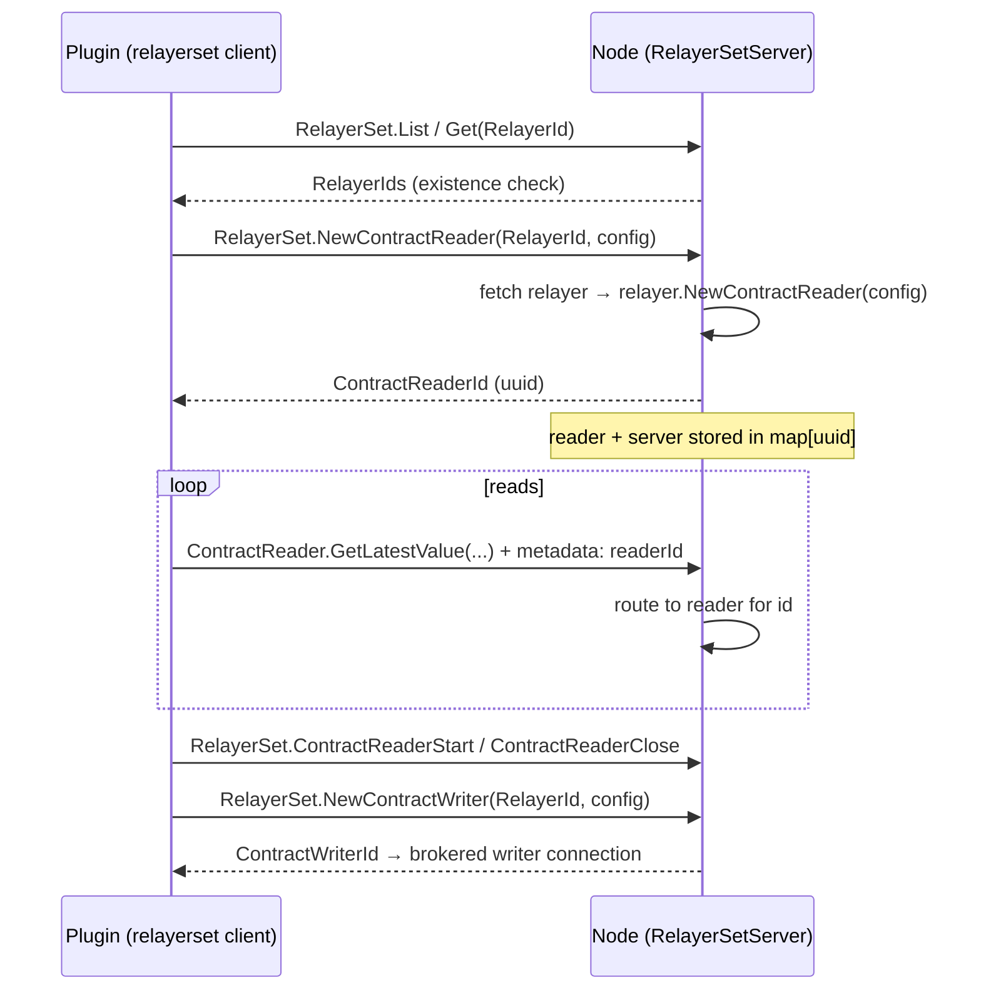
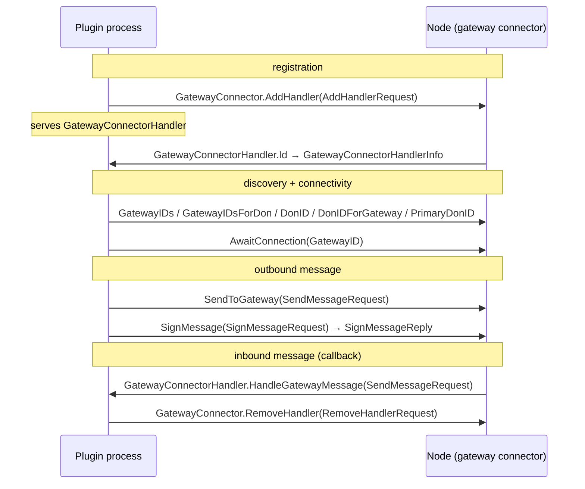
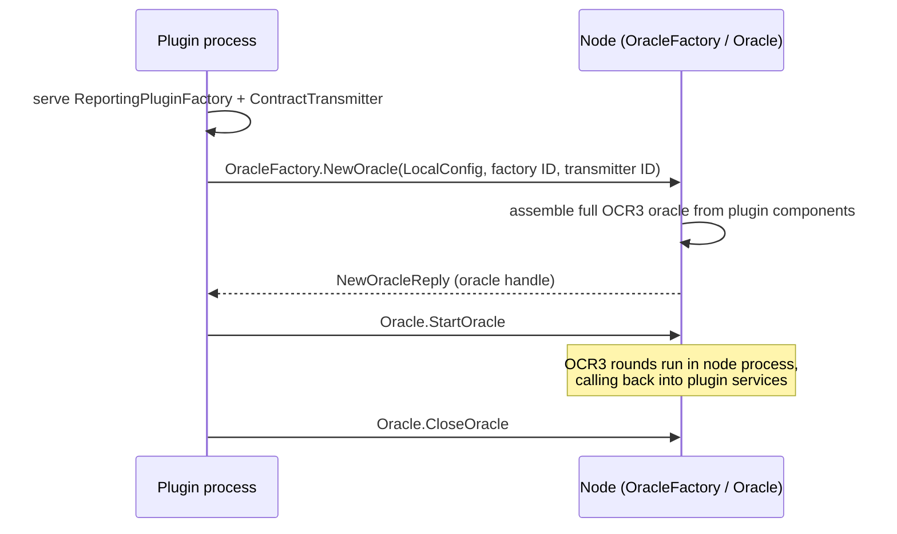
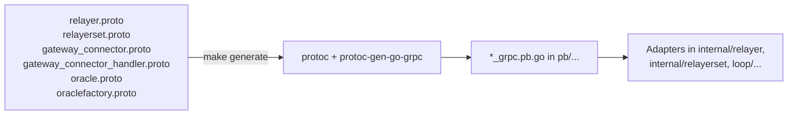
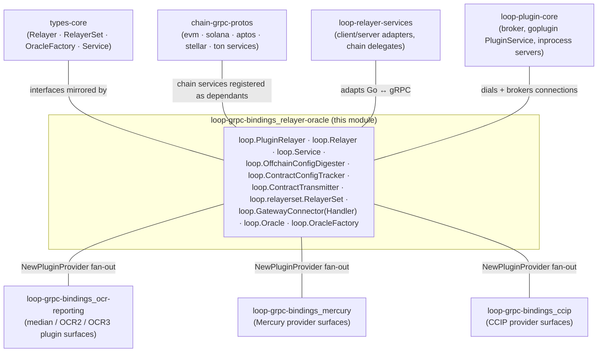

# loop-grpc-bindings: Relayer, RelayerSet & Oracle Bindings

The **relayer-oracle** module is the sub-module of [loop-grpc-bindings](../loop-grpc-bindings.md) that defines the gRPC wire contract for **chain access and oracle lifecycle** across the Loop plugin process boundary. While the sibling module [loop-grpc-bindings_contract-io](loop-grpc-bindings_contract-io.md) covers the *node-provided infrastructure* services (contract reads/writes, keystores, telemetry), this module covers the services through which **relayers are created, multiplexed, and consumed**, how **gateway messages** flow between a plugin and the node's gateway connector, and how **OCR3 oracle instances** are manufactured and driven.

Everything here is generated code (`protoc-gen-go-grpc v1.5.1` / `protoc v5.29.3`, requiring `grpc.SupportPackageIsVersion9` / gRPC-Go ≥ 1.64, every RPC invoked with `grpc.StaticMethod()` semantics). The module contains **no business logic**: each `loop.*` gRPC service is a wire mirror of a Go interface defined in [types-core](../../Shared_Foundation_Libraries___Domain_Types/types-core.md) or `pkg/loop/internal/types`, and the translation happens in the adapter layer documented in [loop-relayer-services](../loop-relayer-services.md).

> Parent page: [loop-grpc-bindings](../loop-grpc-bindings.md) · Framework overview: [Plugin_Process_Framework_(Loop)](../../Plugin_Process_Framework_(Loop).md)

---

## 1. Service catalog

| gRPC service (full method prefix) | Proto source | Served by | Mirrors Go interface | Purpose |
|---|---|---|---|---|
| `loop.PluginRelayer` | `pb/relayer.proto` | **Plugin** | `looptypes.PluginRelayer` | Entry point of a LOOPP relayer binary: node requests a relayer instance |
| `loop.Relayer` | `pb/relayer.proto` | **Plugin** (LOOPP relayer) or node | `looptypes.Relayer` / `types.Relayer` | Chain access surface: heads, chain info, contract reader/writer & provider factories, funds transfer, replay |
| `loop.Service` | `pb/relayer.proto` | Both sides | `types.Service` | Uniform lifecycle: `Name`, `Close`, `Ready`, `HealthReport` — registered alongside every long-lived object |
| `loop.OffchainConfigDigester` | `pb/relayer.proto` | Relayer owner | `libocr.OffchainConfigDigester` | OCR2 config-digest computation (client enforces 32-byte digests via `pb.ErrConfigDigestLen`) |
| `loop.ContractConfigTracker` | `pb/relayer.proto` | Relayer owner | `libocr.ContractConfigTracker` | OCR2 on-chain config tracking (latest config details / block height) |
| `loop.ContractTransmitter` | `pb/relayer.proto` | Relayer owner | `libocr.ContractTransmitter` | OCR2 report transmission (`Transmit`, `LatestConfigDigestAndEpoch`, `FromAccount`) |
| `loop.relayerset.RelayerSet` | `pb/relayerset/relayerset.proto` | **Node** | `core.RelayerSet` | Multiplexed access to *all* configured relayers, addressed by `RelayerId{ChainId, Network}` |
| `loop.GatewayConnector` | `pb/gatewayconnector/gateway_connector.proto` | **Node** | `types.GatewayConnector` | Plugin → node gateway messaging: handler registration, sends, signing, DON/gateway discovery |
| `loop.GatewayConnectorHandler` | `pb/gatewayconnector/gateway_connector_handler.proto` | **Plugin** | gateway handler callback | Reverse direction: node delivers gateway messages to the plugin's registered handler |
| `loop.Oracle` | `pb/oracle/oracle.proto` | **Node** | `core.Oracle` | Lifecycle of an OCR3 oracle instance (`StartOracle`, `CloseOracle`) |
| `loop.OracleFactory` | `pb/oraclefactory/oraclefactory.proto` | **Node** | `core.OracleFactory` | Factory that assembles a full OCR3 oracle from plugin-supplied components |

All services are **unary RPCs only** (no streaming). Factory-style RPCs (`NewRelayer`, `NewContractWriter`, `NewContractReader`, `NewConfigProvider`, `NewPluginProvider`, `NewCCIPProvider`, `NewOracle`, `NewPluginProvider` on RelayerSet) return **service IDs** that the consumer resolves into a brokered gRPC connection — the "direction of control" convention described in the [parent module](../loop-grpc-bindings.md).

---

## 2. Ownership architecture

Unlike the contract-io services (all served by the node), this module's services are **bidirectional in ownership**: some run in the core node process, others in the plugin binary. The Loop broker (hashicorp go-plugin + [loop-plugin-core](../loop-plugin-core.md) net brokering) lets each side serve *hidden* services on demand and hand out connection IDs.

Two symmetrical patterns emerge:

1. **Node consumes plugin capabilities** — `PluginRelayer` and `Relayer` are served by the plugin; the node dials them when a job runs in LOOPP mode.
2. **Plugin consumes node capabilities** — `RelayerSet`, `GatewayConnector`, `OracleFactory`, and `Oracle` are served by the node; reporting plugins and capability plugins dial them.

---

## 3. PluginRelayer and Relayer — the LOOPP relayer bootstrap

### 3.1 Wire surface

`loop.PluginRelayer` is a single-method service:

- `NewRelayer(NewRelayerRequest{Config, KeystoreID, KeystoreCSAID, CapabilityRegistryID}) → NewRelayerReply{RelayerID}`

`loop.Relayer` mirrors the full `looptypes.Relayer` interface (which extends `types.ChainService` — see [types-core](../../Shared_Foundation_Libraries___Domain_Types/types-core.md)):

| RPC group | Methods | Notes |
|---|---|---|
| Provider factories | `NewContractWriter`, `NewContractReader`, `NewConfigProvider`, `NewPluginProvider`, `NewCCIPProvider` | Each reply carries a service ID (`ContractWriterID`, `ContractReaderID`, `ConfigProviderID`, `PluginProviderID`, `CcipProviderID`) for a brokered sub-connection |
| Head tracking | `LatestHead`, `FinalizedHead` | `pb.Head` (height/hash/timestamp) |
| Chain metadata | `GetChainStatus`, `GetChainInfo`, `ListNodeStatuses` | Chain/node configuration and pagination |
| Funds | `Transact` | `pb.TransactionRequest` uses the hand-written `pb.BigInt` for amounts |
| Replay | `Replay` | `structpb.Struct` for free-form args |

The **chain-family services** (EVM, Solana, TON, Aptos, Stellar — defined in [chain-grpc-protos](../../Shared_Foundation_Libraries___Domain_Types/chain-grpc-protos.md)) are deliberately *not* part of the `loop.Relayer` service. They are registered as extra services on the *same* brokered connection during `NewRelayer`, conditionally on the relayer implementing the corresponding `types.*Service` interface. The client adapter (`relayerClient`) composes `pb.RelayerClient` with `evmpb.EVMClient`, `tonpb.TONClient`, `solpb.SolanaClient`, `aptospb.AptosClient` and `stelpb.StellarClient` to present one Go `looptypes.Relayer`.

### 3.2 Bootstrap sequence

The node-side `PluginRelayerClient` (in `pkg/loop/internal/relayer/relayer.go`) first **serves its dependencies** to the plugin over brokered connections, then requests the relayer. The plugin's `pluginRelayerServer` dials those dependencies back, creates + starts its relayer, and serves the relayer (plus conditional chain servers) on a new brokered connection:

On the provider factories, the plugin side fans out again: `NewConfigProvider` serves the OCR2 trio (`OffchainConfigDigester`, `ContractConfigTracker`, `ContractTransmitter` — see §4) via `ocr2.RegisterConfigProviderServices`, and `NewPluginProvider` dispatches on `RelayArgs.ProviderType` (`median`, `generic`, `mercury`, `ccip-commit`, `ccip-exec`, …) into the provider surfaces documented in [loop-grpc-bindings_ocr-reporting](loop-grpc-bindings_ocr-reporting.md), [loop-grpc-bindings_mercury](loop-grpc-bindings_mercury.md) and [loop-grpc-bindings_ccip](loop-grpc-bindings_ccip.md).

### 3.3 Service lifecycle (`loop.Service`)

Every long-lived object served across the boundary — the relayer itself, contract readers/writers, plugin instances — also registers `loop.Service` (`Name`, `Close`, `Ready`, `HealthReport`). The goplugin wrapper `goplugin.ServiceServer{Srv: impl}` does this automatically, and client-side `goplugin.ServiceClient` uses it to implement `types.Service` (Start/Close/Ready/HealthReport) semantics over the wire. `HealthReport` returns `map<string,string>` (error strings keyed by subsystem).

---

## 4. OCR2 config-provider trio

`NewConfigProvider` returns a connection carrying three small services that together satisfy libocr's `offchainreporting2plus` config-provider contract for a generic OCR2 plugin:

Implementation notes:

- `offchainConfigDigesterClient` validates that `ConfigDigestReply.ConfigDigest` is exactly 32 bytes (`pb.ErrConfigDigestLen`) before copying into libocr's `[32]byte` digest — the wire type is opaque `bytes`, so bounds checking is client-side.
- `ContractTransmitter` here is the OCR2 flavor. The OCR3 flavor (`loop.ocr3.ContractTransmitter`) is a separate service — see [loop-grpc-bindings_ocr-reporting](loop-grpc-bindings_ocr-reporting.md).
- These services are implemented by the **relayer owner** (plugin in LOOPP mode, node in embedded mode) and consumed by the OCR2 reporting plugin runtime.

---

## 5. RelayerSet — multiplexed relayer access

### 5.1 Wire surface

`loop.relayerset.RelayerSet` is served by the **node** and consumed by plugins that receive a `core.RelayerSet` (for example, the `ReportingPluginServer.NewReportingPluginFactory` hands a relayer set to reporting plugins — see [types-core](../../Shared_Foundation_Libraries___Domain_Types/types-core.md)). Individual relayers are addressed by `RelayerId{ChainId, Network}` rather than by connection:

| RPC group | Methods | Semantics |
|---|---|---|
| Discovery | `Get`, `List` | Existence check / enumeration; replies carry `RelayerId`s, not objects |
| Provider factories | `NewPluginProvider`, `NewContractReader`, `NewContractWriter` | Take a `RelayerId` + config; return service IDs for brokered connections |
| Per-relayer ops | `StartRelayer`, `CloseRelayer`, `RelayerReady`, `RelayerHealthReport`, `RelayerName`, `RelayerLatestHead`, `RelayerFinalizedHead`, `RelayerGetChainInfo` | All take a `RelayerId`; the server fetches the relayer and proxies the call |
| Shared reader lifecycle | `ContractReaderStart`, `ContractReaderClose` | Drive the shared `ContractReader` service |

### 5.2 The hidden-dependants registration pattern

A RelayerSet server does more than implement `RelayerSetServer`: the per-relayer chain access and contract reading are served through **shared, hidden services** registered on the same gRPC server. `helper.go` defines the two pieces that make this possible:

- **`HasChainServers`** — an interface a RelayerSet server may implement to expose its internal chain servers:
  - `SolanaServer() solana.SolanaServer`
  - `EVMServer() evm.EVMServer`
  - `TONServer() ton.TONServer`
  - `AptosServer() aptos.AptosServer`
  - `StellarServer() stellar.StellarServer`
  - `ContractReaderServer() pb.ContractReaderServer`
- **`RegisterRelayerSetServerWithDependants(s, srv)`** — registers `RelayerSet` *plus* every dependant service: it always registers the ContractReader server if `srv` implements `pb.ContractReaderServer` directly, and, if `srv` implements `HasChainServers`, registers the Solana, EVM, TON, Aptos, Stellar and ContractReader servers. The chain servers are thin delegates (`evmServer{parent: *Server}`, etc.) that read the target `RelayerId` from gRPC metadata and forward to the matching relayer.

### 5.3 Avoiding a per-relayer server — the `(RelayerSetClient, RelayerId)` pattern

The implementation comment in `internal/relayerset/server.go` documents the key optimization: instead of wrapping each `Get` result in its own gRPC server, the client keeps a reference to the RelayerSet client plus the `RelayerId`:

So in client code, `relayer.NewContractReader(...)` becomes a `RelayerSet.NewContractReader(relayerId, config)` call; `RelayerSet.Get` is effectively a *relayer-existence check*, and `RelayerSet.List` enumerates `RelayerId`s. Chain-family calls (e.g. `LatestHead` for EVM) are multiplexed through the shared chain servers using per-request metadata identifying the relayer.

---

## 6. GatewayConnector and GatewayConnectorHandler — bidirectional gateway messaging

Gateway connectivity is split across two services with **opposite ownership**, connected by handler registration:

- **`loop.GatewayConnector`** (node-served) mirrors `types.GatewayConnector`: manage handlers, send messages to gateways, sign messages with the node's CSA key material, and discover gateway/DON topology (`GatewayIDs`, `GatewayIDsForDon`, `DonID`, `DonIDForGateway`, `PrimaryDonID`, `AwaitConnection`).
- **`loop.GatewayConnectorHandler`** (plugin-served) is the callback surface: the node calls `HandleGatewayMessage` to deliver messages arriving from gateways and `Id` to identify the registered handler. Both services share the `SendMessageRequest` message type.

The node-side implementation behind `GatewayConnectorServer` is the gateway connector service of the core node — see [gateway](../../Node_Platform_Services/gateway.md) for the gateway platform itself.

---

## 7. Oracle and OracleFactory — OCR3 oracle assembly

The OCR3 oracle lifecycle follows the factory pattern, with the node serving both services and the plugin supplying the oracle's *guts*:

- **`loop.OracleFactory`** — one RPC: `NewOracle(NewOracleRequest) → NewOracleReply`. The Go interface is `core.OracleFactory.NewOracle(ctx, OracleArgs)` where `OracleArgs` bundles:
  - `LocalConfig` (libocr OCR3 local config),
  - `ReportingPluginFactoryService ocr3types.ReportingPluginFactory[[]byte]` — a **plugin-implemented** reporting plugin factory (served over gRPC; see [loop-grpc-bindings_ocr-reporting](loop-grpc-bindings_ocr-reporting.md)),
  - `ContractTransmitter ocr3types.ContractTransmitter[[]byte]` — a **plugin-implemented** transmitter.
- **`loop.Oracle`** — lifecycle of the assembled instance: `StartOracle` / `CloseOracle` (both take `google.protobuf.Empty`), mirroring `core.Oracle`.

This is the mechanism by which OCR3-driven products (CRE capabilities, CCIP OCR3 plugins) run their consensus inside the node while keeping plugin-specific logic out-of-process. The resulting oracle calls back into the plugin's `ReportingPlugin` and `ContractTransmitter` services on the brokered connections it was handed.

---

## 8. Wire conventions exercised by this module

The generated code follows the same discipline as the rest of [loop-grpc-bindings](../loop-grpc-bindings.md); the patterns visible here are worth calling out because they recur in every client/server adapter built on top:

1. **Forward compatibility by value embedding.** Every service ships `Unimplemented<Service>Server` (embedded by value) and `Unsafe<Service>Server` (compile-time opt-out). `Register...Server` performs the embedded-by-value sanity check (`testEmbeddedByValue`) at registration time, panicking on a nil-pointer embedding before any I/O can occur.
2. **Service-ID handles instead of object references.** Factory replies carry `*ID` fields (`RelayerID`, `ContractReaderID`, `ContractWriterID`, `ConfigProviderID`, `PluginProviderID`, `CcipProviderID`); consumers resolve them through the broker (`net.BrokerExt.Dial`). Closing a handle closes the underlying resources (`net.Resources`).
3. **Metadata-based multiplexing.** `RelayerSet` addresses relayers and contract readers through gRPC metadata rather than dedicated connections — one server, many logical instances.
4. **Shared wire types.** `RelayArgs`/`PluginArgs` (`pb.RelayArgs{ExternalJobID, JobID, ContractID, New, RelayConfig, ProviderType}`, `pb.PluginArgs{TransmitterID, PluginConfig}`), `pb.Head`, `pb.ChainInfo`, `pb.BigInt` are reused across the Relayer and RelayerSet services, and chain payloads come from the [chain-grpc-protos](../../Shared_Foundation_Libraries___Domain_Types/chain-grpc-protos.md) packages.
5. **Errors as gRPC status.** Adapters translate internal failures to `codes.Internal` / `codes.NotFound` (e.g. unknown `RelayerId` → `codes.NotFound`); client-side validation preserves typed errors (`ErrConfigDigestLen`).

---

## 9. Code generation and build integration

These bindings are regenerated from their `.proto` sources via the chainlink-common toolchain (never hand-edit `*_grpc.pb.go`):

- `chainlink-common/Makefile` — `install-protoc` (installs `protoc`, `protoc-gen-go`, `protoc-gen-go-grpc` pinned in `.tool-versions`), `cre-protoc` (builds the `protoc-gen-cre` plugin), and `generate` (runs `gomods -go generate -x ./...` plus mockery across the module). The `//go:generate protoc ...` directives live next to each package (`pb/generate.go` for `relayer.proto`; `pb/relayerset/`, `pb/oracle/`, `pb/oraclefactory/`, `pb/gatewayconnector/` each carry their own).
- Sub-package layout mirrors the service families: `pb/relayerset` (own proto + helper), `pb/gatewayconnector` (connector + handler), `pb/oracle`, `pb/oraclefactory`, with the core relayer surface in the top-level `pb` package (`relayer.proto`).
- Version compatibility: all files here declare `protoc-gen-go-grpc v1.5.1` / `protoc v5.29.3` and the `grpc.SupportPackageIsVersion9` assertion (gRPC-Go ≥ 1.64).

Proto schema changes must follow the protobuf do's-and-don'ts recorded in `chainlink-common/pkg/loop/internal/README.md` (field numbers immutable; additive-only evolution; `Unimplemented` embedding as the compatibility mechanism).

---

## 10. How this module fits into the system

- **[loop-plugin-core](../loop-plugin-core.md)** — the runtime: `PluginRelayerClient`, brokered connection management (`net.BrokerExt`), the in-process provider server used for embedded relayers, and the goplugin `PluginService` wrapper that drives relayer binary lifecycle via `loop.Service`.
- **[loop-relayer-services](../loop-relayer-services.md)** — the hand-written adapter layer: `PluginRelayerClient`/`pluginRelayerServer`, `relayerClient`/`relayerServer`, the RelayerSet `Server`/client and per-chain delegating servers that implement `HasChainServers`.
- **[types-core](../../Shared_Foundation_Libraries___Domain_Types/types-core.md)** — the stable Go interfaces (`Relayer`, `RelayerSet`, `OracleFactory`, `Oracle`, service types) that these bindings project; consumers program against these, never against the internal `pb` packages.
- **[chain-grpc-protos](../../Shared_Foundation_Libraries___Domain_Types/chain-grpc-protos.md)** — per-chain gRPC services (`evm`, `solana`, `ton`, `aptos`, `stellar`) registered as hidden dependants of both `Relayer` and `RelayerSet`.
- **Product surfaces** — the `NewPluginProvider` / `NewCCIPProvider` fan-out hands out connections whose services live in the sibling modules [loop-grpc-bindings_ocr-reporting](loop-grpc-bindings_ocr-reporting.md), [loop-grpc-bindings_ccip](loop-grpc-bindings_ccip.md) and [loop-grpc-bindings_mercury](loop-grpc-bindings_mercury.md); node gateway infrastructure behind `GatewayConnector` is documented in [gateway](../../Node_Platform_Services/gateway.md); OCR3 oracle behavior in [ocr](../../Oracle_Engines___Data_Pipelines/ocr.md).
