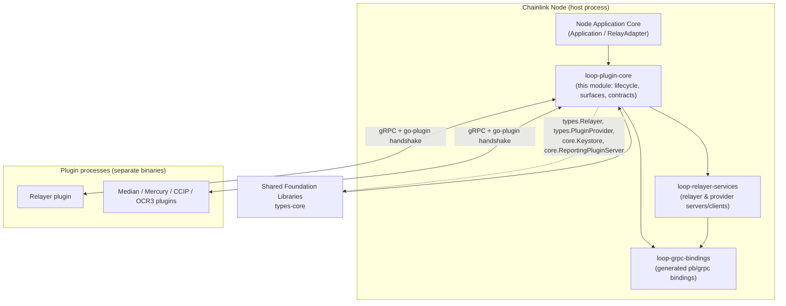
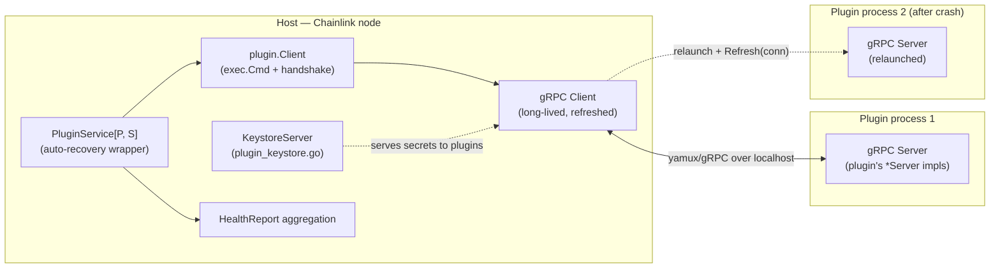
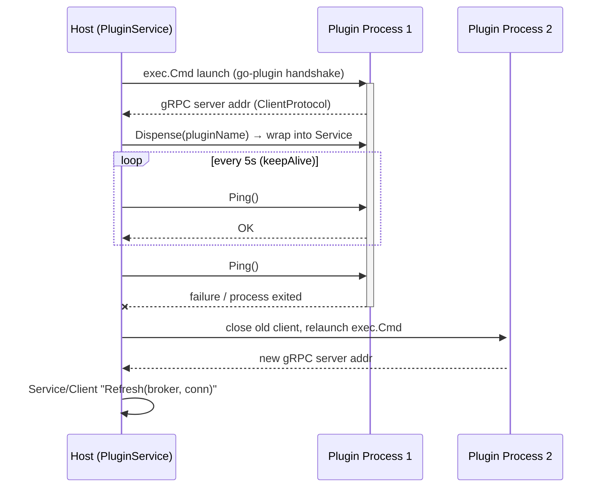
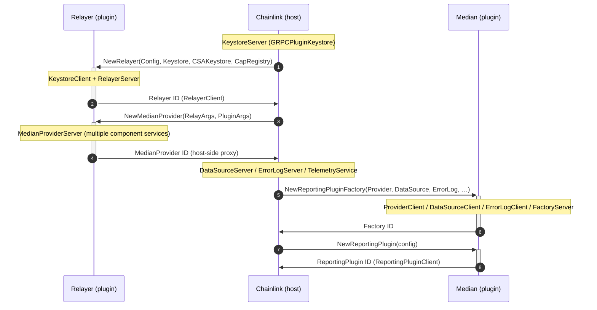
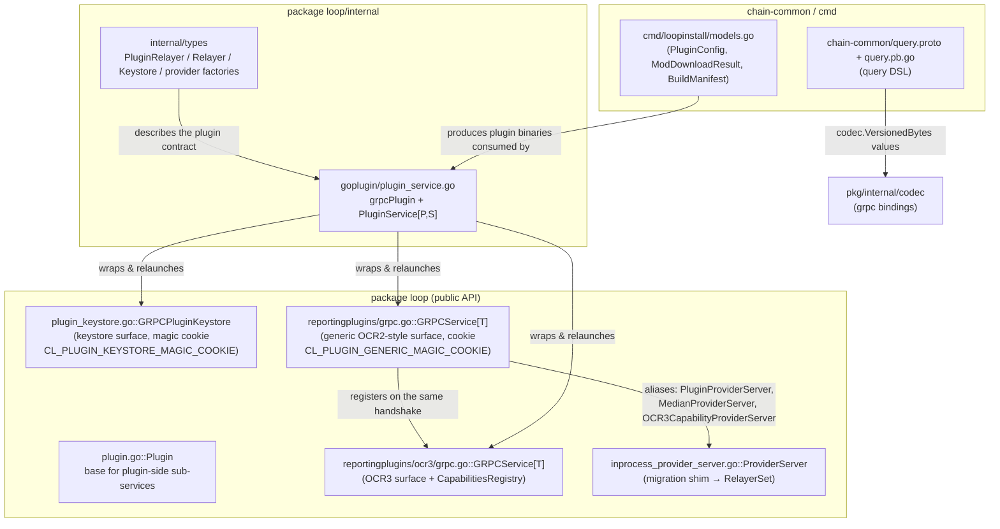

# loop-plugin-core — Core of the LOOP Plugin Framework

> **Module scope:** `chainlink-common/pkg/loop` — the foundational layer of the LOOPP (Local Out-of-Process Plugin) framework. It defines how the Chainlink node (the *host*) launches, supervises, and communicates with plugin binaries (the *plugins*) over gRPC, using [`hashicorp/go-plugin`](https://github.com/hashicorp/go-plugin).

## 1. Purpose and Overview

The `loop` package ("LOOP" = **L**ocal **O**ut **O**f **P**rocess) allows the Chainlink node to run reliability-critical, product-specific logic — relayers, OCR2/OCR3 reporting plugins, Median, Mercury, CCIP providers — in **separate OS processes**. This provides:

- **Fault isolation** — a crashing plugin does not take down the node; the framework relaunches it automatically.
- **Hard process boundaries** — plugins cannot access node memory, the database, or keys except through explicit gRPC surfaces.
- **Independent versioning** — plugins are compiled from independent Go modules pinned in `plugins/plugins.*.yaml` and installed by the `loopinstall` tool.

`loop-plugin-core` is the *core* of that framework (as opposed to its siblings [loop-grpc-bindings](loop-grpc-bindings.md) — the generated protobuf/gRPC bindings — and [loop-relayer-services](loop-relayer-services.md) — the relayer/provider client & server implementations). It provides:

| Concern | Components |
|---|---|
| Plugin process lifecycle & auto-recovery | `internal/goplugin.PluginService[P, S]`, `Plugin` base type |
| Host↔plugin contracts (Go interfaces) | `internal/types` (`PluginRelayer`, `Relayer`, `Keystore`, provider factories) |
| gRPC plugin surfaces (handshake + serve + client) | `GRPCPluginKeystore`, `reportingplugins.GRPCService[T]` (OCR2 & OCR3) |
| Migration shims | `ProviderServer` (in-process provider wrapper) |
| Shared cross-chain query DSL | `chain-common/query.proto` + generated `query.pb.go` |
| Plugin build & install tooling | `cmd/loopinstall` config models |

Canonical references in the repository:

- [`chainlink-common/pkg/loop/README.md`](https://github.com/smartcontractkit/chainlink-common/blob/main/pkg/loop/README.md) — public API, communication and auto-recovery diagrams.
- [`chainlink-common/pkg/loop/internal/README.md`](https://github.com/smartcontractkit/chainlink-common/blob/main/pkg/loop/internal/README.md) — internal structure and feature-development guide (`pb`, `types`, `net`, `core`, `test`, `relayer`, `goplugin`, `reportingplugin`).

## 2. Where This Module Fits in the System

Consumers of this module elsewhere in the wiki:

- [Node_Application_Core___Interfaces](../Node_Application_Core___Interfaces.md) — `node_application_relay` wires `RelayAdapter` (`chainlink/core/services/relay/evm/loop_impl.go`) to a loop `PluginRelayer`.
- [Oracle_Engines___Data_Pipelines](../Oracle_Engines___Data_Pipelines.md) — OCR2/OCR3/median reporting plugins are hosted through `reportingplugins.GRPCService`.
- [Workflow___Capability_Runtime_(CRE_Engine)](../../Workflow___Capability_Runtime_(CRE_Engine).md) and [CCIP_Cross-Chain_Protocol](../CCIP_Cross-Chain_Protocol.md) — standard/chain capabilities and CCIP oracles are served to the node via loop gRPC surfaces.
- [Shared_Foundation_Libraries___Domain_Types](../Shared_Foundation_Libraries___Domain_Types.md) — `types-core` defines the Go interfaces (`types.Relayer`, `types.PluginProvider`, `core.Keystore`, `core.ReportingPluginServer`, …) that this module mirrors over gRPC.

## 3. Architecture

### 3.1 Process model

Each plugin is a **separate binary** launched by the host as an `exec.Cmd` managed by `hashicorp/go-plugin`. One long-lived **service**/**client** pair survives many short-lived **process**/**server** incarnations:

Key invariants, per the package README:

- Plugins never talk to each other directly; the host can proxy connections between them (gRPC broker).
- Both directions are gRPC: the host calls plugin services, and plugins call back into host services (Keystore, Telemetry, PipelineRunner, RelayerSet, …) via brokered connections.

### 3.2 Sequence: plugin launch and auto-recovery

From [`loop/README.md`](https://github.com/smartcontractkit/chainlink-common/blob/main/pkg/loop/README.md) — `PluginService.keepAlive()` pings the plugin protocol every `KeepAliveTickDuration` (5 s) and relaunches on failure:

### 3.3 Sequence: host↔relayer↔reporting-plugin wiring

The gRPC surfaces in this module are the glue for the generic "NewRelayer → NewXxxProvider → NewReportingPluginFactory" flow (example shown for Median; OCR2/OCR3 follow the same shape through `reportingplugins.GRPCService[T]`):

## 4. Sub-modules

Detailed documentation for each sub-module lives in [loop-plugin-core/](loop-plugin-core/) (final generated page names shown below — each page cross-links back to this overview and to its siblings):

| Sub-module | Documentation | Contents |
|---|---|---|
| Plugin process runtime & lifecycle | [loop-plugin-core_plugin_runtime.md](loop-plugin-core/loop-plugin-core_plugin_runtime.md) | `internal/goplugin/plugin_service.go` (`grpcPlugin`, `PluginService[P,S]`), `plugin.go` (`Plugin` base) — process launching, 5 s keep-alive, auto-recovery, health reporting, test hooks. |
| gRPC plugin surfaces | [loop-plugin-core_grpc_plugin_surfaces.md](loop-plugin-core/loop-plugin-core_grpc_plugin_surfaces.md) | `plugin_keystore.go` (`GRPCPluginKeystore`), `reportingplugins/grpc.go` and `reportingplugins/ocr3/grpc.go` (`GRPCService[T]`), `inprocess_provider_server.go` (`ProviderServer` shim) — handshake configs, `GRPCServer`/`GRPCClient`/`ClientConfig`. |
| Host↔plugin core interfaces | [loop-plugin-core_interfaces.md](loop-plugin-core/loop-plugin-core_interfaces.md) | `internal/types/types.go` — `PluginRelayer`, `Relayer`, `Keystore`, and the typed provider factories (Median, Mercury, Functions, Automation, CCIP Exec/Commit, OCR3 Capability). |
| Cross-chain query primitives | [loop-plugin-core_query_primitives.md](loop-plugin-core/loop-plugin-core_query_primitives.md) | `chain-common/query.proto` + generated `query.pb.go` — chain-agnostic filtering (`Expression`, `Primitive`, comparators) and sorting/pagination (`LimitAndSort`) DSL. |
| Plugin installation tooling | [loop-plugin-core_loopinstall.md](loop-plugin-core/loop-plugin-core_loopinstall.md) | `cmd/loopinstall/models.go` — `PluginConfig`, `PluginDef`, `ModDownloadResult`, install tasks/results and `BuildManifest`. |

## 5. Component Relationships

Notes on the relationships above:

- `internal/types.Relayer` / `Keystore` are the **host-side** Go contracts; every method call crosses gRPC. The generated bindings for them live in the sibling module [loop-grpc-bindings](loop-grpc-bindings.md) (`internal/pb/relayer_grpc.pb.go`, `internal/pb/keystore_grpc.pb.go`, …).
- `reportingplugins/ocr3/grpc.go::GRPCService` extends the generic surface of `reportingplugins/grpc.go::GRPCService` with an extra `core.CapabilitiesRegistry` argument and the `core.OCR3ReportingPlugin*` types.
- `inprocess_provider_server.go::ProviderServer` is an explicitly **temporary shim** (see the file's header comment) to migrate generic plugins from a raw provider connection to a `core.RelayerSet`; it delegates to `internal/relayerset/inprocessprovider`.
- The query DSL in `chain-common` is versioned protobuf shared across chain implementations; its `VersionedBytes` values come from `chainlink-common/pkg/internal/codec` (same proto module used by [Shared_Foundation_Libraries___Domain_Types/codec](../Shared_Foundation_Libraries___Domain_Types/codec.md)).

## 6. Build, Packaging and Operations

The module's runtime behaviour is tightly coupled to how plugins are **built and shipped**:

- **Module & dependencies** — `chainlink-common/go.mod` defines module `github.com/smartcontractkit/chainlink-common` and pins `github.com/hashicorp/go-plugin v1.8.0`, `google.golang.org/grpc v1.83.2`, `google.golang.org/protobuf v1.36.12` — the exact stack this framework is built on.
- **Plugin install tooling** — `chainlink/GNUmakefile` provides:
  - `install-loopinstall` → `go install github.com/smartcontractkit/chainlink-common/pkg/loop/cmd/loopinstall`
  - `install-plugins-public` / `install-plugins-private` / `install-plugins-testing` → `go tool loopinstall --concurrency 5 ./plugins/plugins.*.yaml`, optionally writing installation artifacts JSON via `CL_LOOPINSTALL_OUTPUT_DIR` (`--output-installation-artifacts`).
  - `docker-plugins` builds the experimental `chainlink-plugins` image with the installed plugins.
- **Version syncing** — `chainlink/tools/plugout/main.go` keeps the `gitRef` of each plugin in `plugins/plugins.*.yaml` in sync with `chainlink/go.mod` (run by the `gomodtidy` target); its `PluginsFile`/`Plugin` YAML model mirrors the `PluginDef` model in `cmd/loopinstall/models.go`.
- **Protobuf codegen** — generated code in this module (e.g. `query.pb.go`) is produced with `make generate` (`chainlink-common/Makefile` target `cre-protoc`, protoc-gen-go v1.36.x); see the [loop-grpc-bindings](loop-grpc-bindings.md) module for the full generated binding surface.
- **Container packaging** — `chainlink/core/chainlink.Dockerfile` / `plugins/chainlink.Dockerfile` (referenced by the `docker` and `docker-plugins` make targets) install the plugin binaries produced by `loopinstall`; the `libs` globs of a `PluginDef` list shared libraries (e.g. `libwasmvm.*.so`) that must be copied alongside the binary.

## 7. Operational Notes

- **Auto-recovery**: one `PluginService` instance per plugin lives for the whole node lifetime; crashes are transparent to callers after the client is refreshed (`GRPCClient`/`Refresh(broker, conn)` pattern used by `GRPCPluginKeystore` and both `GRPCService` types).
- **Health**: `PluginService.HealthReport()` waits (bounded by a 5 s timeout) for deferred construction of the wrapped service, then merges the plugin's own health report; `Plugin` (plugin side) aggregates sub-service reports with `services.CopyHealth`.
- **Graceful shutdown**: `Close()` stops the keep-alive goroutine, closes the wrapped service, and kills the plugin client; `context.Canceled` errors from forced shutdowns are filtered (`isCanceled`).
- **Testing hooks**: `PluginService.XXXTestHook()` returns a `TestPluginService` supporting `Kill()`/`Reset()` of the underlying process without racing the keep-alive goroutine — used by the multi-process tests in `pkg/loop/internal/test`.

## 8. Further Reading

- Parent module: [Plugin_Process_Framework_(Loop)](../Plugin_Process_Framework_(Loop).md)
- Sibling modules: [loop-grpc-bindings](loop-grpc-bindings.md) · [loop-relayer-services](loop-relayer-services.md)
- Interfaces consumed/produced here are defined in [Shared_Foundation_Libraries___Domain_Types/types-core](../Shared_Foundation_Libraries___Domain_Types/types-core.md)
- In-repo guides: `chainlink-common/pkg/loop/README.md`, `chainlink-common/pkg/loop/internal/README.md`, `chainlink-common/pkg/loop/cmd/loopinstall/README.md`
