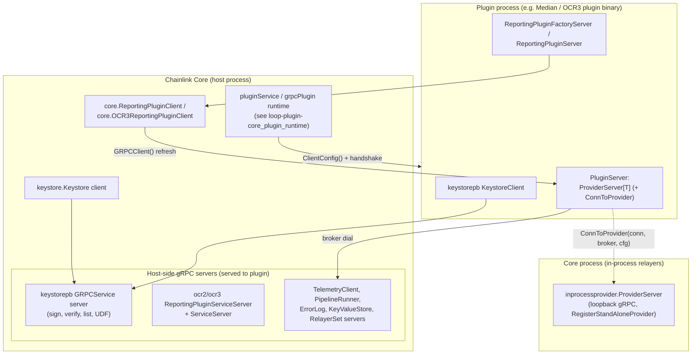
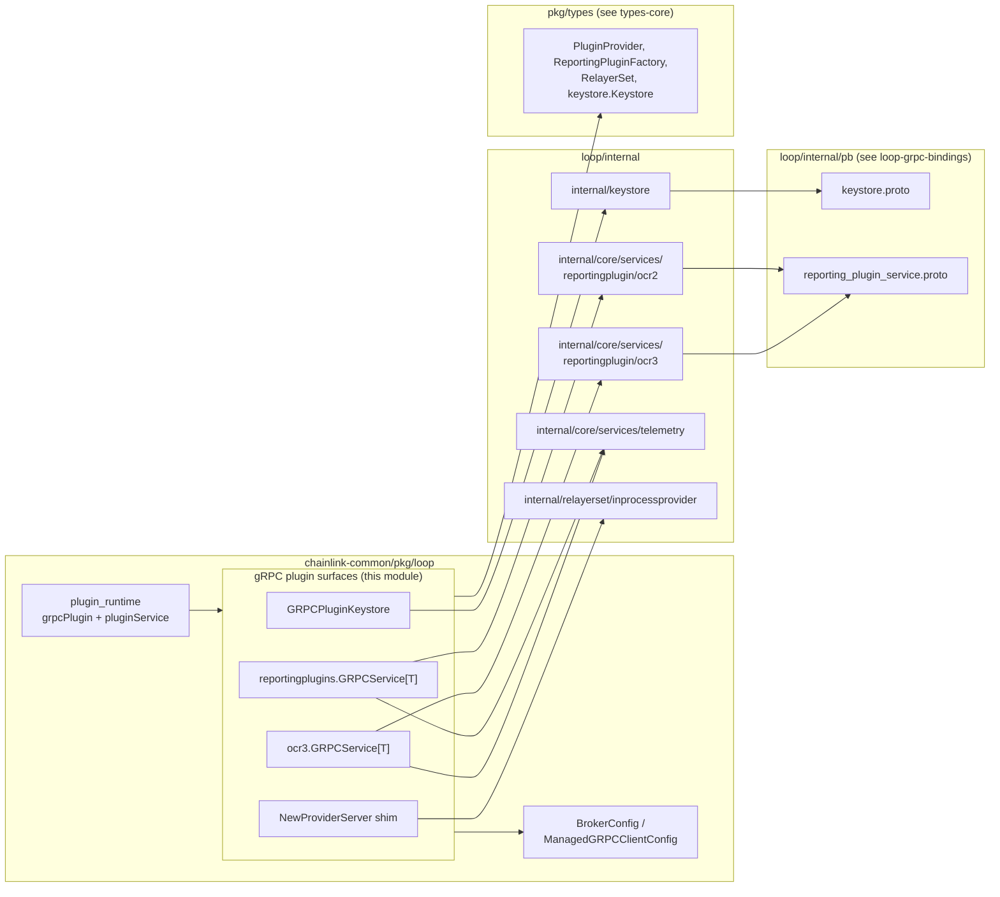
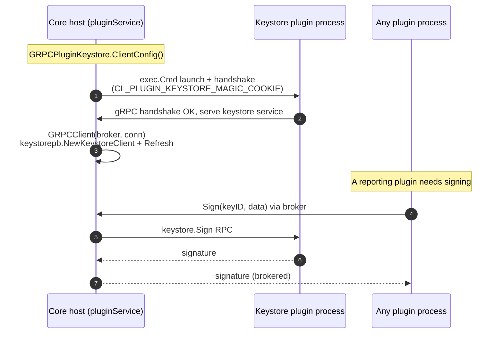
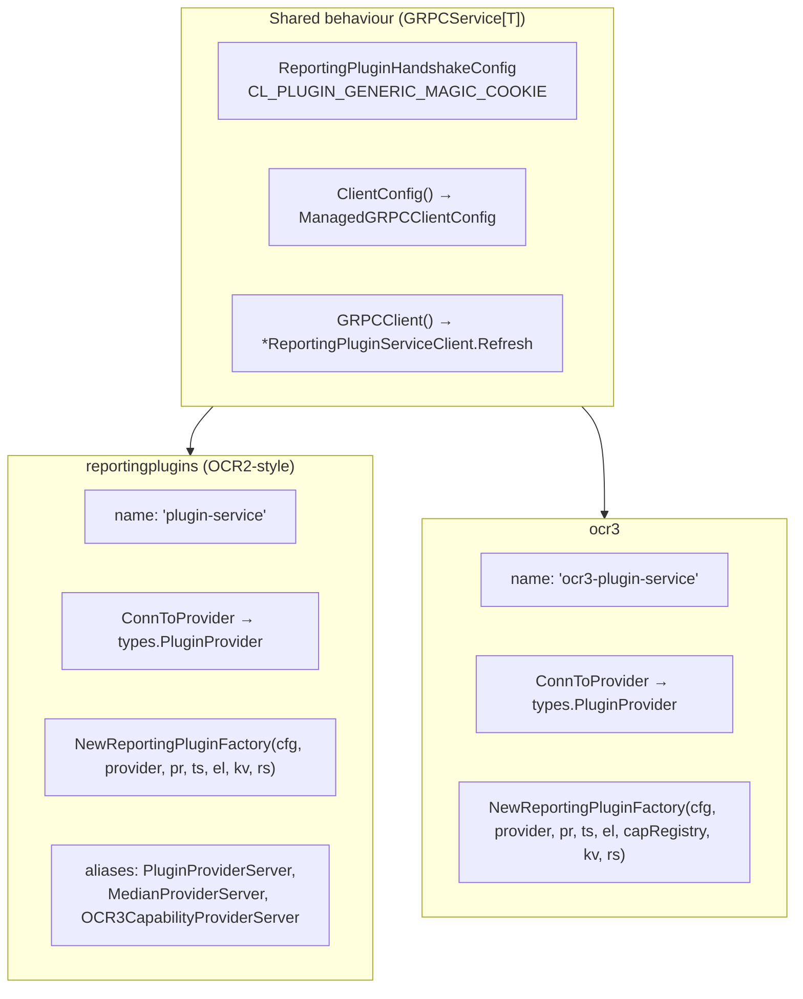
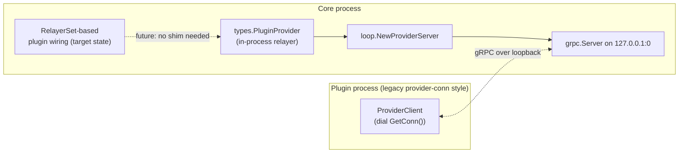

# loop-plugin-core: gRPC Plugin Surfaces

> **Module path:** `chainlink-common/pkg/loop` (files: `plugin_keystore.go`, `reportingplugins/grpc.go`, `reportingplugins/ocr3/grpc.go`, `inprocess_provider_server.go`)
>
> This module defines the **gRPC plugin surfaces** of the [LOOP (Local Out-of-Process) plugin framework](../../Plugin_Process_Framework_(Loop).md): the concrete `hashicorp/go-plugin` implementations that a host (Chainlink core node) and a plugin process use to expose and consume services over gRPC. It is a sub-module of [loop-plugin-core](../loop-plugin-core.md), alongside [loop-plugin-core_interfaces](loop-plugin-core_interfaces.md), [loop-plugin-core_plugin_runtime](loop-plugin-core_plugin_runtime.md), [loop-plugin-core_loopinstall](loop-plugin-core_loopinstall.md) and [loop-plugin-core_query_primitives](loop-plugin-core_query_primitives.md).

## 1. Purpose and Core Functionality

The LOOP framework runs plugin code (relayers, reporting plugins, keystores) in separate OS processes so that crashes, panics and resource usage in plugin code cannot take down the core node. Communication happens over gRPC, with [hashicorp/go-plugin](https://github.com/hashicorp/go-plugin) handling process lifecycle, handshaking and connection brokering (see `chainlink-common/go.mod`, which pins `github.com/hashicorp/go-plugin v1.8.0` and `google.golang.org/grpc v1.83.2`).

The **gRPC plugin surfaces** module provides the four concrete glue points of that architecture:

| Component | File | Role |
|---|---|---|
| `GRPCPluginKeystore` | `plugin_keystore.go` | go-plugin surface that exposes/consumes the node **Keystore** over gRPC, with its own handshake (magic cookie `CL_PLUGIN_KEYSTORE_MAGIC_COOKIE`). |
| `reportingplugins.GRPCService[T]` | `reportingplugins/grpc.go` | Generic go-plugin surface for **OCR2-style reporting plugin services** (Median, generic `PluginProvider` products), handshake `CL_PLUGIN_GENERIC_MAGIC_COOKIE`, service name `"plugin-service"`. |
| `ocr3.GRPCService[T]` | `reportingplugins/ocr3/grpc.go` | OCR3 variant of the reporting plugin surface, service name `"ocr3-plugin-service"`, adds a `core.CapabilitiesRegistry` to the factory contract. |
| `ProviderServer` + `loop.NewProviderServer` | `inprocess_provider_server.go` | A **temporary migration shim**: serves an in-process `types.PluginProvider` on a loopback gRPC server (`127.0.0.1:0`) so plugins that still expect a provider *connection* can talk to relayers that run in-process. |

All of these implement the internal `grpcPlugin` contract — `plugin.Plugin` + `plugin.GRPCPlugin` + `ClientConfig() *plugin.ClientConfig` — which is what [loop-plugin-core_plugin_runtime](loop-plugin-core_plugin_runtime.md) (`grpcPlugin` / `pluginService`) requires to launch, supervise and auto-recover plugin processes.

## 2. Architecture Overview

Each surface is a **bidirectional pair**: `GRPCServer` registers host-side (or plugin-side) services on a `*grpc.Server` for the *other* process to call, while `GRPCClient` returns a typed client wrapper for the *local* process to use. gRPC sub-connections negotiated through the go-plugin **broker** allow host↔plugin calls in both directions, and the host can proxy connections between plugins (plugins never talk to each other directly).



The three real surfaces and the shim relate to the rest of the framework as follows:



- Generated protobuf/grpc bindings live in [`loop-grpc-bindings`](../loop-grpc-bindings.md) (`internal/pb/*_grpc.pb.go`, e.g. `UnsafeKeystoreServer`, `UnsafeReportingPluginServiceServer`).
- The provider implementations handed to plugins (`PluginProviderServer`, `MedianProviderServer`, `OCR3CapabilityProviderServer` aliases) are documented in [`loop-relayer-services`](../loop-relayer-services.md).
- The Go interfaces being transported (`types.PluginProvider`, `core.ReportingPluginServer`, `keystore.Keystore`, …) are defined in [`types-core`](../../Shared_Foundation_Libraries___Domain_Types/types-core.md) and [`keystore`](../../Node_Platform_Services/keystore.md).

## 3. Component Reference

### 3.1 `GRPCPluginKeystore` — Keystore plugin surface (`plugin_keystore.go`)

Exposes the node keystore to plugin processes (and, symmetrically, lets the host consume a keystore that itself runs as a LOOP plugin, e.g. the standalone keystore service).

Key elements:

- **`PluginKeystoreName = "keystore"`** — the go-plugin registration name.
- **`PluginKeystoreHandshakeConfig()`** — dedicated magic cookie pair (`CL_PLUGIN_KEYSTORE_MAGIC_COOKIE` / `fe81b132-…`) that go-plugin uses to verify it is talking to the intended plugin binary.
- **`GRPCServer(broker, server)`** — delegates to `keystorepb.RegisterKeystoreServer` (`loop/internal/keystore`), which registers the generated `keystore.proto` service plus a broker-aware wrapper. The transported interface is `keystore.Keystore` (`Sign`, `SignBatch`, `Verify`, `VerifyBatch`, `ListKeys`, `RunUDF` — see [`types-core`](../../Shared_Foundation_Libraries___Domain_Types/types-core.md)).
- **`GRPCClient(broker, conn)`** — lazily creates `keystorepb.NewKeystoreClient(p.BrokerConfig)`, then `Refresh(broker, conn)`s it so the long-lived client survives plugin restarts, and returns it as a `keystore.Keystore`.
- **`ClientConfig()`** — builds the `plugin.ClientConfig` (handshake + `Plugins` map) wrapped by `loop.ManagedGRPCClientConfig`, which injects the broker configuration (logging, middleware) used by the [plugin runtime](loop-plugin-core_plugin_runtime.md).



### 3.2 `reportingplugins.GRPCService[T]` — generic OCR2-style reporting plugin surface (`reportingplugins/grpc.go`)

The surface used by products whose plugins expect a `types.PluginProvider`-derived provider (Median, generic OCR2 jobs). `T` is the concrete provider type; servers supply `PluginServer ProviderServer[T]`, i.e. a `core.ReportingPluginServer[T]` **plus** a `ConnToProvider(conn, broker, brokerConfig) T` method that turns the plugin's inbound gRPC connection into that provider.

Key elements:

- **`ReportingPluginHandshakeConfig()`** — shared generic magic cookie (`CL_PLUGIN_GENERIC_MAGIC_COOKIE`), reused by the OCR3 surface; **`PluginServiceName = "plugin-service"`**.
- **`GRPCServer`** — registers `ocr2.RegisterReportingPluginServiceServer` (generated `reporting_plugin_service` service + go-plugin `ServiceServer` health/lifecycle, see [`loop-grpc-bindings`](../loop-grpc-bindings.md)). It wraps the node's factory function in a `serverAdapter` that:
  1. calls `g.PluginServer.ConnToProvider(conn, broker, g.BrokerConfig)` to bind the *plugin's* connection to a typed provider,
  2. wraps `core.TelemetryService` in `telemetry.NewTelemetryClient(ts)` (loop/internal/core/services/telemetry),
  3. forwards to `PluginServer.NewReportingPluginFactory(ctx, cfg, provider, pr, tc, el, kv, rs)`.
- **`GRPCClient`** — lazily creates `ocr2.NewReportingPluginServiceClient(g.BrokerConfig)`, refreshes it with the new broker/conn, and returns it as `core.ReportingPluginClient`.
- **`ClientConfig`** — handshake + `Plugins` map under `PluginServiceName`, wrapped with `loop.ManagedGRPCClientConfig`.
- **Convenience aliases** — `PluginProviderServer` (= `pluginprovider.PluginProviderServer`), `MedianProviderServer`, `OCR3CapabilityProviderServer` let product servers embed the matching provider-server implementations from [`loop-relayer-services`](../loop-relayer-services.md).

### 3.3 `ocr3.GRPCService[T]` — OCR3 reporting plugin surface (`reportingplugins/ocr3/grpc.go`)

Structurally identical to §3.2 but targets the OCR3 contract:

- Service name **`"ocr3-plugin-service"`**; reuses `reportingplugins.ReportingPluginHandshakeConfig()`.
- `ProviderServer[T]` embeds `core.OCR3ReportingPluginServer[T]` + `ConnToProvider`.
- The factory signature gains **`core.CapabilitiesRegistry`**: `NewReportingPluginFactoryFn(ctx, config, conn, pr, ts, errorLog, capRegistry, kv, rs) (core.OCR3ReportingPluginFactory, error)`, reflecting OCR3 plugins' dependency on the [capabilities registry](../../../Workflow___Capability_Runtime_(CRE_Engine)/capabilities/capabilities_registry.md).
- `GRPCServer` registers via `ocr3.RegisterReportingPluginServiceServer`; `GRPCClient` returns `core.OCR3ReportingPluginClient`; `ClientConfig` names the plugin `reportingplugins.PluginServiceName` but uses the ocr3 client implementation.



### 3.4 `ProviderServer` / `loop.NewProviderServer` — in-process provider shim (`inprocess_provider_server.go`)

A **deliberately temporary** shim for the migration from "plugins receive a provider gRPC connection" to "plugins receive a `core.RelayerSet`". While some relayers still run in-process (not as LOOPP plugins), plugin code that dials a provider connection still needs something to dial.

- `ProviderServer` interface: `Start(ctx)`, `Close()`, `GetConn() (grpc.ClientConnInterface, error)`.
- `loop.NewProviderServer(p types.PluginProvider, pType types.OCR2PluginType, lggr)` delegates to `internal/relayerset/inprocessprovider.NewProviderServer`, which:
  1. listens on `tcp://127.0.0.1:0` (ephemeral loopback port),
  2. creates a fresh `grpc.NewServer()`,
  3. calls `RegisterStandAloneProvider(server, p, pType)` to expose the in-process provider under the standard OCR2 provider service surface.

The package README notes the code exists only "to support relayers that run in the same process as the core … Once all relayers are running as LOOPPs this package can be disposed of." Consumers of this shim are the relayer-side provider servers in [`loop-relayer-services`](../loop-relayer-services.md).



## 4. End-to-End Flow: Launching a Reporting Plugin

The sequence below shows how the runtime (parent module [loop-plugin-core](../loop-plugin-core.md)) uses these surfaces together — handshake, server registration, brokered back-calls, and factory creation:

```mermaid
sequenceDiagram
    autonumber
    participant Core as Core host
    participant RT as pluginService runtime
    participant Surf as GRPCService[T] surface
    participant Plug as Plugin process
    participant Rel as Relayer / RelayerSet

    Core->>Surf: ClientConfig()
    Surf-->>RT: plugin.ClientConfig (handshake cookie, ManagedGRPCClientConfig)
    RT->>Plug: launch process, perform handshake
    Plug->>Surf: connect (conn)
    Surf->>Surf: GRPCServer(): register ocr2/ocr3 service,<br/>wire ConnToProvider
    Surf->>Core: GRPCClient(): ReportingPluginClient.Refresh(broker, conn)

    Core->>Plug: NewReportingPluginFactory(cfg, conn, pr, ts, el, [capReg], kv, rs)
    Plug->>Surf: serverAdapter.NewReportingPluginFactory
    Surf->>Rel: ConnToProvider(conn, broker, cfg) → T provider
    Surf->>Plug: PluginServer.NewReportingPluginFactory(..., provider, telemetryClient, ...)
    Plug-->>Core: ReportingPluginFactory / OCR3ReportingPluginFactory
    Note over Core,Plug: Subsequent calls flow over brokered gRPC both ways;<br/>if the plugin process dies, pluginService restarts it and Refresh() re-binds the client.
```

## 5. Interaction with Other Modules

| Module | Relationship |
|---|---|
| [loop-plugin-core](../loop-plugin-core.md) | Parent module. The [plugin runtime](loop-plugin-core_plugin_runtime.md) (`grpcPlugin`, `pluginService`) is the consumer of these surfaces' `ClientConfig`/`GRPCServer`/`GRPCClient` contract and provides auto-recovery. |
| [loop-plugin-core_interfaces](loop-plugin-core_interfaces.md) | `internal/types` (`Keystore`, `Relayer`) defines the service interfaces these surfaces transport. |
| [loop-grpc-bindings](../loop-grpc-bindings.md) | Generated `internal/pb/*_grpc.pb.go` code that `RegisterKeystoreServer` / `RegisterReportingPluginServiceServer` delegate to. |
| [loop-relayer-services](../loop-relayer-services.md) | Supplies the relayer/provider server implementations aliased here (`PluginProviderServer`, `MedianProviderServer`, `OCR3CapabilityProviderServer`) and the in-process provider backend. |
| [Shared Foundation: types-core](../../Shared_Foundation_Libraries___Domain_Types/types-core.md) | Go interfaces carried over gRPC: `PluginProvider`, `ReportingPluginFactory`, `RelayerSet`, `ValidationService`, telemetry clients, etc. |
| [Node Platform Services: keystore](../../Node_Platform_Services/keystore.md) | The node-side keystore implementation served through `GRPCPluginKeystore`. |
| [Workflow & Capability Runtime](../../../Workflow___Capability_Runtime_(CRE_Engine).md) | OCR3 surface passes `core.CapabilitiesRegistry`, connecting plugins to the capabilities ecosystem. |

## 6. Build & Code-Generation Context

These surfaces sit on generated code and are exercised by the toolchain configured in the repository:

- **Protobuf/grpc generation** — `chainlink-common/Makefile` provides `install-protoc` (installs `protoc`, `protoc-gen-go`, `protoc-gen-go-grpc` from `.tool-versions`) and the `generate` target, which also runs `cre-protoc` (builds the `protoc-gen-cre` template generator from `pkg/capabilities/v2/protoc`) and mockery. The keystore wire format itself is defined by `chainlink-common/pkg/loop/internal/pb/keystore.proto`.
- **Module isolation** — `chainlink-common/go.mod` declares this module's dependencies on `hashicorp/go-plugin v1.8.0`, `google.golang.org/grpc v1.83.2`, `google.golang.org/protobuf v1.36.12` and the OpenTelemetry stack (used by broker-managed clients for tracing/metrics middleware).
- **Linting** — `chainlink-common/Makefile` targets `lint` / `lint-workspace` invoke `script/lint.sh` (golangci-lint) over the `./golangci-lint` directory set, which includes the `pkg/loop` tree.
- **Plugin distribution** — binaries that implement these surfaces are built and installed via the `install-plugins*` targets of the core `chainlink/GNUmakefile` and the [loopinstall](loop-plugin-core_loopinstall.md) tooling.

## 7. Design Notes & Evolution

1. **Symmetric client/server design.** Every surface is usable from both ends: a host embedding the surface serves node capabilities to plugins (`GRPCServer`), and the same struct can represent a plugin binary exposing its own implementation (`GRPCClient` returns the typed client). This symmetry plus the broker is what allows host→plugin and plugin→host calls on one connection.
2. **Refresh-based auto-recovery.** `GRPCClient` is written to be called repeatedly: `pluginClient.Refresh(broker, conn)` re-binds the long-lived client to a new connection after a plugin crash, complementing the restart logic in the [plugin runtime](loop-plugin-core_plugin_runtime.md).
3. **Handshake cookies as safety checks.** The keystore surface has its own magic cookie while both reporting surfaces share `CL_PLUGIN_GENERIC_MAGIC_COOKIE`; go-plugin aborts if a launched binary answers the wrong cookie.
4. **Generic provider typing.** `GRPCService[T types.PluginProvider]` keeps the wire protocol generic while letting each product (Median, OCR3 capability, CCIP via relayer services) bind its own provider type through `ConnToProvider`, avoiding per-product copies of the whole surface.
5. **Shim with an expiry date.** `inprocess_provider_server.go` exists solely for the RelayerSet migration; both its doc comment and the `inprocessprovider` README state it should be removed once all relayers run as LOOPP plugins.
